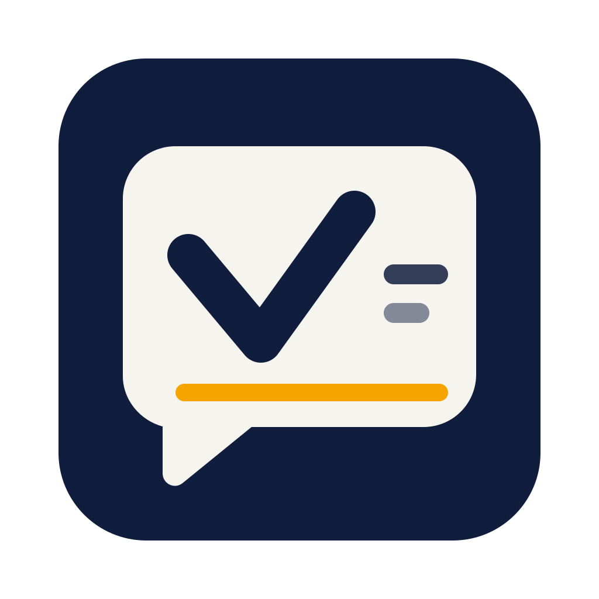

<p align="center">
  
</p>

<h1 align="center">Vakyartha</h1>

<p align="center">
  <b>Ask. Then go live your day.</b><br>
  An AI desktop assistant that stays with the work: generative canvas interfaces, hands-free voice, and connected tools.
</p>

<p align="center">
  <a href="https://github.com/nranjan2code/vakyartha/releases/latest"></a>
  <a href="https://github.com/nranjan2code/vakyartha/releases/latest"></a>
  <a href="https://v2.tauri.app"></a>
  <a href="https://ollama.com"></a>
  <a href="LICENSE"></a>
</p>

<p align="center">
  <a href="#download"><b>Download .dmg</b></a> ·
  <a href="https://vakyartha.com">vakyartha.com</a> ·
  <a href="#key-capabilities">Key capabilities</a> ·
  <a href="#where-the-rebuild-stands">Rebuild status</a> ·
  <a href="#your-control">Security & privacy</a> ·
  <a href="#develop">Develop</a> ·
  <a href="#documentation">Docs</a>
</p>

---

From *Vākyārtha* (Sanskrit: the meaning of a sentence). You bring an idea in your own words; Vakyartha carries its meaning into useful work, from the first thought to the next step.

Unlike typical chatbots that only respond with walls of text, Vakyartha projects live, interactive user interfaces directly beside the conversation. It runs completely offline with local models through Ollama, or connects to hosted providers when you want them.

## Key Capabilities

- 🎨 **Generative Canvas & Live Surfaces**: Answers come back as interfaces you can use, not just read—interactive cards, sortable tables, reactive charts, dashboards, forms, buttons, and node-and-edge graphs opened in a canvas beside the chat.
- 🔒 **Local & Private by Default**: The local 4B model (Ollama `qwen3.5:4b-mlx`) is the primary target. Your chats, artifacts, and keys stay on your Mac. Optional hosted models (11 providers) store keys securely in the macOS Keychain.
- 🎙️ **Hands-Free Conversation Mode**: Talk and listen naturally (`⌘⇧D`). Forms, interactive choices, and tool approvals can be answered aloud in your own words (transcribed offline via Whistle/Phonon on Apple Silicon).
- 🔌 **Pluggable Tools via MCP**: Connect Model Context Protocol servers for web reading, search, time, files, persistent memory, and workspace data. Pinned packages, zero ambient environment variables, and strict approval defaults.
- 🛠️ **Skill Studio & Workbench**: Author, lint, visually stage, and rehearse multi-file agent skills (`SKILL.md`, schemas, scripts, references) with live Projection canvas previews (`sm`, `md`, `lg`, `full`).
- 📊 **Local FinOps Ledger**: Track tokens, context depth, and estimated cost per turn in a transparent local ledger with CSV export.

---

## Download

Pre-built Apple Silicon packages are available on GitHub Releases:

👉 **[Download Vakyartha for macOS (.dmg)](https://github.com/nranjan2code/vakyartha/releases/latest)**

> [!NOTE]
> Builds are currently unsigned. After dragging `Vakyartha.app` to `/Applications`, either allow it under **System Settings → Privacy & Security**, or run this one-line command in Terminal:
> ```bash
> xattr -cr /Applications/Vakyartha.app
> ```

---

## Where the rebuild stands

This repository is the active **rebuild** of the app described on [vakyartha.com](https://vakyartha.com). It is built on the **[Projection framework](https://github.com/nranjan2code/Projection)** (`@vak/*`), the engine that parses, repairs, and projects model-written interfaces, pinned here as a git submodule.

| On vakyartha.com | In this rebuild |
|---|---|
| Ask, and get something you can use | **Works.** Answers project as live surfaces; chats are saved; an **Artifacts** library gathers every surface across chats and reopens it in the canvas. |
| Your choice of models | **Works.** Local models through Ollama; 11 hosted providers with keys in the macOS Keychain. |
| Connected tools and services | **Works.** Optional external catalog discovery supplements our curated entries, with review before import and the same lifecycle ([support and limits](docs/EXTERNAL-CATALOGS.md)). A curated catalog for web reading/search, time, local OCR, scoped files, persistent memory, repositories, pages, library documentation and workspace data/tools. Local npm servers are pinned; remote services use HTTPS, with per-tool policies and approvals. Workspace connector setup is implemented; live account access remains unverified ([setup](docs/DATABRICKS.md)). |
| Make and edit media | **Implemented.** Independent Images, Audio and Video plugins, provider/model selection per tool, shared provider keys, saved files, background job recovery and dedicated screen/voice projections. Hosted calls are opt-in and billed separately. See [media tools](docs/MEDIA-TOOLS.md) for supported operations and verification limits. |
| Skill Studio & authoring workbench | **Works.** Full visual, raw, and autonomous YOLO authoring for multi-file Agent Skills packages (`SKILL.md`, references, schemas, scripts, tests). Features multi-day isolated draft lifecycle (`.drafts/<name>/`), live Projection canvas staging (`sm`, `md`, `lg`, `full`), surface design linter, dual spoken voice projection simulation, disposable sandbox rehearsals, selection gate evaluation, and chaining inspector ([Skill Studio architecture](docs/skill-studio/SKILL-STUDIO-ARCHITECTURE.md)). |
| In your everyday chat | **Telegram works**, answered from the menu bar while the window is closed. Slack and Discord are listed as coming. |
| Spending limits and usage | **Usage works:** Settings → FinOps charts tokens, context and estimated cost per turn. Spending limits are not built yet. |
| Agent tasks | **First slice works:** Schedule provides full-page setup, lifecycle views, immediate and one-time future runs, review, continuation, per-run records, shared execution limits and guarded deletion. Results reuse the interactive canvas. Repeating schedules, task chains and long-term run history are not built yet. |
| Pick up the thread (commitments) | Not yet. |
| Vakyartha and seven companions | Not yet. |
| Headless & Cloud, scheduled routines | Not yet. `npm run web` serves the same app on loopback for development only. |
| Voice | **Works.** Replies read aloud as natural speech, interfaces included, by a voice in the reply's language. Dictation in the message box. Conversation mode (⌘⇧D) talks hands-free: approvals, choices and forms are answered in your own words, read back, then acted on exactly as a click. All run free on this Mac (Phonon through Ollama; Whistle for dictation) or through a hosted provider with your key. |
| Email and calendar | Not yet. |
| macOS and Linux | macOS only so far. |
| `vak setup`, `vak doctor`, `vak serve` | Those belong to the [earlier codebase](https://github.com/nranjan2code/code) the site still links to; the rebuild installs from source as below. |

---

## Your control

- **You choose the access.** Apart from the built-in clock (Time), integrations stay off until you turn them on; each declares what it can reach, and the Files server is limited to the folders you pick.
- **Actions follow your rules.** Anything that writes, deletes or reaches the internet asks first; each tool's policy can be allowed, ask or blocked. Model text, tool output and fetched pages are treated as data, never as instructions.
- **Local server packages are pinned.** Supported npm integrations use a fixed version published at least 14 days earlier, install without scripts, and receive only declared environment variables. Hosted servers can change independently of listing versions.
- **Your work stays on your Mac.** Chats, artifacts and usage records live in the app's data folder; keys live in the Keychain. Requests go only to the providers and services you connect, and a local model keeps them on your machine.
- **You can follow the outcome.** Every tool call is logged to `logs/tools.jsonl`; the engine window is token-protected.

Details: [SECURITY.md](SECURITY.md).

---

## Develop

### Prerequisites
You need **macOS**, **Node.js 24+**, npm, **Rust** (stable), and the [Tauri prerequisites](https://v2.tauri.app/start/prerequisites/). For a free local model, run [Ollama](https://ollama.com) with `qwen3.5:4b-mlx` (or any installed model).

### Build from source

```bash
git clone --recurse-submodules https://github.com/nranjan2code/vakyartha.git
cd vakyartha
npm ci
npm run desktop:build
```

Install the built application:
```bash
osascript -e 'quit app "Vakyartha"' 2>/dev/null || true
ditto src-tauri/target/release/bundle/macos/Vakyartha.app /Applications/Vakyartha.app
```

### Dev commands

```bash
npm run desktop          # dev window: Vite on :1420 + Tauri; the engine runs from source
npm run web              # the same app in a browser on http://127.0.0.1:5178 (builds dist/ first)
npm test                 # app tests
npm run test:framework   # Projection's tests against the pinned framework
npm run typecheck
```

For development, provider keys can also go in a local `.env` (see [`.env.example`](.env.example)). Changes to the engine belong in [Projection](https://github.com/nranjan2code/Projection), never in `framework/`; [RELEASING.md](docs/RELEASING.md) explains how to pull them in. Working rules: [AGENTS.md](AGENTS.md).

### How it fits together

| Part | Where | What |
|---|---|---|
| Framework | `framework/` (submodule) | Projection: engine, catalog, projectors, providers, `@vak/host`, MCP client and `Integrations`, Telegram runner |
| Sandbox | `vak-sandbox` (separate repo) | macOS Seatbelt commands, retained Realms, reviewed promotion, recovery and rollback; Linux remains unsupported |
| Shell | `src-tauri/src/lib.rs` | starts the engine, hands the window its address and token, tray, close-to-background, single instance, launch at login, graceful stop |
| Engine | `sidecar/main.ts` → `sidecar/server.ts` | `@vak/host` plus settings, channels, integrations, client-log and info routes; token-protected for the window, loopback-only for `npm run web` |
| Settings store | `sidecar/settings.ts` | provider and channel keys in the Keychain; plain values in `settings.env` |
| Integrations | `sidecar/integrations.ts`, `sidecar/marketplaces.ts` | curated catalog plus external discovery/review and imported definitions; installing and running them is Projection's `Integrations` |
| Skills | `sidecar/builtin-skills/`, `sidecar/skills.ts`, `src/skills-page.ts` | reusable procedures, counted selection, reviewed supporting text imports and updates ([guide](docs/SKILL-AUTHORING.md)) |
| FinOps | `sidecar/finops.ts`, `src/finops-page.ts` | local usage ledger, model rates, per-turn charts and CSV export ([FINOPS.md](docs/FINOPS.md)) |
| Channels | `sidecar/channels.ts` | Telegram (`runTelegram`); Slack and Discord slots |
| UI | `src/` | chats, thread, composer, approvals, canvas and Artifacts ([CANVAS.md](docs/CANVAS.md)), Settings, themes, right-click menus |
| Release | `scripts/bundle-sidecar.ts`, `src-tauri/tauri.release.conf.json`, `scripts/version.ts` | the engine as one module with Node and npm; one version everywhere |

### Data

| | Dev (`npm run desktop`) | Installed app | Browser (`npm run web`) |
|---|---|---|---|
| Folder | `.vak/desktop/` | `~/Library/Application Support/com.nranjan2code.vakyartha/` | `.vak/web/` |
| Keys | Keychain `com.nranjan2code.vakyartha.dev` + `.env` | Keychain `com.nranjan2code.vakyartha` | Keychain `com.nranjan2code.vakyartha.web` + `.env` |

Each folder holds `sessions/`, `integrations/`, `integrations.json`, `channels.json`, `settings.env`, `logs/engine.log` (engine and UI errors) and `logs/tools.jsonl` (every tool call).

### Debugging

- **Engine log:** Settings → About → Engine log, or `logs/engine.log` in the data folder.
- **The window is WebKit, not Chromium.** Check layout with `scripts/webkit-check.swift` and `node scripts/canvas-check.ts` after `npm run build`.
- **Probe the real window** (debug builds): `VAK_DEBUG_JS=/path/probe.js npm run desktop`.
- **Inspector:** Option-right-click in a dev build.

---

## Documentation

- [SKILL-AUTHORING.md](docs/SKILL-AUTHORING.md): start here for reusable skills, reports, dashboards, chart selection and visual/spoken composition; [SKILLS.md](docs/SKILLS.md) defines the lifecycle, and [SKILL-AUDIT.md](docs/SKILL-AUDIT.md) retains evidence.
- [SPECS.md](docs/SPECS.md): what the app is, its framework dependency and identity.
- [AGENT-TASKS.md](docs/AGENT-TASKS.md), [IMPLEMENTATION-STATUS.md](docs/IMPLEMENTATION-STATUS.md) and [ADR.md](docs/ADR.md): ongoing task requirements, preserved interactive surfaces, architecture decisions, verified progress and open acceptance gates.
- [Agent runtime architecture](docs/agent-runtime/README.md): single-agent/delegated execution, diagrams, drift/stopping, recovery, multi-job resources, QoS and observability.
- [RELEASING.md](docs/RELEASING.md): releasing the app and updating Projection.
- [EXTERNAL-CATALOGS.md](docs/EXTERNAL-CATALOGS.md): external discovery, review/import UX, lifecycle ownership, supported runtimes/authentication and verification.
- [DATABRICKS.md](docs/DATABRICKS.md): workspace MCP endpoint/token setup, supported clouds, permissions, costs and verification limits.
- [MEDIA-TOOLS.md](docs/MEDIA-TOOLS.md): media plugins, shared credentials, supported tools, projections and recovery; [research baseline](docs/MEDIA-TOOLS-RESEARCH.md).
- [AGENTS.md](AGENTS.md) and [HANDOVER.md](docs/HANDOVER.md): working rules and where work stands.
- [SECURITY.md](SECURITY.md), [CANVAS.md](docs/CANVAS.md), [FINOPS.md](docs/FINOPS.md) and [CHANGELOG.md](CHANGELOG.md).
- The framework: [Projection](https://github.com/nranjan2code/Projection).

---

## Contributions and license

Maintainer-developed; external contributions are not accepted (see [CONTRIBUTING.md](CONTRIBUTING.md)). Copyright © 2026 Nisheeth Ranjan, released under the [MIT License](LICENSE).
