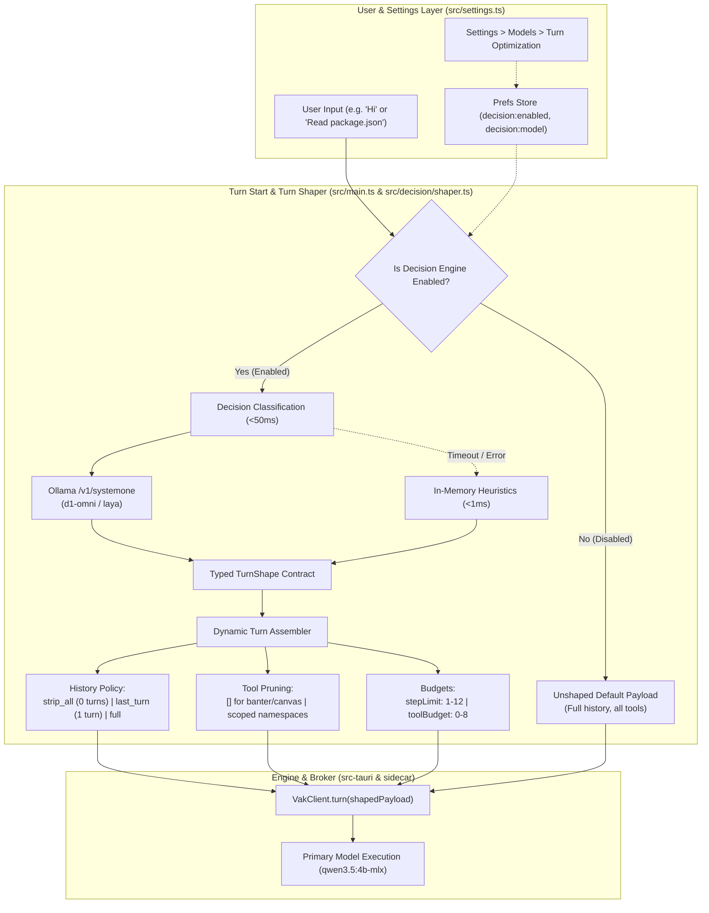
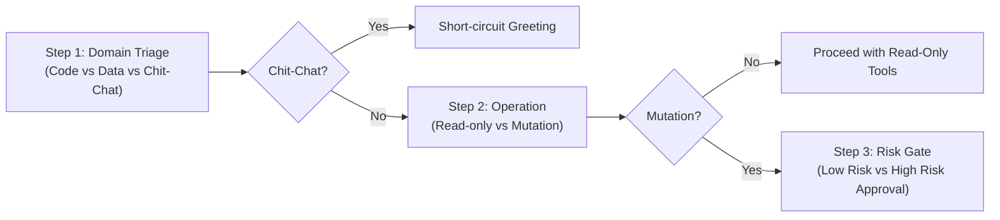

# Decision Models, Dynamic Turn Shaping & Decision Chaining

This document describes the architecture, runtime placement, and usage of **Decision Models**, the **Turn Shaper**, and **Decision Chaining** in Vakyartha.

---

## 1. Overview & Problem Statement

### The "Monolithic Turn" Penalty
In standard agent architectures, every user interaction—even casual greetings like `"Hi"`, acknowledgments like `"Thanks"`, or simple visual adjustments like `"Make the chart blue"`—prepares and sends an unpruned payload to the primary model:
- Comprehensive system instructions (3,000–5,000 tokens)
- Full conversation history (2,000–10,000 tokens)
- Schemas for all enabled MCP tools (5,000–15,000 tokens)
- Default execution limits (`maxSteps=12`, `toolRounds=10`)

### Impact on the Primary Local 4B Target
For Vakyartha's primary target—a local 4B model running on Apple Silicon / CPU via Ollama (`qwen3.5:4b-mlx`):
1. **Prefill Latency:** Prompt ingestion of 15,000 tokens takes 3–6 seconds before the first token is generated.
2. **Memory Pressure:** Attention caches across 15k tokens consume high unified RAM.
3. **Tool Hallucination:** Flooding a compact model with 30 irrelevant tool schemas on a simple greeting increases the risk of hallucinated tool calls.
4. **FinOps Waste:** On hosted frontier providers, casual banter unnecessarily consumes paid input tokens.

---

## 2. The Solution: System 1 Decision Models

Vakyartha separates **System 1 (Decision Models)** from **System 2 (Generative Models)**:

| Dimension | Generative Models (System 2) | Decision Models (System 1) |
| :--- | :--- | :--- |
| **Primary Target** | `qwen3.5:4b-mlx`, Claude, OpenAI, Gemini | `d1-omni:latest` (380M), `laya:latest` (421M), Heuristics |
| **Output Type** | Autoregressive streamed text / tokens | Single-pass discrete choice + calibrated probabilities |
| **Output Tokens** | Variable (tens to thousands) | **`0 output tokens`** (Logit / score evaluation) |
| **Typical Latency** | 1.5s – 10.0s | **15ms – 50ms** |
| **Core Role** | Deep reasoning, prose, code synthesis | Intent classification, MCP tool pruning, criteria scoring |

---

## 3. End-to-End System Architecture

---

## 4. Turn Profiles & Shaping Matrix

When enabled, the Decision Engine classifies incoming user turns into one of four deterministic profiles:

| Intent | Criteria / Detection | History Policy | Tool Policy | Max Steps | Tool Budget | Surface Grammar |
| :--- | :--- | :--- | :--- | :--- | :--- | :--- |
| **`salutation`** | Greetings, gratitude, casual banter (`"Hi"`, `"Thanks"`, `"Ok"`) | `strip_all` (0 prior turns) | `[]` (Prunes all MCP schemas) | `1` | `0` | Excluded |
| **`canvas_refinement`** | Visual styling, chart kind, table sorting with active canvas | `last_turn_only` (1 prior turn) | `[]` (No external tools) | `3` | `0` | Included |
| **`scoped_tool_task`** | Tasks needing specific tools (file inspection, web search, SQL) | `recent_window` (3 prior turns) | Pruned to matching namespace only | `6` | `4` | Included |
| **`complex_reasoning`** | Architecture, coding, multi-step problem solving | `full` (Normal history) | All enabled tools preserved | `12` | `8` | Included |

---

## 5. Decision Chaining for Multi-Stage Decisions

For complex tasks where a single decision is insufficient, `DecisionChainRunner` ([`src/decision/chain.ts`](file:///Users/nisheethranjan/Projects/vakyartha/src/decision/chain.ts)) enables sequential, branching pipelines:

Because each step in `d1-omni` takes only ~15ms, a 3-step decision chain finishes in **under 50ms total**, returning a composite confidence score without token generation.

---

## 6. Built-in Agent Skill: `decision-eval`

Located at [`sidecar/builtin-skills/decision-eval/SKILL.md`](file:///Users/nisheethranjan/Projects/vakyartha/sidecar/builtin-skills/decision-eval/SKILL.md), this skill allows running LLMs to delegate discrete classification to the local decision model during their workflow.

### Use Cases:
- Security audit of code snippets (`vulnerable` vs `sanitized` vs `unreviewed`)
- Acceptance criteria verification before marking an autonomous task step complete
- Optimal surface kind selection (`table` vs `bar_chart` vs `metric_card`) based on dataset cardinality

---

## 7. Configuration & User Preferences

All settings live in Vakyartha's reactive preferences store:

| Key | Type | Default | Description |
| :--- | :--- | :--- | :--- |
| `vak:decision:enabled` | `boolean` | `"true"` | Master switch for dynamic turn shaping |
| `vak:decision:provider` | `string` | `"ollama"` | Active decision provider (`ollama` or `heuristic`) |
| `vak:decision:model` | `string` | `"d1-omni:latest"` | Local decision model name |
| `vak:decision:timeout` | `number` | `1500` | Hard timeout ceiling (ms) before heuristic fallback |
| `vak:decision:pruneTools` | `boolean` | `"true"` | Prunes irrelevant MCP tools on non-tool turns |
| `vak:decision:stripSalutations`| `boolean` | `"true"` | Strips past history and surface grammar on greetings |

Controls are exposed under **Settings > Models > Decision & Turn Optimization** in the desktop app.
