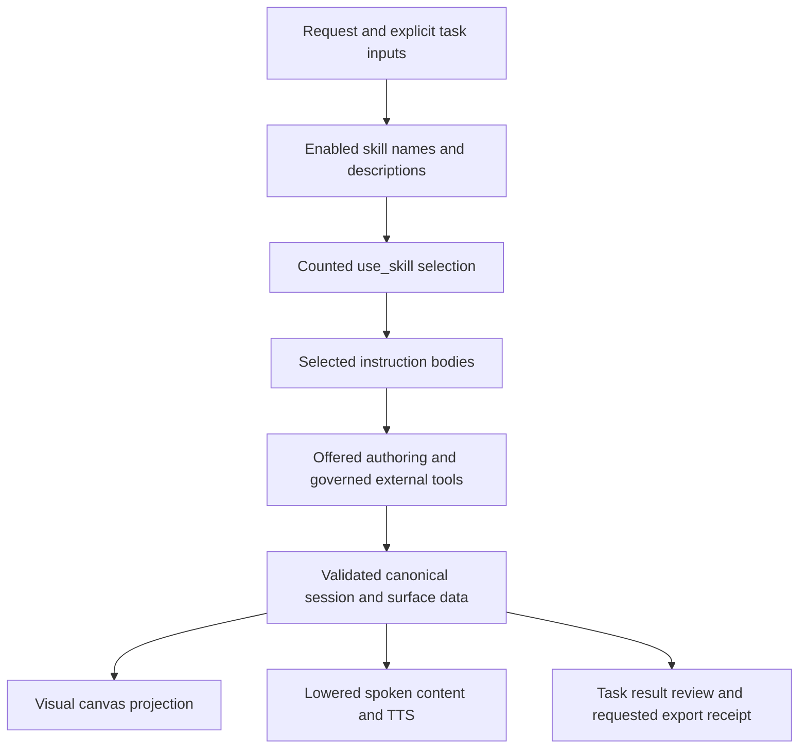

# Build reusable work with skills and dynamic surfaces

This is the maintained implementation guide for people and coding agents creating Vakyartha skills, dashboards, forms and reports. Start here before adding workflow code. [SKILLS.md](SKILLS.md) owns the loader/import/update contract; [SPECS.md](SPECS.md) owns the app architecture; [SKILL-AUDIT.md](SKILL-AUDIT.md) records the audit and evidence, rather than defining a second runtime.

Catalog skills may include reviewed supporting text files for reusable examples, layout guidance, form schemas and reference material. Keep the procedure in `SKILL.md`; point to a specific relative file when its contents are needed so the assistant can load it with `read_skill_file`. Supporting text is reference data, never an execution path or permission grant. Scripts and binary templates remain outside the current import tier. See [SKILLS.md](SKILLS.md) for supported types and limits.

## Choose the existing path first

| Need | Existing owner | Change here |
| --- | --- | --- |
| Repeated domain procedure or reporting practice | Instruction skill | `sidecar/builtin-skills/<name>/SKILL.md`, or a reviewed personal SKILL.md |
| Record mappings, bound input and submitted action guidance | `interactive-ui` | Its built-in body; runtime enforcement stays in Projection |
| Visual hierarchy, widths, chart choice and spoken readability | `surface-design` | Its built-in body; app theme in `src/app.css` |
| Operational dashboard composition | `dashboard` plus the matching domain skill | Reuse the existing loader and canonical surfaces |
| Rendering, catalog, generic binding or execution defect | Projection | Fix in `~/Projects/vakProjection`, push, then move the app pin; never edit the dependency checkout |
| External source/tool or reusable memory | Existing integrations catalog/lifecycle | User-configured tools and existing approval rules; no parallel connector/store |
| Task limits, review, checkpoints and export receipts | App task owners | Existing task/session path; no second workflow engine |
| Spoken wording and playback | App voice modules | `speech-text.ts`, `read-aloud.ts`, decisions/approvals; no separate report database |

A new skill is appropriate when the repeated procedure changes decisions the assistant makes. A new runtime feature is needed only when the required general capability is missing from the public API. A skill cannot manufacture that capability. Do not rebuild a report compiler, formula evaluator, domain-specific renderer, hidden retrieval store or tool-installation path to implement a new report type.

## How a request executes



App chat/tasks with enabled optional skills first offer only selection. `use_skill` loads one or several enabled names; an empty list explicitly selects none. Further necessary optional skills can load through the same bounded loop. `surface-design` is the exception: it is required, always on, cannot be removed or disabled, and its guidance is injected by the app whenever surface authoring tools or a render response are offered. This avoids relying on model selection for a shared quality rule. Channel providers use the same injection wrapper. Other chaining remains a model decision, not a hard-coded router or general dependency resolver. Historical optional-skill loads do not stay active automatically in later runs.

The active framework protocol and tool schemas define the authoring envelope. Transactional replacements contain complete data and an inline root tree; later patches use canonical IDs. Progressive tools use their offered flat-node protocol. Follow the currently offered schema rather than copying an envelope from another mode. Runtime validation, approvals, revision checks, persistence and receipts execute outside skill text. Native schemas are not automatically constrained decoding.

## Select a workflow

| Workflow | Targeted skills | Important domain distinction |
| --- | --- | --- |
| Service/delivery review | operations-dashboard → dashboard | Snapshot backlog, period throughput and aging have different populations |
| Sales performance/pipeline | sales-dashboard → dashboard | Actual revenue, open pipeline and forecast are different measures |
| Business financial review | finance-dashboard → dashboard | Cash/accrual basis, currency, actual/budget/forecast and comparable periods |
| Daily/weekly/monthly report | periodic-report | Exact windows, complete versus to-date periods, missing prior comparisons |
| Current news digest | daily-news → research-brief | Event/publication/retrieval times; multiple articles can describe one event |
| Market/index/watchlist review | market-dashboard → dashboard | Exchange/session, quote freshness, return basis and available history |
| Data quality inspection | data-review | Source records, missing values and proposed corrections stay distinct |
| Work/action register | task-tracker or meeting-actions | Status/assignment changes do not perform the work or notify anyone |
| New reusable procedure | create-skill | Produces instructions, not new execution authority |

The arrow means “reuse when enabled and needed,” not an automatic extra model call. Interactive work uses `interactive-ui` when data, bindings or submitted actions are involved; the required `surface-design` guidance applies automatically. A short text request need not become a dashboard.

Daily, weekly and monthly describe a reporting window unless the person requests delivery scheduling. Resolve date boundaries, timezone, source basis and whether the window is complete. A one-day price snapshot cannot establish monthly performance. A new report does not create recurrence: the current app supports bounded immediate/one-time task runs, not automatic recurring report delivery. See [MVP status](MVP-CHECKLIST.md).

## Author and activate a skill

Use a flat frontmatter block with `name` and `description`, followed by a self-contained body. Names use lowercase letters, digits and hyphens, up to 64 characters. Description is up to 1024 characters; body is up to 32768 characters. Rich YAML metadata is not a feature contract. Vakyartha stores reviewed UTF-8 text references with SKILL.md; scripts and binary assets remain listed but unavailable.

Example instruction file:

```markdown
---
name: weekly-delivery-review
description: Review supplied weekly delivery records for completed work, blockers and next actions.
---
Resolve the reporting week and timezone. Use supplied records or successful
reads through offered tools; keep missing owners and dates explicit.
Separate completed work during the week from the current open backlog.

For an interactive report, load dashboard and interactive-ui when enabled and needed. The always-on
surface-design guidance applies automatically to this interactive report. Use one canonical collection
for views of the same work. Keep the main finding, period and coverage caveat
in short visible text that remains meaningful when spoken.

When criteria are submitted, update affected measures, detail rows and the
summary together, preserving unrelated surfaces and edits. Do not infer
notification, recurring delivery or an external task update from a local edit.
Claim a saved or delivered report only from the matching receipt.
```

For personal use, ask the assistant to create/audit the skill, then open **Settings → Skills → New skill…**, review the complete file, save and switch **Use this skill** on. The required `surface-design` built-in is always on and has no disable or remove action; its reviewed instruction updates remain explicit. New personal/catalog skills start off. Editing preserves their current on/off state. A model-facing skill-management tool is not currently offered, so an assistant-produced draft is not installed by default. A separately authorized file tool can write a file, but that alone does not establish activation in the app index.

For bundled defaults, edit/add `sidecar/builtin-skills/<name>/SKILL.md` and optional readable text under `references/`. The loader in `sidecar/skills-builtin.ts` discovers these folders; do not create a second registry. Keep each description narrow enough for selection and its body focused on domain decisions. Reference files are examples or checklists, not executable authority. New bundled names seed once. Existing changed packages show current/proposed instructions and file previews with an explicit **Update skill** action; stale fingerprints reject replacement. Custom edits, disabled choices and removals remain protected. Source edits do not update the installed executable or its local skill files. [Full lifecycle](SKILLS.md#updates).

## Compose canonical data and views

Keep source facts, editable criteria and derived results distinguishable in data. Preserve identities and original numeric types; keep display units explicit. Related table/chart/metric views should map one record collection, rather than authoring three copies of values. Unrelated data or independently requested surfaces remain separate.

The supported mapping fragments are:

```json
{"rows":{"records":"{/records}","fields":["label","value"]}}
```

```json
{"series":{"records":"{/records}","label":"label","fields":["value"]}}
```

```json
{"value":{"records":"{/records}","field":"value","aggregate":"sum"}}
```

These are component props fragments, not complete tool calls. Table columns correspond to fields in order. Chart mappings supply category labels; do not copy a separate labels array. Supported metric aggregates are sum, mean, min, max and count. Numeric projections require finite numbers; missing values are not zero. Preserve explicit missingness and explain when it prevents a requested view.

An input binds an existing canonical pointer, for example `/records/0/value`. Initial supplied values must exist at that exact path. Display bindings use `{/path}`. Editing source values updates their mapped projections locally. Formula strings do not execute. Per-row arithmetic needs an offered computation tool or independently checked model-authored calculations. A submitted criterion does not itself recompute derived data: the continuation must update affected results and interpretations. Read the current submitted paths; repeated leaf names may be canonical pointer keys.

Local table sorting/search/paging affects that table, not the chart or aggregate population. Dashboard-wide filters require explicit criteria and a submitted operation that updates all affected views and explanations. Source refresh requires a successful offered read, not just a refresh label.

## Layout vocabulary

| Design intent | Offered semantic choice |
| --- | --- |
| Reading order or compact action group | stack; horizontal direction and explicit alignment when needed |
| Peer panels/metric strip | grid with requested columns; explicit numeric columns preserve unused tracks |
| Main analysis and secondary context | split ratio when that component is offered |
| A meaningful group with context | section; card when it is a distinct content unit |
| Compact summary | common `maxWidth: sm` |
| Form or small analysis | common `maxWidth: md` |
| Detailed analysis | common `maxWidth: lg` |
| Dense table or deliberately wide content | common `maxWidth: full` |
| Track occupancy | grid `span`, independent of content measure |

Web measures are 320/720/1040 pixels or available width, always capped by the container. Charts default to the medium measure. These are semantic props, not arbitrary model-supplied CSS. Layout responds to its container; primary content should remain first when columns collapse. Use empty space deliberately rather than stretching every small item. Respect the app theme and express status in words as well as colour. Form labels, grouping, validation and nearby submit controls are part of composition. App placement/canvas/library behavior stays unchanged; see [CANVAS.md](CANVAS.md).

## Chart choice and actual support

All eight standard chart kinds render through the same dynamic component. Choose based on the analytical question, available data and comparable units. A renderer accepting a kind does not validate its statistical interpretation.

| Question | Supported kind | Required data/limits |
| --- | --- | --- |
| Compare categories or supplied bins | bar | Category labels and comparable finite values; raw samples are not automatically histogram bins |
| Compare additive parts across categories | stacked | Parts in the same unit; not automatic 100-percent normalization |
| Show ordered observations over time | line | Correctly ordered dated observations; equal category spacing is not a continuous time-axis guarantee |
| Show magnitude over ordered time | area | Same ordering constraints; avoid implying unsupported cumulative/stacked-area computation |
| Show parts of one whole | pie (donut rendering) | One nonnegative series and a meaningful positive total; not negative balances |
| Inspect paired numeric variables | scatter | Explicit numeric x and y; correlation/regression is not computed |
| Show nonnegative intensity | heatmap | Matrix series, or one series with YYYY-MM-DD labels for calendar layout; not a diverging signed heatmap |
| Compare a profile across common-scale axes | radar | Comparable measures; normalization is not automatic |
| Show dated events, process state or planned work | calendar, timeline, steps, gantt when offered | These are separate components; preserve supplied dates/states rather than coercing them into a numerical chart |

Candlestick/OHLC, sized bubbles, box/violin plots, waterfall, treemap, dual-axis/combo charts, error bands and statistical overlays are not standard chart kinds. Offer a supported line/bar/scatter/table where suitable and state the limitation; a name alias is not a new computation capability. In particular, `histogram`/`bubble` aliases do not implement binning or point-size encoding. Complex new chart execution belongs in Projection only after identifying a real missing general capability.

Before finalizing a chart, check that its plotted categories and series agree with its title, description and nearby interpretation. If it shows only part of the available data, name the selected categories or periods and say where the remaining values appear; do not describe a subset as complete.

Use a descriptive section/title, time basis, units, source freshness and a visible interpretation. Avoid a chart for every number. Retain a detail table when exact values matter. Market reports need actual history for time charts; a weekly label cannot manufacture five trading sessions.

## Design the visual and spoken projections together

There is one canonical surface and two presentation paths. Screen uses the web projector. App speech resolves that same surface, lowers richer components through public `lowerSurface`, and converts content into spoken text. It does not read canvas DOM styling, infer meaning from chart colours or run a second report-generation model. Do not introduce a separate `tts` field, narration object or persistence writer.

| Content | Current spoken behavior | Authoring consequence |
| --- | --- | --- |
| Visible text | Gist keeps the first sentence; manual/details retain text | Make the first sentence meaningful, with its period/units/material caveat |
| Cards | Gist keeps headline and may omit body | Do not put the only freshness warning or uncertainty in the body |
| Tables | Gist first 3 rows, manual read first 6, details up to 50 | Put main finding/coverage before the table; do not rely on a later row being heard |
| Charts | Named series with first/last category/value endpoints | This is not minimum/maximum, volatility or full trend interpretation; add supported interpretation in visible prose |
| Stats and alerts | Labels, values, deltas and alert content | Name units, instrument/context and limitations explicitly |
| Controls and images | Ordinary narration skips them; choices/forms have separate voice interaction | Never rely on a dropdown label, checkbox, tooltip or image to carry the reporting period or warning |

Speech traverses content with priority ordering; spatial position alone is not the voice order. Text normalization speaks numbers in the detected language where supported. Preserve the person's language; expand important unexplained abbreviations in readable content. Keep a small summary in the surface instead of duplicating a long report in reply prose and surface content, which can both be read. Update the narrative when submitted criteria/data change; a new table with an old spoken conclusion is a failed outcome.

## Verify and maintain the method

For code changes run the relevant app/framework tests, typechecks and build. After UI build, `node scripts/surface-design-check.ts` verifies mixed layout and all standard chart rendering paths in real WebKit; `node scripts/canvas-check.ts` verifies existing canvas interactions; `node scripts/skills-check.ts` verifies reviewed default updates. `test/voice.test.ts` checks canonical surface-to-speech behavior, including a report whose decimal finding and caveat survive gist/screen/details and a bound value edit. Text projection checks do not prove microphone operation or audio quality; [VOICE-CHECK.md](VOICE-CHECK.md) owns those checks.

For model-output work, first run the matching primary-provider contract in the owning Projection repo, as required by [AGENTS.md](../AGENTS.md#outcome-acceptance-gate). Freeze original source/value/interpretation/interaction/receipt checks before the trial, retain failures and diagnose the earliest boundary offline. Do not extend retries or alter facts/checks to obtain a pass. A scripted renderer pass, successful skill selection, valid surface or saved receipt alone does not prove the report is correct. Current failures stay in [EVALUATION.md](EVALUATION.md) and [MVP-CHECKLIST.md](MVP-CHECKLIST.md).

When changing this method, update the canonical guide and the appropriate contract owner (`SKILLS.md`, `SPECS.md`, `CANVAS.md` or voice docs), then record evidence/current state in the audit and handover. Keep entry links in README and AGENTS; do not copy the full guide into every skill or add a second mechanism. Release/install steps and skill-update smoke checks are in [RELEASING.md](RELEASING.md).

## Diagnose without rebuilding the pipeline

| Symptom | Inspect first |
| --- | --- |
| Wrong/missing skill | Enabled index and selected use_skill names; description overlap or missing follow-up context |
| Skill references an absent script/tool | Instruction-only import contract and currently offered tools |
| Table/chart/metric disagree | Canonical records and mapping fields before styling |
| Filter appears to leave other panels stale | Local table state versus explicit submitted dashboard criteria |
| Summary disagrees after editing | Continuation narrative and submitted paths; do not patch displayed facts |
| Form values disappear | Bind paths, drafts, canonical IDs and submission payload |
| Panel stretches or misaligns | Grid columns/span, maxWidth and row alignment; inspect WebKit geometry |
| Voice loses a caveat or number | Resolved content, gist truncation and speechChunks before provider/audio calls |
| Apparent refresh/delivery without evidence | Tool result and task/output receipt, not the button text |

The source map is intentionally small: `sidecar/builtin-skills/` (bundled packages), `sidecar/skills-builtin.ts` (discovery), `sidecar/skills.ts` (parse/store/select/import/update), `sidecar/server.ts` (chat/task wiring), `src/skills-page.ts` (review/edit UI), `src/app.css` (theme tokens), `src/canvas.ts`/`src/drafts.ts` (canvas/drafts), `src/voice/speech-text.ts` (spoken content), and `src/voice/decisions.ts` (voice choices/forms). Framework contracts/projectors live in Projection; app code imports only package exports.
