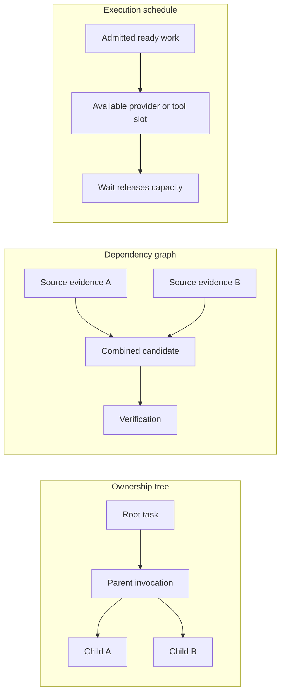
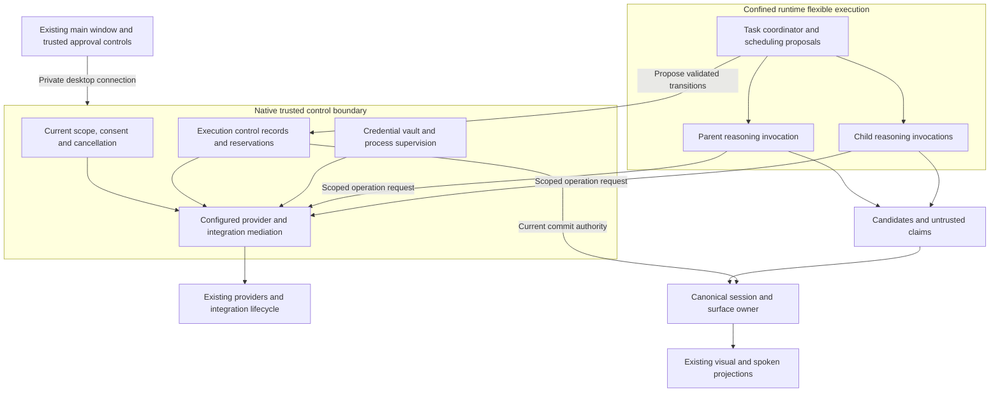

# Architecture and design decisions

Status: proposed, 2026-10-29. Start with the [reading map](README.md). Security placement follows ADR-050/052; general framework mechanisms remain in Projection's owning repository.

## 1. Goals and exclusions

Complete bounded user work with inspectable evidence, preserve interactive results, and retain control through interruption or compromise of a reasoning worker. Make delegation available where it earns its cost without making it a prerequisite for ordinary work.

This proposal does not add unattended cloud execution, a new memory database, an agent marketplace, an external-agent protocol, a second workflow engine, arbitrary process spawning or a new dependency. A model, skill, persona and operating-system process are not interchangeable concepts.

| Term | Contract |
| --- | --- |
| Root task | User goal, current contract revision, scope, limits and acceptance policy |
| Run | One bounded execution interval or continuation of that task |
| Agent | Model-driven decision loop operating under an admitted invocation |
| Child | Agent assigned a bounded deliverable within the root task; not a new user-owned chat |
| Attempt | One execution attempt of a child; replacement attempts retain lineage and consume allowances |
| Tool | Defined operation; deterministic computation stays a tool where practical |
| Skill | Selected procedure; never an authority grant or implicit child |
| Candidate | Proposed content, patch or artifact awaiting applicable checks |
| Evidence | Version-bound source observation, calculation, operation receipt or explicit review supporting a requirement |

## 2. Three structures, three responsibilities

Ownership determines cancellation, retention and accounting. The dependency graph determines readiness and invalidation. The scheduler determines which ready work executes. Dependency edges must be acyclic; parent ownership must not be inferred from dependencies or visible sidebar grouping.

One provider slot may serve several logical agents serially. A child has a separate reasoning context without necessarily having a dedicated OS process. Sharing a process is permitted only for mutually trusted invocations with no required access separation: a compromised process can use every channel, credential handle and input buffer it holds. Distinct IDs or contexts inside that process do not establish narrower child authority. Separately restricted assignments, protected checkers and unrelated trust domains require confined workers whose channels/state are inaccessible to each other, or a demonstrated equivalent. Freeze that topology under AR-03/05/07; security isolation is independently enforced, not inferred from the logical tree.

## 3. Target trust and component boundaries

The TypeScript coordinator proposes decomposition, dependencies and business transitions. Rust owns the actual scheduler, capacity allocator, durable execution state, non-bypassable approval, credential, egress and execution-control enforcement. A compromised coordinator cannot mint child authority, allocate an execution slot, reset counters, forge consent or restore cancelled work. Generated content, tool output and worker-reported success remain untrusted. [Implementation design](IMPLEMENTATION-DESIGN.md) specifies the module/command topology and clean root-correction cutover selected by the user.

Many roots and unrelated workloads compete for the same machine. The shared [capacity and observability design](SCALE-AND-OBSERVABILITY.md) governs aggregate admission across chats, tasks, children, verification, executable apps and integration work. Per-root limits alone cannot establish host stability.

Native admission must derive the caller from a supervised channel/invocation association; a task ID supplied in JSON is not authentication. No raw credential-returning or general network/shell command becomes a worker capability. Provider dispatch resolves a configured provider and endpoint; custom destinations require their own existing user configuration and policy. Redirects and resolved addresses must retain destination enforcement.

The trusted process is required to resist an execution-worker compromise through actual OS and protocol boundaries. The design does not establish that native-language code is intrinsically invulnerable or that kernel/admin compromise is contained. Attempted modification, termination and credential access from a compromised worker are explicit acceptance tests. Required isolation has no ordinary-process fallback.

### Persistence ownership

| Entity | Proposed sole authority/writer | Other components |
| --- | --- | --- |
| Execution control: root/child/attempt identity, scope revision, cancellation epoch, reservations and terminal admission | Native trusted control owner | Coordinator submits transitions; never maintains a second authoritative ledger |
| Goal, requirement and acceptance contract revisions | Trusted task-control persistence through admitted user/workflow changes | Agent proposes amendments; cannot publish relaxed criteria |
| Canonical sessions, records and surfaces | Framework service owns semantic mutation/versioning through public APIs; native persistence writer owns durable bytes through a protected injected adapter | No duplicated Rust surface schema, direct reasoning-worker files or second live store; exact missing adapter is AR-03 |
| Source/output/verification receipts | Existing registered receipt owner, referenced by task control | Worker prose cannot replace a receipt |
| Mutable requirement acceptance, invalidation and review state | Native trusted task-control aggregate | References immutable receipt/candidate identities; changes participate in terminal compare-and-set |
| Workspace copies, promotion and rollback journals | Existing sandbox owner | App requests reviewed operations |
| UI drafts and local view state | Existing UI owner | Incoming updates expose conflicts |
| Numeric usage | Existing app FinOps writer | Reconciles with admission reservations without authorizing work |

The current TypeScript task writer is an implementation foundation, not the target security authority under worker compromise. Before implementation, assign the complete task aggregate and its transitions to one writer; avoid splitting one invariant across independent files. Any ownership move requires an explicit cutover and crash proof, not a dual-write bridge. Derived projections may cache state with revision identity but never authorize operations.

Single writers do not make a cross-owner completion decision atomic. Freeze a version-bound finalization handshake between control, canonical content and receipt owners, as specified in [drift and completion](DRIFT-AND-COMPLETION.md). Race and crash tests must prove no older candidate is accepted as current while a newer canonical commit becomes visible.

Keep the framework's canonical content ownership. If its public API cannot separate candidate execution from protected commit/persistence, record that exact gap and add the smallest general contract in Projection. Do not duplicate its schemas or move its surface store into the app by assumption.

## 4. Proposed decisions and tradeoffs

| ID | Decision | Reason and cost |
| --- | --- | --- |
| AR-D01 | Default to one agent and zero children | Avoid unearned context, execution and coordination overhead; some broad work remains slower |
| AR-D02 | Separate model usefulness judgment from trusted admission | Safety limits are enforceable; necessity is evaluated rather than claimed provable |
| AR-D03 | Start with one delegation level and parent-mediated messages | Bounds lineage and coordination; no arbitrary peer mesh |
| AR-D04 | Separate child admission from execution slots | Supports context isolation on a single local provider; requires durable queues |
| AR-D05 | Share root limits and reserve before dispatch | Prevents budget multiplication; requires serialized accounting and conservative crash handling |
| AR-D06 | Publish through canonical owners with revision checks | Preserves multiple surfaces and drafts; conflicts require explicit resolution |
| AR-D07 | Keep evidence and acceptance independent of agent declarations | Prevents self-certified success; unknown semantics may require user review |
| AR-D08 | Stop with explicit partial/uncertain outcomes | Avoids replay and false success; some failures require human reconciliation |
| AR-D09 | Treat local-provider behavior as the primary outcome target | No silent paid escalation and no dismissal of failures by model size |
| AR-D10 | Reuse existing private connection, tools and storage owners | Avoids parallel authority and needless IPC; exact missing seams require a design proof |

These are proposed decisions for this package, not new accepted ADR entries. Approval to write this documentation does not approve new dependencies or implementation defaults.

## 5. Existing interactive experience

One task retains several identified surfaces. Children may produce candidates for related records/views or independent outputs; accepting one must not replace unrelated surfaces. Existing local sort/filter/page interactions make no model request. Unsent drafts survive task changes and conflict with incoming updates explicitly.

The root owns user-facing questions and consolidates duplicate child blockers. Background events do not steal focus. Trusted approval cards remain distinct from generated forms. Visual and voice projections use canonical values and the same validated actions; there is no separate narration truth store. Completion does not make surfaces read-only; later submission creates an explicit continuation with fresh checks.

## 6. Repository responsibilities

Vakyartha owns product contracts, delegation policy, task control, native broker composition, recovery UX, QoS selection, retention and FinOps. Projection owns general host/session execution, provider/MCP transports, validation and canonical surface mechanisms. The sandbox project owns containment, effective resource enforcement, descendant cleanup, workspace promotion and rollback.

Native control must remain available when the desktop window is hidden; channel/task lifetime cannot depend on a mounted webview. The development browser adapter cannot silently fall back to weaker authority: it must use the same proved native control service where supported or refuse workflows requiring it. The supervised lifecycle and narrow private adapter are AR-03/07 decisions; this proposal does not introduce a public listener or certify current headless behavior.

For every possible framework change, first record: existing exported API, missing behavior, why app composition cannot supply it, minimal additive contract, affected consumers and verification. Never edit the pinned `framework/` checkout. No repository placement or new runtime boundary is justified by an agent role name alone.
