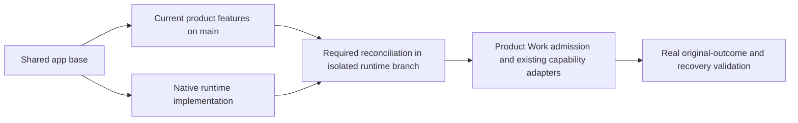

# Code status audit before product integration

Audited 2026-10-30, before reconciling the product and runtime histories. This is a source/call-path audit, not a fresh test run, model evaluation or installed-build claim.

## 1. Source snapshots

| Owner | Audited revision | Finding |
| --- | --- | --- |
| Current product checkout, `main` | `625787dc09b689a335321f80b07d8a8e9ffe0302` | Decision providers/shaping/chaining, skill cache and new procedures, cache visibility, diagrams, voice cleanup and Voice Desk exist. |
| Isolated runtime implementation | `ab25c0732790530fbc27170fce6625d6d97d652a` | Native authority/storage/consent/I/O and separate reasoning/canonical supervision exist. Product task execution is disabled. |
| Shared app base | `1a7dc6f1dffb28ffc4475d5f34b75f67665adee6` | Product has 19 commits and runtime 111 commits after this base; neither app branch contains the other. |
| Product framework pin | `196b7967c381023c02156e63c806dc86ba746ede` | One framework commit beyond the runtime pin; the existing runtime API work is its ancestor. |
| Runtime framework pin | `cb8762b31e41ccae0b92d1ff1518cb880728e32e` | Public candidate/session/transport seams already exist; do not rebuild them. |

Both app worktrees were clean at inspection. Product checkout and decision-feature files were read only. Framework ancestry was inspected in its owning repository, without editing `framework/`.

## 2. Audit of the eight remaining areas

The eight areas remain integration/acceptance gates. It would be inaccurate to describe their underlying code as wholly absent.

| Area | Code already present | Actual remaining boundary |
| --- | --- | --- |
| 1. Work end to end | `sidecar/tasks.ts` implements task creation, execution, input/continuation, scheduling, permission suspension, review and completion; `sidecar/task-files.ts` owns task output receipts. These run in the TypeScript/browser path. Runtime `src/desktop-fetch.ts` and `control/tasks.rs` provide native metadata controls. `reasoner_supervisor.rs`, `provider_io.rs`, `canonical_supervisor.rs` and publication receipts form the assembled native fixture. | Desktop routes admit create/list/read/cancel/delete only. Native task DTOs refuse started runs, the only product-start opcode is test-only, and startup uses an empty capacity profile. Connect lifecycle/context/result acknowledgement and reuse existing behavior through native authority; do not write a second task product. |
| 2. Context, skills and decisions | Both branches have Skills and context composition in `sidecar/server.ts`. Product `src/decision/` contains providers, heuristics, `shapeTurn` and `DecisionChainRunner`; `src/main.ts` invokes classification, history/budget/reasoning shaping and runtime discovery. New skill cache/defaults also exist on product. | Runtime branch has not incorporated the newer product code. The isolated reasoner accepts explicit instructions/files/surfaces but offers no external tools or selected-skill loader. Decision results still need actual tool/grammar propagation, background-task integration and native mediated classification/scoring transport. Reuse the decision capability. |
| 3. Common mediation and spending | Native vault, registered broker routes, exact-byte consent, bounded streamed I/O, root budget charging and cleanup receipts exist. FinOps already has task/run attribution in its TypeScript scope; product adds cache-rate visibility and decision usage fields/proof script. MCP/integration lifecycle and domain execution already exist. | The general app-worker provider pipe explicitly refuses generation. Other execution classes have not joined one native admission/lease owner. Hosted task spending policy and native receipt-to-FinOps attribution are incomplete. Decision usage fields are not evidence of a product usage-ledger connection. |
| 4. Workspace, storage and IA | `sidecar/workspace-registry.ts`, workspace/project panels, session/folder scope and Realm flows exist. Native `control/registry.rs`/`folder.rs` implement separate identities, revisioned grants and physical-folder revalidation. Desktop canonical sessions and task definitions already have native writers. | `sidecar/server.ts` still constructs the TypeScript registry for active product routes. Finish workspace ownership/route/UI cutover, shared navigation and scoped retention/deletion. Preserve existing direct/copy/shared workflows and runtime branch's additional folder safeguards. |
| 5. Recovery, drift and stopping | Native fences, cancellation epochs, contract revision/stale-check invalidation, requirement/review guards, monotonic deadlines and uncertain lease retention are implemented and tested. TypeScript tasks contain explicit uncertain-operation reconciliation, review snapshots and output checks. | General evidence collection/refresh, drift triggers, bounded correction, product recovery UI and task-level terminal integration are incomplete. Native publication intentionally leaves original checks pending. Cumulative active time across task attempts is not enforced yet. |
| 6. Scheduling and QoS | Logical global/per-root resource reservations, bounded actor/IPC, provider backpressure, process cleanup and separate active/consent clocks exist. TypeScript tasks implement a single-slot pump, missed-schedule handling and permission suspension; a separate sandbox pool exists. | Native fair scheduling across all workload classes, waiting-slot release, resident-service accounting, pressure/telemetry/load proof and hard resource enforcement remain. The reviewed sandbox backends explicitly refuse requested resource-limit policies; policy field names are not enforced CPU/memory/PID/disk quotas. |
| 7. Bounded subagents | `control/delegation.rs` rejects generic complexity/role labels, unbounded or conflicting scopes and unsupported parallelism claims. Native child identities, queue/execution reservations, attempt/result/review state and root-wide fences/budgets exist in `state.rs`/`control.rs`. Default delegation is disabled. | No product child reasoning/IPC launch, yield/join/cancel orchestration or native verification workflow is connected. Measured adaptive benefit thresholds and actual smallest-child outcome proof remain. Existing domain/policy code should be connected, not recreated. |
| 8. Acceptance and delivery | Runtime's retained baseline is 294 app tests, 151 macOS/153 Linux native tests, typecheck, Clippy and native desktop smoke. There are historical primary-provider checks, installed builds and an initial architecture review. | Those receipts do not validate the reconciled app or a genuine user-started native Work task. Original failed source/value/interpretation/interaction/output outcomes, concurrent fault/load evidence, Linux package/Windows durability proof, a fresh installed build and final Astra implementation review remain open. |

Runtime source entry points: [`control/tasks.rs`](../../src-tauri/src/control/tasks.rs), [`desktop-fetch.ts`](../../src/desktop-fetch.ts), [`server.ts`](../../sidecar/server.ts), [`tasks.ts`](../../sidecar/tasks.ts), [`task-worker-runtime.ts`](../../sidecar/task-worker-runtime.ts), [`reasoner_supervisor.rs`](../../src-tauri/src/reasoner_supervisor.rs), [`state.rs`](../../src-tauri/src/control/state.rs), [`delegation.rs`](../../src-tauri/src/control/delegation.rs), [`registry.rs`](../../src-tauri/src/control/registry.rs).

For product-only code, inspect the pinned `main` revision above: `src/main.ts`, `src/decision/{shaper,chain}.ts`, `src/decision/providers/`, `sidecar/skills.ts`, `sidecar/voice/resolve.ts`, `src/finops-page.ts` and the newly bundled skills/apps. These are an inventory of actual source, not endorsement of every documentation claim.

## 3. Concrete findings requiring reconciliation

1. **Product startup is still gated in runtime.** `src-tauri/src/lib.rs` initializes `CapacityProfile::unconfigured()`. `control/tasks.rs::view` rejects started runs. `PrepareProductFixture` is under `cfg(test)`. Supervisor call sites are fixtures; a successful harness cannot be counted as a user-started task.
2. **Decision shaping is partially connected on product.** `src/main.ts::runTurn` receives `shaped.payload` but forwards selected history/step/tool-round/reasoning settings. It does not forward the filtered `tools` or `includeSurfaceGrammar` result. `shapeTurn` also receives no conversation history from that hook, so its history-dependent prefix-preservation logic cannot infer the continuing conversation from that input. Its automatic step fallback currently uses a floor of eight; small decision step recommendations are not automatically the effective limit. Trace the actual host payload before claiming pruning or trivial-turn reduction.
3. **Decision chaining is not automatic task verification.** The runner exists, but no product `sidecar/tasks.ts`/`server.ts` call site connects it to task criteria/security checks. Providers/runner currently call `fetch` directly. Native registration, approval/budget policy and result/evidence correlation must accompany their runtime integration; a score grants no authority or original-outcome pass.
4. **Decision telemetry needs a real consumer.** Product provider adapters expose `decisionUsage` and `scripts/verify-finops-connection.ts` exercises cost helpers. No consumer was found forwarding that decision usage from the chat hook into the existing product FinOps ledger. Preserve the existing ledger and add the missing attributed observation path.
5. **The default product decision test includes a possible paid call.** `test/decision.test.ts` contains a live test that reads a stored key and calls a fixed hosted model when available, without an explicit live-test opt-in. This audit did not execute it, read a key or make any inference call. Before running a combined default suite, separate/explicitly opt in live tests; a missing key must not silently count as live success. The user's Luna allowance does not authorize that different model implicitly.
6. **Integration must preserve runtime fixes.** Seventeen paths changed on both histories: app instructions/status/docs, `framework`, `sidecar/{egress,sandbox-status,server,settings}.ts`, native `policy.rs`, main/settings/CSS and egress/FinOps tests. Review semantic ownership even where Git merges text automatically. Keep the contained launcher, native vault, no ambient worker authority, one desktop task/session writer, exact consent and native budget ceilings. Keep the product's newer skills, voice, caching, discovery and diagrams. No dependency/lockfile delta was found in the product-only history.

## 4. Revised immediate order

1. Reconcile the audited product revision into the isolated runtime branch, leaving the original `main` checkout unchanged. Follow the framework update procedure before moving its pin; its newer pin already contains the runtime public APIs.
2. Check merged source and default-test network behavior, typecheck/build/public API compatibility, existing app/framework/native tests and affected WebKit flows. Retain failures. Do not perform implicit paid tests.
3. Implement the actual native Work admission/lifecycle and the existing context/skills/decision adapters, with explicit publication acknowledgement and original completion guards.
4. Run the smallest real primary-local contract before broadening the workflow; then independently verify the original task's sources, values, interpretation, interactions, output and recovery.
5. Continue the remaining authority/IA/evidence/QoS/child/platform/delivery gates using existing components. No group is closed merely because code, unit tests or a mock pipeline exists.
