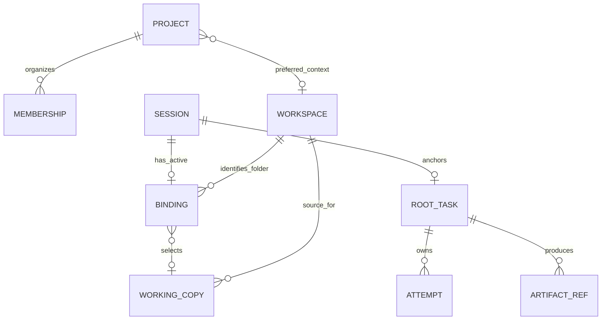
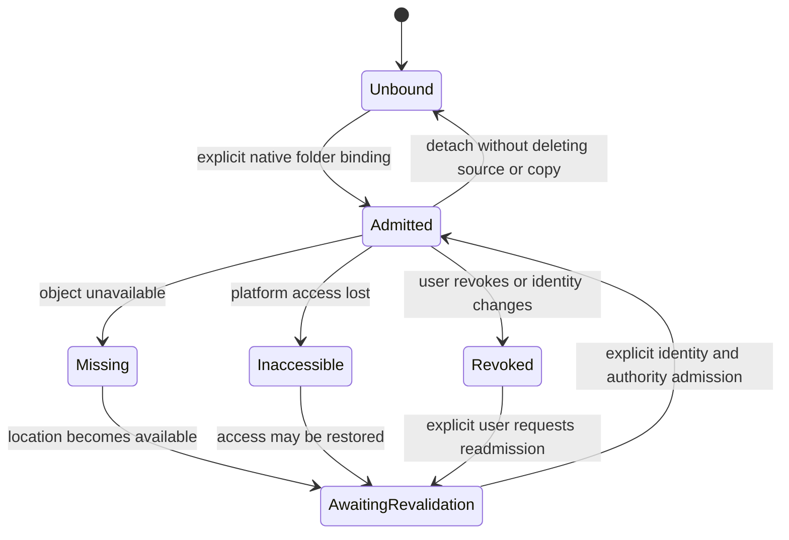

# Data identity, folder authority and storage layout

Status: code-inspected baseline and proposed target, 2026-10-29. Follows the user's request to check source before trusting older folder/IA documentation. [Information architecture](INFORMATION-ARCHITECTURE.md) defines navigation; [implementation design](IMPLEMENTATION-DESIGN.md) defines native ownership. Proposed directories are not current on-disk migrations.

## 1. Direct answer: what lives where

Source files stay in the user-selected folder. Private app state stays in the app's private data root. Project/workspace views are metadata references to that state, not additional copies of chats, task journals or files. Nothing creates a hidden app database or credential store in a selected source folder.

| Current runtime | Current private data root |
| --- | --- |
| Installed macOS app | `~/Library/Application Support/com.nranjan2code.vakyartha/` |
| Desktop development | `<repository>/.vak/desktop/`, unless explicitly overridden by development configuration |
| Browser development | `<repository>/.vak/web/`; its explicit transcript override may use that root directly |
| Other native platforms | Native platform app-data resolver; effective path must be shown, not guessed from a folder selection |

Environment/dev data is not committed. Stored secrets remain in the canonical platform vault; never copy them into workspace/project metadata, transcripts, export packages or backup manifests. A provider-sent snapshot is already disclosed data; later folder revocation cannot unsend it.

## 2. What current source actually represents

Inspected `sidecar/workspace-registry.ts`, `sidecar/sandbox-realms.ts`, `sidecar/server.ts`, `sidecar/task-files.ts`, `src/workspaces-panel.ts` and `src/main.ts`.

| Current entity/path | Observed behavior |
| --- | --- |
| `Project` | UUID, name, canonical folder string, revision and optional shared Realm; current creation requires a folder |
| `WorkspaceBinding` | Keyed by session ID; folder string, optional project/Realm IDs, mode, sharing flag, revision and access state |
| `<data>/workspaces.json` | TS-written projects and bindings; no independent stable `workspaceId` entity or durable physical folder identity |
| `<data>/sessions/` | Host canonical conversations/surfaces via `sessionsDir` |
| `<data>/tasks/` | Current TS task journals; a task links its canonical session |
| `<data>/outputs/<task>--<run>.md` | Current private task Markdown outputs with hash/version receipts |
| `<data>/attachments/<session>/` | Session-owned attachments |
| `<data>/media/` | Existing media jobs/private assets and media metadata owner |
| `<data>/apps/`, `app-drafts/`, `app-state/` | Existing executable package/draft/state owners |
| `<data>/sandbox/realms/<realm-id>/workspace/` | Existing helper-owned retained working copy; original stays external until reviewed Apply |
| `<data>/logs/` and optional transcripts | Numeric/diagnostic records with their distinct retention scopes |

Direct editing writes admitted originals; copy/review operates in a Realm. Shared project Realms exist already. The target must preserve these capabilities while correcting authority and ownership. Do not describe stable folder identity, native registry control or fully unified navigation as already implemented.

The inactive Rust control prototype now models Project, Workspace, WorkspaceBinding and ProjectMembership as separate records, captures canonical folder identity and includes them in the same schema-3 control snapshot as native root/capacity state. Its actor can register workspaces, bind/revoke/rebind a session, change project membership and preferred workspace, and revalidate a grant before returning it. Both the active TypeScript admission path and the native prototype reject system/private roots, reserved path components and the app-data root or its ancestors. The TypeScript registry remains the product writer, the native actor is not enabled, and no sandbox command receives the grant; native dispatch-time workspace enforcement is still open. See [implementation progress](IMPLEMENTATION-PROGRESS.md) for evidence and limits.

## 3. Target entity relationships



Membership is organizational and can reference a chat/task/artifact/app through its existing owner. The initial IA uses one optional project membership per such item; it does not require duplicating that item. A project can exist without a folder. A standalone chat can bind a workspace without a project. Initially a chat has at most one effective workspace binding; adding multiple active folders requires an explicit future scope contract.

Retain one canonical session per explicit task with multiple runs/continuations; do not let unrelated tasks concurrently overwrite one session. Ordinary chat has an internal admitted execution scope without becoming a user-visible unattended task. Session ownership and explicit outside-agent surface routing remain distinct from project membership.

| Identity | Meaning and authority |
| --- | --- |
| `projectId` | Organization and optional preferred workspace; not a filesystem grant |
| `workspaceId` | Native-allocated identity for an explicitly registered external folder; not itself permission to every session |
| Folder identity | Canonical display path plus platform directory/object/volume identity or a proved equivalent; path alone is not identity |
| `bindingId` / revision | Admitted association of a session with workspace, mode and allowed capabilities |
| `realmId` | Existing helper-owned working-copy identity, source workspace identity and explicit sharing ownership |
| `rootId`, `runId`, `childId`, `attemptId` | Execution/accounting lineage, not filesystem paths |
| Artifact reference | Existing session/surface/version or owned output/media identity; does not copy canonical content |

Native registry owns project/workspace/binding/membership records and revisions. Rust control owns task/execution/evidence state. Framework service owns canonical semantic records, with native protected persistence. Sandbox owns working copies/promotion. Derived indexes can be rebuilt and never authorize access.

## 4. Proposed physical layout

Keep the same private root, with explicit bounded namespaces. `control/registry` uses the same native sole-writer generation/selection primitive as root control; do not leave a live TS `workspaces.json` writer beside it.

```text
<private-data>/
  control/
    format.json
    registry/                     projects, workspaces, bindings, membership,
                                  policy references and native revisions
    roots/<root-id>/              authoritative task/run/child/evidence state
    recovery/                     prepared commits and exact uncertain ops
  content/
    sessions/<session-id>/        opaque canonical snapshots; semantic owner is framework
    inputs/<root-id>/             explicitly captured immutable input snapshots
    outputs/<root-id>/<run-id>/   private task exports and receipts
  attachments/<session-id>/       existing session-owned asset namespace
  media/                         existing media owner; no second asset library
  apps/                          existing package owner
  app-drafts/                    existing draft owner
  app-state/                     existing app/domain owner
  sandbox/                       helper-owned Realm/control layout unchanged
  logs/                          numeric telemetry and protected diagnostic streams
```

These are entity namespaces, not one private state directory per project name or source-path hash. Renaming/moving a project or associating a task with another project does not move its content, duplicate it or reset execution history. Workspace/project pages query references under the current native registry. Historical task scope remains in its admitted run record even if the sidebar grouping changes.

Native persistence I/O is the sole durable writer for the new protected task/registry/canonical namespaces. Existing media/app/sandbox owners keep their own entities until a separately specified ownership move; any retained writer is confined to that namespace and cannot mutate native control. No reasoning worker receives the whole private root, Realm metadata or unrelated content. It receives only scoped read-only input references and its admitted working tree/scratch through the sandbox.

## 5. Folder identity and authority transitions

Register a selected folder through native admission: validate/canonicalize the user selection, reject forbidden roots, capture its platform identity and display path, allocate/reuse an identified workspace, and create an explicit binding/mode grant. Matching aliases for the same verified folder may reuse identity; they do not merge histories or transfer approvals. The exact platform identity and no-follow/open-handle mechanism is IA-02, not a portable inode assumption.

Before dispatch, resolve current binding/permission/cancellation revisions and verify that the actual enforced filesystem target still matches the admitted object. Close check/use races through the native/sandbox path; canonicalizing once is insufficient. Missing identity support refuses a required strong binding guarantee.

### Execution grants do not follow a mutable chat binding

At root/run admission, native control records an immutable execution grant: `bindingId` and revision, `workspaceId`, physical folder identity, allowed relative path/capability scope, editing mode, and any Realm/sharing identity and revision. Queued, scheduled, waiting and resumed work retains that grant. Dispatch compares it with current authority and the actual enforced target; a mismatch refuses the operation. It never resolves a newer session binding and silently substitutes folder B for admitted folder A.

Rebinding invalidates affected queued/scheduled/waiting roots, descendants, pending approvals and prepared candidates as well as active work. Historical results keep their original scope attribution. Retargeting requires an explicit task-contract amendment or continuation with reviewed inputs and a new admitted grant; changing project membership alone changes none of this. A queued job can remain discoverable as blocked/stale without acquiring the new folder.

A child is not a new chat or binding. Native derives a narrowed grant from the root's fixed grant and records the child's read/write scope and copy/scratch ownership. It gains no Realm membership from a parent/project label. Use immutable/read-only source snapshots for independent analysis, separate child candidate/scratch trees for conflicting writes, or explicit shared-copy membership with serialized operations and version-checked inputs. All derived grants remain constrained by the same root and sharing revisions; child completion cannot promote candidate files outside the existing reviewed sandbox path.



Permission revocation is sticky. Availability checks cannot grant authority again. Recreating a directory at the same path does not inherit the old grant. A move/rename can retain `workspaceId` only after verified identity and explicit locator/readmission handling; pending approvals are invalidated by the revision change. A copied folder or different-volume replacement is a new identity unless a separately reviewed migration establishes otherwise.

Project preferred-folder changes affect new defaults, not existing bindings. Moving a chat between projects changes membership only. Rebinding a chat is a separate action showing effective path/mode and context-history implications, with every affected execution grant invalidated as above. No global `cwd` or process environment is retargeted.

## 6. Working-copy ownership and storage operations

Each non-shared copy belongs to an admitted binding/workflow and source workspace. Shared copies have a stable workspace-level sharing record, explicit member grants and serialized writes; project removal does not destroy that owner. A session with no assigned Realm has no blanket access to any Realm from the same source folder. Validate source identity and membership, not merely matching paths.

| User action | Effect | Must not imply |
| --- | --- | --- |
| Remove project | Remove organization/default reference; expose detached items | Delete source files, chats, copies, receipts or revoke unrelated access |
| Detach folder | Revoke that binding and fence future operations | Destroy its retained candidate copy silently |
| Discard working copy | Explicit reviewed destruction through sandbox owner, showing unsaved changes and sharing impact | Delete originals or another member's live copy |
| Delete chat/task | Remove its stated owned content/drafts according to retention and active/uncertain-effect rules | Cascade into shared artifacts, project source or provider records |
| Export/save to folder | Exact admitted destination/mode, current candidate and receipt | Grant arbitrary filesystem writes or upload permission |
| Apply/Undo | Existing fingerprint-bound sandbox promotion/rollback | Pretend a manifest is a filesystem restore checkpoint or undo remote effects |

Unbinding leaves retained work discoverable under Workspaces/Working copies until explicitly discarded. Orphan cleanup is a visible retention policy with reference checks, not a side effect of sidebar navigation. Private outputs are discoverable from their task/project/workspace references; writing an output into the external folder is a separate governed operation.

## 7. Source-level audit evidence and root corrections

Isolated registry probes used temporary synthetic folders, no app instance, helper, provider, credentials or network, and removed fixtures afterward. Observations on the inspected source:

- `revokeBinding` followed by `verifyDispatchScope` accepted dispatch because `revalidateBinding` restored `admitted` from filesystem availability.
- Replacing the directory with a new directory at the identical path was accepted; the registry stores no physical folder identity to distinguish it.
- `verifySessionRealmAccess` accepted an arbitrary Realm identity when the binding had none assigned. The tool adapter later checks source path, so this probe establishes a registry authorization gap, not a complete cross-folder exploit demonstration.
- Registry load handles unreadable/corrupt content as empty; the native target must expose recovery failure rather than silently start a new authoritative registry.
- Binding deletion in `sidecar/server.ts` attempts to destroy a non-shared Realm and suppresses destruction errors. Target detach and discard must be distinct and inspectable.
- Sidebar grouping currently derives from `WorkspaceBinding.projectId`, coupling organization to the access record. Target membership is separately modelled; no folder is required merely to organize chats.

These findings remain open implementation work under IA-01–IA-06 and AR/ISO gates. Do not claim the new diagrams, source audit or an existing containment test repairs them. Native replacement and original folder workflows need independent acceptance.
