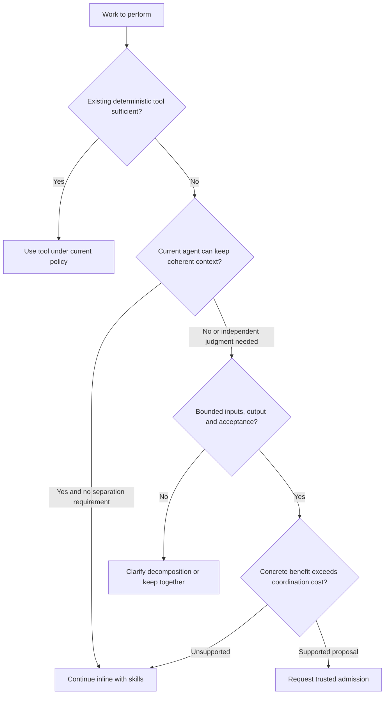
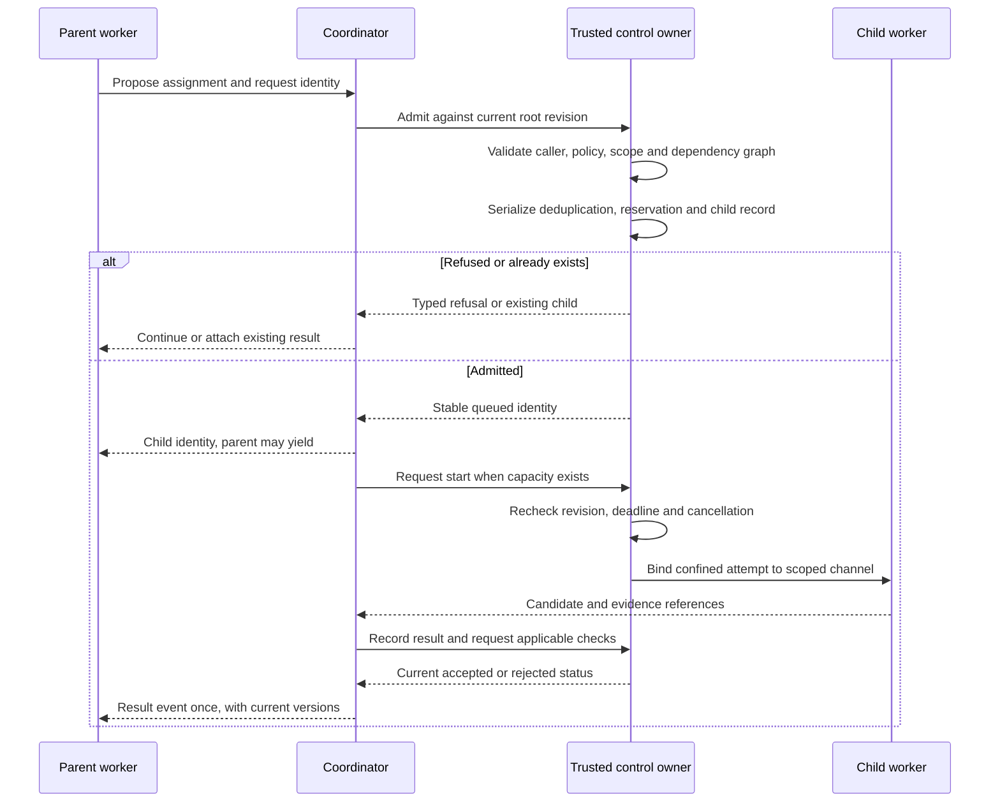
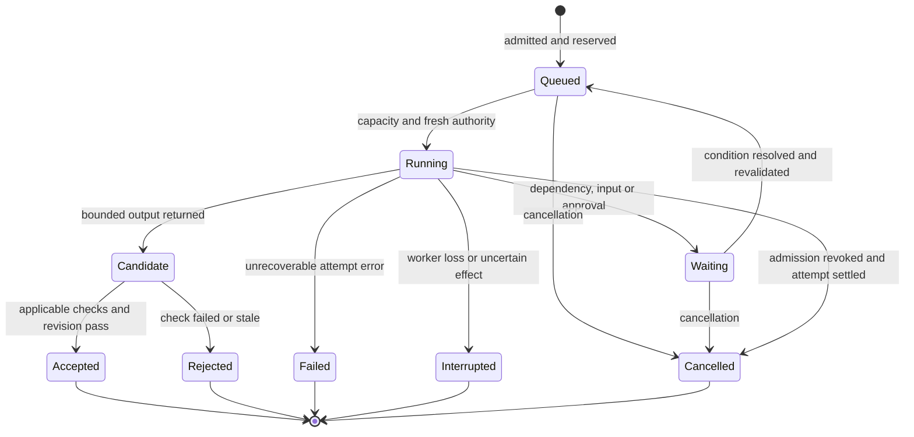

# Delegation decisions and runtime contracts

Status: proposed, 2026-10-29. Component ownership: [architecture](ARCHITECTURE.md). All identifiers and envelopes below are design requirements, not exported APIs.

## 1. When a child is justified

Good reasons include independent investigations, a fresh judgment against original evidence, a smaller relevant context, or deliberately restricted capability access. Parallel speedup is a reason only where independent work and measured provider/tool capacity support it. A skill or different prompt alone does not require a child.

| Classification | Meaning | Consequence |
| --- | --- | --- |
| Required separation | A trusted task/workflow contract calls for separately formed judgment or separately confined access | Runtime checks the declared separation property; it cannot guarantee independent truth |
| Potentially useful | A concrete expected quality/context/latency benefit exists | Permit a bounded experiment if policy and budget allow; evaluate benefit |
| Unjustified | Only length, number of steps, title or generic complexity is offered | Continue inline or use tools/workflow |

No automatic recursion after failure. Each additional child must address another bounded deliverable. A child count is never a progress target. Assignments needing continuous mutual updates usually need consolidation or better boundaries. Distinct role labels do not establish disjoint work.

## 2. Policy and admission

Trusted task policy has three modes: `disabled`, `bounded_adaptive`, and `declared_workflow`. A workflow explicitly declares required separation/checking; the model cannot select that mode to enlarge authority. No routine per-child user confirmation is needed inside an already authorized scope. Expanded access, paid spending, external disclosure or effects retain the existing approval rules.

Initial proposed adaptive envelope: depth one, at most four children including replacements, no child-created descendants, one active local generation, read/analysis assignments by default. Reads reaching the internet retain applicable Ask policy. These values are provisional and must be frozen with the initial benchmark/hardware profile before implementation; they are not existing limits or research-derived optima.

Admission outcomes: `admitted` with stable identity, `existing` for an idempotent duplicate, `refused` with a typed reason, or `needs_authorization` for a concrete scope expansion. Slot pressure normally queues admitted work; it does not pretend the child has started. A finite queue may refuse admission.

Use a task-scoped request identity for creation deduplication. A repeated identity with different content is a conflict. Exactly matching child requests can attach to existing work; semantic duplicate detection is advisory. Do not hard-code keyword classifiers as proof of necessity.

## 3. Delegation contract

| Field group | Required semantics |
| --- | --- |
| Identity | Version, root task, parent invocation, child, attempt and creation-request identity; IDs allocated or resolved by the trusted owner |
| Revision | Current root contract, permission revision and cancellation epoch |
| Assignment | Objective, exclusions, declared requirement references and expected separation benefit |
| Inputs | Immutable bounded snapshots or authorized artifact references, hash/version, freshness and disclosure classification |
| Capabilities | Requested existing tool/provider identities and resource subsets; no arbitrary credential names, command tunnel or destination headers |
| Workspace grant | Fixed root binding/workspace/physical-folder/mode/Realm-sharing identities and revisions; native derives the child's narrower scope and candidate/scratch ownership |
| Limits | Requests, tools, attempts, deadline, active execution, output/context bounds and effective resource profile |
| Dependencies | Accepted prerequisite identities and versions; readiness and invalidation policy |
| Output | Candidate shape, artifact references, supporting evidence, explicit unknowns and partial-result policy |
| Acceptance | Required check identities, accepting owner and any designated human review |
| Recovery | Retry classification, operation reconciliation and cancellation/cleanup policy |

Receiver validation precedes domain conversion. Reject unknown versions/operations, malformed values and oversized frames before expensive parsing. Worker-supplied identity is cross-checked against its supervised channel. Errors are bounded and redact secrets.

Effective child authority is the intersection of current root authority, parent authority, child scope, integration policy and any exact operation approval. Child claims never widen that intersection. Check combinations of operations against task restrictions, not just each endpoint individually. Enforce revocation at dispatch and commit, not only creation.

Binding channels to invocation IDs is insufficient if a compromised process can reach another invocation's channel or state. Required scope separation follows the trust-domain topology in the architecture document; a protected verifier cannot share an accessible authority/data boundary with candidate-authoring code. Shared-process invocations are treated as one trust domain, with its combined exposure reflected in admission.

Root/run workspace grants do not follow a later chat binding. Rebinding invalidates queued/scheduled/waiting descendants and prepared results as well as active operations. A child has no implicit new binding or Realm grant; its scope narrows the fixed root grant. Dispatch rejects stale grants and never silently retargets the new folder. [Data/storage](DATA-AND-STORAGE.md#execution-grants-do-not-follow-a-mutable-chat-binding) defines the full identity and continuation contract.

## 4. Communication and context

Events include `started`, `progress`, `blocked`, `input_requested`, `candidate_ready`, `failed` and `cancelled`. The envelope includes schema version, event identity, authenticated sender, recipient, root/child/attempt IDs, contract revision, per-stream sequence and bounded payload/reference list. Ordering is per declared stream; timestamps do not establish a global order.

Important events are durable before acknowledgement. Delivery may repeat; consumers deduplicate and resume from a cursor. Missing sequence numbers trigger bounded resynchronization. Terminal events and approvals cannot be dropped under progress pressure. Replace/coalesce expendable progress rather than grow queues without bound.

Pass relevant context and original evidence, not the entire parent transcript by default. A child can request missing scoped context. References remain untrusted data; only the existing trusted skill-loading path may supply approved procedure instructions. External text cannot promote itself into system instructions or user consent.

A separately formed review receives original requirements and candidate/source artifacts before author advocacy. It may share the same underlying model, so correlation remains a measured risk. No hidden chain-of-thought collection is required: preserve actions, assumptions, evidence, decisions and concise progress facts.

## 5. State and effect contracts

This is an attempt lifecycle. A replacement creates a new attempt; terminal attempts do not silently restart. A root can later continue explicitly. Cancellation requested and cleanup pending are recorded before the settled cancelled state; uncertain effects remain attached even after cancellation.

Before effects: persist intent/reservation, authorize exact operation, dispatch, then record receipt or uncertainty. A stable logical operation identity survives a safe retry; an attempt identity changes. Provider-supported idempotency does not make arbitrary tools exactly-once. Local deduplication cannot resolve a remote timeout after dispatch.

Candidates name base revisions and write sets. Existing owners reject stale/conflicting commits. No shared mutable surface arrays or unrestricted project directory are given to children. Isolated workspace candidates use existing review/promotion/rollback; combined changes need combined validation. A valid child result may still fail the root outcome.
