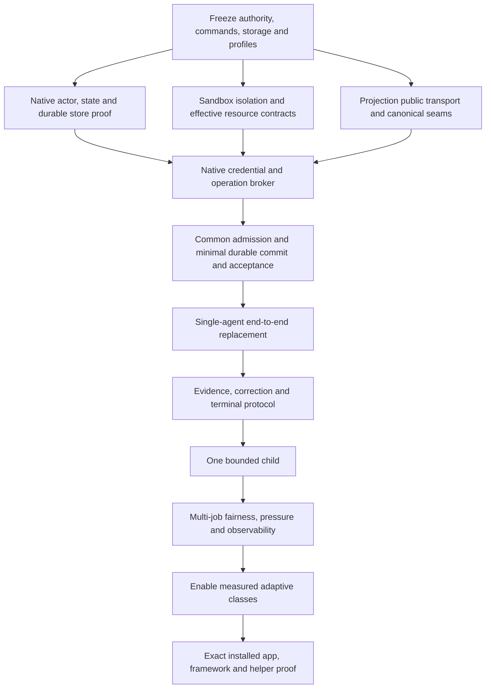

# Implementation delivery plan

Status: active implementation plan, 2026-10-30. Implements the [Rust-first design](IMPLEMENTATION-DESIGN.md) through clean vertical replacements. User direction establishes language/ownership preference and root correction; each dependency, security proof and original task outcome still needs its own gate. The native actor/store starts on macOS and Linux with a metadata-only empty capacity profile. Private protocol v2 carries health, candidate commits and revisioned canonical host-session operations. Desktop chat snapshots now have one native persistence writer, trusted UI admission and explicit non-destructive import; browser development retains its filesystem backend. Candidate commits still have no public recovery/publication path and no product task invokes them. Windows actor startup remains disabled pending durable directory-sync implementation and proof. I1 remains incomplete and no delivery slice has passed its full exit conditions; current limits and evidence are in [implementation progress](IMPLEMENTATION-PROGRESS.md).

The [source-audited storage](DATA-AND-STORAGE.md) and [information architecture](INFORMATION-ARCHITECTURE.md) contracts are in scope. Implement native project/workspace/binding identities with I1/I2, then the single navigation owner, Work/Scheduled distinction and safe storage actions with I3. UI claims cannot precede their underlying authority/storage mechanism.

## 1. Dependency order

Independent repository proofs may proceed separately, but do not enable a downstream slice until its authority/isolation prerequisites pass. No extra agents are required to execute this plan.

## 2. Concrete slices and exit conditions

| Slice | Change | Remove at enabled cutover | Exit evidence |
| --- | --- | --- | --- |
| I0: frozen design | Confirm command schemas, trust topology, actual resource domains, snapshot/platform semantics, native HTTPS dependency decision and workload profiles | Ambiguous duplicate ownership proposals | AR-01–AR-09 decisions; exact API-gap records and frozen tests |
| I1: native control core | `control/state`, actor, bounded channels, root aggregate, native store, reservations, queue/deadline/cancel transitions | No new TS authority added | Deterministic state/fault/race tests; no model or network needed |
| I2: containment and mediation | Native configured credentials/egress/approval dispatch, registered provider payload contracts, sandbox isolation and persistent integration transport; common capacity admission for every workload that will remain enabled | Desktop direct secret reads, worker network fallback, request-supplied endpoint exceptions, duplicated policy mirror and independent host-level pool admission | Compromised-worker canaries; model/output/hosted-tool payload tampering, redirects, revocation, malformed protocol and quotas/cleanup tests |
| I3: single-agent task path | Native task/registry endpoints and scheduler; confined framework/canonical adapters; durable canonical commit/ack/publication plus existing mandatory acceptance, user review and terminal fencing before enablement | TS task/registry journal, reservations/pump/approval authority; old route mutations and unguarded canonical persistence | Existing tasks, folder bindings, approvals, navigation, restart, files/outputs and multiple-surface outcomes; canonical commit/finalization races and lost acknowledgements |
| I4: extended evidence and stopping | Additional registered isolated checks, general evidence/drift checkpoints, bounded diagnosis and richer recovery workflows | Ad hoc repair/worker claims as substitutes for checks | Unknown/fail/stale checks block completion; original source/value/interaction/output outcomes; this extends rather than first establishes I3's mandatory completion guards |
| I5: one child | Native child/attempt identities, scoped channels, root-wide budgets, yield/join/cancel | Any ad hoc spawn/independent child budget shortcut | Smallest actual primary-local child contract, then original independent outcome checks |
| I6: many jobs | Prove/tune the already required shared capacity, fair queues, resident-service leases, pressure state and bounded telemetry across all enabled classes | Any remaining bypass or misleading hard-cap claim | Saturation/noisy-root/shared-provider/disk/telemetry/restart tests; measured profile and detector/benefit thresholds |
| I7: bounded enablement | Adaptive policy only for classes with demonstrated value | Blanket multi-agent default or child-count progress measures | Comparable single-agent/tools/serial/parallel trials; real quality/latency benefit and total overhead |
| I8: delivery | Build/pin/package exact reviewed revisions and native helpers | Stale packaged binary or unproved fallback | RELEASING contract, actual installed WebKit/canaries, preserved failed outcomes |

Keep single-agent work usable before enabling children. Required mediated/isolation paths refuse unsupported execution until I2 is proved; do not advertise protection during an intermediate source refactor.

The first enabled cutover must include common capacity admission for every simultaneously enabled chat/task/app/integration path and minimal durable canonical commit, existing acceptance/review and terminal fencing. If a path cannot participate, keep that capability explicitly disabled until it can; do not temporarily leave its old privileged implementation running. I4 adds richer drift/evidence behavior and I6 measures/tunes scale; they do not postpone invariants needed by I3 or I5.

## 3. File-level change order

1. Add native `control/` pure domain/command/store proof with temporary fixtures; wire only explicit test harness entry points initially.
2. Prove native HTTP/TLS/credential dispatch and sandbox channels using synthetic endpoints/secrets; do not route through broad UI commands.
3. Wire the already-exported Projection `ProviderTransport` API (`65f183c`) into app provider construction through the native broker protocol. Use Projection's `VakHost.commitCandidate` callback and revisioned `HostSessionStore` API (pinned at `822622e`) for isolated candidate handoff and one canonical persistence owner; implement app-owned native fencing, publication, durable receipts and recovery. Never edit the app's `framework/` submodule.
4. Split the existing sidecar composition into reasoning and protected canonical/checker adapters using public APIs. Do not copy internal framework session code.
5. Replace authoritative `Tasks` and `WorkspaceRegistry` behavior and their mutation routes with the native control client in one enabled implementation state. Update task/workspace contracts, project membership and typed UI navigation together; remove stale formats/aliases rather than keep runtime shims. Preserve direct/copy/shared modes and existing source/Realm ownership.
6. Route app/integration/provider capacity through native leases; remove independent host-level counters from TS pools while retaining their domain invocation code.
7. Route FinOps observations from attributed native/provider receipts; preserve unknown cost and existing numeric writer, view and CSV behavior.
8. Run the smallest primary-provider contract and original task outcome before widening workflows. Do not write prompt variants to compensate for a failed boundary.

Each slice updates [implementation status](../IMPLEMENTATION-STATUS.md), [handover](../HANDOVER.md) and [evaluation](../EVALUATION.md) with source revision, exact scope, retained failures and installed-state distinction.

## 4. Tests and performance proof

Native unit tests cover pure transitions, authority intersections, root/global reservation races, cancellation/dispatch ordering, dependency readiness, replay identity, deadline policy, evidence invalidation and recovery. Persistence tests kill the process around flush/selection/finalization boundaries and check durable acknowledgement semantics on each supported filesystem/platform.

Cross-process tests use a deliberately hostile worker that attempts outside reads/writes, secret retrieval, direct network/process control, sibling/verifier impersonation, oversized frames and receipt forgery. Refusal must occur before forbidden effects. Real native resource workloads establish effective quotas; telemetry alone cannot pass them.

Framework tests cover public execution/canonical seams and existing semantic/interaction behavior in its owning repo. App tests cover native-client commands, multiple surfaces, local controls, drafts/conflicts, retention/deletion, save retry, voice approvals and task continuation. Run actual wide/narrow WebKit, not only a different browser engine.

Measure control latency, queue fairness, snapshot write amplification, native/worker message counts/bytes, resource residency and trace overhead independently of provider latency. Freeze regression budgets before comparison. No hard scale claim until the named hardware/profile passes; no automatic quota increase after failure.

## 5. Data cutover and stop conditions

Stop running jobs/channels deliberately before changing their runtime owner; never restart a channel while the user is mid-test without saying so. Back up private local data without printing secrets. If existing records need conversion, use one explicit offline converter with dry-run validation and a complete receipt; retire it from runtime once cutover is verified. Do not migrate by running two live writers.

Stop a slice if required enforcement, native transport, durable storage or the canonical public seam cannot meet its contract. Record the concrete dependency/design decision rather than retain an insecure fallback. A safe stop is mechanism evidence; it does not complete the user's original task. Paid inference, a new dependency, installation or public release retains its existing approval requirement.
