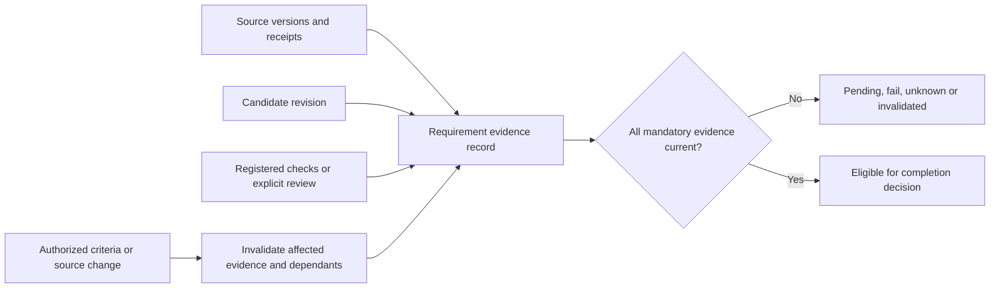
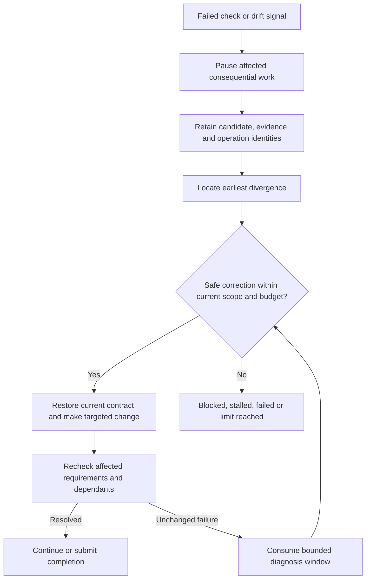
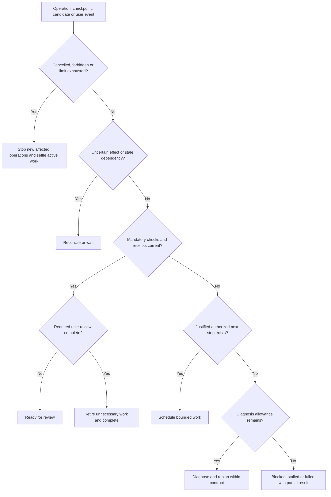

# Drift, evidence, correction and stopping

Status: proposed, 2026-10-29. Applies equally to one agent and every descendant. See [runtime contracts](DELEGATION-AND-CONTRACTS.md) and [validation](VALIDATION-AND-ROLLOUT.md).

## 1. Establish the reference before measuring drift

The trusted task contract records the user goal, deliverables, constraints, exclusions, sources, authority, acceptance methods and limits. Every revision retains its predecessor and reason. The agent may change its plan inside that contract; only an admitted user/workflow change may change acceptance conditions or scope.

Natural-language goals are not automatically executable specifications. Known typed requirements use registered checks. Open interpretation remains explicitly assessed or unknown. A generated requirement decomposition is a proposal until validated against the original request; it cannot silently omit inconvenient requirements.

Freeze outcome checks before evaluation. A failed run cannot relax checks, edit expected values or replace missing evidence with a label to obtain a pass. Legitimate user changes create a new revision and retain the failed evidence. A suspected checker defect is investigated independently; any corrected checker creates a separately labelled evaluation, not a retroactive erase.

## 2. Evidence model

Each requirement has an identity, original source, mandatory/optional status, verification method, current candidate/input revisions, evidence references and a state: `pending`, `pass`, `fail`, `unknown` or `invalidated`. Optional work cannot become mandatory merely because an agent proposed it. Mandatory work cannot disappear through summarization.

| Evidence kind | What it establishes | What it does not establish |
| --- | --- | --- |
| Captured source with hash/version and retrieval receipt | Identity and time of observed bytes | That the source is true, complete or correctly interpreted |
| Registered calculation/check receipt | Result for named inputs, checker version and scope | Correctness of unrelated prose or a modified checker |
| External operation receipt plus relevant read-back | Observed effect under that service's documented semantics | Exactly-once effects across arbitrary services |
| Canonical candidate and interaction checks | Shape, bindings and tested actions for that version | General source truth or user value |
| Output hash/size/version receipt | Saved bytes match the requested candidate representation | That its contents are correct |
| Explicit user review | Named person accepted the current evidence/candidate | Automatic or universal correctness |

An agent's `pass` flag is a claim, not an accepted check result. Trusted control accepts results only from the registered check/review path bound to invocation and candidate. Protect checker definitions/expected fixtures from candidate edits. A dedicated check execution has a separate identity and restricted inputs; its channels/state must also be inaccessible to compromised authoring workers, not merely differently named inside the same process. Arbitrary child stdout cannot impersonate it. Semantic checks may remain probabilistic and must disclose that limitation.

Invalidation follows explicit dependency references: source → derived claim → candidate → output/review. Preserve old evidence as historical. A candidate changing after review cannot inherit that review. Invalidation may reduce observed progress; do not force a monotonically increasing percentage.

## 3. Detect divergence at observable boundaries

| Drift | Signal | Confidence and action |
| --- | --- | --- |
| Authority | Wrong resource, endpoint, tool, expired grant or revoked ancestor | Deterministic refusal before dispatch; containment/integrity failures stop affected execution |
| Contract/state | Old task revision, input hash, source freshness or conflicting candidate | Reject stale commit; invalidate dependants and reacquire current inputs |
| Evidence | Missing receipt, unsupported scalar, failed calculation or claim/source mismatch | Deterministic where typed; semantic interpretation otherwise needs calibrated assessment/review |
| Scope | Unrelated work, missing deliverable or scope expansion | Relevance warning; bounded reassessment, not a universal keyword rule |
| Coordination | Same resource edited concurrently, contradictory assumptions or child output unused | Detect explicit conflicts; assess semantic redundancy separately |
| Progress | Same failing check/action with unchanged relevant inputs, or repeated plan churn | Watchdog signal; diagnose before concluding the work is stalled |
| Completion | Success declared with mandatory failures, unknowns or stale evidence | Refuse successful completion |

Evaluate before consequential operations, after tool/source results, on candidate submission, on contract changes, at bounded progress checkpoints and before completion. Avoid another model call after every token or tool event. Cheap deterministic checks run first; selected semantic checks consume the same root allowance.

No universal drift score is claimed. An action's requirement ID provides traceability, not proof of relevance. New messages, queries, tokens, children and claimed confidence are not independent progress evidence. Useful exploration can eliminate a hypothesis, establish a limitation or resolve ambiguity before producing an artifact.

## 4. Bounded correction

Correction restores current requirements and verified facts, narrows stale context, fixes the owning mechanism, or changes the plan within existing authority. It does not patch factual values in the renderer, accumulate prompt/parser variants, silently broaden permissions, or automatically add agents. General output-protocol defects belong in Projection after locating the missing public capability.

A proposed starting watchdog is two consecutive diagnostic checkpoints with no new relevant evidence or changed failure cause before one bounded replan. This is a tuning proposal, not a universal proof of stagnation. Checkpoint cadence, replan allowance and exemptions for known long operations must be frozen per task class. All corrective work consumes the existing root limits; restart does not reset the window. One unchanged attempt may be enough to stop when the earliest boundary is already diagnosed and another retry has no justified new information.

Preserve an accepted checkpoint where possible, but do not claim local rollback undoes a remote effect. Under the initial conservative policy, uncertain dispatch pauses all new ordinary automatic operations in the root and its descendants. Late receipt ingestion, containment cleanup and an explicitly authorized reconciliation path remain available. An untrusted dependency graph omitting an edge is not proof of independence. Narrower branch continuation is a later policy requiring trusted effect/read-write dependency proof; it is not assumed safe by this proposal.

## 5. Stopping controller

Execution ending, a child returning, a surface rendering and a model saying done are not completion predicates. Successful root completion requires all mandatory evidence in the current contract to pass its designated acceptance path, required output receipts, any designated review, and no relevant uncertain or still-active operation. Fail/unknown/invalidated mandatory evidence prevents verified completion.

Completion across native control, canonical content and receipt owners needs an explicit linearization protocol, not just one writer per entity. The proposal is a short finalization fence: trusted control records intent; the canonical owner returns an immutable snapshot/version vector and fences affected canonical commits; trusted control checks matching contract/evidence/output/review versions and compare-and-sets the terminal record; owners then release the fence. Mutable acceptance, review and invalidation state resides in that native task-control aggregate and participates in the same compare-and-set. Receipts are immutable identities; correction/supersession creates a new identity and native invalidation, never an in-place update racing outside the aggregate. Any additional mutable owner must join the ordered fence/version protocol before its state may authorize completion.

Do expensive checks before acquiring the short fence and revalidate their version vector within it. No cached permission or `current` flag substitutes for this handshake. If any version changed, abandon finalization and recheck; do not call stale evidence current. A crash leaves a recoverable finalization intent, and the canonical owner cannot silently expire a fence and accept writes until trusted recovery resolves the attempt. The exact public API, ordered fence acquisition, persistence and recovery need AR-02/03/05 proof. A separately proved immutable-snapshot protocol may replace this proposal, but must preserve the same ordering guarantees. Later canonical user actions become explicit continuations; UI drafts/local view changes do not take this fence. External source/service truth remains a dated observation, not a globally locked transaction; completion discloses that freshness scope.

Optional branches cannot hold the task open indefinitely. Once mandatory work is accepted, cancel unnecessary branches, revoke their dispatch/commit authority and settle or record in-flight effects before terminal completion. Cancellation does not erase an already submitted remote operation.

| Stop reason | Meaning and retained behavior |
| --- | --- |
| `ready_for_review` | Machine conditions satisfied to their stated scope; designated judgment still pending |
| `completed` | Current acceptance policy satisfied, with method and evidence attached |
| `blocked` | Necessary input, permission, source or capability unavailable; identify the unblock condition |
| `stalled` | Bounded diagnosis found no justified useful next step |
| `limit_reached` | Finite execution allowance exhausted; retain partial work and failed requirements |
| `failed` | Requirements cannot be met under the current contract |
| `cancelled` | Admission revoked by user/policy; cleanup and uncertain effects reported separately |
| `interrupted` | Unexpected execution loss; continuation needs recovery checks |

These are proposed reason codes, not a claim that every code is an existing `TaskState`. Map them deliberately onto the task aggregate before implementation. Uncertain effects are an explicit operation state, not a successful stop reason.

The active task adapter now preserves the framework's explicit `max_steps` / `limit: steps` result as `step_budget_exhausted`, separately from provider request, tool-call and active-time limits. The 2026-10-26 selected-file report evaluations reached that step limit three times without passing independent-surface or exact-value checks or producing a verified output receipt. A budget stop must retain partial canonical state and failed evidence, must not mint a saved-output receipt or mark the task complete, and must not automatically replay. A continuation is a new user-admitted attempt under the remaining root-wide allowance. The current TypeScript journal implements only the typed stop and no-auto-retry portion; native authority, root-wide budget enforcement and durable candidate/evidence recovery remain open.

For open-ended research, define coverage, source bounds, freshness and budget up front. There is no generally provable endpoint for “find everything.” Disclose bounded coverage; absence of more results is not evidence of exhaustive knowledge. Waiting for a person uses its separate expiry policy, not active compute time.

## 6. Single-agent and delegated consistency

A single agent uses the same contract, evidence and stop controller without child records. A child succeeds only for its assignment; the parent must still integrate/check the root result. Root changes propagate invalidation to affected children; root cancellation fences all descendants. A parent need not remain running to enforce those rules.

Service regression over many tasks is distinct from drift inside one task. Monitor outcome success, false completion, detector false alarms/missed drift, cost and latency by runtime/provider/skill version. A regression may disable adaptive delegation for an affected class; it must not change the current task's frozen acceptance criteria.
