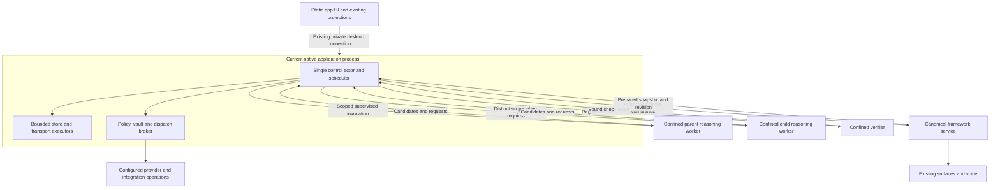
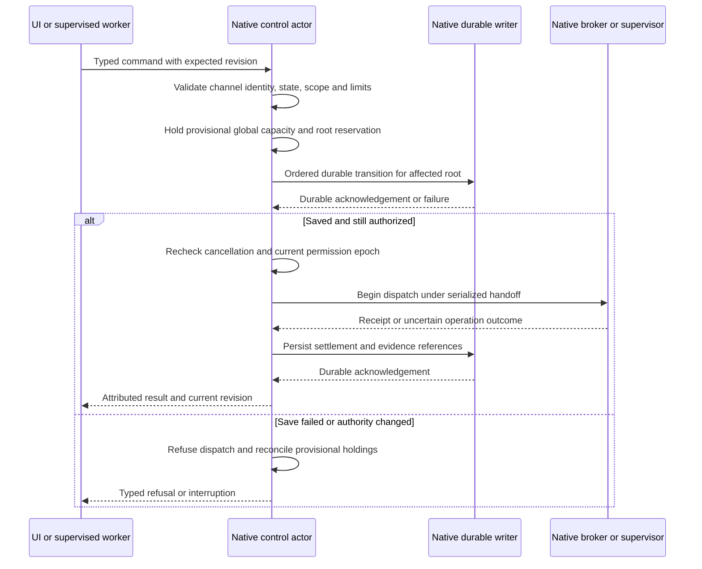
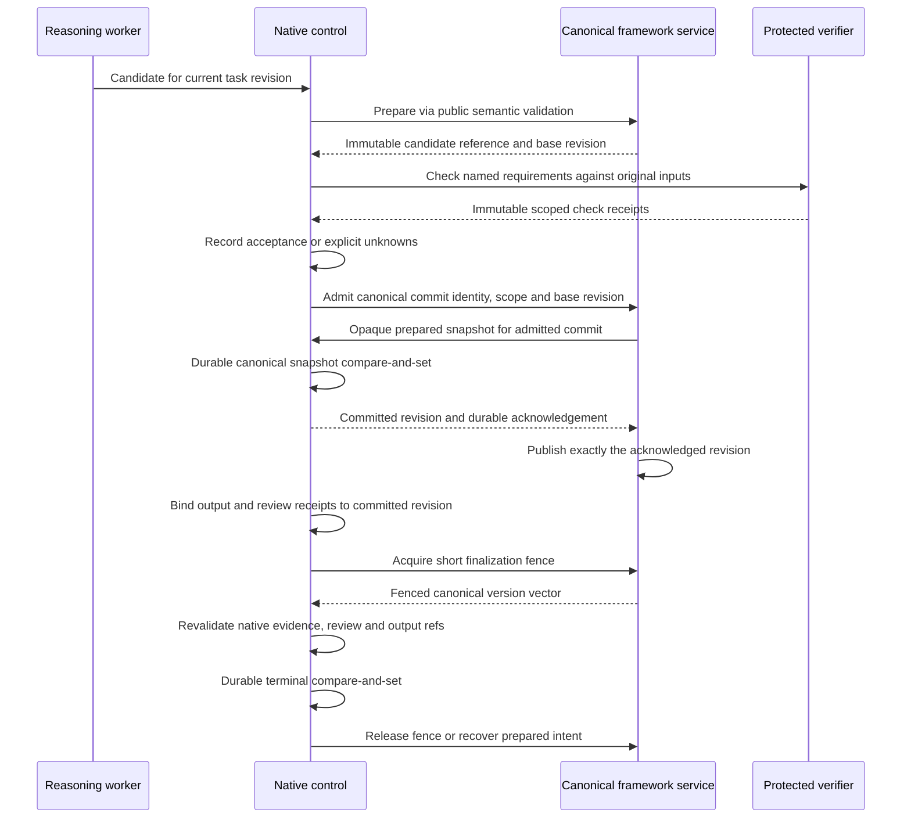

# Rust-first implementation design

Current launch checkpoint (2026-10-30): both desktop modes now use the reviewed helper with a bundled Node 26 runtime, private descriptor 3, read-only runtime resources and one `<app-data>/worker/` write grant. Native stores and credentials are outside the filesystem grants; desktop secret updates route only through Rust and the worker receives no environment files. Direct filesystem/network denial canaries pass on macOS/Linux, with a native WebKit smoke for the actual desktop. Canonical/reasoning adapters remain in the same process, the admitted-session API still returns canonical bytes to it, and workspace product control remains TypeScript. Desktop task definitions and revisioned metadata controls now use Rust; task execution/scheduling remains unavailable, and the sidecar no longer opens its task journal/pump. Provider dispatch stays refused. This supersedes earlier uncontained-launch descriptions below without closing the full authority/isolation gates.

Native approval checkpoint (2026-10-30): immutable local-model policy, ephemeral exact-byte tickets and durable request-budget/provider-lease/operation handoff now live inside the control actor. Pending approvals vanish on restart; committed dispatch holds remain uncertain until exact native I/O settlement. The returned native object is move-only and never serialized. Trusted approval UI and actual network dispatch/cancellation are still absent, so product provider routes remain refused. Current native schema is 15. [Evidence and limits](IMPLEMENTATION-PROGRESS.md#native-provider-approval-and-durable-budget-handoff--2026-10-30).

Contained reasoning checkpoint (2026-10-30): the native launcher selects a separate task reasoning entry with a fresh per-run scratch grant and no app-service environment capabilities. A native channel validator binds its run/session/model, rejects authority command families and replay, and returns opaque candidate proposals only. Packaged execution is proved in native harnesses; product Work dispatch and provider approval/dispatch remain disabled. The canonical service and ordinary app reasoning still share the existing app sidecar; operation-scoped canonical role isolation/publication remains open. [Evidence and topology](IMPLEMENTATION-PROGRESS.md#separate-contained-reasoning-entry-and-bound-task-channel--2026-10-30).

Native execution-lifetime checkpoint (2026-10-30): the control actor derives protected run completion bindings and settles exact verified helper records atomically with capacity release. Real contained Node cancellation/restart/settlement passes on macOS/Linux with helper `79433e2` / contract 4. Worker output never provides settlement authority. The actor still lacks a product task dispatcher and per-task role isolation; broker traffic remains refused. See [current proof and boundaries](IMPLEMENTATION-PROGRESS.md#protected-worker-cleanup-and-native-settlement--2026-10-30).

Status: detailed proposal, active implementation 2026-10-29. The user selected Rust for durable authority and system control, TypeScript for runtime-flexible model/presentation work, and root corrections without legacy compatibility layers. A blocking native HTTP/TLS client with streaming support has been explicitly approved at an exact version with default features disabled. Its existence does not certify a broker or make it safe to enable before endpoint, credential, approval, payload and streaming controls are implemented. Read with [root corrections](ROOT-CORRECTIONS.md), [delivery plan](DELIVERY-PLAN.md) and the [architecture](ARCHITECTURE.md).

## 1. Language and ownership rule

Choose Rust when code owns authority, durable execution state, admission, resource allocation, scheduling, operation identity, cancellation, process lifetime or recovery. These invariants must survive compromise of model-processing code. Choose TypeScript when code interprets a model/provider response, composes skills, prepares candidates, uses the framework's semantic APIs or projects existing canonical content. Do not move the framework's component schema, reasoning engine or renderer into a parallel Rust implementation.

| Responsibility | Implementation owner | Boundary |
| --- | --- | --- |
| Task/run/child/attempt state machine and root revisions | Rust control actor | TS proposes commands; Rust validates/transitions/persists |
| Execution scheduling, fair queues, deadlines and global capacity | Rust scheduler inside that actor | TS declares requested work/dependencies, never grants slots |
| Permissions, exact approvals, provider selection and endpoint configuration | Rust policy and broker | No authority derived from worker/UI request labels |
| Credentials and external dispatch | Rust vault and mediated dispatch | Workers never retrieve stored secrets or call direct network APIs |
| Resource/process containment | Sandbox project, supervised by Rust app control | Native app consumes actual capabilities and cleanup receipts |
| Requirement acceptance/invalidation and terminal decision | Rust task aggregate | Registered checks and admitted user review submit evidence |
| Semantic interpretation, decomposition and plan suggestions | TS reasoning worker using public framework APIs | Bounded inputs, candidates and operation requests only |
| Canonical session/surface semantics | Existing framework owner in a separate confined service | Sole semantic mutation/version owner; no duplicated surface implementation |
| Canonical content persistence I/O | Native protected persistence writer via a public injected framework adapter | Fixed entity namespaces, opaque bounded snapshots, expected revisions; no service/worker arbitrary path writes |
| Trusted verification adapters | Dedicated confined checker/service, registered by Rust | Inaccessible to authoring workers; no arbitrary pass messages |
| Canvas, drafts, local controls, speech projections | Existing TS UI/framework paths | Same canonical data; local interactions remain local |
| Numeric FinOps analysis and view | Existing TS FinOps owner | Observes native/request receipts; does not authorize spend |

The trusted Rust actor owns the scheduler, not merely a permission checker around a TS scheduler. The TS coordinator is a semantic planner/adapter. It cannot mint a child, choose its effective scope, write task-control files or restart an exhausted task.

## 2. Concrete module map

Proposed paths are not existing source files or APIs. Start as modules in the current native library, not a new service or crate workspace.

```text
src-tauri/src/
  lib.rs                 shell registration and application lifetime
  engine.rs              existing supervised private transport
  policy.rs              canonical authority/endpoint decisions
  vault.rs               stored secret operations, internal reads only
  control/
    mod.rs               ControlHandle and single state-owning actor
    command.rs           versioned commands, responses and strict validation
    state.rs             root/run/child/attempt/operation records and transitions
    registry.rs          project membership, identified workspaces and bindings
    folder.rs            platform folder identity and dispatch-time validation
    scheduler.rs         fair ready queues, deadlines and dependency readiness
    capacity.rs          actual resource domains, provisional/active leases
    store.rs             sole native control persistence and recovery
    admission.rs         policy/budget/cancellation checks before effects
    broker.rs            configured provider/tool operation mediation
    evidence.rs          registered check receipts, invalidation, acceptance
    finalize.rs          version-vector fence and terminal compare-and-set
    recovery.rs          interruption, uncertainty and authorized reconciliation
    events.rs            durable event identity and bounded projection feed
    metrics.rs           bounded numeric counters, no raw prompt logging
sidecar/
  control-client.ts      narrow typed client; no authoritative task copy
  reasoning-worker.ts    confined framework reasoning adapter
  canonical-service.ts   confined framework session/surface owner adapter
  verifier-worker.ts     registered isolated checker adapter
```

Prefer fewer modules initially if the implementation remains small; the table assigns responsibilities, not a file-count goal. Keep the existing single native library and approved dependencies. No second native relay, public port or background daemon is introduced.

The current `src-tauri/src/control.rs` implements a single-threaded actor with a capacity ledger, bounded generation snapshot store, revision-fenced root-task aggregate and a separated project/workspace/binding/membership registry. Workspace-scoped root creation resolves and persists the exact admitted workspace grant, including physical folder identity and revision, and binds that root to its session. Root start rechecks that exact grant; rebind/revoke invalidates queued children and releases their queue leases in the same persisted candidate. Stale roots cannot admit children, record checks or enter review/acceptance; an explicit stop remains permitted. A durable cancellation epoch advances across attempt start, yield, stop, contract revision, restart recovery and workspace change. `check_execution_fence` detects stale state snapshots, but is not a single-use operation permit and cannot close the race with a later broker dispatch. Its command queue and request/reply waits are bounded. It persists candidate reservation/release and task transitions before acknowledging, recovers active holds and validated root records while rejecting selected-generation corruption/profile drift, retains only the selected generation after commit, and acquires an OS-managed exclusive writer lock for the store lifetime. Since 2026-10-30, Tauri starts and owns this actor on macOS/Linux with an empty execution profile; Windows startup remains disabled until directory-sync durability is implemented and verified. Desktop protocol v2 now carries health and candidate-commit operations over the private pipes. A candidate commit validates root/session/workspace fences and expected canonical revision, stores an immutable bounded generation, persists its digest/receipt before acknowledging, and recovers exact retries; format schema 15 rejects earlier snapshots. The root aggregate stores child-attempt and atomic queue-to-execution lease transitions, retains result references for later verification, and marks attempts interrupted on restart without releasing uncertain execution charges. The provider broker now resides under the private control module, and its permit/client types are visible only within that boundary; credential lookup/auth headers, DNS/IP pinning, payload checks and bounded streaming are implemented but remain inactive. No task path invokes the candidate API, its snapshot is not published into framework sessions, and receipts cannot be recovered through the UI. Desktop task metadata/control now uses Rust and no TS journal/pump is opened there; native task execution is unavailable. TypeScript workspace services remain product writers. Trusted worker supervision, scoped channels, parent result verification/acceptance, worker-side single-use fence consumption, atomic broker handoff, active-worker interruption receipts, fair queues, operation-level dispatch authorization, filesystem check/use safety and product task authority remain open. Separate-process crash behavior, Windows/network-filesystem durability proof and common capacity coverage remain open.

## 3. Process and trust-domain topology



These are trust domains, not one permanent process per saved job. Launch/park workers under global capacity. Sharing a process is allowed only for the same trust domain without required authority/confidentiality separation; do not claim private child/checker authority inside a shared compromised Node process. Per-worker pipe handles, mounts and invocation grants must be inaccessible to other domains.

Keep native control alive while windows are hidden. The desktop shell may exit only after native admission is fenced and contained workers are settled or their uncertainty retained. Development browser execution must use the proved control path or explicitly refuse protected work; a TS-only fallback is not an equivalent runtime.

## 4. Native actor and transition algorithm

One state-owning actor receives bounded commands from UI control, worker channels, timers, storage acknowledgements and supervisor events. Use existing standard-library bounded channels and threads, with fixed/bounded I/O executors. Do not create a thread per event, hold a global mutex across a provider call, or perform unbounded disk/network work on the UI or control thread.

The actor owns root records, dependency indexes, capacity domains and ready queues. Pure transition functions validate a command against current state and produce a proposed state delta, required durable write and bounded side-effect intent. Workers report outcomes, not authoritative transitions.



Affected roots remain transition-locked while their durable update is pending. Provisional global reservations count against capacity immediately, preventing another root from overcommitting while disk I/O is in progress. No dispatch grant/ack is released before required persistence succeeds. Cancellation can fence new dispatch immediately in memory, but user acknowledgement waits for the durable cancellation record; per-root write ordering preserves earlier intents. Save failure stops affected effects and triggers the documented failure policy.

Dispatch-start and cancellation serialize in native control. A queued start token is not later reusable authority. The transport executor cannot begin a previously queued request without the final native handoff check. External operations started earlier remain potentially in flight.

## 5. Authoritative data and persistence

The root control aggregate contains: goal/requirement revisions, policy references, run/child/attempt identities, cumulative usage reservations, operation states, current acceptance/invalidation/review, cancellation epoch, finalization intent and stop reason. Content, large tool results, transcripts and canonical surfaces remain with their established owners; control stores bounded immutable references and versions.

Use the existing small-file/snapshot approach for an initial bounded control store, implemented by one Rust writer rather than a parallel TS writer. Proposed layout:

```text
<private-data>/control/
  format.json                    supported format and store identity
  roots/<native-id>/              bounded authoritative control aggregate
    generations/<sequence>.json  complete immutable candidate generation
    current                      atomic selected generation identity
  recovery/                      bounded native recovery/finalization records
```

The writer validates internal identities, never accepts a worker path, creates a new complete generation exclusively, flushes it, atomically selects it using a proved platform replacement primitive, and flushes directory metadata where required/supported before acknowledging. Previous committed generation remains until safe cleanup. No side effect is released from a generation merely because its temporary file exists. Corruption or an ambiguous committed pointer fails closed; no silent counter reset or speculative repair.

This is a bounded snapshot proposal, not a new general database, retrieval store or custom append-log engine. Before adopting it, prove crash/durability semantics on each supported platform and benchmark write amplification at the supported job count. No generic cross-platform rename assumption is sufficient. If the profile cannot meet atomicity/durability/latency requirements, choose an established transactional storage dependency through explicit approval; do not grow a bespoke WAL or claim a best-effort write is durable.

Global active capacity is reconstructed from durable admitted/started records and observed supervised processes/services after restart. Unknown live consumption remains held/quarantined until cleanup or reconciliation; it is not free because native memory was lost. Provider/shared-service residency uses its own service identity and actual ownership, not one root's lifetime.

The canonical framework service stays the sole semantic session/surface mutation and version owner. Rust owns durable persistence I/O for its opaque bounded snapshots in a registered content namespace. Pinned Projection exposes both the bounded candidate commit callback and revisioned `HostSessionStore`. Desktop mode uses the latter through the private sidecar pipe and native actor; browser mode retains its filesystem store. The native store enforces trusted UI admission, revision checks, bounded snapshots and fail-closed recovery. Existing desktop sessions are copied only after an explicit first-run confirmation, with an idempotent receipt and source preservation. FinOps reads sessions through the active store. The candidate callback remains unused by product tasks: candidate bytes are not yet published into canonical surfaces, and no recovery UI consumes receipt queries. Do not switch task execution until task fences, publication and recovery share a crash-recoverable protocol with exact output-source receipts. Projection `aa9a6be` adds host session/run correlation metadata; desktop now injects the private native provider transport and Rust validates the bounded identity fields but deliberately refuses every dispatch. The TypeScript default-fetch egress path is removed from desktop mode; no model call currently succeeds through the broker. Native ticket/approval, immutable local-model policy and durable budget/capacity handoff now live inside the actor; product consent UI, actual provider dispatch and native network settlement remain unconnected. Do not treat transport injection as completion of task authority, publication or mediation.

## 6. Narrow protocol and caller identity

Canonical session identity is one-to-many with task-root identity: a chat may have historical or concurrent roots. The native actor may index this relation for bounded lookup, but a provider request's `sessionId`/`runId` must never be mapped to a root by choosing the first, newest, or only-looking root. Native starts now persist capacity-backed root-run bindings and require separate Rust supervisor start/exit settlement; restart retains uncertain charges. These records are not yet bound to product host runs. Before a dispatch path exists, the trusted scheduler must register a native execution binding that names the root and attempt/run identity; every operation must prove that binding is still active and current at the actor's atomic dispatch boundary. Worker-supplied root IDs or run IDs are selectors to validate, never grants. Until that binding and atomic fence consumption exist, provider traffic stays refused.

```mermaid
sequenceDiagram
    participant UI as Trusted UI / scheduler
    participant Actor as Rust control actor
    participant Worker as Reasoning worker
    participant Broker as Native provider broker
    UI->>Actor: Admit root and task session
    Actor-->>UI: Durable root identity and revision
    UI->>Actor: Register bounded execution attempt
    Actor-->>Worker: Confined invocation with bound run context
    Worker->>Broker: Provider operation + run correlation
    Broker->>Actor: Validate binding, fence, policy, approval, budget
    Actor-->>Broker: One-use dispatch authority
    Broker-->>Worker: Bounded provider stream
```

Reuse existing private transport framing/backpressure where it meets the contract. Add a bounded native-owned control channel for worker requests on the same supervised private connection; do not expose a generic `/api/*` dispatcher as worker authority. Existing UI presentation routes can remain adapters but cannot mutate the native task store indirectly through Node.

| Caller | Proposed operation family | Receiver derives/checks |
| --- | --- | --- |
| Trusted user interaction | `task.create`, `task.input`, `task.cancel`, `approval.decide`, `review.accept`, `policy.update` | Real trusted caller/event path, exact target revision, concrete action and scope |
| Reasoning invocation | `delegation.propose`, `operation.request`, `candidate.submit`, `progress.report`, `context.request` | Bound root/attempt/channel, current epoch, limits and capability subset |
| Canonical owner | `candidate.prepared`, `snapshot.fenced`, `commit.settled` | Registered service, admitted candidate, expected revision and fence identity |
| Registered verifier | `check.result` | Protected checker/version, immutable inputs/candidate and allowed check kind |
| Supervisor/transport | `worker.exited`, `dispatch.settled`, `cleanup.settled` | Native-observed process/operation identity; workers cannot fabricate this event family |

Envelope: `version`, `requestId`, `expectedRevision`, `operation`, bounded `payload`; response adds native-resolved root/attempt identity, current revision, outcome/reason and event cursor. Worker-supplied IDs only select already authorized resources and are cross-checked against its bound endpoint. No bearer token containing broad authority is inserted in prompts, arguments or transcripts.

Use `serde` typed decoding with explicit size/count/path constraints, reject unknown operation variants and fields where appropriate, and distinguish absent from null/error. Separate control metadata from bounded bulk chunks; avoid embedding large assets into every lifecycle update. Existing desktop limits are a baseline to measure, not automatically the correct worker/control profile.

Native UI origin checks are necessary but not consent. Approval/review commands require the trusted app interaction path and exact pending operation; generated surfaces cannot invoke the decision family. For an operation awaiting approval, the native actor holds the exact normalized bounded request bytes in memory under one opaque ticket. A domain-separated SHA-256 fingerprint binds those bytes, the disclosure and task fence; the digest is an identity check, never authorization or a substitute for the retained bytes. The trusted UI sees the provider, model, operation, destination, limits and bounded input preview; allow-once approves only that ticket. On approval the actor rechecks the task/workspace fence, durably charges and records the operation identity before handing those same buffered bytes to the broker. Pending tickets are never persisted; a restart discards them and the running root recovers interrupted, requiring a fresh request and approval. The final trusted approval surface/mechanism must be isolated from generated content and proved under AR-07; no new unapproved UI plugin is assumed.

Every filesystem-related root/run captures the fixed native execution grant defined in DATA-AND-STORAGE: binding/revision, workspace physical identity, path scope, mode and Realm/sharing revision. Scheduler entries and child grants reference it, not the session's mutable latest binding. Rebinding invalidates all affected pending/scheduled/active descendants; dispatch refuses stale grants and retargeting requires an explicit contract amendment/continuation.

## 7. Provider, integration and credential mediation

Rust stores selected non-secret provider/endpoint configuration and approved exceptions. A worker names a configured operation; it cannot supply host exceptions, credential names, arbitrary headers, redirect permissions or an unrestricted URL. Native dispatch inserts credentials only for that operation's authorized destination and removes them from returned errors/logs/receipts.

TS retains existing provider request/response formatting and streaming semantics through Projection's exported provider-aware `ProviderTransport` injection, present in the pinned source at `65f183c`. The app must pass this transport to provider construction and bridge it over a typed, bounded, cancellable private protocol; it currently passes no transport, so providers use global `fetch`. Each supported adapter has a registered versioned native operation contract. Native derives or revalidates the configured model, operation kind, paid/local policy, request/output allowances, allowed feature set, provider-hosted tools/remote autonomy, route/method and policy-critical payload fields. A compromised TS formatter cannot change model, raise max output, enable an embedded tool or select another service operation inside an approved hostname. Prefer native construction of these critical fields; otherwise reject any mismatch/unknown authority-bearing field against the registered adapter contract. Unsupported adapters/features refuse before dispatch. This is bounded provider authorization, not a second reasoning loop or blanket claim of a monetary ceiling.

A generic fetch callback must not become a credential-bearing arbitrary-fetch tunnel. Responses are bounded untrusted data; streamed backpressure and cancellation propagate both ways. Provider operation IDs from the pinned `ProviderTransportContext` remain stable across adapter retries; native accepts one dispatch for an operation ID and refuses a later attempt/replay, including after an uncertain transport result. The adapter-version matrix and negative payload tests are prerequisites, separate from approving the native HTTP/TLS transport.

The app has adopted the user-approved exact `reqwest = 0.13.5` dependency with `blocking`, `stream` and `rustls` features, with default features disabled. Its source metadata, lock checksums and active dependency tree were reviewed; the selected Rustls path includes `aws-lc-sys` native compilation and a platform trust verifier. The exact user-approved `sha2 = 0.11.1` dependency is also pinned with default features disabled for a domain-separated request fingerprint used by one-use approvals. Its active graph is pure Rust; manifests declare no crate build scripts, while the already present `libc` dependency has a target build script. The inactive broker now has constrained fixed routes, DNS/IP pinning, redirect/proxy refusal, exact payload checks, bounded streaming, provider-to-vault credential lookup and provider authentication headers. Its API is restricted to the private control module. This still does not provide product mediation: approval-ticket actor integration and trusted UI, task-fence consumption, cancellation, durable redacted receipts, bounded workers and a typed sidecar operation remain open. Do not invent TLS/authentication, rely on an undeclared transitive crate, invoke an arbitrary shell client, or retain direct secret-bearing TS fetch as a fallback. Required mediated providers remain unavailable until the complete control handoff is implemented and verified.

Keep the existing MCP catalog/install/configure/tool lifecycle. General transport/supervision hooks belong in Projection; the native app decides current authority/capacity and supervises contained launch. Local server environments retain only declared variables. Any tool credential that must be visible to a server is scoped to that separately confined server, not the reasoning worker. Do not assume a persistent stdio server works through a one-shot helper that closes stdin.

## 8. Canonical commit and completion



Preparation does not change canonical visibility. A commit is admitted with its own idempotency identity, expected canonical base revision, task/permission epoch and exact write scope. The registered semantic owner validates and supplies that prepared snapshot; native persists it through an opaque snapshot compare-and-set and acknowledges its committed revision only after durability. The canonical service publishes that exact revision only after acknowledgement. Repeating the commit identity returns its recorded result; mismatched reuse is refused. If acknowledgement/publication is lost, recovery loads the committed snapshot and republishes by revision without rerunning model or external operations. Failed/stale commits publish nothing. This path serves progressive valid updates as well as final candidates; it does not force all chat work into one final surface.

Projection commit `946ee39` adds the narrower `VakHost.runCandidate` primitive: explicit snapshots in, no inherited chat history/default tools, transactional submission into an isolated store, and base versions plus candidate snapshots out. Commit `6fd13f3` adds a bounded, one-use `candidateId`; `6d81a23` adds explicit expected canonical revision to the `commitCandidate` handoff; `822622e` adds the optional revisioned `HostSessionStore` persistence contract. Candidate commit submits the host-retained unchanged candidate with base versions and a task fence to the app owner. Callback retries preserve one commit identity, canonical revision and fence after an ambiguous failure; success consumes the candidate. The framework persists or publishes nothing for candidate commits. Candidate references are in-memory and lost on restart; durable receipt lookup and native interrupted-commit recovery remain mandatory app work. Vakyartha must not bypass native admission or merge candidates directly into canonical sessions.

Finalization, exported bytes and designated review refer to the committed candidate revision and its source/check identity, never just a prepared candidate or old base. No authoring worker can publish task completion. Mutable acceptance/review/invalidation is native-owned; immutable check/source/output references retain their registered owners. Cross-owner ordering follows [the completion contract](DRIFT-AND-COMPLETION.md#5-stopping-controller), including crash recovery and later explicit continuations. A native enum/schema validates mechanics; it does not determine source truth or semantic interpretation. Unknown mandatory judgment prevents verified completion and remains visible for designated review.

## 9. Scale, observability and failure placement

Rust owns actual provider/process/accelerator domain keys, fair queues, leases, pressure state, cancellation fences and trusted audit records. TS FinOps consumes numeric attributed receipts and presents usage; it cannot reset admission counters. Do not duplicate endpoint or task-control policy in a TS safety mirror. Local preflight hints can explain an expected refusal, but native is the sole decision owner.

Apply [aggregate capacity](SCALE-AND-OBSERVABILITY.md) to ordinary chats as admitted work scopes as well as explicit tasks, children, apps and integrations. An internal chat work scope does not silently create a user-visible unattended task. Retained model/server memory is charged while resident. Separate physical quotas from sampled observations, particularly unmanaged local providers and filesystem growth.

The native actor performs deterministic permission/state/staleness/progress checks. Semantic drift assessment stays a bounded registered reasoning/check operation, advisory where uncertain. All repair, checking and synthesis consume the original root envelope. Native control preserves failed evidence, enforces stop reasons and refuses silent retries of uncertain effects.

## 10. Dependency and implementation gate

The approved blocking HTTP/TLS client uses only its blocking, streaming and rustls features. Its resolved path includes a native cryptographic provider compiled from C sources and a platform trust verifier. The inactive provider primitive disables redirects and ambient proxy discovery, resolves each fixed provider hostname per dispatch, rejects non-public/special-purpose answers, pins the client to those answers, and reads provider credentials from the native vault. Its permit/client API is scoped to the private control module, but product traffic remains on the TypeScript path. The conservative address ranges require maintenance against the [IANA IPv4](https://www.iana.org/assignments/iana-ipv4-special-registry) and [IANA IPv6](https://www.iana.org/assignments/iana-ipv6-special-registry) special-purpose registries. Audit exact source/release, build scripts and target-specific lockfile entries before shipping. This does not authorize or enable product traffic; blocking DNS and HTTP still need a bounded native I/O worker plus approval, cancellation, receipt and atomic task-fence integration.

Other gates remain for protected persistence/platform atomicity, integrity hashing through established APIs, persistent contained MCP transport, canonical prepare/fence/persistence seams, and actual CPU/memory/storage enforcement. Do not invent cryptography or an increasingly complex transactional store in-house. A dependency's presence never substitutes for these controls.

The zero-user cutover removes superseded writers, permission paths and schedulers in the same enabled source state. It does not authorize deleting local chats, keys or workspaces. Stop existing execution, retain private backups/export, perform an explicit offline conversion if required, and fail clearly on unsupported state; no automatic destructive reset, dual write or runtime compatibility shim.
