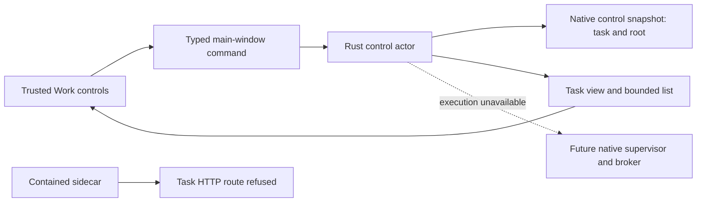
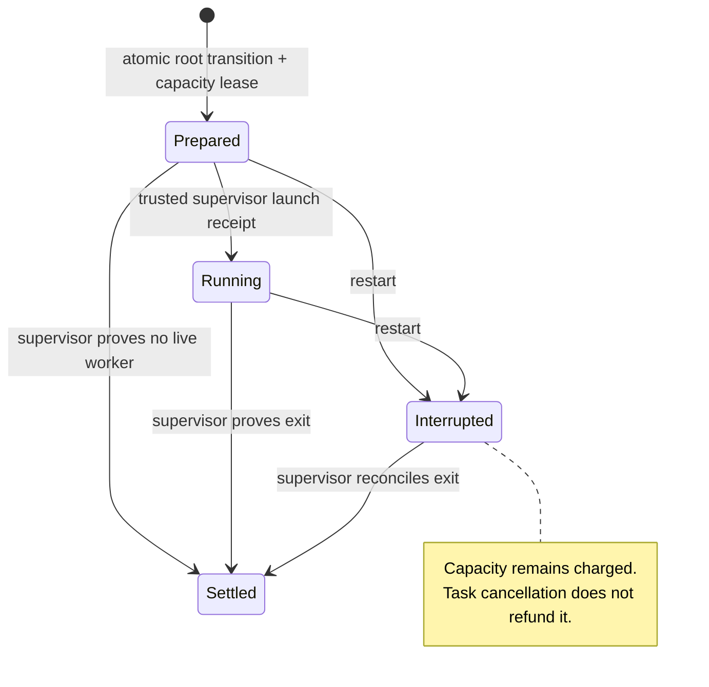
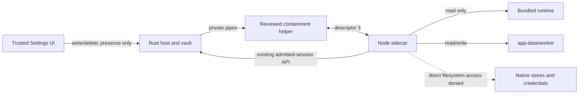

# Implementation progress

Status: active implementation, 2026-10-30. This log records source changes and evidence; it does not close any AR, IA, ISO, or user-outcome gate by itself.

## Protected worker cleanup and native settlement — 2026-10-30

The native root-run ledger now has a trusted-only launcher preparation and file-backed settlement path. The actor derives `<native-data>/executions/<run-id>.json` from an existing prepared invocation, checks the current root/epoch/workspace, creates an owner-only evidence directory and refuses an existing record. The launcher binds that exact path/identity to the containment helper. Neither the webview nor the worker protocol accepts a completion path, receipt body or settlement command. Preparation is a freshness check, not an atomic dispatch permit.

The sandbox helper is pinned to pushed revision `79433e29dcc0104344a6150b84eee7df00630ff2`, containment contract 4. With paired completion options, it refuses target-granted or existing receipt paths before launch, synchronizes unverified evidence first, and writes verified cleanup with the actual target exit code only after backend completion proof and teardown. Target exit 126 remains an ordinary outcome when cleanup is verified. Host input EOF now cancels a target that ignores its private stream. A bounded std-thread input bridge removes the async-stdin runtime shutdown hang. The helper build is pinned to Rust 1.99.1; no dependency was added.

```mermaid
sequenceDiagram
    participant A as Native actor
    participant L as Trusted launcher
    participant H as Containment helper
    participant W as Untrusted worker
    participant F as Protected execution record
    A->>A: Persist prepared run and capacity hold
    L->>A: Prepare exact run completion binding
    A-->>L: Native-derived path and invocation ID
    L->>H: Start with exact binding
    H->>F: Exclusive unverified record; synchronize
    H->>W: Contained private descriptor 3
    L->>H: Close owner input on cancellation
    H->>H: Stop tree and validate backend cleanup
    H->>F: Verified cleanup and actual exit code; synchronize
    L->>A: Settle named run
    A->>F: Validate bounded private record and exact identity
    A->>A: Persist receipt digest and release capacity together
```

Settlement accepts at most 2 KiB and rejects links, permissive modes, malformed/unknown fields, unsupported versions, false/missing cleanup, mismatched invocation IDs and invalid exit codes. It binds the durable exit receipt to the exact evidence bytes using the existing approved digest. Exact retries recover the same settled run; changed proof conflicts. Cancellation/restart alone still cannot refund capacity, and cleanup never marks the task successful. Missing/invalid evidence retains the charge; it is not reset or replayed. Snapshot schema remains 14.

The first actual Linux Node stream-wrapper test failed with `ERR_INVALID_FD_TYPE: UNKNOWN`: the existing byte-write canary had not exercised `Socket({fd:3})` recognition. The owning Linux filter now allows only interactive `getsockopt(3, SOL_SOCKET, SO_TYPE)`. Other descriptors/options, option mutation, socket creation/pairs, connect and sendmsg/recvmsg remain denied; ordinary commands receive no exception. A dedicated C probe and the real Node cancellation/restart/settlement test pass. The original outside-file/network-denial canaries remain unchanged in their assertions; they now keep the owner pipe open until normal target exit because EOF explicitly means cancellation. The macOS test also caught `/var` versus `/private/var` spelling in the completion binding; native preparation now returns its canonical parent path.

Verification: Rust 1.99.1 full app library suites with both real worker canaries explicitly included pass 114 on macOS and 116 in pinned ARM64 Linux Docker; strict Clippy passes on both. Helper workspace tests pass 65 on macOS and 67 in Linux Docker, with strict Clippy/formatting. Node 26.13.0 typecheck and all 284 app tests pass. Final native WebKit smoke with the new clean helper pin passes Work controls, canonical rendering/storage, native vault, exact binary upload, zero TCP listeners and parent-exit cleanup. Receipt: `/var/folders/bz/dq3r0_6s4msbsq08r5h4slcr0000gn/T/vak-desktop-private-S3Ax4u`. The source smoke does not install or replace the app.

Limits: real process launch and settlement are exercised through the Rust harness, not the product task dispatcher. There is no per-task reasoning entry/role isolation, atomic dispatch/approval handoff, product supervisor loop, native scheduler or canonical publication path yet. Native task execution remains unavailable, capacity stays unconfigured in the app and provider dispatch remains refused. CPU/memory/process-count/disk quotas, production multi-job QoS, workspace/IA cutover, original outcomes and final Astra implementation review remain open. This is a proved execution-lifetime primitive, not a completed I2/I3 or a user-task outcome.

## Desktop Work controls moved to Rust — 2026-10-30

Desktop Work task definitions, captured input bytes and lifecycle metadata now have one native writer. The trusted window maps list/create/read/cancel/delete to a bounded `control_task` command; the actor validates and persists the original request with its root before acknowledgement. Exact create retries return the same task; conflicting definitions and collisions with chats, roots or workspace references are refused. Generic root creation cannot shadow a product task's session. Cancellation and deletion require the current native revision. Deletion is currently limited to cancelled, never-started tasks without canonical content, candidate receipts or native registry references.



The Work composer submits one native create command; the former separate chat pre-admission/release bridge is removed. The desktop sidecar no longer opens `Tasks`, its journal, its scheduler/pump or task output writer. Raw worker `/api/tasks` requests return 403. Browser development retains its separate TypeScript implementation; it is not a fallback desktop executor. Native task views use the shared UI contract, with zero runs/usage/history and an explicit execution-unavailable note. Scheduling, continuations, task approval/review, output and usage endpoints remain unavailable until their full native execution path is connected. The native capacity profile remains empty and provider dispatch remains refused. Saving a provider, spending acknowledgement, integration selection or result policy grants no dispatch or completion authority. The result policy is stored as bounded inert contract data, not accepted evidence.

The control snapshot is schema 14, with no older-schema reader or automatic reset. Existing task files are neither imported nor deleted. Recovery validates the original definition/root relationship and permitted queued/cancelled state; reopening never starts work. Worker canonical-session writes/deletes for native task IDs are refused, and legacy chat import is held while native tasks exist to prevent namespace collisions. Ordinary chat canonical persistence keeps its existing native adapter. Project/workspace product writes remain TypeScript-owned; native task execution and the registry/IA cutover are still open.

Native list summaries trim whitespace and count the shared UI contract’s UTF-16 units without splitting a Unicode scalar. Input filenames require a basename before the supported extension. Verification: Node 26.13.0 typecheck and all 284 app tests pass. Rust 1.99.1 macOS library tests pass 111, Linux Docker tests pass 113, with one opt-in containment test ignored in each; strict Clippy passes on both. Native tests cover forged state/oversized inputs, unavailable schedules, exact/conflicting retries, task/chat/root namespace collisions, stale revisions, worker session-write refusal, restart without replay, content-free list projection and guarded deletion. Native WebKit smoke exercises the Work list/detail with an astral-Unicode task summary and the actual Cancel control, verifies native zero-run state, refuses the worker route and confirms no `worker/tasks` directory exists. Receipt: `/var/folders/bz/dq3r0_6s4msbsq08r5h4slcr0000gn/T/vak-desktop-private-zb93g4` (source smoke, not an installed build). This is a partial I3 ownership cutover; no complete delivery, original model outcome, scale or final Astra review gate is closed.

## Durable root-run admission and settlement — 2026-10-30

Native `StartAttempt` now requires a stable start-request identity and atomically persists the root transition, a native run identity, its root/session/epoch binding and a `Generation` lease. Empty profiles refuse execution without changing the root. Exact start retries recover the existing state rather than consuming another run or slot; conflicting identity reuse and attempts to adopt a generic reservation are refused. Only one unsettled invocation per root is admitted. Trusted Rust supervisor methods confirm launch and settle an exact exit identity; neither method is exposed to the worker protocol or UI.

A root cancellation, input/approval wait, workspace invalidation or restart does not prove worker exit and therefore does not refund the root-run lease. Restart marks prepared/running invocations interrupted and retains the charge. Supervisor settlement releases capacity and persists its receipt in the same transaction; identical settlement retries recover the receipt, conflicting receipts fail. Generic lease release cannot release a root-run reservation. Review/acceptance waits for unsettled root invocations. New candidate commits require a supervisor-confirmed running invocation with the current root epoch and active lease, while exact historical receipt recovery remains idempotent after exit/restart.



The native snapshot is schema 13 with no schema-12 reader. No native control directory was present in the checked ordinary development or installed-app data paths before this change; temporary smoke stores remain separate. Existing data is not deleted or automatically reset. Recovery validates root/session/run/lease associations, cumulative run counts, receipt uniqueness and active-versus-settled charges. The run ledger is bounded by the configured request-identity and snapshot limits.

Verification covers eight concurrent exact starts, one-slot contention across two roots in one chat, rollback on unavailable/unconfigured capacity, generic-lease adoption/release refusal, late launch confirmation, cancellation, continuation blocking before settlement, restart charge retention, exact/conflicting settlement, tampered recovery, and candidate refusal before launch/after exit. Rust 1.99.1 full suites pass 107 tests on macOS and 109 in pinned Linux Docker, each with the separately opted-in worker canary ignored, and strict Clippy passes on both. The native WebKit desktop smoke passes with schema 13; it checks metadata/storage/transport, not task model execution. Earlier tests started native runs with an empty profile or reused capacity without exit settlement; they now configure execution explicitly or supply the trusted test supervisor exit. This corrects those fixtures' lifecycle assumptions rather than widening production limits.

Limits: supervisor identities in these native tests are supplied by the Rust harness, not a product run supervisor. The contained app sidecar exists, but task-specific workers, actual launch/exit receipts, the product scheduler/control cutover, provider run binding/approval/dispatch and canonical publication remain unconnected. The active product `Tasks` and workspace registry remain TypeScript; the app profile is still empty and provider dispatch remains refused. This closes no AR, IA, ISO, original outcome or full delivery slice.

## Contained desktop launcher and native-only credentials — 2026-10-30

Both debug and release launch the bundled Node runtime through the reviewed `vaksb worker` helper. There is one launch path: missing runtime/helper or unavailable OS enforcement refuses startup. The worker receives read-only runtime resources plus the reviewed helper's fixed OS runtime read grants, and one owner-only `<app-data>/worker/` write grant, an explicit environment and private descriptor 3. Rust keeps the existing framed parent protocol through the helper's stdin/stdout relay. No source-tree, selected-project, native-store or old app-data grant is added. Runtime grants cannot cover the native store (including through implicit OS runtime roots), runtime code and writable data cannot overlap; a replaced worker directory is refused. Development now rebuilds the self-contained runtime before launch. The direct `npm run sidecar` entry was removed. Executable packaging stages each binary on a fresh inode and atomically renames it, avoiding the observed macOS signing-cache failure from overwriting a signed helper in place. Packaging requires clean helper revision `0c0a3473b2ddba595fef370d7266223723403a15`; the app and helper build use Rust 1.99.1, and JavaScript bundles target Node 26.

The Settings UI writes secrets only to Rust. Vault operations use the build-owned app identifier (with a development suffix), so callers cannot select another credential service and isolated smoke identities do not share the development vault. It retrieves bounded native presence flags; it no longer sends saved values to `/api/settings`. Desktop settings use a native-only secret-store adapter that neither reads secret values from old settings files nor accepts secret updates, including mixed plain/secret batches. Browser development retains its separate configured secret backend. The worker receives no environment files or inherited credential/preload variables. `OPENSSL_CONF=/dev/null` prevents Linux Node from loading ambient host crypto configuration.



Evidence: real Node canaries pass on macOS and digest-pinned Linux Docker. They prove outside-file read/write denial, denial of a connection to a real loopback listener, omission of helper-only synthetic secrets/preload hooks, positive worker-directory writes and private-channel output. Native WebKit desktop smoke passes with contained startup, canonical native persistence/import, actual native vault presence/deletion, secret-write refusal, binary upload, no helper/worker TCP listeners and descendant cleanup. The first smoke retained a checker failure because its upload path still pointed at the former data directory; the path expectation was corrected without changing the uploaded bytes. The first Linux canary retained OpenSSL configuration denial; the explicit empty config fixes startup without broader filesystem grants. Node 26.13.0 typecheck and all 284 app tests pass. Rust 1.99.1 full library tests pass 105/105 on macOS and 107/107 in digest-pinned Linux Docker, including the real Node canary on both; strict Clippy passes on both. The regular Linux gate separately passes 106 tests with the explicit canary opt-in left ignored.

Limits: this changes the desktop launch boundary, not task authority. Reasoning and canonical adapters still share a process, and the admitted-session API still returns canonical bytes to that sidecar. No complete confidentiality or ISO1 closure is claimed. Existing desktop operations needing direct network, credentials or original-folder access now refuse under containment until their native brokers/grants are implemented. Desktop provider dispatch remains refused. Native task/workspace cutover, common capacity, hard CPU/memory quotas, child supervision, recovery/drift, IA and original outcome gates remain open. The installed app has not been replaced; no final Astra review has run.

## Distinguish framework step exhaustion in run recovery — 2026-10-30

The latest three retained local selected-file report evaluations (2026-10-26 17:29, 17:34 and 17:40 UTC) all ended at the framework `max_steps` limit after 12 model requests. Across them, independent-surface checks failed 3/3, exact visible-value checks failed 3/3, and verified output receipts failed 3/3; source naming failed in 1/3. The runs also show surface churn (four surfaces in one attempt, one in another), while the third produced one combined form/table. These are frozen outcome failures, not evidence that a particular prompt or added agent fixes the task.

The active TypeScript task journal previously collapsed an explicit framework `{ stop: "max_steps", limit: "steps" }` into generic `execution_error`. It now persists `step_budget_exhausted` separately from provider request and tool-call exhaustion, retains the framework stop string, leaves the failed result without a fabricated output receipt, and requires a user initiated continuation. The new regression reopens the journal and verifies the typed cause and absence of a receipt. This improves diagnosis and safe stopping; it does not repair the original result or authorize completion. Original source/value/interaction/output gates remain open.

## Desktop provider egress fail-closed cutover — 2026-10-30

Projection `aa9a6be` adds public host-owned `sessionId`/`runId` correlation metadata to each generation request and carries it through provider transport callbacks and retries. Vakyartha pins that public API and now passes the desktop private native `providerFetch` into `startAppServer`, including the startup interval where no transport is ready (which rejects). Desktop model calls therefore cannot fall back to the TypeScript default network fetch. The sidecar rejects missing/invalid execution identities and forwards them over private IPC; Rust requires and validates both fields on the registered operation frame.

This closes an accidental direct-egress path but does not enable dispatch: Rust still refuses every provider request. The metadata is not authority. Native task/root admission, binding the host run to the durable root/fence, approval review/decision, exact request ticket consumption, durable budget charge and redacted receipt, cancellation settlement, and a trusted UI outcome path still must be implemented together before provider traffic can be enabled. Desktop model requests currently fail closed.

Evidence: Projection focused host/provider tests pass 29/29; its full suite passed 420/420, typecheck and package generation passed before a final import-only cleanup (typecheck and focused tests passed after cleanup). Vakyartha desktop transport tests pass 8/8; app typecheck and the serial app suite pass (282/282); the Rust 1.99.1 Linux Docker suite passes 103/103 with strict Clippy; and Node 26.13.0 desktop smoke passes. The first Linux run retained one stale private-pipe fixture without `sessionId`/`runId` and failed with EOF; the fixture was updated and the full Linux rerun passed. These checks validate transport shape/fail-closed behavior, not native provider authorization or an original user outcome.

## Native root association index — 2026-10-30

The control ledger now rebuilds a bounded derived index from canonical host session IDs to sorted native root IDs at startup and updates it in the same candidate state as root creation. A session may have multiple historical or concurrent roots: the first attempted one-to-one invariant broke two existing workspace rebind/revocation tests, which exposed that the proposed cardinality was wrong. The corrected index preserves every association and returns only root IDs, avoiding full aggregate copies or a scan of up to 10,000 roots for each lookup. Tests verify two roots in one session, invalid identity refusal and index reconstruction after restart. This index is correlation support only; session/run identity still does not name an active root/attempt or authorize provider egress. The app's task writer is still TypeScript and no provider request consults this index.

Evidence: macOS Rust library suite passes 102/102; strict Clippy passes; the digest-pinned Rust 1.99.1 Linux Docker suite passes 104/104 with strict Clippy. No persisted schema change or dependency was required. This does not close task cutover, native dispatch, QoS or outcome gates.

## Native file-vault fallback moved beside native stores — 2026-10-30

The Rust file-vault fallback now uses `<native-data>/.vault.secrets`, under the same sibling root as control and canonical-session data. On Unix the directory is owner-only and the file is 0600; on Windows the path relies on the user-SID-protected AppData ACL. Every file get/set/delete validates that the root is a real directory and refuses a symlink. Tests cover sibling placement, Unix owner-only directory mode, persistence/deletion, symlink refusal, and that an existing `<data>/.vault.secrets` is neither read nor modified. The old file is left untouched under the zero-user cutover. Platform credential vaults remain primary; this file is a fallback, not an OS isolation boundary. The same-UID sidecar can still derive the sibling path until the contained worker is actually launched.

Verification: host Rust library suite 101/101, strict Rust Clippy, Rust 1.99.1 Linux Docker library suite 103/103 with strict Clippy, app typecheck, serial app suite 282/282, and Node 26.13.0 desktop smoke covering native vault set/delete IPC, legacy vault source preservation, canonical rendering, FinOps, zero TCP listeners and parent-exit cleanup. The current desktop smoke is not an isolation proof. This closes no agent-runtime, ISO, QoS, recovery/drift or original outcome gate.

## Native store root separated from sidecar data — 2026-10-30

Rust-owned control snapshots, candidate generations and canonical desktop session snapshots now reside at a hidden app-specific sibling `.<data-directory-name>-native/`, created and verified as an owner-only directory. The sidecar receives only `VAK_DATA_DIR`; the trusted UI still admits sessions through Rust. Existing native files under the previous `<data>/control`, `<data>/content` and `<data>/host-sessions` paths are left in place and are not read or automatically migrated, consistent with the zero-user clean cutover. The desktop WebKit smoke now verifies the sibling location, owner-only mode, canonical session migration/source preservation, private IPC, zero TCP listeners and parent-exit cleanup. This path separation is not yet an OS boundary: the current same-UID sidecar is uncontained and can derive/read the sibling path. It is groundwork for a Linux profile built from positive per-directory grants and for the macOS worker profile; it closes no confidentiality or ISO gate until the helper is actually supervising the sidecar.

The helper capability contract is now 3 because it reports platform-specific nested filesystem-exclusion support. Vakyartha's stale probe still required contract 2, which made correctly supervised sandbox operations fail closed. Updated the exact app probe and added a regression requiring 3 and refusing 2 or missing capabilities. The first parallel and serial app runs both reproduced 19 failures from this stale contract; those failures were initially attributed to the separate known contention pattern, then independently traced to the contract check. After correction, the admin API regression passes and the serial full app suite passes 282/282. Verification: macOS native Rust tests 99/99, strict Rust Clippy, desktop smoke, `npm run typecheck`, app suite 282/282, and Rust 1.99.1 Linux Docker tests 101/101 with strict Clippy. The known prior contention failures remain separate evidence; this correction does not close global QoS, task cutover, provider mediation, recovery/drift UI or original outcomes.

## Contained interactive worker prerequisite — 2026-10-30

The owning `vak-sandbox` repository now exposes an explicit `vaksb worker` CLI backed by a persistent supervised process and an invocation-scoped full-duplex descriptor 3; target stdin remains `/dev/null`, stdout/stderr are diagnostics, and startup skips Realm-store initialization. This lets a future app host keep its existing private framed protocol while the sidecar loses ambient filesystem and network authority. The CLI accepts repeated read/write grants, explicit environment values and deny roots. macOS Seatbelt enforces nested deny paths, so native-only session/control stores can be carved from an app-data grant. Landlock grants are additive and cannot enforce that pattern: Linux advertises `filesystem_exclusions: false` and refuses a worker with nested denies before target launch. The helper changes are pushed as `b98348c` and `0c0a347` on `codex/linux-runtime-fail-closed` in the sandbox repo. macOS workspace tests and strict Clippy pass; Rust 1.99.1 Linux Docker worker integration passes 2/2, full workspace tests passed before the final capability-report-only change, and workspace strict Clippy passes.

This capability is not pinned, bundled or launched by Vakyartha. That is intentional until a correct app profile exists: current native IPC explicitly refuses provider dispatch; native approval tickets have no product review/decision path; and task/workspace authority and actual candidate publication remain TypeScript-owned. Native stores have since moved to a sibling path outside `VAK_DATA_DIR`; a future Linux profile can exclude them with positive per-directory grants, while macOS may use the helper's explicit denies. The sidecar is still uncontained and can read them today. No product request was routed through this helper and no ISO, AR, QoS or user-outcome gate closes.

## Host-session filesystem threat boundary correction — 2026-10-30

Review of the live desktop process topology found that the Node sidecar and Rust host run as the same OS user. The sidecar's private-pipe store adapter and trusted UI admission protect the canonical write API, but do not stop a compromised sidecar from opening native files directly; owner-only permissions cannot distinguish two same-user processes. The canonical store has moved from `<data>/host-sessions/` to sibling `<native-data>/host-sessions/`, outside the sidecar data root, but the sidecar remains uncontained and can derive/read it through ambient access. No direct-read exploit was run. Existing admission and CAS tests are not evidence for confidentiality. A proved OS-enforced sidecar boundary or a broker design that keeps protected bytes inaccessible and returns operation-scoped data remains required. This is an open containment gate and blocks any full-compromise claim.

## Desktop canonical session store cutover — 2026-10-30

Desktop mode now supplies Projection's revisioned `HostSessionStore` through a bounded typed private-pipe operation set owned by the Rust control actor. Trusted Tauri UI admits a chat ID before the worker can load/save/remove it; actor snapshots use revision compare-and-set, 8 MiB/session and 10,000-session bounds, owner-only directories, atomic replacement and fail-closed recovery. Listing returns summaries only. Browser development retains the framework's filesystem store. FinOps chat attribution and historical reconstruction now read through the configured canonical backend, so desktop no longer depends on scanning the old sessions folder. First-run legacy import is count/size/digest planned, explicitly confirmed, copy-only and receipted; declining leaves legacy records unchanged. No legacy data was migrated during development.

Verification on this slice: macOS WebKit native smoke passed with explicit legacy import, source-byte preservation, private file mode, native list/load and new chat save; desktop private IPC smoke also confirms zero TCP listeners and parent-exit cleanup. Focused FinOps tests pass 7/7. Digest-pinned Node 26.13.0 Linux Docker typecheck and full app suite pass (260 passed, 21 platform/feature skips, zero failures); npm reports zero known vulnerabilities. Rust 1.99.1 pinned Linux Docker tests pass 101/101 and strict Clippy passes. Scope limit: this changes canonical chat persistence only. TS tasks/workspace registry remain active owners; candidate commits remain unused by product tasks; receipt recovery UI, full task cutover, mediation, global resource scheduling, IA navigation and original user outcomes remain open.

## Task session admission at the UI boundary — 2026-10-30

The trusted task composer now allocates its task/session ID, asks the native shell to admit that ID before posting the create request, and includes the same ID in the task proposal. `Tasks.create` accepts an explicit validated, unique identity so its canonical host session matches the admission. If creation fails before success, the trusted UI releases the unused admission; Rust refuses that release if a snapshot already exists. This keeps task-session access on the same native HostSessionStore boundary without giving the sidecar a self-admission command.

Regression evidence: the task lifecycle test now executes against an admission-enforcing revisioned session-store fake, verifies that the admitted ID receives the canonical task snapshot and that an unadmitted ID is refused. Rust 1.99.1 Linux Docker tests pass 101/101 with strict Clippy; digest-pinned Node 26.13.0 Docker typecheck and full app suite pass (260 passed, 21 skipped, zero failures); focused task tests pass 20/20. The native WebKit desktop smoke still passes private IPC, canonical chat rendering, FinOps, zero TCP listeners and parent-exit cleanup; it does not run a task model request. This only repairs new UI-created task session access. Task journals, scheduling/restart authority, workspace registry, provider dispatch, candidate publication, shared capacity, recovery/drift UI and outcome gates remain open; the native actor is not yet the task scheduler or task source of truth.

## Revisioned host session store API pin — 2026-10-30

Projection `822622e7d3e58879a8a31bd0b79017b251cce3f4` now exports the optional `HostSessionStore` adapter contract for one revisioned canonical persistence owner. Its regression covers write, reload, list/surface restoration and deletion without a filesystem session directory. Projection focused host tests pass 23/23; full Projection suite/replay passes 418/418, typecheck and package generation pass. The app submodule now points to this revision, and Docker Node 26.13.0 app typecheck plus the app's pinned framework suite pass. The app has not adopted the adapter: `sidecar/server.ts` still supplies `sessionsDir`, and the native actor has no general session snapshot load/save/list/remove operation. The newly pinned API is a capability seam only; it does not change persistence ownership or close any app task/recovery/QoS/IA/outcome gate.

## Native canonical candidate persistence bridge — 2026-10-30

Implemented the app callback seam from Projection's pinned `VakHost.commitCandidate` through `AppServerOptions.candidateCommit`, the private stdio control protocol, and the native control actor. Root admission now durably binds an optional canonical session identity (workspace admission supplies it from the native binding); commit rejects a candidate for a different session, and recovery validates each durable receipt against its root's session. The native control snapshot is schema 12 and rejects the previous format. Sidecar maps only the retained candidate, identity, fence and expected canonical revision; one commit may be in flight, the request is bounded to 8 MiB, and every receipt field is matched against the original request. Rust validates the task's current fence, workspace ownership, session owner and compare-and-set revision; it writes immutable `content/sessions/<session>/generation-<revision>.json` bytes, durably commits the selected digest/receipt with the single-writer ledger, then acknowledges. Exact retries return the saved receipt; altered bytes under the same commit identity conflict. Startup cleans unselected generations and fails closed on selected symlinks, missing bytes or digest mismatch. The current and previous generations remain. Errors after durable ledger commit are recoverable by exact retry.

Verification: the desktop transport suite passes 7/7; full app suite under digest-pinned Node 26.13.0 Linux Docker passes 259/259 runnable tests with 21 platform/feature-gated skips and typecheck passes; native Rust host tests pass 94/94 with strict Clippy; pinned Rust 1.99.1 Linux Docker passes 96/96 with strict Clippy. `npm ci --ignore-scripts` in the isolated Linux dependency volume reports zero known vulnerabilities. The trusted main/admin Tauri API can now query a durable receipt by commit ID after restart; an app recovery surface does not consume that query yet. This remains an unused seam: no task path calls `runCandidate`/`commitCandidate`, the snapshot is not published to the existing canonical host session/surface store, and no independently sourced task-output receipt has been checked. The actor is not yet the canonical product writer. This does not close any task, approval, mediation, recovery, QoS, IA or user-outcome gate.

## Projection fenced candidate commit API — 2026-10-30

Projection `6fd13f3` adds a bounded four-ticket, 8 MiB-per-candidate, ten-minute `candidateId`; `6d81a23` adds an explicit expected canonical revision. `commitCandidate` submits the retained exact proposal, base versions, canonical revision and task fence to an app-owned canonical callback. Callback failure keeps the candidate bound to the first commit identity/revision/fence for a safe idempotent retry; a success receipt consumes it. The contract prevents mutation through the returned proposal, and framework tests cover retries, changed fences, one-use completion, count bounds and discard. Projection passes 417/417 tests/replay, 22/22 focused host tests, typecheck and package generation. The app moved its framework pin to the pushed commit and `npm install` reports zero vulnerabilities. The callback, native durable prepare/fence/commit, receipt query across restart and post-ack publication remain unimplemented; the process-local candidate ticket is discarded on host restart. No task path uses this API and no I3/outcome gate closes.

## App provider transport injection seam — 2026-10-30

Added optional `AppServerOptions.providerTransport` and route it through both the model/voice/skill-evaluation provider factory and the channel provider factory via one helper. Host injection overrides factory-supplied transport while preserving per-turn options such as Ollama `think`; without a callback the existing provider construction is unchanged. Focused tests pass 2/2. Under the pinned Node 26.13.0 Linux ARM64 Docker environment, the full app suite passes 256/256 runnable tests (21 platform/feature-gated skips) and typecheck passes. The desktop sidecar has not yet supplied the Rust private-pipe bridge, so this seam remains dormant and providers still use default fetch in product execution. It does not close mediation, authority, budget, cancellation or outcome gates.

## One-use approval ticket design refinement — 2026-10-30

Exact-request binding uses native ownership of the normalized bounded bytes and a fingerprint, never a digest as authority. Rust stages one opaque in-memory ticket, presents a bounded operation preview in the trusted UI, and dispatches only those unchanged bytes after an allow-once decision plus current task/workspace fence and durable budget/dispatch intent. Pending tickets do not survive actor restart; existing root recovery marks active work interrupted, so a new request and approval are required. The first isolated implementation now retains exact bytes, enforces one-use decisions, bounds count/body/preview, consumes stale/denied/altered tickets, and binds the displayed SHA-256 fingerprint to the task fence and disclosure. The exact `sha2 = 0.11.1` dependency was approved by the user, pinned with defaults disabled, and reviewed: the active SHA graph adds `digest 0.11.3`, `block-buffer 0.12.1`, `crypto-common 0.2.2`, `hybrid-array 0.4.15`, `cpufeatures 0.3.1` and `cfg-if 1.0.5`; no new native build script appears in that graph. The dependency path compiled and `cargo check` passed; focused ticket tests pass 3/3. It is not yet owned by the control actor, reachable from the trusted UI, coupled to durable budget charging, or connected to provider dispatch. No approval or mediation gate closes. See the approval and dispatch sections in [implementation design](IMPLEMENTATION-DESIGN.md).

## Projection provider operation identity API pin — 2026-10-30

Projection commit `c51987ba62cb0bd5537b1d3dbd39b837f7e440ca` adds an optional `ProviderTransportContext` containing one UUID per logical HTTP call and a zero-based attempt count. Retry attempts reuse the operation ID. The Projection provider retry suite passes 4/4, the full framework suite/replay passes 414/414, typecheck and package generation pass. The app pin now uses this pushed commit; its Node 26.13.0 Docker verification passes `npm run test:framework` (414/414) and `npm run typecheck`. This makes retries attributable/deduplicable by a future host; it does not itself prevent a retry, provide authorization, or mediate app provider traffic. The app does not yet pass a transport callback. No AR, IA, ISO or user outcome gate is closed.

## Provider transport seam code-audit correction — 2026-10-30

Current app and pinned Projection source were compared directly. Projection `65f183c` publicly exports provider-aware `ProviderTransport` injection through each provider factory; `sidecar/server.ts:modelProviders()` still calls `entry.make(options)` without a transport, leaving providers on default `fetch`. The app can inject a transport without another framework change. The missing work is the native private-pipe request/stream protocol, exact operation authorization, approval/receipt lifecycle and TypeScript secret removal. Projection `6d81a23` provides the `runCandidate`/`commitCandidate` callback seam with expected canonical revision; the app still lacks its durable native implementation and recovery. No product execution path changed in this audit.

## Fixed-loopback local generation transport primitive — 2026-10-30

Extended the inactive native broker with the app's primary local Ollama `/api/chat` contract: only `http://127.0.0.1:11434/api/chat` is accepted, the client disables proxy discovery and redirects, and this route takes no credential. The model is pinned by the permit; streaming is required; output count is inserted or capped; only a small allowlist of generation options is accepted; `think` and `keep_alive` must exactly match admitted policy fields. Tests reject alternate hosts/ports/paths, query redirects, model substitution, non-streaming requests, unsupported resource options and output-limit bypass. macOS Rust library tests pass 83/83 with host strict Clippy; the pinned Rust 1.99.1 Linux Docker gate passes 85/85 with strict Clippy.

This remains an inactive transport primitive. The actor cannot yet create approval-bound permits, consume them atomically with cancellation/budget/capacity checks, or stream frames to/from the reasoning worker. Local Ollama access is not yet selected through native settings and the current TypeScript provider path remains live. No product request has been switched, no local model request was made through this Rust route, and no I2/I3 acceptance gate is closed. The route follows the current pinned provider's local native-chat contract; the upstream project also documents its local server at `localhost:11434` in its [API compatibility guide](https://github.com/ollama/ollama/blob/main/docs/api/openai-compatibility.mdx).

## Primary-local record-view timeout diagnosis and frozen recheck — 2026-10-30

The retained Projection contract failure was inspected offline and the exact prescribed `--run-local --table-only` gate was run once, without changing prompt, checks or timeout. The fresh receipt passes all three pairs and local edit behavior in 12.100/4.139/4.240 seconds. The retained failed run's sanitized provider log shows 49/50 prompt tokens processed, no observable provider event reaching the framework, an HTTP request ending at 60.0019 seconds, and a context-canceled termination. The installed local runtime was v0.40.13, the upstream current release that day. The failure is therefore located after prompt processing and before usable provider output, but its cause remains unknown; the new pass does not erase the failed receipt or close model/provider reliability, source-backed outcomes or installed latency gates. Details and private evidence pointer are in [evaluation](../EVALUATION.md#primary-local-record-view-contract-recheck--2026-10-30) and [failure lessons](LOCAL-FAILURE-LESSONS.md).

## Trusted native workspace task entry — 2026-10-30

The trusted main/admin Tauri windows can register an admitted folder in the actor's durable workspace registry, bind a session to it, read the current grant at an expected revision, and create a root task scoped to that session/revision. The actor resolves and captures the grant; the caller supplies no grant or execution path. The isolated WebKit desktop smoke verifies registration, binding, grant readback, root grant capture, and stale-revision refusal. macOS Rust library tests pass 82/82; `npm run typecheck` passes; the pinned Rust 1.99.1 Linux Docker suite passes 84/84 with strict Clippy; `scripts/desktop-check.ts` passes on Node 26.13.0.

This opens only a trusted-shell command seam. The visible task/workspace UI and TypeScript stores remain authoritative; no native folder picker-to-binding workflow, project membership, rebind/revoke UI, task lifecycle, approval, provider dispatch, worker fence handoff, or canonical commit uses these commands. The sidecar protocol remains health-only. Do not route one task through both stores. No AR, IA, ISO, or original task outcome gate is closed.

## Trusted native workspace rebind and revoke — 2026-10-30

Added trusted-shell commands for the actor's revision-checked workspace rebind and revoke transitions. The isolated desktop smoke now binds a session, creates a root with its fixed grant, rebinds the session to a second admitted folder, confirms the old root still names its original grant, refuses creation against the superseded revision, accepts creation against the new revision, then revokes and confirms the grant cannot be read. macOS Rust library tests pass 82/82, host strict Clippy passes, typecheck passes, the Rust 1.99.1 Linux Docker suite passes 84/84 with strict Clippy, and the Node 26.13.0 desktop WebKit smoke passes.

This still does not connect the product workspace UI or TypeScript stores to the native registry, and the Rust control actor remains unconfigured for execution capacity. Project membership, filesystem-safe dispatch, lifecycle/approval, provider/tool mediation, canonical commit and original task outcomes remain open. No acceptance gate is closed.

## Native cumulative model/tool operation accounting — 2026-10-30

The native root aggregate now stores bounded cumulative model-request and tool-call limits plus charged operation identities. The control actor persists a charge before acknowledging it, accepts retry of the same identity idempotently, and persists a `LimitReached` stop when another unique operation arrives after exhaustion. A concurrent eight-caller regression proves one revision can admit at most one unique charge, stale callers cannot charge, and a fresh over-limit attempt stops the root. Root creation uses typed `BudgetLimits`; the native store schema is version 9. Focused macOS budget tests pass 2/2 plus the concurrency case, strict Rust 1.99.1 Clippy passes, and `scripts/linux-rust-check.sh` passes 83/83 with strict Clippy.

This is accounting substrate only: it does not authorize an external effect, dispatch a provider/tool request, provide per-run caps or active-time reservation/settlement, or replace the current TypeScript task budget and task writer. Duplicate charge acknowledgement is not permission to replay the operation. The product cutover and complete ADR-013 semantics remain open.

The existing Node 26 app suite was rerun serially under the official Node 26.13.0 macOS ARM64 archive (SHA-256 verified against Node's published `SHASUMS256.txt`): 275/275 pass; TypeScript typecheck passes; pinned Projection suite passes 412/412. These are regression checks and do not close the task/outcome gates.

## Trusted native root entry IPC — 2026-10-30

Added strict `RootCreate` decoding and two Tauri commands for the admitted main/admin app windows: create a root in the native control store and read one by opaque task ID. A repeated create with the same ID and exact original contract/workspace revision returns the persisted root; conflicting reuse is rejected. The original create request is retained in store schema v10 for restart-safe idempotency. The commands obtain the actor from Tauri-managed state, return bounded generic errors, and are not available on the sidecar health pipe. No task mutation, list, delete, workspace assignment, start, approval or dispatch command is exposed. The actor regression proves eight simultaneous identical creates converge on one root, an uncertain retry after restart returns the recovered `Interrupted` state, and a changed contract under the same identity is refused. `scripts/desktop-probe.js` exercises create, idempotent retry, persisted readback, conflict refusal and unknown-field rejection in the isolated macOS native smoke; `scripts/desktop-check.ts` passes under Node 26.13.0.

Before the schema bump, the development and installed-app control-store paths were both absent; the change requires no compatibility reader or conversion for these inspected stores.

This is a trusted-shell API foundation, not product cutover: current UI task creation and reads still use the TypeScript service, and the new commands are not wired into a user workflow. Do not call both paths for one task. The next vertical change must move task UI reads/creation and every subsequent state transition together, while preserving workspace grants and trusted approval; the current sidecar must not gain broad task-control authority.

After the idempotency/schema update, macOS Rust library tests pass 82/82, host strict Clippy passes, and the pinned Rust 1.99.1 Linux Docker gate passes 84/84 with strict Clippy. The isolated macOS desktop smoke also passes with create/retry/read/conflict/unknown-field checks.

## Active provider and credential path audit — 2026-10-30

Rechecked the live source after confining the Rust broker. `Settings.load()` still reads provider secrets into the sidecar's `process.env`; on desktop, `src/ui.ts` calls native `vault_set`/`vault_delete` and then PUTs the same secret to `/api/settings`, whose TypeScript `Settings` store writes Keychain or the settings file. `modelProviders()` still calls `providersFromEnv()` and wraps its provider instances, but supplies no `ProviderTransport`; the pinned Projection host calls `entry.make()` or `entry.make({ think })`, so the provider default remains global `fetch`, while `tasks.beforeModelRequest()` and FinOps wrap it. Task approvals and task persistence also remain in `sidecar/tasks.ts`.

This confirms the broker cannot be activated by wiring only the transport seam: that would still leave sidecar-held credentials and TS-owned approval/task authority. The replacement must move settings ownership, task authorization, provider dispatch, cancellation and receipts together, with one native control writer and a trusted user decision path. Until that complete vertical cutover passes the local-provider and original-outcome gates, provider traffic remains on the existing TypeScript path. Source trace: `src/ui.ts`, `sidecar/settings.ts`, `sidecar/server.ts`, `sidecar/tasks.ts`, and the public `ProviderTransport` seam in pinned Projection.

## Confine provider broker API to native control — 2026-10-30

Moved the provider broker from the native crate root to `src-tauri/src/control/broker.rs`. Permit, request, client and stream APIs are now visible only to the `control` parent, so unrelated Rust modules cannot mint a generation permit or invoke the transport. This is an API boundary tightening only: the control actor still has no approval-bound, task-fenced dispatch command; no provider traffic is routed through the broker. Focused tests pass 16/16, strict macOS Clippy passes, and the pinned Rust 1.99.1 Linux Docker suite passes 80/80 with strict Clippy.

## Native broker credential lookup and authentication — 2026-10-30

The inactive Rust provider transport now retrieves credentials directly from the app vault using a fixed provider-to-account mapping and inserts provider-specific authentication headers in Rust. OpenAI-compatible providers use Bearer auth; Anthropic and Gemini use their required dedicated headers. The credential is never part of the request body, URL, or returned error. The mapping covers every currently declared native provider route. A synthetic isolated vault fixture proves fixed-account lookup and missing-key refusal. Focused macOS broker tests pass 16/16, strict macOS Clippy passes, and the pinned Rust 1.99.1 Linux Docker suite passes 80/80 with strict Clippy.

This does not yet remove the active TypeScript `process.env` credential path or mediate product requests. The broker still has no trusted single-use authorization bound atomically to task/workspace revision, user approval, cancellation, durable redacted receipt, or product caller.

## Sandbox resource-policy refusal correction — 2026-10-30

The sandbox repository is pushed at `fe184ee` following Linux containment `d621f51`. `ResourcePolicy::default()` no longer advertises numeric limits that neither OS backend enforced. Both macOS Seatbelt and Linux Landlock backends reject explicit CPU, memory, wall-time, process-count or file-size policy requests before target launch. The CLI/runtime's own wall/output bounds remain distinct. macOS serial workspace tests pass 59/59, strict Clippy and formatting pass; the pinned Rust 1.99.1 Linux Docker suite passes 59/59 with strict Clippy, formatting and workspace build. The Linux suite exercised real Landlock/seccomp execution and the new resource-refusal canary.

Limits: this is a fail-closed correction, not resource enforcement. The Docker cgroup v2 mount is read-only, so this environment cannot verify a cgroup quota implementation. Both backend capability reports continue to state `resource_limits: false`; Vakyartha does not package/pin this helper, and ISO4/ISO5/ISO6 remain open. One parallel macOS suite run had the localhost networking fixture fail with an unverified supervisor completion; its isolated rerun and later serial 59/59 suite passed. Cause remains unknown and is retained in the sandbox hardening record.

## Native provider DNS resolution pinning — 2026-10-30

The inactive native provider transport now resolves the fixed provider hostname before each dispatch, rejects an empty result or any mixed result containing a non-public/special-purpose address, and configures reqwest to connect only to the validated address set. Redirects and ambient proxy discovery remain disabled. The address classifier conservatively denies IANA special-purpose IPv4 ranges and restricts IPv6 to global-unicast space while excluding local, documentation, transition and other special ranges. The deny policy is intentionally conservative and should be reviewed against the [IANA IPv4](https://www.iana.org/assignments/iana-ipv4-special-registry) and [IANA IPv6](https://www.iana.org/assignments/iana-ipv6-special-registry) registries as they change.

Focused tests cover public and denied IPv4/IPv6 examples, mixed DNS answers, empty answers, deduplication and a local reqwest request proving an explicit resolver pin is honored. Focused broker tests pass 14/14, strict host Clippy passes, and the full digest-pinned Linux Rust 1.99.1 Docker gate passes 78/78 with strict Clippy. The Linux gate compiles and exercises the address policy/pinning primitive; it does not exercise public-provider DNS or authorize live provider traffic.

Limits: the blocking resolver and HTTP call still require a bounded native I/O worker. The broker is not connected to credentials, approval issuance, cancellation, a durable receipt, the private protocol, or product provider traffic. DNS pinning closes only the address-rebinding gap for this transport primitive; it does not close AR-07, ISO2 or any product outcome gate.

## Typed private native-control health bridge — 2026-10-30

The Rust engine and sidecar now use desktop protocol v2. A sidecar may request only the typed `health` operation with a bounded `ctl-` identity; strict decoding rejects unknown fields/operations and frames above 4 KiB. Rust feeds at most 16 requests through a dedicated control executor, which pings the native actor and returns only `ready`, `unavailable` or `overloaded`. If the actor is unsupported/unavailable, the sidecar reports that state and continues the existing app startup; no protected workload should infer authorization from health status. Tauri UI request/ack/cancel frames and sidecar HTTP response frames were migrated together to v2, with no v1 fallback.

Evidence: Rust 1.99.1 macOS library suite passes 67/67 and digest-pinned Linux Docker tests pass 69/69; strict Clippy passes on both. The child-process test sends a health request through the actual private stdin/stdout pipes and reads the native actor's correlated response. The desktop transport suite passes 4/4, and Node 26.13.0 typecheck passes. `scripts/desktop-check.ts` passes under Node 26.13.0 with a temporary app identity/data directory: private IPC, canonical rendering, FinOps, exact binary upload, zero Node TCP listeners and parent-exit cleanup. This is a local smoke check, not an installed/release app test or task-authorization outcome gate.

Scope limit: the protocol has no task, workspace, approval, lease, provider, sandbox, or arbitrary-command operation. The actor's stores and capacity remain unused by product paths, and TypeScript remains the authoritative task/workspace writer. No I1/I2/I3 gate or user outcome closes here. Subsequent control operations must be added as distinct native command variants with identity/revision/authority validation and independent canaries; do not widen this health message into a generic RPC tunnel.

Follow-up regression receipts: serial Node 26.13.0 app tests pass 275/275, the pinned Projection suite passes 412/412, and `npm run typecheck` passes. This broad run follows the protocol migration; it is not a multi-root saturation test and does not close any original task-output or authority acceptance gate.

## Native child-attempt lifecycle foundation — 2026-10-30

The native root aggregate now persists one child attempt with a stable attempt/start identity and a reserved `ChildExecution` lease. Preparing an attempt requires the root and child revisions plus a running root, checks the captured workspace grant when present, atomically releases the queued-child lease and obtains one child-execution lease, advances the root cancellation epoch, then persists `Starting` before returning the attempt. A separate supervisor-start receipt is required to transition it to `Running`; that receipt check is idempotent. A repeated prepare identity returns the same persisted attempt; conflicting identities fail without poisoning the store. Generic actor resource reservations cannot create `QueuedChild` or `ChildExecution` leases. A trusted-supervisor result return stores a bounded opaque result reference, releases the execution lease and advances the root/child revisions as one durable candidate; this reference is still an unverified claim, not accepted evidence. A duplicate return with the same identity is idempotent, and an attempt cannot reuse another child's result, start identity or supervisor receipt.

On actor restart, queued children are invalidated and their queue leases released. Starting and running children become `Interrupted`, their cancellation epoch/revision advances, and their `ChildExecution` leases remain held because this actor cannot prove that the supervised process tree exited. This makes uncertain resource cleanup visible rather than refunding capacity on assumption. The control snapshot schema is now 8, with no old-schema reader. The checked development and installed-app paths contained no native control store requiring an offline conversion.

Evidence: Rust 1.99.1 macOS library tests pass 70/70 with strict Clippy; the digest-pinned Linux Docker full Rust gate passes 72/72 with strict Clippy. Focused rustfmt checks pass for `control.rs` and `control/state.rs`. Actor tests cover stale revisions, identity replay/conflict, atomic queue-to-execution conversion, serialized capacity contention, result return/replay, persistence/reopen, restart interruption and retention of an uncertain execution charge.

Limits: the `ControlHandle` methods are not exposed on the private protocol or used by a product path. The supervisor receipts and exit reports are test-supplied identities, not proof from a running process supervisor. No trusted process supervisor starts the child, sends a framed result, verifies/accepts the returned result or integrates it into the parent candidate. There are no native attempt time/deadline budgets, child cancellation/settlement acknowledgements, scoped worker channels, fair ready queue, or common chat/task/integration capacity profile. The empty app profile still refuses all execution.

## Single-child delegation decision correction — 2026-10-30

The shape gate previously refused any single-child proposal unless it claimed workflow-required separation. That contradicted the design's valid single-child cases: independent judgment or a smaller relevant context. It now admits one bounded proposal with either of those reasons to the normal trusted policy/capacity checks. A one-child `MeasuredParallelism` claim remains inline because one child cannot create parallel work; `RequiredSeparation` still requires a task fixed in `DeclaredWorkflow` mode; generic complexity and role labels remain unjustified. Zero children remains the default. This gate checks shape and declared reason, not whether quality or latency improved; actual utility remains an outcome/evaluation question, and the actor is still not connected to product work.

Evidence: Rust 1.99.1 digest-pinned Linux Docker tests pass 75/75 with strict Clippy. Tests cover one-child independent judgment, context-bound work, declared separation, the invalid one-child parallelism claim, and actual queued admission under a one-child root policy. Focused rustfmt passes; the host focused state test passes under the local Rust development toolchain.

## Native provider response streaming primitive — 2026-10-30

The inactive Rust provider transport now returns a bounded response reader after HTTP headers arrive instead of collecting the entire response body first. Callers read incrementally; the reader never exposes more than 8 MiB and detects an oversized body without a declared content length using a one-byte probe. The buffered response API was removed so this transport has one response path. A local HTTP fixture holds the response open after its first chunk and proves the reader is available before the rest of the body is sent; another streams beyond the limit and proves exactly the capped amount is delivered before `ResponseTooLarge`.

Evidence: all 73 Rust library tests pass under the digest-pinned Rust 1.99.1 Linux Docker gate; strict Clippy passes. The 11 broker tests pass on the host development toolchain, and focused rustfmt passes. This changes only an inactive transport primitive. There is no private protocol adapter, credential retrieval/insertion, approval-bound issuer, DNS/IP pinning, cancellation propagation, durable redacted receipt, or product provider caller. Do not enable provider traffic through it.

## Native control actor lifecycle wired — 2026-10-30

On macOS and Linux, Tauri application setup resolves and creates its app-data directory, opens the native control store under its private `control/` directory, and manages the actor for the application lifetime. Startup fails closed on these targets if the native store or its durable single-writer lock cannot be established. Windows keeps starting the app but leaves the actor disabled until its directory-sync durability contract is implemented and verified. `CapacityProfile::unconfigured()` is a valid metadata-only profile; because it contains no execution dimensions, reservations fail as `UnconfiguredResource`. A regression starts two actors against one store, verifies single-writer refusal, then drops and reopens cleanly.

Evidence: Rust 1.99.1 macOS `cargo test --lib` passes 63/63 and strict Clippy passes. The digest-pinned Linux Docker full manifest test passes 65/65 and strict Clippy passes. No new dependencies were introduced. The actor has not yet been given an IPC command surface: the existing private pipe remains UI-to-sidecar request/response only, and TypeScript task/workspace mutations remain the active writers. No product workload is admitted by the empty profile; this closes only startup lifecycle and empty-profile fail-closed behavior, not I1/I2/I3 or any original outcome gate.

## Linux sandbox containment backend — 2026-10-30

Implemented in the owning `vak-sandbox` repository and pushed as `d621f51` on `codex/linux-runtime-fail-closed`, then corrected at `fe184ee`; no files under Vakyartha's `framework/` submodule were changed. The backend combines Landlock ABI 5+ path rules, seccomp restrictions, capability dropping, supervised process groups, cancellation, bounded command/output inputs and cleanup receipts. Linux CLI execution requires an existing specific workspace and refuses protected system roots. Unsupported kernel/policy features fail closed. No third-party dependency was added.

Evidence: Rust 1.99.1 macOS workspace tests pass 58/58 with strict Clippy and formatting; digest-pinned Linux Docker tests pass 58/58 with strict Clippy and a locked CLI build. The CLI reports `execution_available: true` in the supported container; a workspace write/read canary succeeds and an `/etc` write canary is denied. The earlier `/etc/passwd` read canary is denied as well. These checks exercise the standalone sandbox project only.

Limits: this does not add CPU, memory, process-count or disk quotas; explicit unsupported resource requests now refuse before launch, while default policies request no such backend quota. Same-user host processes and kernel attacks remain outside the containment claim. Vakyartha does not yet package or pin this helper, start its native control actor, consume atomic workspace grants at execution dispatch, or route app jobs through common admission. Consequently it closes no app-side I2/ISO gate and enables no Linux app execution path.

## Remaining end-to-end closure work — 2026-10-30

The task objective remains active; these are blocking implementation and acceptance steps, not optional polish:

1. **Native control transport and lifecycle:** health and fenced candidate-commit operations now traverse private protocol v2; actor startup and bounded backpressure exist. Extend narrow typed lifecycle/recovery commands with caller-role binding and cancellation, and prove command identity over the pipe. Do not expose generic RPC or treat a candidate receipt as authorization for unrelated work.
2. **Mediation and isolation:** issuer-backed single-use dispatch for exact provider payloads, credentials, approvals and approved egress; cancellation/revocation races, DNS/IP controls, bounded stream decoding and durable redacted receipts; package and pin the sandbox at an exact reviewed revision.
3. **One authoritative task/workspace path:** replace the TypeScript task, workspace registry, reservation, scheduler and approval writers in one cutover; carry project/workspace/binding identities through typed navigation and preserve modes without compatibility shims.
4. **Canonical outcome closure:** expected-version canonical commits, durable acknowledgement/publication, existing mandatory checks and user review, recovery after lost acknowledgements, and terminal fencing. Keep the original source/value/interpretation/interaction/output checks as the acceptance gate.
5. **Drift, recovery and stop:** registered independent checks; unknown, stale or failed evidence blocks completion; bounded diagnosis; explicit recovery choices; no automatic repair loops; distinguish user stop, policy block, interruption, failure and budget exhaustion.
6. **Delegation:** default to one agent/zero children. Admit a child only when the task contract names a separable bounded work unit, dependency/write scopes do not conflict, and expected quality/latency benefit exceeds queue, context, verification and resource cost. Bound attempts, depth, fan-out and root-wide time/tool/compute budgets; propagate cancellation and accept only validated results. Prove the smallest child contract before any multi-child policy.
7. **Multi-job QoS and operations:** one shared scheduler for every enabled workload; fair queues, leases, resource reservations and cleanup; measured CPU/memory/process/disk/provider limits; pressure and overload behavior; bounded-cardinality telemetry, trace propagation, queue age, saturation, cost and failure attribution; restart and noisy-neighbor evidence. Never claim a hard quota that the runtime cannot enforce.
8. **Storage and information architecture:** execute the documented project/workspace/folder/binding ownership and navigation cutover; make workspace-local versus app-global storage explicit; migration/retention/deletion and restart evidence; preserve multiple surfaces.
9. **Delivery and independent review:** latest-stack macOS/Linux builds, exact helper/framework pins, installed WebKit end-to-end canaries and original task outcomes; update [implementation status](../IMPLEMENTATION-STATUS.md), [handover](../HANDOVER.md) and [evaluation](../EVALUATION.md); then request the user's previously requested Astra third-party review and resolve findings.

See [delivery plan](DELIVERY-PLAN.md) for dependency ordering and frozen slice exit conditions. The sandbox backend commit above is a prerequisite contribution only; the native actor and TypeScript stores are still not connected or cut over. Do not report the architecture implementation complete until all applicable outcome, isolation and installed-state gates pass.

## Native HTTP transport primitive — 2026-10-30

Added the first native HTTP transport primitive using the previously approved exact-pinned reqwest 0.13.5 dependency. The client disables automatic proxy discovery, refuses redirects, sets connect/total timeouts, accepts only HTTPS URLs on the static provider-origin allowlist, rejects endpoint user-info and query strings to prevent URL-carried credentials, bounds endpoint and request sizes, and caps streamed response bodies even when the server omits `Content-Length`. Transport errors are stable categories and do not include reqwest's potentially URL-bearing error text. The module is compiled but remains explicitly inactive and is not exposed to TypeScript or a provider request path. A review of its redirect test found that a single nonblocking accept could miss delayed connections; the test now polls for one second and confirms the second listener receives no redirected request.

The client now accepts a typed model API and generation operation instead of an arbitrary endpoint string. The registered route table covers the hosted model families currently declared by the pinned provider catalog; mismatched provider/operation pairs and unsafe model path segments fail closed. A source comparison caught that the Gemini adapter uses its streaming generation route: the fixed native route now constructs that exact method and its non-secret `alt=sse` query, while arbitrary query strings remain rejected. A native-issued generation-permit type now binds model, request size, output-token ceiling, operation-specific top-level fields, streaming mode, allowed tool-name subset and exact optional adapter fields. It rejects credential/endpoint JSON fields, forces OpenAI Responses storage off, checks the final normalized body size and rejects malformed, duplicate or unapproved tool names. Regression development caught missing Responses stream-field allowance and test fixtures that omitted the streaming contract; all 63 Linux Rust library tests and strict Clippy now pass. This permit is only constructible inside Rust code today; there is no actor-backed issuer, credential retrieval, exact approval binding, IP pinning, single-use/atomic dispatch, cancellation, provider event decoder or durable redacted receipt. Do not connect it to product traffic yet.

Validation: digest-pinned Linux Rust 1.99.1 Docker gate passes 63/63 library tests and strict Clippy. Consequently this remains a transport building block only: no provider egress or trust-boundary gate is closed.

The transport initially consulted the broader egress list, which also contains messaging, package and MCP hosts. It now checks a distinct static hosted-model API origin set; regressions explicitly reject Telegram, npm registry and MCP origins even though those remain separate egress destinations. This prevents an origin classification from silently granting the generic model transport access to unrelated service families. Provider endpoint/payload contracts and dispatch enforcement remain open.

## Execution-path and current-stack audit — 2026-10-30

Re-audited the app, Projection, and sandbox owners before the full-runtime cutover. The Rust control actor and TypeScript `Tasks`/`WorkspaceRegistry` still have separate authority; `src-tauri/src/lib.rs` does not start the actor. The private desktop pipe currently carries bounded UI-to-sidecar requests and sidecar-to-UI response frames, but has no typed sidecar-to-Rust control request/response contract. Adding a route through the existing generic `/api/*` engine request would leave the Node worker as the caller of native authority and is not an acceptable cutover by itself. The next implementation slice must establish caller identity, command families, cancellation/backpressure, and native actor lifecycle on the private transport before routing task or workspace mutations through it.

Current-stack check against official release sources: Node 26.13.0 is the newest official LTS patch as of 2026-10-30, Rust 1.99.1 is latest stable, and Tauri 2.12.5 / CLI 2.12.4 is the latest stable 2.x line (Tauri 3 remains alpha). This checkout's shell resolves Node 24.22.2 and Rust 1.98.1, so do not use those host binaries to claim latest-stack validation. The digest-pinned Docker Rust 1.99.1 gate passed 53/53 library tests plus strict Clippy; the digest-pinned Node 26.13.0 Linux ARM64 DuckDB 2.0.0-r.1 check passed forward-read, forward-write and current-format checks. These are baseline and platform/library checks only; they do not establish sandbox containment, actor integration, or product outcomes.

## Realm receipt settlement checkpoint — 2026-10-30

Removed an unawaited task-journal write from the synchronous integration result observer. The observer validates and attaches the Realm UUID receipt to the in-flight operation; the enclosing tool settlement then performs the awaited durable write of both `state: returned` and that receipt before execution can unwind. This removes a redundant concurrent snapshot/revision write while preserving the cancellation case where the external result arrives after stop. The full serial app suite on Node 26.13.0 Linux ARM64 passes 253/253 runnable tests; 21 platform/feature-gated tests skip and typecheck passes. The first container attempt reused macOS `node_modules` and lacked TypeScript's Linux ARM64 package; a clean ephemeral Linux dependency volume using `npm ci --ignore-scripts` resolved it and was removed. The next full run exposed a test that expected macOS Seatbelt errors on Linux; its expectations now assert the actual documented Linux fail-closed errors for both command and Realm calls, with no relaxation of the refusal behavior. This corrects current TypeScript recovery ordering and a cross-platform test assertion only; it does not close native task ownership, actor dispatch, or the original output gates.

## Durable stop-cause attribution

The app-owned task journal now records a bounded typed `stopCause` for known runtime fences: user cancellation, active-time limit, model/tool budget, failed checkpoint persistence, uncertain dispatched effect, application shutdown, and generic execution failure. The first observed cause wins, so later cleanup cannot overwrite the initiating fence. Restart recovery writes `unknown` when a running journal has no durable cause; it does not infer one from a missing end record. Host stop labels remain separate. This is additive recovery metadata and does not prove task acceptance, provider attribution, or native actor cutover.

Task run history now displays the cause using explicit plain-language labels alongside (not instead of) the host stop label. Existing run-history, review and recovery actions remain unchanged.

Focused validation passed: `node --test test/tasks.test.ts test/task-files.test.ts` (25/25) and `npm run typecheck`. The first serial full app run reported 254/273 because the shared sandbox checkout's `target/debug/vaksb` had been replaced with a Linux ARM64 ELF by a Docker build. On macOS this produced the misleading “helper could not be started” result, followed by dependent API/workspace failures. Rebuilding only `vak-sandbox-ctl` for the macOS host restored a Mach-O ARM64 helper; the same serial app command then passed 273/273. This was a cross-target build-artifact collision in the local sandbox checkout, not an app code failure. Future Linux sandbox checks must keep their Cargo target directory outside the host `target/` tree or rebuild the host helper before running app integration tests.

## Workspace-boundary correction in progress

The current TypeScript registry remains the only workspace-registry writer until a native replacement is ready for one cutover. The active change set hardens that existing boundary while implementation continues:

- New explicit bindings capture the canonical path and a physical folder identity (`device`, `inode`, and birth time). Dispatch refuses filesystems that cannot provide that identity.
- Revoked, missing, and inaccessible grants remain non-admitted until the user explicitly binds again. A replacement directory at the same path does not inherit the previous grant.
- Path-only v1 bindings are retained but revoked on load, requiring explicit rebinding. Malformed or unreadable registry data now stops workspace initialization instead of becoming an empty grant store.
- Realm access requires explicit assignment or current shared-project membership. A binding with no Realm cannot authorize an arbitrary identifier; a changed physical folder does not inherit its previous Realm ID.
- Realm routes revalidate the captured binding revision before acting. Tool dispatch carries the binding revision captured when that turn's tools were created, so a rebind cannot silently retarget a later tool call in the same turn.
- Chat detach preserves the retained Realm. Explicit Realm discard remains separate, refuses project-shared Realms, and reports helper destruction failure. Forced refresh destroys and clears the old assignment before creating the replacement.
- Registry mutations restore the last committed in-memory snapshot if a persistence write fails.
- Removed the unused general-purpose Tauri `vault_get` command and TypeScript wrapper so frontend code cannot retrieve stored secret values. Secret insertion into provider requests remains an open native-broker requirement.

These checks narrow current bugs but do not provide a hostile-worker trust boundary. Node filesystem checks remain subject to process compromise and filesystem time-of-check/time-of-use races. The planned native owner must repeat the checks at actual dispatch and use platform-supported handle/capability operations; this TypeScript work is not a substitute.

## Verification performed

- `node --test test/workspace-registry.test.ts test/workspace-containment.test.ts test/workspace-realms.test.ts`: 26 passed, 0 failed at the recorded checkpoint, including same-path replacement, sticky revocation, unassigned Realm access, legacy grant revocation, corrupt registry refusal, dirty refresh and detach preservation. A separate registry run passed 13/13 after the persistence rollback case was added; the latest serialized full app suite passed 271 tests including these cases and the provider-policy parity regression.
- `npm run typecheck`: passed.
- No live provider request, paid model run, release build, installation, channel restart, or Astra development/review call was performed for this implementation slice. Tests used fixture transports only.

## Native workspace authority core started — 2026-10-29

Added `control/folder.rs` and `control/registry.rs` to the Rust control actor. Projects may exist without folders and hold a revision-fenced preferred workspace; physical workspaces have canonical paths and captured device/object/creation-time identity; per-session workspace bindings carry mode, optional Realm identity, revision and sticky revocation; project membership is a separate organizational record. Exact-revision grant reads recheck path identity. Registry records share native snapshot schema 3 with root tasks and capacity, and workspace writes persist before actor acknowledgement. This does not make path checks race-free: the sandbox must consume and enforce the captured grant at execution. The TypeScript `WorkspaceRegistry` remains the active product writer and the Rust actor remains inactive, so this is not an enabled app cutover.

Native registration now also rejects system roots, home itself, reserved metadata components and both paths inside the private app-data root and folders containing that root. This prevents selecting an app-private data parent as source. Host `cargo test --manifest-path src-tauri/Cargo.toml --lib` passes 42/42. The pinned Linux Rust Docker check also passes 42/42 using Rust 1.99.1; this verifies Linux compilation and control-core behavior, not Linux sandbox containment or a packaged app. Tests cover path admission, actor restart/revocation persistence, same-path directory replacement, explicit revision-checked rebind and independent membership. The identity uses standard-library filesystem creation-time metadata; platforms/filesystems without it refuse registration. Windows physical file identity is not implemented, and Windows store durability remains unsupported. No new crate was added. This slice does not modify the sandbox helper or provide dispatch-time identity enforcement.

Strict `cargo clippy --manifest-path src-tauri/Cargo.toml --lib -- -D warnings` fails on 16 existing repository diagnostics in policy, vault, engine, control and shell code; none points to the new folder/registry modules. Clippy is not claimed as passed for this checkpoint.

The active TypeScript workspace validator now also rejects a selected project root that contains the private app-data root, and rejects reserved `.vak`/`.git`/`.ssh`/`.aws` path components at any depth. This aligns current admission with the native prototype while TypeScript remains the sole product writer. Targeted workspace/containment tests pass 22/22 and Node 26 typecheck passes. The native actor is still inactive and has not replaced TypeScript persistence or enforced dispatch.

The native capacity ledger now distinguishes `ChildExecution`, `VerificationExecution`, `ToolInvocation` and `PersistentService` slots from primary `Generation`, `ProviderRequest` and contained-process slots. A request for an unconfigured dimension returns `UnconfiguredResource`; it cannot infer a child allowance from free generation capacity. Tests prove the default profile refuses a child slot and an explicitly supplied profile applies global/per-root child limits. This is only slot accounting: there is no child task/attempt state, usefulness decision, fair scheduler or worker dispatch yet, and no product runtime has child capacity configured.

## Native capacity core started — 2026-10-29

Added `src-tauri/src/control.rs` with a bounded single-threaded actor for a native capacity ledger and generation snapshot store. Callers provide non-zero global/per-root limits and a profile revision; no machine profile or supported scale is inferred. It rejects global/per-root overcommit, makes live request retries idempotent, rejects conflicting/replayed settled identities, bounds retained identities from the supplied profile, and releases only the exact issued lease; repeated release is idempotent. The actor serializes commands, persists candidate reservations/releases before replying, and returns queue-full/closed/timeout errors distinctly. Snapshots preserve live holds and settled request identities; recovery revalidates accounting, rejects selected-generation corruption/profile drift, and never falls back to older generations. A failed persistence attempt poisons that store handle because the selected commit may be uncertain. The actor was initially capacity-only; the root aggregate was added later in this log. It remains unwired to UI, sidecar, chat, task, child, verifier, app or integration execution; workspaces, fair queues and dispatch remain open. Cross-platform crash/durability proof remains open. AR-01–AR-09 remain open.

Initial verification checkpoint before the writer-lock and latest-toolchain follow-ups: `cargo test --manifest-path src-tauri/Cargo.toml --lib` passed 24/24 on the development platform and in Docker ARM64 Debian 12 (Rust 1.90, GTK 3.24, WebKitGTK 4.1). The container test used a build-only Tauri override to omit external binaries; it verifies Linux Rust compilation/tests but not a packaged desktop app. The normal Linux Tauri build requires target-specific Node and `vaksb` binaries. The separate sandbox workspace currently cannot build its control binary for Linux: its runtime imports a macOS-only `SeatbeltBackend`, while its own support guide says Linux process containment is unavailable. I made no change to that repository and did not substitute a fake helper. At that checkpoint, Windows/Linux durability, process-kill/power-loss behavior and inter-process writer exclusion were open. The unused vault-read warnings remain because the broker that would consume them is not implemented.

Repeatable Linux Rust check: `npm run test:linux-rust` builds `scripts/linux-rust-check.Dockerfile` from the digest-pinned Rust 1.99.1 Debian image (latest stable as of 2026-10-29), installs the Tauri Linux development headers, and runs all locked Cargo test targets with the external-binary bundle override. `Cargo.toml` declares 1.95 as the minimum because the current atomic queue API stabilized there; the pinned Tauri stack's floor is 1.90. This check does not build or launch the desktop app; Linux sandbox containment and target-specific Node/helper bundling remain unsupported/open.

## Bounded control snapshot retention — 2026-10-29

The native control store previously retained every committed generation indefinitely, so routine reserve/release traffic caused unbounded snapshot-file growth. After the selected pointer and directory metadata are committed, the writer now removes older generations and syncs the directory; recovery removes every unselected generation only after the selected snapshot passes validation. No older-generation fallback is introduced. A repeated-commit regression check proves one selected generation remains after four commits. Host and Docker Rust suites pass 28/28; Docker also compiles the desktop entry target. This does not establish a hard disk quota, cleanup behavior under injected filesystem failure or platform power-loss semantics.

## Exclusive native writer and Rust toolchain floor — 2026-10-29

`ControlStore` now holds an OS-managed exclusive lock on `control/writer.lock` for the store lifetime and refuses a second writer with `WriterAlreadyOpen`. The lock file is created owner-only on Unix and the OS releases the lock when its handle/process closes. Separate-process contention and release tests pass on macOS and Linux; abrupt-crash behavior and network-filesystem semantics remain unproved. Windows directory synchronization previously returned success without syncing; it now returns `UnsupportedDurability`, so the native store fails closed there until a supported, verified primitive is implemented. Testing with Rust 1.89 exposed that the pinned Tauri 2.12.5 dependency set requires Rust 1.90, and the latest Rust run exposed queue calls deprecated in 1.99. Cargo now declares 1.95, when the replacement atomic API stabilized; Docker validates the source on latest stable Rust 1.99.1. No runtime task path is wired to this store yet.

## Native root-task aggregate started — 2026-10-29

The native control snapshot now stores bounded root-task records alongside capacity reservations (snapshot schema 3; no prior-schema compatibility path). The actor exposes create/read and expected-revision mutation commands. The aggregate tracks queued/running/input-wait/approval-wait/review and distinct blocked/stalled/failed/cancelled/interrupted/limit/completed outcomes, bounded run allowance, contract revisions, mandatory check outcomes and receipt references. Contract edits stale prior requirement evidence; only mandatory `Pass` checks can enter review, and only a recorded user review can produce `Completed`. No generic resume command exists: input submission needs a durable input identity/payload, approvals need the exact decision and capability revision, and interrupted/blocked/stalled work needs an explicit recovery decision. On actor restart, running and approval-wait roots become `Interrupted` and that change is persisted before accepting commands; their resource holds remain charged because this actor has no verified cleanup receipt. Candidate transitions commit with the same native snapshot before the actor acknowledges. The current host and pinned Linux Docker Rust library suites pass 42/42, including explicit child-slot admission and workspace identity/revocation persistence, restart recovery of a running root record and tests for revision conflicts, stale evidence and unknown checks.

This is native domain/storage work only. The actor remains inactive in the app, command identity is not bound to UI/worker roles, the TypeScript task service remains the product writer, and no cumulative compute/tool/active-time or child budget, workspace grant, approval broker, common scheduler, registered evidence adapter or canonical outcome path has cut over. Do not treat the new root status as an enabled product API or end-to-end task authority.

## Still required

- Replace the TypeScript registry/task/scheduler/approval writers with one native durable control actor and a single cutover; do not run duplicate writers.
- Connect the child-attempt foundation to a trusted supervisor, scoped worker channel, bounded result/evidence verification, parent integration/acceptance, deadline/cancellation/cleanup acknowledgements and shared ready-queue scheduling. The current handle methods are not exposed or used by product work.
- Capture fixed workspace grants in queued and scheduled root records, derive child grants, invalidate affected descendants on rebind, and recheck the target at native dispatch.
- Implement native provider and integration mediation, exact payload contracts, effective isolation/resource enforcement, common multi-job admission, recovery, version-fenced canonical commit, evidence and terminal finalization.
- Implement the planned navigation owner and storage IA changes without breaking existing interactive surfaces.
- The user approved exact reqwest 0.13.5 (`blocking`, `stream`, `rustls`) for native HTTPS. The dependency tree resolves `aws-lc-rs`/`aws-lc-sys` and a platform trust verifier; the native broker implementation and its restricted builder configuration are still open. Do not enable provider calls through it before endpoint, credential, approval, payload and stream controls are enforced.
- Run the design's hostile-worker, race, crash, saturation, canonical-acknowledgement and exact-installed checks. Preserve the known local/provider outcome failures; this change does not close them.

AR-01–AR-09, IA-01–IA-06, ISO-1–ISO-8 and all original output acceptance gates remain open unless a later dated evidence entry says otherwise.

## Sidecar provider framing adapter — 2026-10-30

The private TypeScript sidecar transport now has a dormant `providerFetch` adapter for the public Projection transport seam. It maps an explicit set of fixed provider URLs to registered operation names and sends no URL, method, or caller headers over the pipe; only provider, operation, optional Gemini route model, bounded JSON and stable operation ID/attempt cross the boundary. It bounds request bodies and concurrent calls, strips provider credential headers before processing, accepts only a small response-header allowlist, validates strict base64 chunk/sequence framing, and streams response chunks through a bounded Web stream with acknowledgement-based flow control. Cancellation, timeout, late native frames, and terminal errors are accounted for. Rust now strictly decodes registered provider operation records under a 48 MiB frame ceiling and returns a typed sanitized refusal without dispatch; a child-process test exercises this refusal through the actual private pipes. The adapter is not passed by `sidecar/main.ts`, so no model traffic uses this path.

Evidence: desktop protocol tests pass 6/6; the full app suite passes 279/279 on the host. Digest-pinned Node 26.13.0 Linux Docker passes 258 runnable tests with 21 platform/feature-gated skips, zero failures and zero reported dependency vulnerabilities; TypeScript typecheck passes. Rust 1.99.1 Linux Docker passes 86/86 library tests and strict Clippy before the final child-pipe regression; the final host Rust library suite passes 85/85, and host strict Clippy passes. This validates framing/refusal behavior only. Native provider response frames and actual dispatch, trusted approval and task/workspace/revocation fences, atomic persisted dispatch/receipt, cancellation acknowledgement, native worker QoS and app cutover remain unimplemented. The product still uses provider default fetch; no authority or original outcome gate is closed.

## Delegation proposal validation started — 2026-10-29

Added `control/delegation.rs`, a native deterministic shape validator for proposed child assignments. It leaves generic complexity and role-label requests inline, requires declared workflow mode for required-separation claims, bounds proposals to four children, requires bounded objective/acceptance/input references, and refuses overlapping writes or undeclared read/write dependencies. A positive result is named `EligibleForTrustedAdmission`; at this first checkpoint it was only a proposal gate. The actor remains inactive in product. The host and Docker Linux Rust library suites passed 46/46.

## Durable child queue admission — 2026-10-29

The native root aggregate now stores the delegation mode and child-count ceiling selected when the trusted task is created. `ControlHandle::admit_children` validates against that stored policy and current root revision, reserves global/per-root `QueuedChild` slots, writes the root revision, child records and leases in the same selected snapshot, and acknowledges only after persistence. A request retry with the same proposal returns the existing child; changed content under the same request identity conflicts. Queue saturation leaves the root unchanged. Root stop, wait-for-input, wait-for-approval and contract revision invalidate unstarted children and release their queue leases in the same commit. Review/completion is blocked while any child is still queued. Restart marks an in-flight root interrupted, invalidates queued children that never dispatched, and releases those queue slots before accepting commands.

This records bounded queued assignments only. There is no child attempt lifecycle, worker dispatch, `ChildExecution` reservation conversion, capability-bound channel, or child result acceptance yet. `QueuedChild` must be explicitly configured in the capacity profile; the default remains unavailable. The actor is still inactive in the app. Snapshot schema advanced to 4 with no legacy schema reader. Host and digest-pinned Docker Linux Rust 1.99.1 library suites pass 50/50; this is Rust persistence/control behavior, not Linux sandbox containment or a production task path.

## Native root stop-cause contract — 2026-10-29

The native root aggregate now stores typed stop causes separately from operator-facing reason text. Status/cause pairs are validated (for example, a user cancellation cannot be recorded as a policy block); run-limit exhaustion and control restart assign their own causes. Manual root-stop mutations must supply a typed cause, and accepted/revised work clears both stop fields. The private control snapshot version advanced to 5; no old snapshot reader was added. A control-actor close/reopen assertion verifies that the restart cause survives persistence. Host Rust tests pass 50/50, strict Clippy passes, and the pinned Linux Docker Rust suite passes 52/52; the focused actor restart test also passes. This keeps the future native contract aligned with the active task journal but does not connect the two writers or enable the native actor in product execution.

## Cancellation after a returned operation — 2026-10-29

The active TypeScript task path previously changed an operation to `uncertain` whenever the run abort signal was set, even if the external tool had returned successfully while cancellation was in flight. The wrapper now records `returned` when a response is received; errors after dispatch still record `uncertain` and stop further work. A regression cancels during a delayed Realm-create call, then returns the success receipt and verifies the task retains `returned`, records the user-cancel cause and dispatches only once. This preserves operation certainty, not the raw receipt payload or canonical Realm details; independent receipt/identity persistence is still required for full recovery.

Verification: focused task/file suites pass 26/26, Node typecheck passes, and the complete serial app suite passes 274/274. The serial run uses one test file at a time to avoid the previously observed cross-file supervisor contention; it does not claim multi-root production saturation.

## Persisting the sandbox Realm creation identity — 2026-10-30

The built-in sandbox integration exposes a trusted `create_realm` adapter response as structured JSON before it is framed as untrusted tool text. The task operation scope now binds that response to the exact `sandbox-execution__create_realm` call and checkpoints only a validated UUID with an app timestamp. It never copies the response body or `base_path` into the task journal. Run history displays that retained UUID after cancellation/restart; deletion names the retained Realm and requires exact receipt-ID acknowledgement before removing the task’s recovery link. Invalid, error and unrelated tool responses do not become receipts. This does not yet persist promotion transaction/path receipts or wire canonical Realm recovery into the native root actor.

The cancel-in-flight test verifies one dispatch, `returned` state, receipt checkpoint, close/reopen durability and path omission. Validation: task/file tests pass 26/26, Node typecheck passes, WebKit `scripts/task-check.ts` passes at 1100px and 620px, and the serial app suite passes 274/274. The WebKit check exercised the task and run-history UI; the receipt UUID was verified at the task journal boundary.

## 2026-10-29 — provider transport seam and workspace guard checkpoint

Projection commit `65f183cb73c45d5335e7cc41cf6000520f1b77fe` adds optional public `ProviderTransport` injection through all model provider constructors and `ProviderEntry.make`. It carries provider identity and covers discovery and streaming requests while preserving default fetch behavior. Projection full suite/replay: 412 passed; typecheck and package generation passed. Vakyartha now pins this pushed change. The app suite passes 270, framework suite 412, typecheck, production UI build, 11 native tests, and Task WebKit checks at 1100px/620px. The seam is not a secure broker by itself; Vakyartha still uses its existing direct provider path pending the protected native operation contract.

The app’s `reqwest = 0.13.5` dependency was approved and pinned with default features off. Crates.io source metadata and checksum lock entries were inspected; the active tree includes rustls-platform-verifier and `aws-lc-sys 0.45.0`, whose build script compiles bundled C through the Rust native build toolchain (and can use CMake when configured). The selected rustls feature adds native compile time and toolchain requirements. Blocking requests must run on bounded dedicated workers, not an async/control thread. The app now distinguishes the broad authorized egress origins (provider, integration, messaging and package services) from the narrower model API origins used by the inactive broker primitive. This static policy classification does not mediate or authorize actual provider requests. No native provider dispatch was enabled. No Astra agent was used for implementation.

Normal parallel app-suite runs intermittently failed with sandbox supervisor exit 126 and, once, a local FinOps chat response 400. The implicated suites passed in isolation and the latest serial-file run passed 271/271. The failures and serial pass are retained in [local failure lessons](LOCAL-FAILURE-LESSONS.md); concurrency/resource contention is an inference, not a production capacity pass.
# Latest stack checkpoint — 2026-10-29

- Docker Rust checks use Rust 1.99.1, the newest stable Rust release verified for this date.
- Tauri remains on the latest stable 2.x release. Tauri 3 is alpha and is not suitable for the app's current release line.
- The release packager now rejects Node versions outside the newest official LTS major and rejects any patch older than that line's current release. The package requires Node 26 or newer and pins `@types/node` to 26.6.6. The newest official LTS release on this date is Node 26.13.0.
- DuckDB was upgraded to the exact latest LTS Node client `2.0.0-r.1`; its official package docs describe the stable 2.0 client. The old client can read 1.5 snapshots; the user explicitly waived rollback compatibility, and the new default storage version is used for new database files. Existing local records are retained and will be read by DuckDB 2.
- The runtime dependency's direct/transitive graph and platform variants were checked; `npm audit signatures` reports 27 verified registry signatures and 17 verified attestations, and no package lifecycle scripts were enabled.
- A compressed synthetic DuckDB 1.5.6 database fixture proves DuckDB 2 can read, append, close and reopen prior-format data. App integration tests cover fresh storage, restart, bounded snapshots, external-access refusal and failed-action rollback. The full app suite passes 273/273 under Node 26.
- The pinned Linux ARM64 Docker check installs from the app lockfile with scripts disabled, opens and writes the old-format fixture, and creates a new DuckDB 2.0 database. It passes on Node 26.13.0 / linux-arm64 with zero reported vulnerabilities.
- A release-mode macOS app bundle builds at `src-tauri/target/release/bundle/macos/Vakyartha.app` (224.19 MiB) with bundled Node 26.13.0 and DuckDB 2.0.0-r.1. The packaged node binary executed the packaged native DuckDB binding and returned `v2.0.0`. This bundle is not installed. A prior all-bundles attempt failed only while `bundle_dmg.sh` tried to unmount its temporary `/dev/disk5`; the app-only bundle succeeded after that temporary image was ejected. No DMG is verified.
- `scripts/desktop-check.ts` also passes under Node 26.13.0: private IPC, canonical rendering, FinOps, exact binary upload, zero Node TCP listeners and parent-exit cleanup. It uses a separate temporary app identity/data folder and does not replace the installed app. Receipt: `/var/folders/bz/dq3r0_6s4msbsq08r5h4slcr0000gn/T/vak-desktop-private-wJBg8T`.
- Verified Node 26.13.0 from the official `nodejs.org` archive: SHA-256 matched its published `SHASUMS256.txt`; macOS codesign verified and reported the Node.js Foundation team identifier `HX7739G8FX`. Node 26's npm is 11.20.0.
- Ran the actual release sidecar packager under Node 26.13.0. Its live newest-LTS check accepted Node 26.13.0, the sidecar bundle completed, and the sandbox helper rebuilt successfully. This verifies the sidecar packaging step only; it does not build or install a desktop release, and the generated runtime manifest is build output.
- Under Node 26.13.0, `npm run typecheck` passes, the complete app suite passes (272/272), and the pinned Projection suite passes (412/412). `npm install --ignore-scripts --engine-strict=false` reported 0 known vulnerabilities while first run under the old local Node 24; a lock-only install under Node 26 also reported 0 known vulnerabilities.
- Linux Rust package verification remains the already recorded 28/28 Docker tests under Rust 1.99.1; this Node-only checkpoint does not change that Rust result or prove a Linux app package.

## Workspace dispatch snapshot correction — 2026-10-29

The tool wrapper captured a workspace revision only when a binding existed. If a chat had no binding while its tool set was constructed, then a folder was bound before that already-created tool ran, `undefined` meant “do not check a revision”; the tool could observe the newly bound folder. The wrapper now captures `null` for the unbound state, and dispatch treats that sentinel as a stale snapshot if a binding now exists. A regression test covers bind-after-capture. The latest full app suite passes 273/273 plus typecheck under Node 26. This corrects the existing TypeScript boundary only; native dispatch still must repeat the captured grant check at cutover.

## Linux sandbox boundary compile and refusal — 2026-10-29

The standalone `vak-sandbox` runtime did not compile on Linux because its process executor imported the macOS-only Seatbelt backend unconditionally. Its Landlock stub also reported available unconditionally, and Bubblewrap's binary-presence probe could imply capability despite having no policy executor. Its capability output also advertised enforcement flags on unsupported targets. In the owning sandbox repository, Linux execution now returns an explicit unsupported error before command launch or persisting an unverified Realm receipt; both stubs and all unsupported-target enforcement fields report unavailable. Marker-file and Realm-state regressions prove no command ran and no ready Realm was poisoned. The current-toolchain Clippy diagnostics in the touched test fixtures were also corrected.

Evidence: `cargo fmt --all -- --check` passed in the sandbox repository; Docker ARM64 Rust 1.99.1 `cargo test --locked --workspace` passed 51/51; `cargo clippy --locked --workspace --all-targets -- -D warnings` passed. This proves Linux compilation and refusal behavior, not Linux containment. No dependency was added. The owning repo change is pushed as `nranjan2code/sandbox` branch `codex/linux-runtime-fail-closed`, latest commit `c487ed9`; Vakyartha's framework/helper pin was not changed, so this is not active in an app build.

## Framework isolated candidate generator — 2026-10-29

Projection now exposes `VakHost.runCandidate` (commit `946ee39`) for trusted single-turn proposal generation against explicit, bounded surface snapshots. It uses no canonical session history or host-default tools, admits only caller-supplied local context tools, forces validated transactional submission, and returns candidate surfaces plus their base versions without session persistence or broadcasts. A host-level test proves the original session view and reloaded session remain unchanged, and an external host tool is not inherited. Projection typecheck and 413 full tests/replay, focused host tests (19) and package generation pass under Node 26.13.0. The app did not move its Projection submodule pin. This does not supply native admission, worker isolation, resource/QoS enforcement, canonical commit/acknowledgement/publication, or completion evidence; the API is a semantic proposal primitive only.

## Native vault write boundary — 2026-10-29

The owner-only file fallback previously wrote a predictable temporary path using default creation permissions and tightened it to 0600 afterward. It now uses a unique `create_new` file with mode 0600 at creation, syncs file contents before atomic replacement and syncs the containing directory on Unix before acknowledging. Readback and command output strip only CLI line terminators, preserving valid secret whitespace. Corrupt or unreadable state now returns an error; a regression proves a failed set does not replace malformed bytes with a fresh one-key file. The file-vault regression also checks exact round-trip values and final file mode. The digest-pinned Rust 1.99.1 Linux Docker gate passes all 50 tests and strict Clippy; macOS tests and strict Clippy also pass. The Docker Clippy pass caught three Linux-only diagnostics that the macOS target did not compile, which were corrected. The reproducible gate now installs the Rust Clippy component and runs both checks. This improves the existing storage primitive only and does not route credentials into native provider operations.

## Latest Rust lint pass — 2026-10-29

`cargo clippy --lib --tests -- -D warnings` had 19 failures under Rust 1.99. The unused pure-policy helpers are now test-only until the native broker uses the corresponding decisions; credential retrieval APIs are explicitly expected dead code while the native broker remains unwired; current Clippy control-flow lints are corrected without changing IPC fields or policy outcomes. Strict Clippy passes on macOS and in the pinned Linux Docker gate. The public test commands now keep those target-specific checks visible rather than relying on the macOS target alone.

## Linux Secret Service write correction — 2026-10-29

The native `secret-tool store` call previously did not provide the selected value on stdin, which is the command’s input channel; a zero exit status could therefore acknowledge a write that never stored the key. A narrow helper now pipes the value, sends no secret in arguments or captured output, waits for successful completion, and uses the owner-only fallback if Secret Service is unavailable or refuses the write. Deletion now checks Secret Service status and reports refusal even after attempting to remove a file fallback; a missing `secret-tool` still allows fallback deletion. Linux-only fixtures replace the command with synthetic executables and verify exact bytes, whitespace, absence from argv, successful/refused clears and missing-command behavior without using a real secret service. The digest-pinned Rust 1.99.1 Docker gate passes 52/52 tests and strict Clippy; macOS tests 50/50 and strict Clippy pass. This repairs key storage, not native credential insertion into provider operations.

## Fixed workspace grant on native root creation — 2026-10-30

Workspace-scoped native root creation now resolves the exact admitted session binding and physical-folder identity inside the control actor and persists that immutable grant in the root snapshot. The typed `RootCreate` request keeps the API bounded; callers provide only a session ID and expected binding revision, never a path or caller-constructed grant. A restart/rebind regression confirms the old root continues to reference its admitted workspace/revision while a new read resolves the new binding; the queued-to-running transition refuses a revoked, rebound or physically changed grant. Rebind/revoke atomically invalidates queued children of roots bound to that session, releases their queue leases, increments the root revision and advances a persisted cancellation epoch; stale roots cannot admit children, record checks or enter review/acceptance (an explicit stop remains allowed). The cancellation epoch also advances at attempt start, yield, stop, contract revision and recovery. A native `check_execution_fence` command now detects a stale root revision, contract revision, cancellation epoch, status or workspace grant. This is a freshness check only; cancellation can still race after its reply, so it is not permission to dispatch. Persisted grants validate identifiers, absolute path form, revision and physical identity. The private control snapshot version advanced from 5 to 7 with no compatibility reader; the actor remains inactive and no worker or broker path yet checks the fence at an atomic, single-use dispatch handoff, interrupts active workers, derives narrowed child grants, or provides check/use-safe OS enforcement.

Validation: macOS Rust library tests 51/51; digest-pinned Linux Docker Rust 1.99.1 tests 53/53 and strict Clippy pass. The rebind/revoke regression verifies child invalidation, stale child-admission refusal, queue-capacity reuse by a new root, stale result/review mutation refusal, and fresh-then-stale execution-fence checks. State tests verify cancellation-epoch advance on stop/recovery; workspace tests verify advance on rebinding. An initial Linux Clippy run caught an over-wide positional API; it was changed to a typed request before the passing rerun. Rustfmt checks pass for the three changed Rust files; the repository-wide format check still reports existing formatting differences in unrelated Rust modules, so no broad formatting rewrite was applied.
