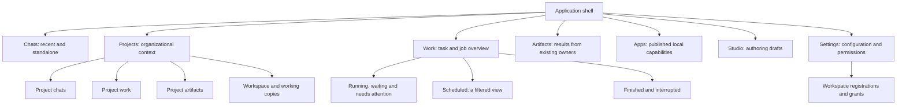

# Information architecture and navigation design

Status: source-audited target design, 2026-10-29. The user requested a coherent IA and root corrections while there are zero production users. Read [data/storage](DATA-AND-STORAGE.md) for identities and [implementation design](IMPLEMENTATION-DESIGN.md) for authority. This is not an implemented UI redesign or a claim of format/tool support.

## 1. Current source baseline

`index.html` and `src/main.ts` expose Chats, Artifacts, Apps, Schedule and Studio with separate open/close handlers. `WorkspacesPanel` adds Projects and a current-chat folder/mode bar. Project chats are discovered from bindings carrying `projectId`; project creation requires a folder. The task overview is called Schedule even though it includes immediate tasks. Existing Canvas, interactive surfaces, local drafts and page controls are useful foundations to preserve.

Do not plan from an earlier assumption that the app only has standalone chats or disposable folder copies. Retained/shared Realms, direct editing, independent app pages and folder controls exist in source. Their boundaries and verification still need the separate correction/security gates.

## 2. Canonical concepts and navigation

Use one term per concept. A project organizes work; an identified workspace binds an external folder; a working copy is the sandbox candidate tree; a task is bounded user work; a run/attempt is execution; an artifact is a discoverable reference to an owned result. A surface is the existing interactive representation, not a new task or filesystem container.

The diagram is a navigation map, not a requirement for seven permanent columns or nested card panels. Preserve the current compact shell and adapt narrow screens. Projects can remain a sidebar collection; their overview provides context without adding a second active-agent engine.

Rename the general task destination to **Work**. **Scheduled** is a filter/tab within it, not the name of all immediate work. A root running from ordinary chat can expose activity and a link back without silently converting conversation into an unattended task. Child attempts are expandable task details, not separate top-level chats by default.

Settings retains its existing configuration families: models/providers, integrations, channels, skills/voice, appearance/general and usage. Workspace registrations/grants have a focused management destination; live folder actions remain visible in the chat/project context. Usage and resource health show actual measured scope, not invented progress/capacity.

## 3. One frontend navigation owner

Replace scattered cross-page close/open side effects with one TS navigation state/reducer and narrow page adapters. This is presentation state; it does not belong in the Rust task scheduler. Proposed internal routes are typed identities, not arbitrary paths accepted as authority:

| View | Identity/context |
| --- | --- |
| Chat | `sessionId`, optional selected surface; effective binding shown separately |
| Project | `projectId`, subview/filter; does not retarget an active chat |
| Work overview | lifecycle, scheduling, project/workspace and attention filters |
| Task details | `rootId`, selected run/child/detail; root authority is native |
| Artifact | existing owner/reference and exact surface/output identity |
| App | `appId` and admitted view/action context |
| Studio | existing draft/package identity; publication remains separate |
| Settings | typed section and optional registered entity ID |

Native commands validate every operation regardless of frontend route. Navigation cannot approve, cancel, rebind or delete execution by itself. Update all internal link producers/consumers at clean cutover; no stale route shim is required. Preserve outside-agent surface action ownership and explicit source links.

Keep a bounded return stack and restore local filters/scroll/selected surface where appropriate. Source content, canonical data and task truth are not copied into navigation history. Background events update badges/status but do not navigate or steal focus.

## 4. Project and workspace interactions

Project creation asks for a name and optional preferred workspace; organizing a research chat does not require filesystem access. Register/bind a folder through a separate explicit native operation. Creating a new project chat may offer its preferred workspace but must show and admit the resulting binding; project membership alone is not consent.

The current-chat context shows project membership, actual folder identity/display path, direct versus copy/review mode, sharing and access/readiness. If the project's preferred folder differs from the chat's bound folder, show that difference rather than silently rebind. Missing/revoked access remains clear even when the sidebar project is selected.

Moving a chat/task to a project changes organization. Changing its workspace changes execution authority and needs a separate current-revision operation. Switching projects, selecting another surface and opening a task do not mutate a global working directory. Native records a fixed execution grant at root/run admission and compares it at dispatch; it never substitutes the chat's later binding. Rebinding marks affected queued/scheduled/waiting work and descendants stale/blocked as well as fencing active work/approvals. Retargeting needs an explicit task amendment/continuation; child scope is a narrowed native-derived grant, not a new binding. See the [execution-grant contract](DATA-AND-STORAGE.md#execution-grants-do-not-follow-a-mutable-chat-binding).

Folder discovery/listing is a governed scoped tool/view over the registered workspace, not a general file explorer rooted at the user's home. Working-copy review stays with the sandbox owner and exposes actual changed paths, fingerprints, Apply/Undo and uncertainty. A detached copy stays discoverable until explicit discard.

## 5. Artifacts, apps and interactive continuity

Artifacts index existing canonical surfaces and owned file/media outputs by reference. Preserve the current surface library and add links through each existing owner's metadata where supported; do not copy data into a second artifact store or imply unsupported document previews. A project/workspace filter changes discovery, not ownership or access.

An app is executable published behavior with its own lifecycle; an artifact is an output/reference. A Studio draft remains inert until reviewed publication. Tasks can produce either, but producing a draft is not publishing an app. Keep original app state/package/asset owners and resource accounting.

Every task may retain input forms, intermediate comparisons and final outputs across several surfaces. Use the existing single mounted live element per surface and Canvas picker. Selecting/reopening results preserves local interactions and drafts. Completed work can continue through explicit validated actions; no completion-driven read-only rewrite.

## 6. Attention, accessibility and deletion

Work surfaces needs-input, approval, interrupted/uncertain and failed states separately from ordinary running/finished entries. Trusted approvals stay distinct from model-created UI. Voice uses the same canonical agenda/action checks; a child cannot speak a separate authority grant.

Keyboard/focus behavior must survive navigation refactoring. Announce meaningful status changes, avoid streaming floods, retain clear primary action text and accessible utility icons/tooltips. Long collections use existing bounded paging/search without discarding canonical records. Verify actual wide/narrow WebKit and exact page/filter behavior.

Use precise destructive verbs: **Remove project**, **Detach folder**, **Discard working copy**, **Delete chat/task**, **Apply changes** and **Delete source files** are different operations. The confirmation/review names affected owned/shared data and uncertain effects. Do not hide working-copy destruction behind a harmless-looking disconnect action.

## 7. Implementation scope and acceptance

Implement native identities/grants and metadata references before making UI claims that depend on them. Then replace navigation ownership, separate membership from bindings, expose Work/Scheduled consistently, and update deep-link producers together. No compatibility aliases or duplicate page state remain after enabled cutover.

Preserve all current capabilities, multiple surfaces, app/Studio distinctions and non-destructive project removal. Prove standalone/project chats with and without folders; shared/copy/direct modes; project folder change without retargeting; sticky revocation; same-path replacement refusal; detach/discard distinction; artifact reopening; task continuation; source receipts; voice parity; and collection behavior under many jobs. IA-01–IA-06 track these changes; a diagram is not UI acceptance evidence.
