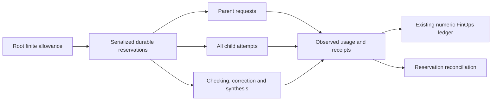
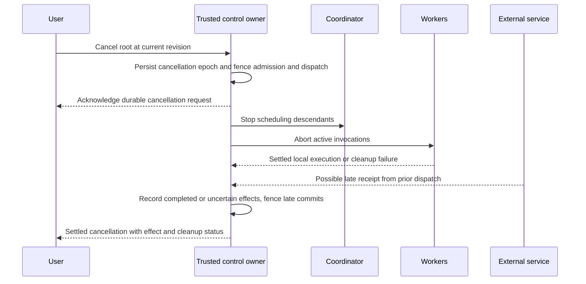

# Operations, governance and quality of service

Status: proposed, 2026-10-29. The [architecture](ARCHITECTURE.md) assigns owners; the [validation plan](VALIDATION-AND-ROLLOUT.md) defines proof. Targets below are provisional, not measured guarantees.

## 1. Scheduling and accounting

Use one shared dispatcher with separate provider, tool and contained-worker capacity. Begin with one active primary-local generation. Admission queues work; capacity determines execution. Prioritize cancellation, authority revocation and trusted user controls over progress. Give direct user continuations preference while using aging and per-root quotas to avoid starvation. Approval/input/dependency waits release execution slots.

Root limits cover model requests, tool attempts, child creations/replacements, retries, context/output, active work and deadline. Reserve checking/synthesis capacity before creating children. Reservation is authorization accounting; measured usage is telemetry. Do not double-count transferring a reservation from root to child, and do not refund uncertain provider consumption merely because the worker died.

The native capacity profile currently models concurrent slot dimensions separately: primary generation, provider request, child execution, verification execution, tool invocation, persistent service, contained process and integration process. An omitted dimension is unavailable, even when another dimension has free capacity; it is never inferred from spare model slots. These leases are concurrent-capacity accounting only. Cumulative requests/tokens/bytes/time/child creations need separate root budgets and trusted usage receipts before delegation can be enabled.

Define wall deadline, queue wait, human wait, external wait, per-attempt active time, aggregate worker time, native CPU time and monetary estimates separately. Parallel workers can consume twice the aggregate work in the same elapsed interval. Existing `activeMs` semantics cannot silently change during the ownership cutover. Select units, charging rules and crash treatment before coding.

Per-provider rate limits and unavailable capacity produce bounded queueing/backoff, not unlimited retries or silent paid fallback. One logical operation retains its idempotency identity across safe attempts. Non-idempotent uncertainty is reconciled instead of retried. Strict monetary ceilings remain refused where prices/tool charges cannot be conservatively enforced.

## 2. Cancellation and recovery

Cancellation and dispatch-start decisions serialize in the trusted owner. After the cancellation fence commits, queued/reserved operations cannot start dispatch, even if admitted earlier. Only operations whose trusted dispatch handoff began before that fence may remain in flight; their effects can complete later or remain uncertain. A reservation or previously issued start proposal is not a reusable dispatch grant. The broker must recheck at its actual dispatch handoff, rather than give a worker authority to send later. A durable cancellation receipt is distinct from verified process-tree termination or remote cancellation.

| Failure boundary | Recovery rule |
| --- | --- |
| Parent worker dies | Coordinator/control records retain children; pause new child effects by default until admitted recovery, preserving any running operation's receipt |
| Child worker dies | Retain attempt and accepted outputs; retry only its safe unfinished work within root limits |
| Trusted control owner dies | Supervised worker cleanup; restart loads durable records, invalidates old channel grants and reconciles in-flight operations |
| Queue/event connection breaks | Reconnect by cursor and deduplicate; no duplicate child creation or effect dispatch |
| Crash between reservation and launch | Retain a queued/reserved identity; trusted recovery proves no dispatch or marks uncertainty |
| Crash after dispatch before receipt | Mark exact operation uncertain; obtain service status/read-back or require scoped user reconciliation |
| Persistence fails | Stop new consequential dispatch; never acknowledge an unsaved permission or completion |
| Old attempt returns after replacement | Fence its dispatch/commit authority; retain late output only as attributed diagnostic evidence |
| Deadline or resource exhaustion | Stop contained descendants, preserve receipts and report the effective limit and cleanup result |
| App quits, machine sleeps or network disappears | Explicit interrupted/wait state; no claim of execution while unavailable or automatic missed-time replay |

Attempt/lease fencing protects local commits and broker admission, not effects already accepted by another service. Restart issues a fresh epoch; stale channels cannot regain authority by replaying an ID. Cleanup failure is visible and prevents reuse of a quarantined execution resource.

### Recovery authority and allowance

Carve a finite reconciliation allowance from the original root envelope before ordinary execution, alongside verification/finalization capacity. Cancellation revokes ordinary work; it does not grant reconciliation. A user-authorized recovery request binds exact uncertain operation IDs, permitted status/read-back tools, destination, expiry and remaining recovery allowance to a separate recovery invocation. Root lineage/accounting remain; no new reasoning worker or ordinary task resumption is implied. Recovery network reads retain the existing egress/approval policy. A compensating external mutation needs its own explicit exact-operation authorization and available allowance.

If no root allowance remains, do not reset counters or automatically grant more. Retain uncertainty and offer manual service-side reconciliation with a revision-bound user record, consistent with current recovery. Incoming late receipts and native containment cleanup require no new provider/tool dispatch; their bounded control capacity is reserved separately under the global profile. A manual note is a labelled user attestation, not a forged service receipt or automatic outcome pass. Freeze exact recovery sublimits, approval expiry and supported adapters under AR-04/07 before automation.

## 3. Security and governance

Default mutations, deletion and egress to Ask under current policy. Exact arguments, destination, resource, expiry and capability revision bind approvals. Deferred work revalidates immediately before dispatch. A parent cannot approve a child, and generated approval-looking surfaces have no authority.

No reasoning worker receives vault retrieval, private app files, unrestricted environment, arbitrary egress or general native commands. Integrations retain declared variables and the pinned script-free installation lifecycle. Endpoint allowlisting alone is not containment: workers must be unable to open a direct connection or invoke another runtime to bypass mediation. Integration-provided remote autonomy is outside the app's controllable internal child count and needs a separately reviewed capability/data contract.

Operation-composition restrictions are enforceable only where a registered rule names observable actions/resources and evaluates trusted history. An arbitrary natural-language exclusion or worker-supplied requirement mapping is not a deterministic security guarantee. Unsupported mandatory restrictions must be refused or resolved before execution, not advertised as enforced by semantic scoring.

Contain filesystem writes, process creation, signals, inherited descriptors, network, CPU and memory through the existing sandbox project. Verify effective descendant scope and platform support; a heap option, manifest declaration, wall timeout or sampled RSS is not a hard CPU/memory quota. Required protection fails closed.

Maintain audit records of admitted user/policy revisions, child lineage, reservations, approvals/denials, dispatch, receipts, correction decisions, acceptance method and stop reason. Separate content from numeric telemetry. Standard process/channel identity suffices for internal provenance; do not invent cryptography or treat an artifact hash as evidence of semantic truth.

Delete task-owned child inputs, candidates, drafts and raw diagnostics with the root after execution settles and uncertainty is acknowledged. Explicitly identify retained shared session/source/integration/numeric records and downloaded/external copies. A referenced artifact cannot be deleted through a child-local operation that breaks another owner. Memory remains a user-selected integration; optional memory failure cannot block local recovery.

## 4. QoS and non-functional requirements

Safety invariants are release gates. Statistical objectives need named hardware, workload, sample size, runtime versions and measurement windows. Do not report a passing fixture as a universal guarantee.

| ID | Requirement or proposed objective | Measurement / release interpretation |
| --- | --- | --- |
| NFR-01 | No authority expansion through delegation | Adversarial caller/scope/revocation tests before effects; hard invariant |
| NFR-02 | No descendant budget reset | Concurrent admission, crash and restart checks against one root ledger; hard invariant |
| NFR-03 | Durable intent before consequential dispatch | Fault injection at every journal/dispatch boundary; unsaved state refuses work |
| NFR-04 | No false verified completion with failed/unknown mandatory evidence | Evidence invalidation and terminal-transition tests; human/semantic uncertainty remains labelled |
| NFR-05 | Responsive local controls: p95 ≤250 ms, p99 ≤1 s | Proposed target from local input to acknowledgement under defined saturation; measure inference separately |
| NFR-06 | Cancellation reaches authoritative admission and dispatch fence promptly | Proposed p99 ≤1 s from trusted receipt of request to durable fence; test pre-admitted queued work too; cleanup time measured separately by backend |
| NFR-07 | Bounded queues, messages, context and artifacts | Freeze numerical limits in initial profile; overload rejects/coalesces, never silently loses terminal/control events |
| NFR-08 | No starvation under sustainable admitted load | Aging/per-root scheduling test with defined maximum wait profile; no deadline guarantee above capacity |
| NFR-09 | Reconstructable lineage and outcomes | Every child/attempt/operation attributable after restart; cursor replay produces same accepted state |
| NFR-10 | Measured resource enforcement | Native CPU/memory/descendant probes, effective settings and overshoot; unsupported required modes refused |
| NFR-11 | Privacy and deletion scope | Canary secrets absent from worker surfaces/logs/env; child and root retention/deletion tests |
| NFR-12 | Existing interactions preserved | Wide/narrow actual WebKit, drafts/conflicts, multiple surfaces, local controls and voice/action parity |
| NFR-13 | Truthful cost and usage | Unknowns remain unknown; failed requests/checks counted; no silent paid provider change |
| NFR-14 | Bounded detector overhead and error | Measure extra requests/time, false positives and missed drift on frozen labelled scenarios |
| NFR-15 | Aggregate capacity holds across all admitted workload classes | Global leases include chats/tasks/children/verifiers/apps/integrations; prove [scale and observability](SCALE-AND-OBSERVABILITY.md) under saturation and recovery |

The machine must be awake and app/provider available for local execution. There is no unqualified uptime SLA or hard model-response latency promise. Set native cleanup limits per backend after measuring real operations; a fixed universal timeout is not assumed safe.

## 5. Operational visibility

Show the root goal, status, current useful activity, pending input/approval, limits, child count and accepted/partial results. Child details expose assignment, scope, attempts, evidence and reason for stopping. Do not show fabricated progress percentages or raw hidden reasoning.

Correlate root → child → attempt → request/tool operation → candidate → check → output/review. Track queue/active/wait time separately; include retries and merge overhead. Duplicate progress can be coalesced. Notify only for meaningful changes, completion, failure or required action; consolidate repeated child questions through the root.

The [latest local-run audit](LOCAL-FAILURE-LESSONS.md) requires stream completion, task acceptance and stop initiator/cause to be distinct fields. A final `end` or successful projection can coexist with failed tools or missing outcome evidence. Retain typed error/dispatch categories and operation/Realm receipts across abort; diagnostic-content deletion leaves explicit missing-evidence/tombstone status, not inferred historical success.

Use the existing workspace, Canvas and task controls. This package does not define a new dashboard/report compiler or rendering workflow. Any later UI implementation follows the maintained skill-authoring and WebKit contracts.
