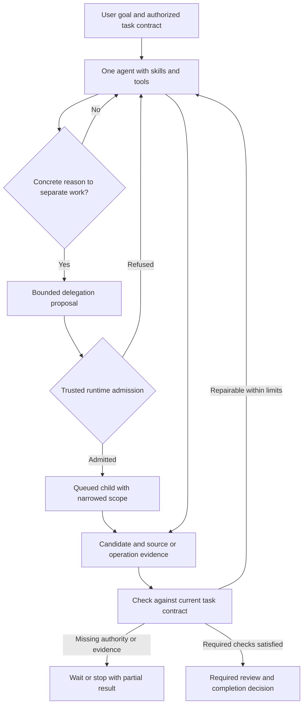

# Agent execution and bounded delegation

Code audit before integration: the newer product history already contains decision/shaping/chaining, additional skills, voice, diagrams and cache features; the runtime history contains the native authority path. The committed product baseline is now reconciled; native adapter work and acceptance remain. [Pinned source inventory and actual gaps](CODE-STATUS-AUDIT.md).

Latest integrated source checkpoint (2026-10-30): committed product `main` through `625787d` is reconciled into the isolated runtime branch, retaining schema 20 native authority and the newer decision, skills, cache, diagram and voice features. Existing task/review/output/schedule code is available for reuse. Product Work execution remains disabled; its admission/lifecycle, context/decision/tool adapters, acknowledgement and original-outcome gates remain open. [Code audit and integration result](CODE-STATUS-AUDIT.md).

Design baseline: 2026-10-29. Status: architecture and active implementation. Tauri starts the native actor on macOS/Linux; private protocol v2 now carries health and exact candidate-commit operations; and native control can persist a root/session-fenced immutable candidate generation with a durable receipt. Desktop Work definitions and revisioned list/read/cancel/delete controls now use the native actor; the desktop TypeScript task journal/pump is removed. TypeScript still owns product workspace routes. Task execution/scheduling is explicitly unavailable, the actor profile refuses execution, candidate commits are not published to canonical sessions, and no full delivery or outcome gate has passed. Browser development retains its separate task backend. Diagrams show the target unless explicitly labelled current behavior. Track live changes and verification in [implementation progress](IMPLEMENTATION-PROGRESS.md).

Native supervision proof now includes protected helper cleanup records and durable run settlement with real contained Node on macOS/Linux. Product task dispatch remains disabled. See [current implementation evidence](IMPLEMENTATION-PROGRESS.md#protected-worker-cleanup-and-native-settlement--2026-10-30).

A separate contained task reasoning entry, fresh per-run scratch and native invocation-bound proposal channel are now packaged and proved through harnesses. It cannot use app/canonical session command families; product execution and provider dispatch remain unavailable. [Current evidence](IMPLEMENTATION-PROGRESS.md#separate-contained-reasoning-entry-and-bound-task-channel--2026-10-30).

Native provider tickets now bind an immutable local-model policy to exact request bytes and durable budget/capacity commitment. Rust tests prove races, restart uncertainty and settlement; native consent, streamed I/O and canonical publication are now exercised by the assembled fixture; product Work execution remains disabled. [Current evidence](IMPLEMENTATION-PROGRESS.md#native-provider-approval-and-durable-budget-handoff--2026-10-30).

The design applies to one agent first. Delegation is an optional extension of the same task contract, authority, budgets, evidence and recovery. The default is zero children; neither task length nor a role name justifies creating one.

## Reading map

| Document | Question it answers |
| --- | --- |
| [Architecture](ARCHITECTURE.md) | What owns decisions, authority, state and execution? What remains inside each repository? |
| [Rust-first implementation design](IMPLEMENTATION-DESIGN.md) | Which concrete modules, protocols, state transitions and persistence boundaries implement the architecture? |
| [Root corrections](ROOT-CORRECTIONS.md) | Which inspected control paths must be replaced or removed instead of wrapped in compatibility layers? |
| [Data identity and storage](DATA-AND-STORAGE.md) | What exists in source, where is data stored, and how are projects, folders, bindings and working copies identified? |
| [Information architecture](INFORMATION-ARCHITECTURE.md) | How do Chats, Projects, Work, Artifacts, Apps, Studio and Settings fit together without confusing navigation with authority? |
| [Implementation delivery plan](DELIVERY-PLAN.md) | In which vertical slices do we replace the old path, and what proves each slice? |
| [Delegation and runtime contracts](DELEGATION-AND-CONTRACTS.md) | When is another agent justified, and how does admission enforce its boundaries? |
| [Drift, evidence and stopping](DRIFT-AND-COMPLETION.md) | How do we detect divergence, recover, and distinguish stopping from success? |
| [Operations, governance and QoS](OPERATIONS-AND-QOS.md) | How do scheduling, accounting, cancellation, restart, privacy and service objectives work? |
| [Multiple jobs, resources and observability](SCALE-AND-OBSERVABILITY.md) | How do all jobs share finite machine capacity, remain fair under load, and expose system/job health? |
| [Validation and rollout](VALIDATION-AND-ROLLOUT.md) | What must be decided, implemented and independently proved before enabling this design? |
| [Research basis](RESEARCH.md) | Which external observations informed the proposal, and what do they not prove? |
| [Independent review](REVIEW-2026-10-29.md) | What did Astra find, what was corrected, and what proof remains open? |
| [Local failure lessons](LOCAL-FAILURE-LESSONS.md) | What did the latest three installed run records reveal, and which regression cases must the implementation retain? |
| [End-to-end implementation prompt](IMPLEMENTATION-PROMPT.md) | What complete instruction should an implementing agent follow? |

## End-to-end view

The proposal separates three questions: whether a task may delegate, whether delegation seems useful, and whether a particular child may execute now. Code can enforce permission and resource constraints. It cannot universally prove that another reasoning context was intellectually necessary. That quality judgment is evaluated against outcomes and comparable single-agent baselines.

## Current baseline and proposal boundary

| Area | Inspected foundation | Proposed extension |
| --- | --- | --- |
| Task execution | Browser development task journal/runner in `sidecar/tasks.ts`; desktop native metadata controls with execution unavailable | Explicit child lineage, shared root reservations and dependency-aware scheduling |
| Result review | Selected typed result checks, output receipts and revision-bound user review | General requirement/evidence record, drift checkpoints and typed stopping reasons |
| Integrations | Existing catalog, schemas, policies, approval waits, logging and configured scopes | Derive narrower child scope through the same lifecycle; no second connector path |
| Surfaces | Canonical sessions, multiple interactive surfaces and local view interactions | Child candidates accepted through existing owners; preserve drafts and independent surfaces |
| Security | Native vault/policy source and private desktop transport; ISO1–ISO8 remain open | Non-bypassable authority, accounting and persistence boundaries under ADR-050/052 |

Source inspection is not a claim of installed behavior or end-to-end security. Native policy functions do not establish containment or mediation of every request. Existing local-provider and original source/value/interpretation/interaction/output failures remain open.

## Governing contracts

- [Working rules](../../AGENTS.md), [current app](../SPECS.md), [task contract](../AGENT-TASKS.md) and [implementation tracker](../IMPLEMENTATION-STATUS.md).
- [ADR-044](../ADR.md#adr-044-desktop-engine-uses-private-parent-pipes-2026-10-27), [ADR-050](../ADR.md#adr-050-minimal-trusted-broker-and-required-system-isolation-2026-10-29) and [ADR-052](../ADR.md#adr-052-indestructible-rust-engine-and-minimal-trusted-broker-architecture-2026-10-29).
- [Required isolation](../sandbox/SYSTEM-ISOLATION.md), [workspace lifecycle](../sandbox/FOLDER-WORKSPACES.md), [skill authoring](../SKILL-AUTHORING.md), [skill loading](../SKILLS.md) and [Canvas](../CANVAS.md).
- [Handover](../HANDOVER.md) and [evaluation](../EVALUATION.md) own implementation and outcome evidence. This directory owns the proposed design, not a duplicate evidence log.

Do not silently resolve a conflict by treating a proposal as an accepted decision. The current working rules and accepted trust boundaries govern; inconsistencies needing implementation decisions are explicit gates in the rollout document.
