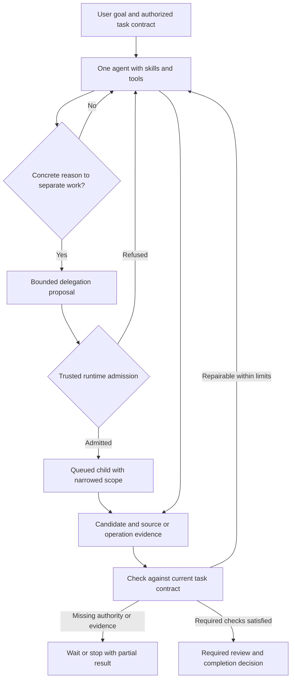

# Agent execution and bounded delegation

Design baseline: 2026-10-29. Status: proposed architecture, documented at the user's request. This package does not authorize implementation, enable delegation, establish isolation, or close an outcome gate. Diagrams show the target unless explicitly labelled current behavior.

The design applies to one agent first. Delegation is an optional extension of the same task contract, authority, budgets, evidence and recovery. The default is zero children; neither task length nor a role name justifies creating one.

## Reading map

| Document | Question it answers |
| --- | --- |
| [Architecture](ARCHITECTURE.md) | What owns decisions, authority, state and execution? What remains inside each repository? |
| [Delegation and runtime contracts](DELEGATION-AND-CONTRACTS.md) | When is another agent justified, and how does admission enforce its boundaries? |
| [Drift, evidence and stopping](DRIFT-AND-COMPLETION.md) | How do we detect divergence, recover, and distinguish stopping from success? |
| [Operations, governance and QoS](OPERATIONS-AND-QOS.md) | How do scheduling, accounting, cancellation, restart, privacy and service objectives work? |
| [Validation and rollout](VALIDATION-AND-ROLLOUT.md) | What must be decided, implemented and independently proved before enabling this design? |
| [Research basis](RESEARCH.md) | Which external observations informed the proposal, and what do they not prove? |

## End-to-end view

The proposal separates three questions: whether a task may delegate, whether delegation seems useful, and whether a particular child may execute now. Code can enforce permission and resource constraints. It cannot universally prove that another reasoning context was intellectually necessary. That quality judgment is evaluated against outcomes and comparable single-agent baselines.

## Current baseline and proposal boundary

| Area | Inspected foundation | Proposed extension |
| --- | --- | --- |
| Task execution | App task journal, serialized execution slot, bounded runs and cumulative reservations in `sidecar/tasks.ts` | Explicit child lineage, shared root reservations and dependency-aware scheduling |
| Result review | Selected typed result checks, output receipts and revision-bound user review | General requirement/evidence record, drift checkpoints and typed stopping reasons |
| Integrations | Existing catalog, schemas, policies, approval waits, logging and configured scopes | Derive narrower child scope through the same lifecycle; no second connector path |
| Surfaces | Canonical sessions, multiple interactive surfaces and local view interactions | Child candidates accepted through existing owners; preserve drafts and independent surfaces |
| Security | Native vault/policy source and private desktop transport; ISO1–ISO8 remain open | Non-bypassable authority, accounting and persistence boundaries under ADR-050/052 |

Source inspection is not a claim of installed behavior or end-to-end security. Native policy functions do not establish containment or mediation of every request. Existing local-provider and original source/value/interpretation/interaction/output failures remain open.

## Governing contracts

- [Working rules](../../AGENTS.md), [current app](../SPECS.md), [MVP scope](../MVP-SPECS.md) and [implementation tracker](../MVP-CHECKLIST.md).
- [ADR-044](../ADR.md#adr-044-desktop-engine-uses-private-parent-pipes-2026-10-27), [ADR-050](../ADR.md#adr-050-minimal-trusted-broker-and-required-system-isolation-2026-10-29) and [ADR-052](../ADR.md#adr-052-indestructible-rust-engine-and-minimal-trusted-broker-architecture-2026-10-29).
- [Required isolation](../sandbox/SYSTEM-ISOLATION.md), [workspace lifecycle](../sandbox/FOLDER-WORKSPACES.md), [skill authoring](../SKILL-AUTHORING.md), [skill loading](../SKILLS.md) and [Canvas](../CANVAS.md).
- [Handover](../HANDOVER.md) and [evaluation](../EVALUATION.md) own implementation and outcome evidence. This directory owns the proposed design, not a duplicate evidence log.

Do not silently resolve a conflict by treating a proposal as an accepted decision. The current working rules and accepted trust boundaries govern; inconsistencies needing implementation decisions are explicit gates in the rollout document.
