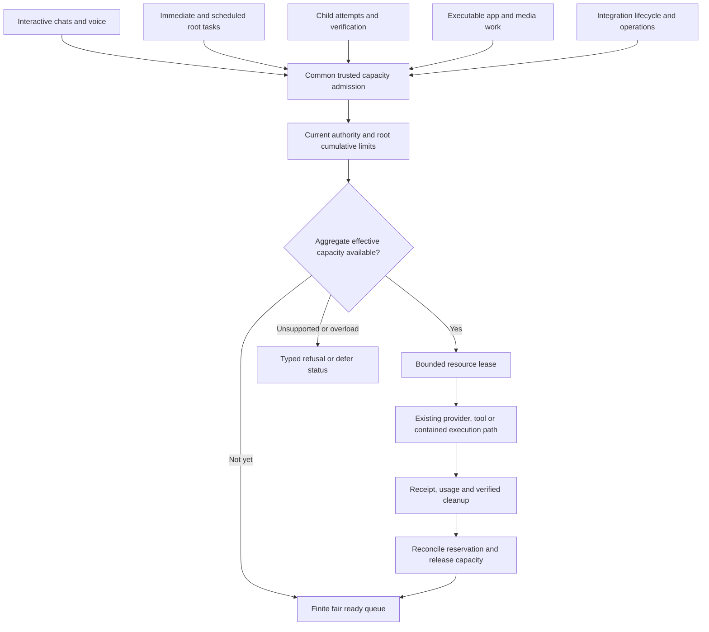
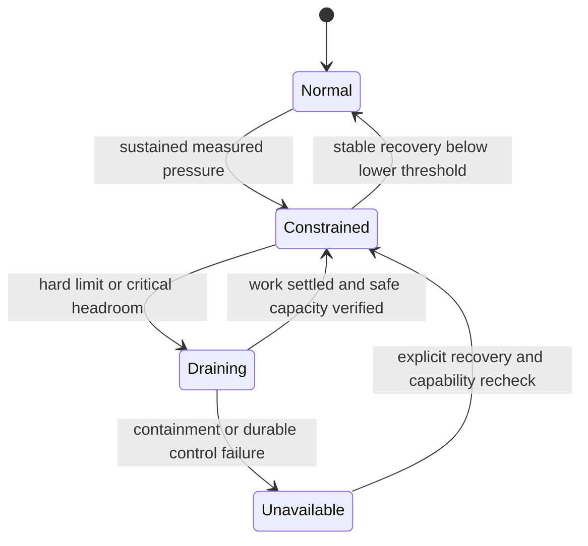
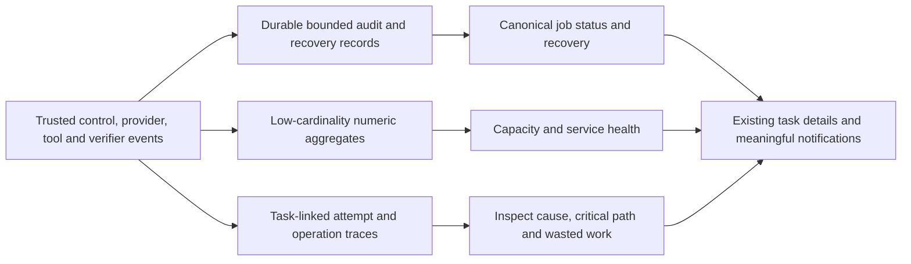

# Multiple jobs, aggregate resources and observability

Status: proposed, 2026-10-29. Extends [operations and QoS](OPERATIONS-AND-QOS.md). This is a desktop, bounded-capacity design, not a claim of unlimited concurrency or a distributed execution service. Many durable queued jobs are distinct from many simultaneously executing agents.

## 1. System-wide admission is required

A job is a root task or another independently admitted app workload. Its agents, children, attempts and tool operations are descendants for accounting. A job within its own budget may still exceed the machine's remaining capacity. Conversely, free machine capacity does not expand a job's authority or spending limit.

Use one authoritative capacity allocator for shared resources, composed with existing runners and their narrower limits. Do not add a competing agent scheduler beside an independent app pool that can collectively exhaust the host. Existing pools acquire common capacity through narrow adapters; they keep their canonical app/task/domain state. A resource lease is not another task database or permission grant.

Trusted admission combines: system ceiling, execution-class allowance, current provider/integration capacity, per-root share, descendant allowance, and effective containment/resource support. The most restrictive applicable limit wins. No child can self-issue or extend a lease. External services' internally spawned agents are outside this allocator's observable process count and need explicit capability/cost limits before use.

## 2. Account for real resources and their owners

| Resource | Shared control and accounting | Important limit |
| --- | --- | --- |
| Model generations | Active/pending slots per configured provider endpoint and measured hardware profile | Start primary-local concurrency at one; logical agent count is not capacity |
| Resident model memory | Separate shared provider-process/model residency from per-request context/KV allocations | Do not charge shared weights once per child or call sampled memory an enforced quota |
| Worker CPU and memory | Effective contained process-tree limits plus conservative launch reservations | Sum children, verifiers, native jobs and retained live processes; include descendants |
| Tool/server processes | Global process/descriptor/startup caps and per-integration ceilings | Persistent servers consume resources while no tool call is active |
| Network/provider requests | Per-destination in-flight/rate caps, bounded connection and response buffers | Rate limits and monetary estimates are separate; backoff has finite attempts/deadline |
| IPC/event transport | Per-channel and global queued-byte/frame limits | Bound before parsing and before copying; reserve control-event capacity |
| Storage | Enforce size/count bounds for app-owned records and outputs; separately account sandbox workspaces/temp and external use | Worker file growth needs an effective filesystem/volume quota for a hard cap; headroom sampling alone is best effort |
| UI and speech | Bounded render/event work and existing single agenda/playback policy | Background streams cannot monopolize the main-window event loop or focus |

An externally managed local provider may lie outside app-enforced CPU/memory containment. Report its scope as unmanaged, constrain admitted request concurrency and context, and measure residency separately. If a task requires a hard aggregate limit that cannot include that provider, refuse that requirement rather than claim the worker quota covers it. Shared accelerators/unified memory require a hardware-specific effective profile; process RSS alone cannot establish total device headroom.

Reserve host headroom for the trusted broker, OS and interactive UI. The budget cannot equal all reported free memory. Freeze conservative profiles from measurement, including model residency, context length, worker count and output size. Reservations prevent known overcommit; measured pressure provides earlier warning but is not a replacement for enforced quotas.

Capacity keys identify the actual shared service/process, provider quota account and accelerator/memory domain, not merely a user-visible configuration alias. Two aliases reaching the same constrained backend share its ceiling; unknown mapping uses a conservative common domain until resolved. Shared model/integration residency has a service-owned lease and reference count independent of any one root. A root ending releases only its request/work holdings; residency is released only after the service owner verifies actual unload/termination. Freeze domain identity and ownership under AR-09.

For every bounded resource dimension, admission requires `live reservations + requested reservation + protected headroom <= supported capacity`. Count each shared provider/model residency once, then add its per-request allowance. CPU uses declared aggregate execution/bandwidth units; memory uses the backend's declared accounted resource. Unknown/unmanaged consumption is explicit, never a zero term. Where that uncertainty prevents a required hard aggregate guarantee, the profile is unsupported.

Illustration, not a supported-size promise: forty saved tasks with up to four child assignments each do not imply 160 child processes. The queue profile may refuse some admissions; admitted children remain durable work records. With one local generation slot, only one generation runs, while a separately bounded tool pool can make progress. Human waits release runnable slots. Persistent server/model residency and retained live workers remain charged. An interactive request receives the next eligible service opportunity under the declared fairness policy, not a guarantee that an already-running non-preemptible request ends immediately.

## 3. Leases, queues and fair service

Each execution lease identifies the root/invocation/attempt, resource class, reserved quantities, effective limits, expiry and cancellation epoch. Allocation and release are serialized by the trusted owner. Reclaim compute/process capacity only after verified settlement or containment cleanup; a missed heartbeat alone is not proof the process stopped. Reconcile unknown usage conservatively.

Cumulative root allowances persist across the task lifetime. Global execution leases are short-lived capacity holdings; a queued task does not reserve the whole machine for its entire lifetime. Waiting for human input, a child or a deadline releases runnable capacity, while any retained resident process/memory remains charged until actually released. Park or terminate idle workers according to the existing contained lifecycle; persist only necessary continuation state.

Use per-class/per-root ready queues rather than a single FIFO that lets an unavailable provider block unrelated work. Proposed classes are control, interactive, verification/finalization and background. Control bypasses model scheduling but still has bounded messages and authorized operations. Use bounded weighted service and aging for runnable work; choose weights and maximum wait under AR-09. A task creating many children does not receive many roots' shares.

Avoid holding one scarce resource indefinitely while waiting for another. Acquire compatible resource sets in a fixed order or release/requeue partial holdings. A parent waiting for children releases its provider slot. Long non-preemptible tool/model requests have declared bounds; prefer priority at safe request boundaries, never interrupt an uncertain external mutation merely to improve a latency chart.

Limit total queued roots, outstanding child requests, queue bytes, admission rate and per-root burst. Reject or defer above the profile with a visible reason and retry condition. Scheduled bursts use the same admission path; they cannot bypass quotas or silently replay missed work. A full queue does not silently drop an accepted operation or terminal record.

## 4. Pressure and overload response

Thresholds include queue age/bytes, memory headroom, CPU saturation, provider latency/errors, disk headroom and broker responsiveness. Freeze high/low thresholds, observation windows and hysteresis per profile. Do not oscillate concurrency after individual samples or treat missing measurements as zero pressure.

Disk pressure detection cannot itself enforce a hard storage cap. Bound trusted app record/output writes at their sole writer, and independently constrain untrusted workspace/temp growth through an effective sandbox filesystem/volume quota where available. If unavailable, expose sampled termination/headroom as best effort and refuse a requirement for a hard workspace or aggregate disk cap. Other applications can consume shared host storage; no app-local reservation guarantees protection against that. Reserved recovery space needs a proved effective mechanism and exhaustion behavior, not a counter that assumes disk remains available.

| Condition | Required action |
| --- | --- |
| Constrained | Stop speculative fan-out, reduce new background starts, coalesce progress, retain interactive/control service |
| Critical resource pressure | Fence new affected starts, drain bounded work, terminate eligible contained computation under policy; retain uncertain-effect records |
| Disk/control persistence cannot safely commit | Refuse new effects; use reserved bounded recovery capacity, expose failure, and require recovery rather than deleting evidence silently |
| Provider slow/offline | Isolate that queue with finite backoff; unaffected classes/providers may continue if current safety policy allows |
| Child/worker crash storm | Cap replacements globally and per root, quarantine failing profile/integration, surface cause |
| Capability/enforcement unavailable | Refuse required protected execution; no uncontained fallback |

Reserve storage space/record budget for terminal and uncertain-operation events before starting effects. If even the durable control path fails, stop new effects and preserve existing records; do not invent a receipt. Broad automatic branch continuation after uncertainty remains deferred under the conservative task recovery policy.

## 5. Observable system and job state

Observe both the system and the job. A healthy provider does not prove a task is progressing; a healthy task does not prove the host can accept another hundred roots. The existing numeric FinOps ledger remains the usage writer; recovery/audit events and content retention have separate declared purposes.

| View | Required observations |
| --- | --- |
| System capacity | Admitted/running/waiting roots and children, live processes, active generations, queue bytes/age, headroom, effective quota backend and overload state |
| Service quality | Admission/control latency, dispatch wait, provider/tool latency and failures, cancellation-fence/cleanup time, deadline misses and class fairness |
| Job outcome | Requirement pass/fail/unknown, useful progress checkpoints, child result acceptance/use, repeated failures, unresolved effects and stop reason |
| Efficiency | Total root compute/requests, context duplication, child/reviewer/merge overhead, critical path, unused work, reservation versus observed usage and unknown charges |
| Reliability | Restarts, stale-event/commit refusals, failed writes, lost/gapped streams, replay deduplication and cleanup/quarantine state |

Use task/child/attempt/operation IDs in protected event records and traces. Do not use every ID, source URL or free-form error as a metric label: that causes unbounded cardinality. Aggregate by bounded execution class, provider identity, operation kind, result category and runtime version; constrain even these catalog dimensions. Redact content/credentials before telemetry and default exports off unless authorized.

Bound telemetry buffers, trace size, event rate, disk usage and retention. Sample optional diagnostics and coalesce progress; do not sample away permissions, dispatch, uncertainty, acceptance or cancellation records needed for recovery. Exporter failure cannot block local controls; critical local audit persistence failure does block new effects. A noisy child cannot flood the broker through its logging path.

## 6. Scale acceptance and limitations

AR-09 must freeze supported workload/hardware profiles, numerical global limits, class weights, headroom and saturation objectives. A profile states queued versus active jobs, model/context, background tool/app load, platform, effective quotas and measured service percentiles. Until measured, supported scale remains unknown; do not promise a job count from a concurrency setting.

Load scenarios include many roots with their maximum children; one noisy root versus interactive work; long provider calls mixed with short tools; a scheduled burst; persistent integration/model residency; cancellation storms; restarts with a full queue; disk pressure; slow telemetry; and a failed provider. Increase offered load beyond the supported profile to prove bounded rejection and recovery, not unlimited throughput.

Verify root fairness, supported effective CPU/memory/process/queue limits, enforced app-record storage bounds and any claimed sandbox storage quota, no duplicate grants, control responsiveness, no cross-job authority or data leakage, preserved terminal receipts and recovery after pressure subsides. Test aggregate memory with actual touched native allocations and shared-model residency separately. Test concurrent native workspace/temp file growth, shared-disk pressure and audit-reserve exhaustion; a headroom poll cannot pass as a quota. Retained-workspace and combined-output correctness still need their original independent checks under load.

This architecture scales admitted work to the machine's proved capacity through bounded scheduling. Multi-machine execution, autoscaling and cross-host trust are separate future designs; this package does not imply them.
