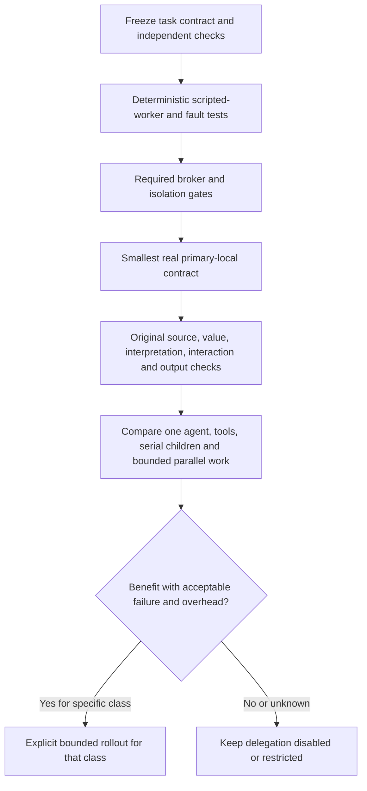

# Validation, open decisions and rollout

Status: proposed, 2026-10-29. Documentation completion is separate from implementation, security acceptance and user-outcome acceptance. Track implementation in [IMPLEMENTATION-STATUS.md](../IMPLEMENTATION-STATUS.md); keep receipts and failed evidence in [EVALUATION.md](../EVALUATION.md) and current state in [HANDOVER.md](../HANDOVER.md).

Concrete module, protocol and cutover details are in [implementation design](IMPLEMENTATION-DESIGN.md), [root corrections](ROOT-CORRECTIONS.md) and [delivery plan](DELIVERY-PLAN.md). Rust owns actual scheduling/control/persistence; TS retains reasoning and framework semantic/presentation adapters. The inspected current task/credential/policy path must be replaced at its root, not kept as a fallback.

[Data/storage](DATA-AND-STORAGE.md) and [information architecture](INFORMATION-ARCHITECTURE.md) add IA-01–IA-06: source-audited identities/navigation, native sticky folder grants, membership/working-copy separation, one frontend route owner, explicit retention and actual UI/outcome proof. These are part of the end-to-end design, not a separate tool/connector path.

## 1. Decisions required before implementation

| Gate | Decision / proof required | Owner |
| --- | --- | --- |
| AR-01 | Confirm proposed modes, one-level/four-child envelope and task classes eligible for adaptive delegation | Product policy |
| AR-02 | Specify one native execution-control aggregate, writer, persistence transactions, startup recovery, cross-owner finalization protocol and cutover from current task writer | App native/task owners |
| AR-03 | Inventory public host/session/provider/MCP APIs; prove trust-domain/channel separation, version-bound canonical finalization, hidden-window/headless lifecycle and exact missing seams | App and Projection in its owning repo |
| AR-04 | Freeze units and values for root/attempt requests, tools, children, active work, deadline, waits, retries, context, output and queue bounds | Product policy and scheduler |
| AR-05 | Specify isolated registered verifier identity, protected fixtures, version-bound receipts/invalidation, semantic unknown handling and user-review boundary | Task/evidence owners |
| AR-06 | Freeze tasks, outcomes, sources, forbidden effects, hardware, comparative budgets, minimum useful benefit and detector error/overhead failure thresholds | Evaluation owner |
| AR-07 | Prove required isolation and broker paths, including non-bypassable dispatch and descendants | Native, sandbox and transport owners |
| AR-08 | Map proposed child/stop states onto one typed lifecycle and all existing interactive continuations | App task/UI owners |
| AR-09 | Freeze global profiles, actual shared-resource/service ownership, effective process/provider/storage/queue bounds, fair service, overload policy and bounded observability; prove saturation and unsupported-hard-quota refusal | Native capacity, scheduler and telemetry owners |

No unchecked gate authorizes a new dependency, paid inference, release, installation or framework edit in the pinned checkout. Do not paper over an ownership conflict with a second writer or broad native command.

## 2. Mechanism and failure matrix

| Scenario | Required independent observation |
| --- | --- |
| Ordinary single-agent task | Zero children; original tools and multiple interactive outputs continue to work |
| Tool-sufficient task | No required delegation; deterministic result satisfies original outcome |
| Separate bounded investigation | Child receives only relevant admitted inputs; parent checks/integrates evidence |
| Duplicate creation and concurrent admission | One logical child per request identity; conflicting reuse rejected; root reservations never oversubscribe |
| Depth/count/provider pressure | Refusal or bounded queue; no recursive spawn, hidden paid escalation or starvation |
| Cyclic dependency or parent holding slot | Cycle refused; waiting parent releases capacity; child can run on one slot |
| Forged identity/scope/consent | Synthetic compromised worker cannot obtain credentials, dispatch outside scope, or impersonate another task |
| Shared-process authority exposure | A compromised process cannot access a supposedly separated invocation/verifier channel or buffer; absent a proved boundary, treat them as one trust domain and refuse required separation |
| Direct bypass | Native file/signal/network/runtime-launch canaries fail while admitted work succeeds |
| Permission/criteria revision during wait | Old operation and candidate refused; affected evidence invalidated |
| Cross-owner finalization race/crash | Concurrent canonical commit, evidence invalidation and terminal transition cannot accept stale versions as current; recovery resolves prepared fences/intents |
| Candidate modifies checker/expected values | Protected verifier inputs unchanged; candidate cannot manufacture a passing receipt |
| Child reports success without evidence | Root remains unverified; no successful completion transition |
| Repeated failure and plan churn | Bounded diagnosis, retained earliest-boundary evidence, explicit stalled/failed result |
| Legitimate exploration and alternative valid path | Detector does not require one fixed tool sequence; false alarm measured |
| Mid-operation cancellation, including every descendant | Durable fence blocks new admission; already dispatched effects and actual cleanup reported |
| Crash before/after each reservation, launch, dispatch, receipt and commit | Recoverable state or exact uncertainty; no silent replay or refunded unknown usage |
| Late/stale child and duplicate/reordered events | Stale commits fenced; cursor/dedup recovers canonical state without duplicate effects |
| External timeout and idempotent retry | Correct logical identity; reconcile uncertain non-idempotent effects; test with local synthetic service |
| Uncertainty with missing dependency edge | All ordinary automatic root/child operations pause; late receipts and explicitly scoped recovery remain; no graph omission authorizes continuation |
| Recovery after cancellation or exhaustion | Recovery requires its own exact authorization and remaining reserved allowance; no counter reset or silent ordinary resumption |
| Concurrent project edits and combined candidates | Isolation, conflict refusal, reviewed promotion and combined outcome tests |
| Partial results and optional children | Mandatory failure remains open; unused children retired before root completion |
| Retention, deletion and output save retry | Scope matches UI; shared records retained explicitly; save retry causes no model/tool replay |
| Control-plane overload and malformed protocol | Queues/frame limits enforced; controls/terminal events survive progress saturation |
| Many jobs across workload classes | Global allocator includes chats/tasks/children/verifiers/apps/integrations; sustained load, bursts, noisy roots, persistent residency and cancellation/telemetry/storage pressure remain bounded with measured fairness |
| Aliased backends and shared service residency | Aliases share actual capacity domains; one root ending cannot refund or terminate live residency still owned/used by another root |
| Provider payload tampering | Approved hostname cannot enable a different model, larger enforced output, unapproved feature or hosted tool/autonomy through worker-formatted JSON |
| Canonical commit acknowledgement loss | Only durable acknowledged snapshots become visible; recovery reloads/re-publishes exact committed revision without model/tool replay |
| Folder/IA corrections | Sticky revocation, same-path replacement refusal, no unassigned Realm grant, membership change without rebinding, detach without silent discard, and current effective scope in all views |
| Rebind with queued/scheduled/waiting descendants | Fixed execution grants retain original folder/mode/Realm scope; rebind invalidates them; no dispatch adopts a later session binding; child scratch/shared membership is explicitly derived |
| Installed-run failure regressions | Ended stream with failed tools is not success; repeated unchanged failures trigger bounded diagnosis; abort after Realm creation retains its receipt/copy; typed stop causes and deletion/missing-evidence status remain attributable |
| Untrusted file growth and audit storage exhaustion | Concurrent native workspace/temp writes obey any claimed effective quota; unsupported hard caps refused; app record bounds and recovery-disk exhaustion tested separately |
| Resource and platform enforcement | Native CPU/touched-memory/descendant tests and unsupported-mode refusal; no inference-based quota claim |
| Existing interactive behavior | Wide/narrow actual WebKit, independent surfaces, drafts, local filtering/paging and voice/action equivalence |

Use synthetic credentials, temporary projects and local endpoints for fault/security tests. Do not expose live secrets or spend on hosted inference to prove deterministic mechanisms. Do not count safe refusal as completion of the intended user task.

## 3. Prove the outcome, not just the mechanism

Start with one child returning a small version-bound result through the actual proposed path. Establish dispatch, evidence and checking before a broader workflow. Then run the original requested outcome with independent source/value/interpretation/action/output checks. Preserve every failed receipt and diagnose the earliest boundary offline before changing prompts/parsers or accumulating variants.

When output authoring is involved, run the matching primary-provider gate in Projection's owning repo: `node scripts/record-view-check.ts --run-local --table-only` for record mappings, or `node scripts/provider-contract-check.ts --run-local` for free-form graph authoring. Source-backed tasks retain independent source/value/receipt checks. Passing one gate does not close failures in another capability.

Compare the same task/input/provider versions across: one agent plus tools; deterministic workflow where applicable; serial children; bounded parallel children only where supported. Use comparable total budgets and report actual extra compute, context duplication, checking/merge effort and wall time. Record both constrained-budget results and any separately labelled larger-budget experiment. Repeat frozen trials enough to expose variability, with the sample plan chosen before observing results.

Metrics: original outcome pass rate, false completion, unsafe dispatch, detector false positives/missed drift, child acceptance/usefulness, redundant/unused output, total requests/tokens/tool attempts, queue/active/wait/merge time, measured resource use and recovery success. Report uncertainty and missing measurements. A different provider or extra budget cannot silently substitute for primary-local acceptance.

## 4. Incremental delivery

1. **Documentation and review:** complete this package, independent architecture review and explicit unresolved decisions, including [global capacity and observability](SCALE-AND-OBSERVABILITY.md). No runtime claim.
2. **Control proof:** implement AR-02/03/04/05 with scripted workers, one writer and fault injection; satisfy applicable isolation gates. No adaptive model delegation enabled.
3. **Single-agent parity:** route existing bounded tasks through the target authority boundary, preserving interactions and original outcome checks.
4. **One child:** prove the smallest primary-local contract with shared limits, explicit evidence, cancellation and restart.
5. **Bounded adaptive classes:** enable only after comparative benefit and failure evidence; keep one local generation initially.
6. **Concurrent or effectful children:** separate gates for provider capacity, branch dependencies, exact approvals, resource enforcement, combined commits and uncertain effects.
7. **Installed verification:** prove the exact app/framework/helper build and native WebKit behavior. Installation does not close failed outcome gates.

If evaluation shows unnecessary delegation, restrict eligible policy rather than rewarding child count. Runtime/model/skill changes trigger regression scenarios for both single-agent and delegated work. Do not automatically raise allowances or weaken acceptance after a regression.

## 5. Review checklist

- Can a fully compromised reasoning worker bypass native authority, overwrite control state or fabricate consent/check receipts?
- Is every durable entity assigned one writer, including the ownership cutover and cross-entity crash boundaries?
- Can a parent waiting for children deadlock a single-slot dispatcher?
- Do descendants, retries, verification and synthesis share one durable root allowance?
- Can cancellation, permission changes or revised criteria race with dispatch/commit?
- Does any success predicate accept mandatory unknowns, stale evidence, missing delivery or uncertain effects?
- Does drift detection penalize a valid alternative approach, or confuse activity with evidence?
- Can loss of optional memory, a channel or a child prevent safe local recovery?
- Are target controls, inspected foundations, installed behavior and proposed defaults clearly separated?
- Do source-backed original outcomes remain open until independently proved?
