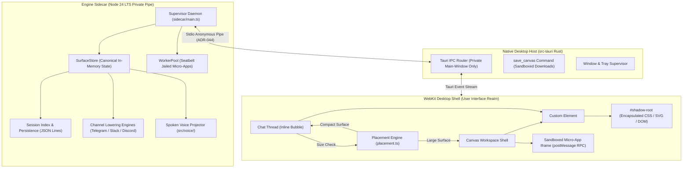
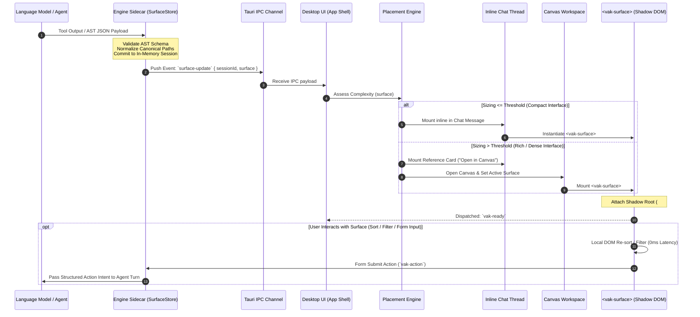
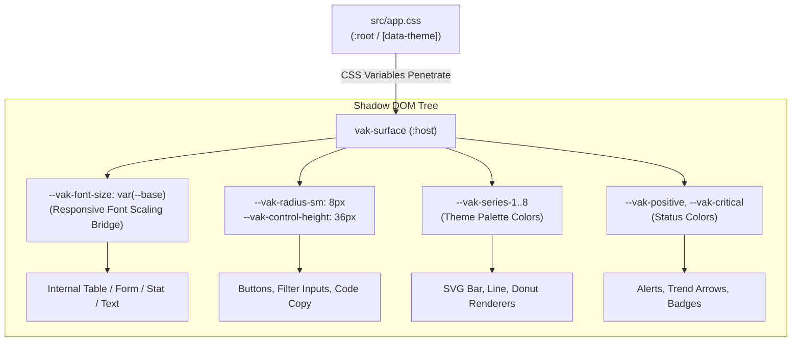
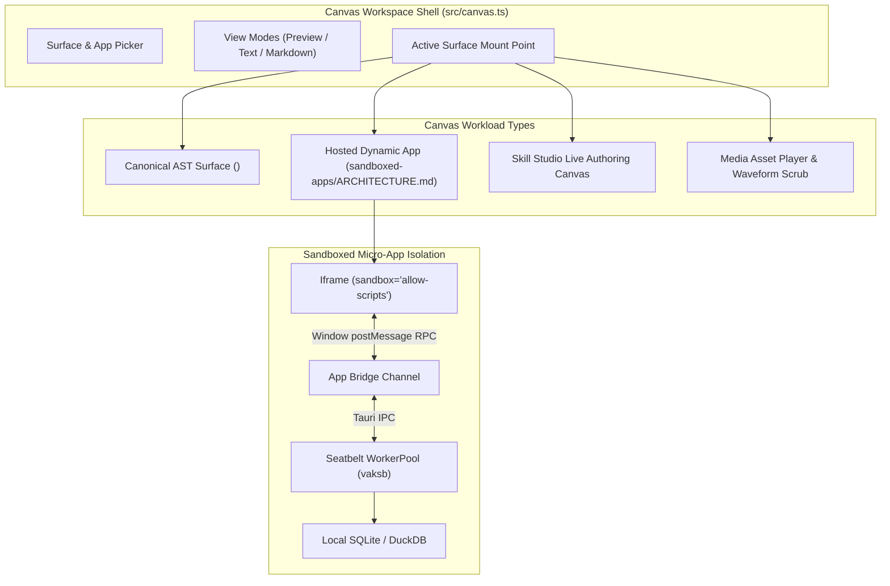

# End-to-End Architecture: Surfaces, Canvas, and Projections
## Comprehensive Engineering Specification: The Universal Rendering Pipeline of Vakyartha & Projection

> **Document Class:** Technical Architecture & System Specification  
> **Target Subsystems:** Projection Framework (`@vak/*`), Vakyartha Desktop App (`src/`, `src-tauri/`, `sidecar/`), Canvas Shell, Multi-Channel Projectors, Spoken Voice Projection  
> **Status:** Production Standard (Aligned with Release 0.2.0 / Pushed Framework `701f87c`)  
> **Authors:** Core Systems & Rendering Working Group  
> **Last Updated:** October 2026  

---

## Table of Contents
1. [Executive Summary & Architectural Axioms](#1-executive-summary--architectural-axioms)
2. [Runtime Taxonomy & Boundary Responsibilities](#2-runtime-taxonomy--boundary-responsibilities)
3. [The Canonical Surface AST & Data Model](#3-the-canonical-surface-ast--data-model)
4. [End-to-End Rendering Pipeline & Flow Architecture](#4-end-to-end-rendering-pipeline--flow-architecture)
5. [Canvas Placement Engine & Liquid Layout Mechanics](#5-canvas-placement-engine--liquid-layout-mechanics)
6. [Web Component Architecture (`<vak-surface>`) & Shadow DOM Styling](#6-web-component-architecture-vak-surface--shadow-dom-styling)
7. [Multi-Surface Projection Engines (Degradation & Lowering)](#7-multi-surface-projection-engines-degradation--lowering)
8. [Extended Canvas Ecosystem: Hosted Apps, Skill Studio & Media](#8-extended-canvas-ecosystem-hosted-apps-skill-studio--media)
9. [State Synchronization, 2-Way Bindings & Event Lifecycle](#9-state-synchronization-2-way-bindings--event-lifecycle)
10. [Zero-Trust Security, Runtime Boundaries & Verification Gates](#10-zero-trust-security-runtime-boundaries--verification-gates)

---

## 1. Executive Summary & Architectural Axioms

### 1.1 The "Ask Any Model, Get an Interface" Paradigm
Traditional conversational AI systems reduce rich computational results to flat markdown text. Even when assistants produce JSON or tables, the user is left with a static transcript that cannot be sorted, filtered, edited, or acted upon without round-trip model prompting.

Vakyartha inverts this relationship through the **Projection framework (`@vak/*`)**. In Vakyartha, language models do not generate ad-hoc HTML, execute uncontrolled JavaScript in the host DOM, or rely on proprietary external front-end bundles. Instead:
1. **The Model Authors Canonical Intent:** Any model (from a local Ollama `qwen3.5:4b-mlx` to an enterprise cloud frontier model) emits a typed, declarative **Surface Abstract Syntax Tree (AST)**.
2. **Canonical State Decoupling:** Data records, form inputs, validation rules, layout groupings, and metric summaries reside in a canonical data owner (`SurfaceStore`). Presentation is strictly a projection of that underlying state.
3. **Universal Multi-Surface Parity:** The canonical AST is rendered natively across disparate presentation targets:
   - **Desktop & Web:** Liquid, container-queried Web Components encapsulated in Shadow DOM (`<vak-surface>`).
   - **Conversational Channels:** Fully lowered, compliant messages for **Telegram** (Bot API 10.3 drafts & compact tables), **Slack** (Block Kit 2026 native table blocks & modals), and **Discord** (Components V2 container primitives & monospace tables).
   - **Voice & Spoken Audio:** Semantic speech synthesis (SSML) narrating executive metrics, top table rows, and interactive voice Q&A flows.
4. **Desktop Canvas & Artifacts:** Large, high-density interfaces automatically move from the conversational stream into an interactive, resizable sidecar workspace (**Canvas**), where they persist as permanently discoverable **Artifacts**.

```
┌────────────────────────────────────────────────────────────────────────────────────────┐
│                              THE UNIVERSAL PROJECTION MODEL                            │
├────────────────────────────────────────────────────────────────────────────────────────┤
│                                                                                        │
│                          Language Model / Agent Execution                              │
│                                          │                                             │
│                                  Emits Surface AST                                     │
│                                          ▼                                             │
│                         ┌─────────────────────────────────┐                            │
│                         │     Canonical Surface Model     │                            │
│                         │  - Typed Node Hierarchy         │                            │
│                         │  - Canonical Data Store         │                            │
│                         │  - 2-Way Reactive Bindings      │                            │
│                         │  - Action Triggers & Intents    │                            │
│                         └────────────────┬────────────────┘                            │
│                                          │                                             │
│         ┌───────────────────────┬────────┴──────────────┬────────────────────┐         │
│         ▼                       ▼                       ▼                    ▼         │
│  ┌──────────────┐       ┌──────────────┐        ┌──────────────┐     ┌──────────────┐  │
│  │ Desktop/Web  │       │  Telegram    │        │    Slack     │     │ Spoken Voice │  │
│  │   Canvas     │       │  Projector   │        │  Block Kit   │     │  Synthesizer │  │
│  │ (Shadow DOM, │       │ (Bot API 10, │        │ (Tables,     │     │  (SSML, KPI  │  │
│  │  Containers) │       │  Inline KBs) │        │   Modals)    │     │  Narration)  │  │
│  └──────────────┘       └──────────────┘        └──────────────┘     └──────────────┘  │
│                                                                                        │
└────────────────────────────────────────────────────────────────────────────────────────┘
```

### 1.2 Core Architectural Axioms
- **Axiom 1 (Framework vs. Product Boundary):** The Projection framework (`framework/`) is a strict, pinned upstream dependency. It owns parsing, AST validation, node rendering, styling tokens, and channel lowering. Product features (Canvas shell, layout heuristics, Keychain secrets, SQLite indexing, FinOps, Skill Studio, and Sandboxed Micro-Apps) reside exclusively in Vakyartha (`src/`, `src-tauri/`, `sidecar/`).
- **Axiom 2 (No Arbitrary Client Execution):** The renderer never evaluates arbitrary model-generated JavaScript or unsanitized HTML strings. All interactive behaviors (sorting, filtering, pagination, form validation, tab selection, action events) are baked into declarative primitives.
- **Axiom 3 (Liquid Container Adaptability):** Surface elements never assume fixed monitor widths or window-level viewports. Layouts adapt dynamically to the parent container via CSS Container Queries (`container-type: inline-size`), maintaining visual balance whether rendered in a 360px inline chat bubble, a 700px canvas split, or a 1440px full-screen monitor.
- **Axiom 4 (Zero Token Recalculation):** User interaction with rendered surfaces (filtering rows, pagination, tab switching, form input) executes with zero latency directly in client memory without triggering round-trip model calls.

---

## 2. Runtime Taxonomy & Boundary Responsibilities

The rendering subsystem spans three distinct execution realms separated by private IPC and OS kernel boundaries:



### 2.1 Boundary Responsibilities

| Subsystem / Realm | Location | Primary Responsibilities | Strict Constraints |
| :--- | :--- | :--- | :--- |
| **Projection Framework** | `framework/packages/*` | AST schemas, `<vak-surface>` Web Component, Shadow DOM CSS, multi-surface projectors (`@vak/telegram`, `@vak/slack`, `@vak/discord`). | Pure library; zero Vakyartha app imports; no network calls; no database writes. |
| **WebKit UI Shell** | `src/` (Vite / TypeScript) | Thread layout, Canvas lifecycle, Placement heuristics, Artifacts library, user input events, theme tokens. | WebKit runtime; runs inside Tauri webview; no direct Node built-ins; communication via Tauri IPC only. |
| **Native Tauri Host** | `src-tauri/` (Rust) | OS window management, main-window IPC authentication, secure file downloads (`save_canvas`), tray menus. | No business logic; no secondary network relays; private stdio pipes only (ADR-044). |
| **Engine Sidecar** | `sidecar/` (Node 24 LTS) | Session storage, tool execution, model orchestration, provider adapters, sandbox worker pool supervisor. | No listening TCP ports; lifetime pinned to native parent; strict seatbelt profiles. |

---

## 3. The Canonical Surface AST & Data Model

At the core of the rendering system is the declarative **Surface Abstract Syntax Tree**. A surface is defined by its metadata, structural nodes, canonical data store, and interactive actions.

### 3.1 Formal Surface Schema Definition

```typescript
export interface Surface {
  /** Globally unique surface identifier (e.g., "surf_01j9...") */
  id: string;
  /** Primary human-readable title */
  title: string;
  /** Optional subtitle or descriptive context */
  description?: string;
  /** Top-level layout container strategy */
  layout?: "flow" | "grid" | "split" | "tabs";
  /** Ordered array of child presentation nodes */
  nodes: SurfaceNode[];
  /** Canonical data store holding structured records and scalar values */
  data?: Record<string, unknown>;
  /** Registered top-level actions and intents */
  actions?: SurfaceAction[];
  /** Version counter for optimistic concurrency and streaming updates */
  version?: number;
}
```

### 3.2 Comprehensive Node Taxonomy

Every visual component on a surface is an instantiation of a typed `SurfaceNode`. The engine supports 6 specialized node families:

```
┌────────────────────────────────────────────────────────────────────────────────────────┐
│                              SURFACE NODE TAXONOMY                                     │
├─────────────────────────┬────────────────────────────┬─────────────────────────────────┤
│ 1. Metrics & KPIs       │ 2. Tabular & Text          │ 3. SVG Visualizations           │
│ - stat (scalar metric)  │ - table (dense, paged)     │ - bar (vertical grouped)        │
│ - kpi (delta + target)  │ - markdown (rich copy)     │ - horizontal-bar (ranked)       │
│ - stat-strip (h-band)   │ - code (syntax highlight)  │ - line (temporal trends)        │
│                         │ - diff / compare           │ - area (cumulative volume)      │
│                         │                            │ - donut / pie (proportions)     │
│                         │                            │ - scatter / sparkline           │
├─────────────────────────┼────────────────────────────┼─────────────────────────────────┤
│ 4. Forms & Controls     │ 5. Complex Workspaces      │ 6. Containers & Structure       │
│ - form (validated group)│ - board (kanban columns)   │ - grid (responsive columns)     │
│ - input / select        │ - gantt (temporal phases)  │ - split (proportional 2-pane)   │
│ - checkbox / radio      │ - calendar (date events)   │ - tabs (switched views)         │
│ - slider / rating       │ - tree (nested hierarchy)  │ - card (elevated boundary)      │
│ - date / toggle         │ - gallery (media cards)    │ - alert (semantic callout)      │
└─────────────────────────┴────────────────────────────┴─────────────────────────────────┘
```

#### Detailed Node Specifications:
1. **Metrics & Stats (`stat`, `kpi`):**
   - Displays key numbers with optional `delta` (percentage or absolute), `direction` (`up` | `down` | `neutral`), and semantic `tone` (`positive`, `caution`, `critical`, `neutral`).
   - Adapts to voice narration: automatically synthesized as `"Label is Value, up X percent"`.
2. **Tabular Data (`table`):**
   - High-density tabular grid supporting column headers, explicit and automatic text alignment (`start`, `center`, `end`), client-side sorting, text search filtering, and pagination.
   - **Auto-Alignment Engine:** Automatically inspects column cells. If all non-empty cells contain numeric, currency (`$`, `€`, `₹`), or percentage data, the column automatically right-aligns (`a-end`) to guarantee decimal alignment without manual specification.
3. **SVG Charts (8 Native Kinds):**
   - Rendered using pure declarative SVG within Shadow DOM without third-party visualization dependencies.
   - Standard kinds: `bar`, `horizontal-bar`, `line`, `area`, `donut`, `pie`, `scatter`, `sparkline`.
   - Uses palette series variables (`--vak-series-1` through `--vak-series-8`) mapped to current active theme.
4. **Forms & Interactive Controls (`form`, `input`, etc.):**
   - Declares input controls bound to canonical paths in `surface.data`.
   - Supports validation schemas (`required`, `min`, `max`, `pattern`, `email`).
   - Emits client `vak-action` events on submission without destroying DOM state.
5. **Structural Layout Containers (`grid`, `split`, `tabs`):**
   - `grid`: Defines `columns` (1–6) and `minItemWidth` (`xs` = 200px, `sm` = 280px, `md` = 360px). Automatically wraps children when available container width drops below threshold.
   - `split`: 2-pane container with proportional ratios (e.g. `[2, 1]` or `[1, 1]`). Collapses to single column when container width `< 720px`.
   - `tabs`: Switched view holding multiple surface panels, maintaining internal scroll positions.

---

## 4. End-to-End Rendering Pipeline & Flow Architecture

The rendering pipeline transitions from raw model completion through sidecar normalization, placement assessment, and Web Component mounting:



---

## 5. Canvas Placement Engine & Liquid Layout Mechanics

### 5.1 Placement Sizing Heuristics (`src/placement.ts`)
To prevent chat conversations from becoming unreadable walls of dense UI, Vakyartha employs a deterministic placement heuristic. A surface is classified as **Large (Canvas-bound)** if it meets any of the following criteria:

```typescript
export function isLargeSurface(surface: Surface): boolean {
  // 1. Any dense or high-dimension component forces Canvas placement
  const denseKinds = new Set([
    "table", "bar", "horizontal-bar", "line", "area", 
    "donut", "pie", "scatter", "tabs", "map", 
    "board", "gantt", "gallery", "calendar", "diff", "compare"
  ]);
  if (hasNodeKind(surface.nodes, denseKinds)) return true;

  // 2. Large form complexity: > 5 fields
  if (countFormFields(surface.nodes) > 5) return true;

  // 3. Deep trees: > 24 total nodes
  if (countTreeNodes(surface.nodes) > 24) return true;

  // 4. Large code blocks: > 12 lines
  if (hasCodeExceedingLines(surface.nodes, 12)) return true;

  // 5. Long-form readable text: > 1,500 characters
  if (totalCharacterCount(surface.nodes) > 1500) return true;

  return false;
}
```

### 5.2 Thread Reference Card vs. Canvas Orchestration
1. **Compact Surfaces:** Render inline immediately below the model's message bubble. Contains an explicit `"Open in Canvas"` button in the action bar allowing manual promotion.
2. **Large Surfaces:** 
   - A compact **Reference Card** is inserted into the chat stream (displaying the surface title, icon, summary, and action pill).
   - The desktop shell automatically slides open the Canvas workspace on the right pane.
   - If the user manually closes the Canvas during a turn, auto-reopening is suppressed for subsequent streaming chunks within that turn to respect user intent.

### 5.3 Liquid 3-Tier Layout Architecture
When rendered on Canvas, surfaces adhere to a strict **3-Tier Hierarchy** governed by CSS Container Queries:

```
┌────────────────────────────────────────────────────────────────────────────────────────┐
│                          CANVAS LIQUID 3-TIER ARCHITECTURE                             │
├────────────────────────────────────────────────────────────────────────────────────────┤
│ TIER 1: EXECUTIVE OVERVIEW                                                             │
│ ┌──────────────┐ ┌──────────────┐ ┌──────────────┐ ┌──────────────┐                   │
│ │ KPI Metric 1 │ │ KPI Metric 2 │ │ KPI Metric 3 │ │ KPI Metric 4 │  (4-col or wrap)   │
│ └──────────────┘ └──────────────┘ └──────────────┘ └──────────────┘                   │
├────────────────────────────────────────────────────────────────────────────────────────┤
│ TIER 2: PAIRED ANALYTICS & SPLIT VISUALS                                               │
│ ┌──────────────────────────────────────┐ ┌──────────────────────────────────────┐     │
│ │ Visual / Chart A                     │ │ Visual / Chart B                     │     │
│ │ (Clamped to max-width: 720px)        │ │ (Clamped to max-width: 720px)        │     │
│ └──────────────────────────────────────┘ └──────────────────────────────────────┘     │
├────────────────────────────────────────────────────────────────────────────────────────┤
│ TIER 3: GRANULAR RECORDS & BOUNDED ACTIONS                                             │
│ ┌────────────────────────────────────────────────────────────────────────────────────┐ │
│ │ Full-Width Data Table (Sortable, Search Filter, Auto-Aligned, Paged)               │ │
│ │ (max-width: full / 100%)                                                           │ │
│ └────────────────────────────────────────────────────────────────────────────────────┘ │
│ ┌──────────────────────────────────────┐                                               │
│ │ Action Form (max-width: 720px md)    │                                               │
│ └──────────────────────────────────────┘                                               │
└────────────────────────────────────────────────────────────────────────────────────────┘
```

#### Responsive Container Query Rules:
- `@container (min-width: 1024px)`: Tier 1 displays 4 columns; Tier 2 displays 2 paired analytics columns; Tier 3 displays full-width data tables.
- `@container (min-width: 720px) and (max-width: 1023px)`: Tier 1 wraps to 2×2 grid; Tier 2 stacks vertically; Tier 3 enables horizontal table scrolling.
- `@container (max-width: 719px)`: All grids and splits collapse to single-column linear flow; table pagination controls collapse to compact numeric steppers.
- **Aspect Ratio Safeguard:** Charts and forms are strictly clamped to `max-width: 720px` (`md`) or `960px` (`lg`). They are forbidden from stretching to 100% width on ultra-wide monitors to prevent visual flattening and distorted aspect ratios.

---

## 6. Web Component Architecture (`<vak-surface>`) & Shadow DOM Styling

The desktop and web rendering engine is implemented as a standards-compliant Custom Element (`<vak-surface>`).

### 6.1 Shadow DOM Encapsulation
`<vak-surface>` attaches an open Shadow Root (`this.attachShadow({ mode: "open" })`). This guarantees:
1. **Zero Style Leakage:** Global app styles (buttons, headers, navigation CSS) cannot unintentionally alter the layout of rendered surfaces.
2. **Component Style Isolation:** Surface styles (`styles.ts`) cannot pollute the parent desktop shell.
3. **Scoped Event Dispatch:** Internal DOM events (`change`, `input`) are intercepted and normalized into semantic `vak-action` events before crossing the shadow boundary.

### 6.2 Design Token Inheritance & Host Bridging
While Shadow DOM isolates CSS classes, standard CSS Custom Properties (variables) penetrate shadow boundaries. The design token architecture bridges application settings to internal surface primitives:



#### The Responsive Font Scaling Bridge:
The Shadow DOM `:host` resets font declarations to `var(--vak-font-size, 14px)`. Without explicit bridging, changes to the application's base font size (e.g. user toggling text zoom) would be blocked at the shadow boundary.
Vakyartha resolves this by declaring `--vak-font-size: var(--base)` directly on `vak-surface` in `src/app.css`. This ensures that user text-scaling preferences dynamically scale all internal tables, forms, and cards while preserving component typography proportions.

### 6.3 Theme Palette Matrix
Vakyartha provides 6 complete enterprise themes, each mapping distinct `--vak-series-1` through `--vak-series-6` colors for SVG data visualizations:

| Theme | Tone Quality | `--vak-series-1` | `--vak-series-2` | `--vak-series-3` | `--vak-series-4` |
| :--- | :--- | :--- | :--- | :--- | :--- |
| **Indigo (Default)** | Corporate & Modern | `#4f46e5` | `#06b6d4` | `#10b981` | `#f59e0b` |
| **Ocean** | Marine & Technical | `#0284c7` | `#0d9488` | `#6366f1` | `#38bdf8` |
| **Forest** | Organic & Calm | `#059669` | `#16a34a` | `#0891b2` | `#84cc16` |
| **Rose** | Editorial & Warm | `#e11d48` | `#d946ef` | `#8b5cf6` | `#f43f5e` |
| **Amber** | Financial & Analytical | `#d97706` | `#ea580c` | `#b45309` | `#f59e0b` |
| **Graphite** | High-Contrast Minimalist | `#475569` | `#64748b` | `#334155` | `#94a3b8` |

### 6.4 Table Rendering & Auto-Alignment
Tabular rendering (`surface-element.ts #table()`) executes an automated column profiling pass:
```typescript
// Inspect cells across rows to detect numeric columns
const isNumericCol = rows.every(row => {
  const val = String(row[colIdx] ?? "").trim();
  return val === "" || /^[+-]?[\$€£₹]?\s*\d+([.,]\d+)?\s*%?$/.test(val);
});

// Auto-assign right-alignment if not explicitly overridden
const alignClass = explicitAlign 
  ? `a-${explicitAlign}` 
  : (isNumericCol ? "a-end" : "a-start");
```
This guarantees that monetary values (`₹5848`), percentages (`-1.48%`), and raw share volumes (`2540047`) automatically align on the right edge, allowing human eyes to scan magnitude effortlessly.

---

## 7. Multi-Surface Projection Engines (Degradation & Lowering)

When a surface is dispatched to a non-web channel or audio voice stream, the canonical AST is processed by a specialized **Projector**. Each projector lowers high-dimension visual constructs to the native capabilities of the destination medium:

```
┌────────────────────────────────────────────────────────────────────────────────────────┐
│                            MULTI-SURFACE PROJECTION MAPPING                            │
├───────────────────┬───────────────────┬───────────────────┬────────────────────────────┤
│ Canonical Node    │ Telegram Projector│ Slack Projector   │ Spoken Voice Projector     │
├───────────────────┼───────────────────┼───────────────────┼────────────────────────────┤
│ Grid / Split      │ Linear descending │ Linear block flow │ Priority audio sequence    │
│ SVG Charts        │ <table compact>   │ Slack table block │ Endpoint & trend narration │
│ Data Table        │ <table compact>   │ Slack table block │ Top 3-5 rows read aloud    │
│ Form Controls     │ Multi-step Q&A    │ views.open Modal  │ Interactive Voice Q&A flow │
│ Actions / Buttons │ Inline keyboard   │ ActionRow buttons │ Spoken choice matching     │
└───────────────────┴───────────────────┴───────────────────┴────────────────────────────┘
```

### 7.1 Telegram Projector (`@vak/telegram`)
- **API Spec:** Fully compliant with Telegram Bot API 9.3 – 10.3.
- **Streaming Drafts:** Uses `sendMessageDraft` for live token rendering; respects `can_stop` and `stopped_message_generation` updates.
- **Rich HTML Tables:** Lowered to `<table compact>` with column headers and right-aligned numeric data (enforcing `MAX_COLUMNS = 20` to avoid client crashes).
- **Interactive Multi-Step Form Flow (`flow.ts`):** 
  - Forms cannot be rendered as interactive HTML inputs in Telegram.
  - The projector emits a summary preview with an action button (`"Start Form..."`).
  - Tapping the button activates `FormFlow`, which prompts the user question-by-question using sequential messages and inline choice keyboards.

### 7.2 Slack Projector (`@vak/slack`)
- **Block Kit Architecture:** Strictly enforces Slack's 50-block ceiling (`SLACK_LIMITS.blocks`).
- **Native Table Blocks:** Maps tabular nodes directly to Slack's native `table` block format. If characters exceed 10,000 or rows exceed 100, gracefully falls back to an aligned monospace code block.
- **Modal Form Submissions (`modal.ts`):** Forms generate an interactive button that dispatches `views.open`, launching a native Slack modal dialog with real-time field validation.

### 7.3 Discord Projector (`@vak/discord`)
- **Components V2 Engine:** Emits payloads flagged with `IS_COMPONENTS_V2` (`1 << 15`).
- **Container Structure:** Wraps all content in `Container (type 17)`, routing text into `TextDisplay (type 10)` and buttons into `ActionRow (type 1)`.
- **Monospace Text Tables:** Because Discord lacks HTML `<table>` tags, tables and charts are converted into aligned ASCII/box-drawing code blocks (`tableText()`).
- **Paged Modals:** Bounded to Discord's 5-input-per-modal limit by partitioning fields into sequential pages (`modalPages`).

### 7.4 Voice & Spoken Audio Projector (`src/voice/`)
- **Visual-to-Spoken Parity:** Uses the canonical surface AST directly—never a separate secondary text payload.
- **Priority Sequence Narration:**
  1. *Executive Stat:* Narrates label, current value, and delta direction.
  2. *Chart Endpoint:* Synthesizes start, end, peak, and overall trend trajectory.
  3. *Table Highlights:* Reads out top 3 rows and column names, offering `"Say 'more' to hear remaining rows"`.
- **Interactive Speech Flows:** Voice users can submit forms by answering synthesized spoken prompts.

---

## 8. Extended Canvas Ecosystem: Hosted Apps, Skill Studio & Media

Beyond static AST rendering, the Canvas serves as the host runtime for advanced interactive workloads:



### 8.1 Hosted Dynamic Apps ("Mini-Cloud")
When an agent authors an interactive application requiring background compute, persistent databases, and custom HTML/JS (detailed in [docs/sandboxed-apps/ARCHITECTURE.md](../sandboxed-apps/ARCHITECTURE.md)):
- The application executes in a background **Seatbelt Worker Pool (`vaksb`)**.
- The Canvas mounts the app inside a strictly sandboxed `<iframe>` (`sandbox="allow-scripts"`).
- Communication with the backend SQLite database and LLM broker routes through an explicit postMessage RPC bridge.

### 8.2 Skill Studio Authoring Canvas
- Provides a live visual workspace for authoring and debugging skills and surface templates.
- Renders hot-reloading AST updates via local WebSocket/IPC without page reloads.

### 8.3 Media Projections
- Dedicated player component for AI-generated images, audio synthesis, and video generation.
- Audio surfaces render interactive waveform visualizers, playback speed controls, and timestamped transcript scrubbing synchronized with speech.

---

## 9. State Synchronization, 2-Way Bindings & Event Lifecycle

### 9.1 The Canonical Data Owner (`SurfaceStore`)
Every surface maintains a dedicated reactive data dictionary:
```
surface.data = {
  searchQuery: "",
  selectedFilter: "all",
  records: [
    { id: 1, symbol: "TCS", ltp: 2460, change: -36.9 },
    { id: 2, symbol: "INFY", ltp: 1123.15, change: -39.85 }
  ]
}
```
- Tables, stats, and charts bind to paths (e.g. `path: "records"`).
- Editing a form control bound to `records[0].ltp` updates the canonical store.
- The renderer reconciles only the affected DOM nodes without tearing down the entire component tree.

### 9.2 Focus Preservation During Streaming
During live LLM token streaming, updates arrive as sequential AST patches. If the renderer executed a naive `innerHTML` replacement, active user inputs would immediately lose keyboard focus.
The engine solves this by:
1. Maintaining an internal virtual map of field identities (`name` / `path`).
2. Updating attributes (`textContent`, `class`, SVG paths) in place.
3. Preserving active `HTMLInputElement` selection ranges and focus states across patch cycles.

### 9.3 Event Bubbling & Action Dispatch
```typescript
// Custom event dispatched from inside Shadow DOM
const event = new CustomEvent("vak-action", {
  bubbles: true,
  composed: true, // Crosses Shadow DOM boundary into Canvas
  detail: {
    surfaceId: this.surface.id,
    action: "submit",
    values: this.collectFormData()
  }
});
this.dispatchEvent(event);
```
The Canvas intercepts `vak-action`, persists the updated draft into local session storage, and routes the action payload back to the agent supervisor via private IPC.

---

## 10. Zero-Trust Security, Runtime Boundaries & Verification Gates

### 10.1 Zero-Trust Desktop Security
1. **No External Network in Renderer:** The WebKit UI connects only to loopback IPC (`connect-src 'self' ipc: http://ipc.localhost`). It cannot initiate arbitrary outbound HTTP requests.
2. **Strict Content Security Policy (CSP):**
   ```
   default-src 'self'; 
   connect-src 'self' ipc: http://ipc.localhost; 
   img-src 'self' https: data: blob:; 
   media-src 'self' blob:; 
   style-src 'self' 'unsafe-inline'; 
   font-src 'self' data:;
   ```
3. **Private OS Pipes (ADR-044):** The Node engine sidecar communicates with the native Tauri host via anonymous stdio pipes. The sidecar binds **no listening TCP ports**, eliminating local port-scanning attack vectors.
4. **Sandboxed File Downloads:** Exporting canvas content to Markdown executes through the native `save_canvas` Rust command, strictly constrained to `~/Downloads` with collision-avoidance suffixes. Existing files and symlinks are never overwritten.

### 10.2 Quality & Regression Verification Gates
Every modification to the rendering engine must pass the complete suite of verification gates before acceptance:

```bash
# 1. Typecheck & App Unit Tests (211 tests)
npm run typecheck
npm test

# 2. Framework Pinned Tests (399 tests)
npm run test:framework

# 3. Native Rust Safety & Canvas Tests
cargo test --manifest-path src-tauri/Cargo.toml --lib canvas_tests

# 4. WebKit Canvas Visual Smoke Check (14 visual steps at 1100px & 620px)
node scripts/canvas-check.ts

# 5. Multi-Viewport Surface Layout & SVG Chart Matrix
node scripts/surface-design-check.ts

# 6. Built-in Skills Review & Responsive Checks (1100px, 620px, 375px)
node scripts/skills-check.ts
```

---

## 11. Architectural Summary & References

The Vakyartha and Projection rendering pipeline transforms unstructured LLM reasoning into high-performance, deterministic, and accessible software interfaces. By anchoring presentation in a canonical AST, enforcing strict container query liquid layouts, encapsulating styles within Shadow DOM, and supporting multi-platform degradation across Telegram, Slack, Discord, and Voice, the system realizes the vision of universal interface projection without compromising security, performance, or user autonomy.

### Related Documentation & Specifications:
- [Canvas & Artifacts Specification](../CANVAS.md)
- [Multi-Surface Projection Architecture](../SURFACES.md)
- [Skill Authoring & Liquid Surface Design Guide](../SKILL-AUTHORING.md)
- [Sandboxed Dynamic Apps Mini-Cloud Architecture](../sandboxed-apps/ARCHITECTURE.md)
- [Architectural Decision Records (ADR.md)](../ADR.md)
- [Release & Bundle Verification Standards](../RELEASING.md)

