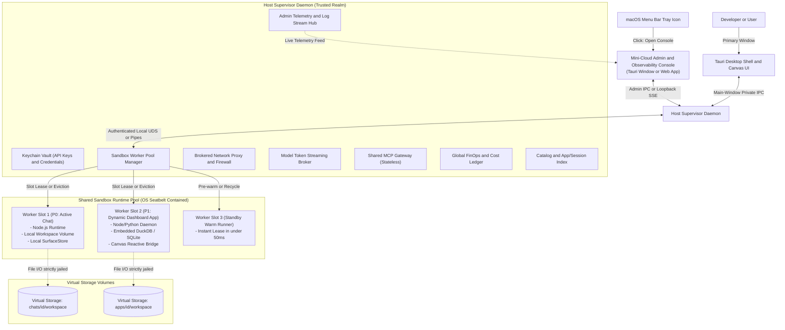
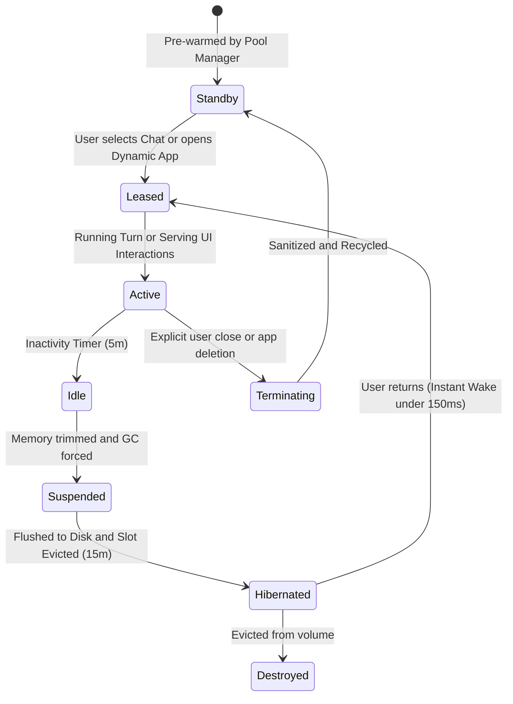
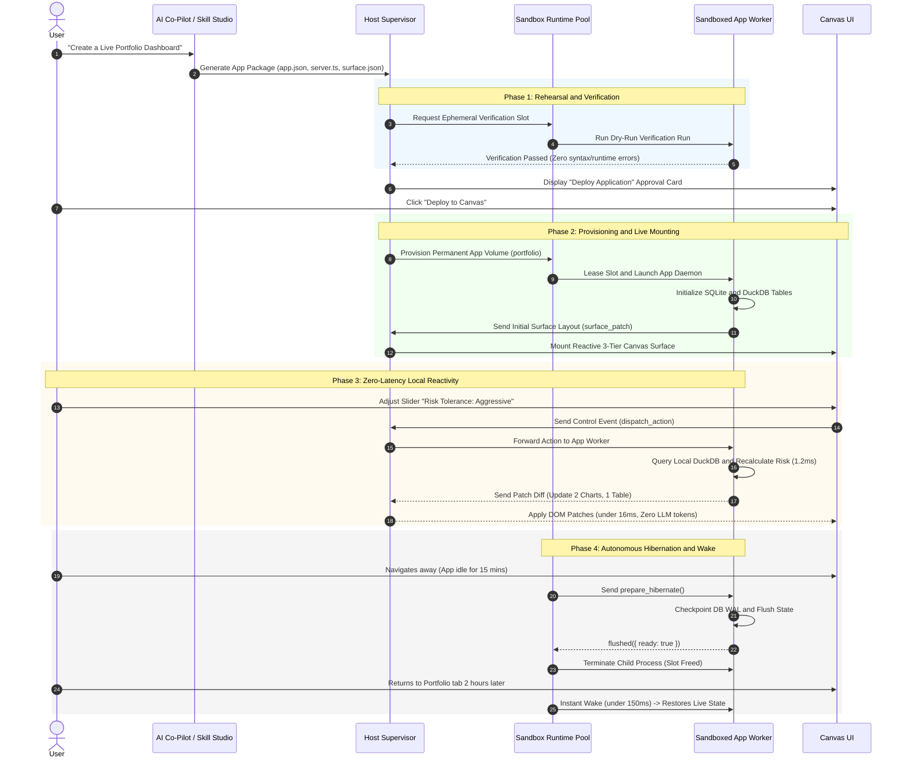
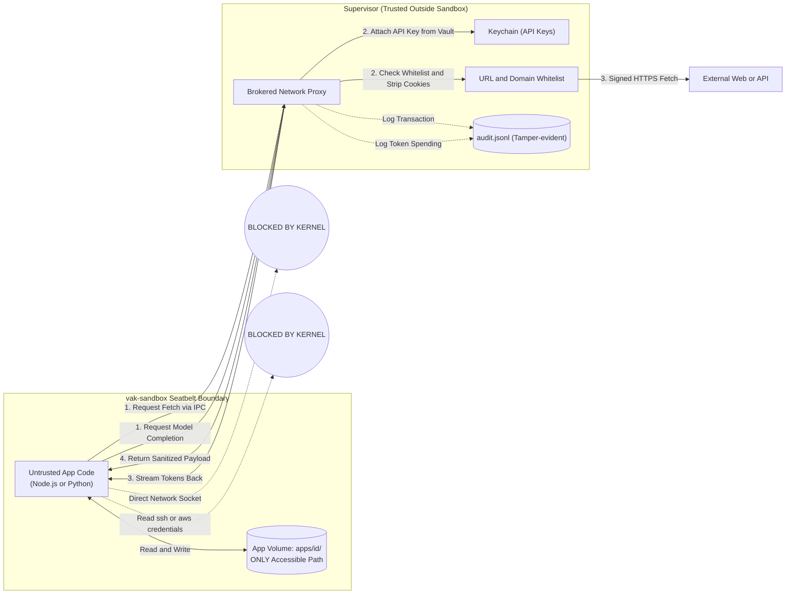
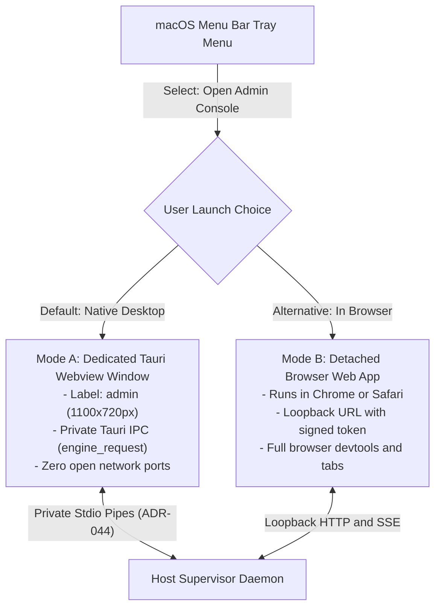
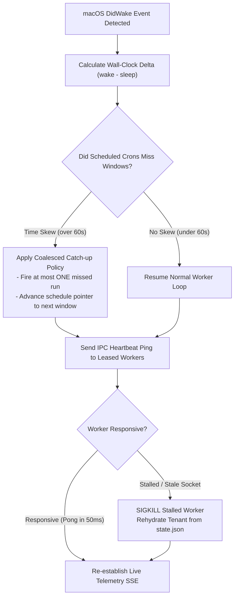
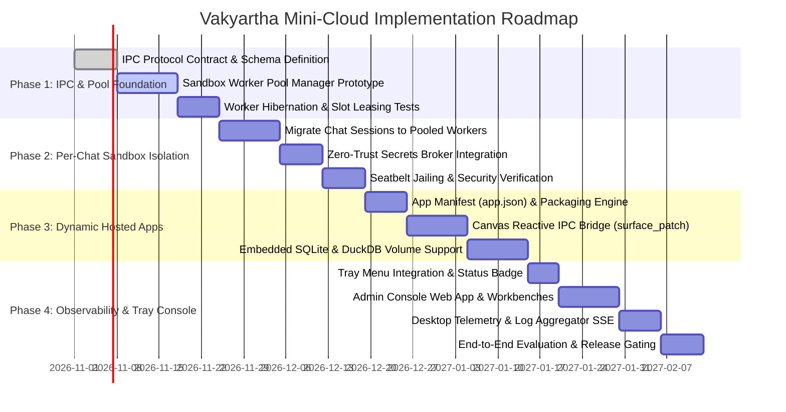

# Enterprise Architecture Blueprint: Vakyartha "Mini-Cloud"
## Multi-Tenant Pooled Sandbox Runtime, Full-Lifecycle Dynamic Apps & Tray-Launched Admin Console

> **Document Class:** Enterprise Architecture Blueprint & Technical Specification  
> **Target Platform:** Vakyartha Desktop Runtime (macOS Tauri + Node sidecar + `vak-sandbox`)  
> **Architecture Status:** Proposed / Comprehensive Review Phase (Target Release 0.3.0)  
> **Authors:** Enterprise Architecture Working Group & Core System Architects  
> **Last Updated:** October 2026  

---

## Table of Contents
1. [Executive Summary & Strategic Rationale](#1-executive-summary--strategic-rationale)
2. [Enterprise Architecture Taxonomy & Tenancy Model](#2-enterprise-architecture-taxonomy--tenancy-model)
3. [System Architecture & Runtime Boundaries](#3-system-architecture--runtime-boundaries)
4. [The Shared Sandbox Runtime Pool (`WorkerPool`)](#4-the-shared-sandbox-runtime-pool-workerpool)
5. [The Anatomy of a Dynamic Artifact App](#5-the-anatomy-of-a-dynamic-artifact-app)
6. [Formal Application Manifest Specification (`app.json`)](#6-formal-application-manifest-specification-appjson)
7. [Supervisor-to-Worker IPC Protocol Specification](#7-supervisor-to-worker-ipc-protocol-specification)
8. [End-to-End Application Lifecycle Management](#8-end-to-end-application-lifecycle-management)
9. [Information & Data Architecture (Storage, DBs & Concurrency)](#9-information--data-architecture-storage-dbs--concurrency)
10. [Zero-Trust Security Architecture & Threat Model (STRIDE)](#10-zero-trust-security-architecture--threat-model-stride)
11. [Desktop Observability, Telemetry & FinOps Governance](#11-desktop-observability-telemetry--finops-governance)
12. [The Mini-Cloud Admin & Observability Console (Tray-Launched Control Plane)](#12-the-mini-cloud-admin--observability-console-tray-launched-control-plane)
13. [High-Impact Enterprise Scenarios & Reference Deployments](#13-high-impact-enterprise-scenarios--reference-deployments)
14. [Workstation Physical Lifecycle: Sleep, Wakeup, Abrupt Crash & Managed Startup](#14-workstation-physical-lifecycle-sleep-wakeup-abrupt-crash--managed-startup)
15. [Failure Modes, Circuit Breakers & Non-Functional Requirements (NFRs)](#15-failure-modes-circuit-breakers--non-functional-requirements-nfrs)
16. [Phased Implementation Roadmap & Evaluation Gates](#16-phased-implementation-roadmap--evaluation-gates)

---

## 1. Executive Summary & Strategic Rationale

### 1.1 The Paradigm Shift: From Text Generator to Local Micro-Cloud
Traditional conversational AI systems are ephemeral request-response generators: a prompt enters, a completion returns, and the compute boundary vanishes. While adequate for superficial copy-editing, this paradigm fundamentally fails to deliver the business value of enterprise software, which requires:
* **Continuous State:** Retaining structured domain records, indices, and transactions across user sessions.
* **Autonomous Compute:** Executing background polling, statistical analysis, data cleaning, and ETL pipelines without an active user prompt.
* **Interactive UI Projections:** Responsive, data-bound interfaces (forms, metrics strips, paired analytics charts, editable grids) that recalculate with zero-latency without invoking round-trip LLM tokens.
* **Strict Data Sovereignty:** Running completely on-device without leaking sensitive operational databases or corporate credentials to third-party cloud hosts.

Vakyartha is uniquely positioned to bridge this gap. Because Vakyartha already controls a **native desktop runtime, private OS pipes (ADR-044), a liquid Canvas projection engine, and an OS-level Seatbelt sandbox (`vak-sandbox`)**, we can evolve Vakyartha into a **Local Mini-Cloud Platform**.

```
┌────────────────────────────────────────────────────────────────────────────────────────┐
│                                   VAKYARTHA MINI-CLOUD                                 │
├──────────────────────────┬──────────────────────────┬──────────────────────────────────┤
│  1. Tenant Workspaces    │  2. Pooled Node Runtimes │  3. Full Software Capabilities   │
│  - Isolated per chat/app │  - Pre-warmed runners    │  - Backend Node/Python code      │
│  - Seatbelt jail (vaksb) │  - Dynamic slot leasing  │  - Local DB (SQLite / DuckDB)    │
│  - Virtual storage disks │  - Fast hibernation/wake │  - Background crons & watchers   │
├──────────────────────────┼──────────────────────────┼──────────────────────────────────┤
│  4. Canvas App Hosting   │  5. Cloud Observability  │  6. Zero-Trust Secrets Broker    │
│  - Liquid 3-tier layout  │  - Real-time stream logs │  - Sandbox never sees raw keys   │
│  - Bidirectional events  │  - CPU/RAM/FinOps meters │  - Brokered LLM token streaming  │
│  - Artifacts library     │  - Health probes & heal  │  - Whitelisted network egress    │
└──────────────────────────┴──────────────────────────┴──────────────────────────────────┘
```

### 1.2 Enterprise Architectural Principles
1. **Zero-Trust Compute Isolation:** All generated code and dynamic applications are untrusted by default. They execute under strict OS-level kernel confinement (macOS Seatbelt) with no ambient network or filesystem reach.
2. **Deterministic Resource Caps:** Local execution must never degrade the host OS or exhaust workstation memory. Concurrency is strictly bounded by dynamic pooling and fast hibernation.
3. **Canonical Data Separation:** Presentation, application logic, and persistence are cleanly decoupled. The UI is a projection of state, not the state itself.
4. **No Framework Contamination:** The underlying Projection framework (`framework/`) remains a clean upstream dependency. All pooling, micro-cloud orchestration, and app lifecycle management reside strictly in Vakyartha's product tier.

---

## 2. Enterprise Architecture Taxonomy & Tenancy Model

The Vakyartha Mini-Cloud defines three distinct **Workload Classes** operating concurrently within a unified resource pool:

```
┌─────────────────────────────────────────────────────────────────────────────────────────┐
│                           TENANCY & WORKLOAD TAXONOMY                                   │
├───────────────────────┬─────────────────────────────┬───────────────────────────────────┤
│ Workload Class        │ Primary Characteristics     │ Execution & Lifecycle Model       │
├───────────────────────┼─────────────────────────────┼───────────────────────────────────┤
│ Class 1:              │ Turn-based, interactive     │ - Leases worker slot during turn  │
│ Conversational Chat   │ dialogue with AI assistant. │ - Runs in-sandbox file/bash tools │
│ (Session Tenant)      │ Ephemeral compute bursts.   │ - Immediate hibernation on idle   │
├───────────────────────┼─────────────────────────────┼───────────────────────────────────┤
│ Class 2:              │ Stateful, reactive micro-   │ - Leases worker slot when viewed  │
│ Hosted Dynamic App    │ software on Canvas (e.g.    │ - Embedded DB (SQLite/DuckDB)     │
│ (Artifact App Tenant) │ live analytics dashboard).  │ - Wakes on cron/timer triggers    │
├───────────────────────┼─────────────────────────────┼───────────────────────────────────┤
│ Class 3:              │ Headless, batch processing  │ - Background queue execution      │
│ Autonomous Automation │ (e.g. nightly ETL, sync).   │ - Bounded execution allowance     │
│ (Job Tenant)          │ Non-interactive run.        │ - Yields priority to user focus   │
└───────────────────────┴─────────────────────────────┴───────────────────────────────────┘
```

### 2.1 Scheduling Priority & Fair-Share Policy
When resource pool contention occurs, the scheduler enforces strict preemption:
* **Priority 0 (P0 - Real-Time Interactive):** The currently focused Chat or Canvas App in the desktop UI. Guaranteed zero-latency compute slot.
* **Priority 1 (P1 - Background Reactive):** Open canvas apps in background tabs. Eligible for memory trimming and event loop throttling.
* **Priority 2 (P2 - Batch Automation):** Headless tasks and scheduled crons. Queued; executed only when free worker slots exist; immediately yielded if a P0 request arrives.

---

## 3. System Architecture & Runtime Boundaries

The architecture enforces a clean separation across the **User Tier**, the **Trusted Supervisor Tier**, and the **Untrusted Execution Pool**:



---

## 4. The Shared Sandbox Runtime Pool (`WorkerPool`)

### 4.1 Process Economics & Pool Sizing
On a standard developer workstation (16GB–32GB RAM), spawning unmanaged Node.js runtimes causes severe degradation:
* Base Node V8 engine RSS: **~35MB–55MB** per process.
* Running 20 independent chat/app processes consumes **~1.0GB+ RAM**, creates dozens of OS IPC threads, and exhausts file descriptors.

The **Sandbox Worker Pool** solves this with **deterministic slot bounds**:

```typescript
export interface PoolConfig {
  /** Maximum concurrent running sandboxed OS child processes (default: 3) */
  maxActiveWorkers: number;
  /** Number of pre-warmed idle workers held in standby for instant leasing (default: 1) */
  standbyWorkers: number;
  /** Time of inactivity before a worker transitions from Active -> Idle (default: 5 min) */
  idleTimeoutMs: number;
  /** Time of inactivity before an Idle worker is flushed and Hibernated (default: 15 min) */
  hibernationTimeoutMs: number;
  /** Maximum RSS memory threshold per worker before warning/force-trim (default: 256 MiB) */
  maxWorkerRssBytes: number;
}
```

### 4.2 Pool Worker State Machine



### 4.3 Hibernation & Hydration Protocol
When an app or chat is evicted to make room for a higher-priority tenant:
1. **Pre-Eviction Notice (`worker.prepare_hibernate`):** The Supervisor notifies the worker.
2. **Persistence Flush:**
   * The app closes or checkpoints its embedded SQLite/DuckDB database (ensuring WAL log is clean).
   * SurfaceStore snapshots the active Canvas state to `state.json`.
   * Any pending file buffers are committed.
3. **Graceful SIGTERM & Slot Reclamation:** The worker confirms flush completion within 500ms; the Supervisor terminates the child process and marks the slot available.
4. **Fast Wakeup (<150ms):** When the user reopens the app, a pre-warmed standby worker immediately mounts the tenant's workspace folder, loads `state.json`, re-establishes the UI stream, and resumes execution seamlessly.

---

## 5. The Anatomy of a Dynamic Artifact App

A **Dynamic Artifact App** is a complete, self-contained micro-application managed by the Vakyartha platform.

```
┌────────────────────────────────────────────────────────────────────────┐
│                       DYNAMIC ARTIFACT APP STACK                       │
├────────────────────────────────────────────────────────────────────────┤
│ 1. Presentation Tier (Liquid Canvas Surface / Interactive UI)          │
│    - 3-Tier liquid layout (Executive strip, paired charts, data table) │
│    - Reactive controls (sliders, date pickers, dropdowns, forms)       │
│    - Real-time updates via streaming Surface Diff patches              │
├────────────────────────────────────────────────────────────────────────┤
│ 2. Backend Compute Tier (Sandboxed Node.js / Python Daemon)            │
│    - Headless application logic executing in vak-sandbox Seatbelt      │
│    - Local API endpoints or event handlers                             │
│    - Custom algorithms, financial models, data aggregations            │
├────────────────────────────────────────────────────────────────────────┤
│ 3. Storage & Data Tier (Virtual App Volume)                            │
│    - Isolated directory: `<dataDir>/apps/<app-id>/`                    │
│    - Embedded databases: SQLite, DuckDB, Parquet, or JSON files        │
│    - Versioned Realm snapshots (rollback, history, audit trail)        │
├────────────────────────────────────────────────────────────────────────┤
│ 4. Autonomous Infrastructure Tier (Triggers & Scheduling)              │
│    - Background polling crons (e.g. hourly market scrape)              │
│    - File-watcher triggers (re-run on local file change)               │
│    - FinOps budget circuit breakers (kill run if compute > limit)      │
└────────────────────────────────────────────────────────────────────────┘
```

### 5.1 Deep Architectural Comparison

| Dimension | Standard Chat Session | Static Code Artifact | Dynamic Hosted App |
| :--- | :--- | :--- | :--- |
| **Compute Execution** | Turn-based model steps | Inert read-only view | Stateful, long-running Node/Python event loop |
| **User Interaction** | Prompt/Answer dialogue | Copy/paste code block | Bidirectional UI controls (filters, forms, buttons) |
| **Data Engine** | Transient prompt tokens | None | Embedded SQLite / DuckDB / Parquet engine |
| **Background Work** | Prohibited | Impossible | Autonomous crons, polling, and file-watchers |
| **UI Projection** | Chat message bubbles | Static preview frame | Full liquid Canvas app (container queries, 3-tier) |
| **Update Latency** | 2–10 seconds (LLM inference) | N/A | **< 16 ms** (Local backend state calculation) |

---

## 6. Formal Application Manifest Specification (`app.json`)

Every Dynamic Artifact App is declared via an immutable, declarative package manifest:

```json
{
  "$schema": "https://vakyartha.dev/schemas/v1/app-manifest.json",
  "id": "portfolio-analytics",
  "version": "1.0.0",
  "name": "Live Portfolio & Risk Analytics",
  "description": "Real-time stock & crypto portfolio analytics with local DuckDB caching.",
  "author": "Nisheeth Ranjan",
  "icon": "chart-candlestick",
  "category": "finance",
  
  "entrypoints": {
    "backend": "server.ts",
    "surface": "canvas-layout.json"
  },

  "runtime": {
    "engine": "node24",
    "memoryLimitMb": 256,
    "cpuTimeLimitSec": 60,
    "maxStorageMb": 512
  },

  "entitlements": {
    "network": {
      "mode": "brokered",
      "allowedDomains": [
        "api.coingecko.com",
        "query1.finance.yahoo.com"
      ]
    },
    "mcpTools": [
      "nse-market-data",
      "filesystem-workspace"
    ],
    "storage": {
      "sqlite": true,
      "duckdb": true
    }
  },

  "triggers": [
    {
      "id": "market-sync",
      "kind": "cron",
      "expression": "*/15 9-16 * * 1-5",
      "action": "syncMarketData",
      "maxDurationSec": 30
    }
  ]
}
```

---

## 7. Supervisor-to-Worker IPC Protocol Specification

Communication between the trusted Host Supervisor and the untrusted Sandboxed Worker occurs over an authenticated, framed **JSON-RPC 2.0 over anonymous Unix Domain Socket (UDS)** or private parent stdio pipes.

```
┌────────────────────────────────────────────────────────────────────────┐
│                        IPC PROTOCOL SCHEMA                             │
├────────────────────────────────────────────────────────────────────────┤
│ 1. Control Plane:                                                      │
│    - supervisor -> worker: init({ id, workspaceDir, config })          │
│    - supervisor -> worker: lease({ tenantId, priority })               │
│    - supervisor -> worker: prepare_hibernate()                         │
│    - worker -> supervisor: flushed({ status: "ready" })                │
│    - supervisor -> worker: teardown()                                  │
├────────────────────────────────────────────────────────────────────────┤
│ 2. Event Plane (Canvas UI Projections):                                │
│    - supervisor -> worker: dispatch_action({ controlId, value })       │
│    - worker -> supervisor: surface_patch({ op: "replace", diff })      │
│    - worker -> supervisor: surface_toast({ kind: "success", msg })     │
├────────────────────────────────────────────────────────────────────────┤
│ 3. Brokered Services Plane (Zero-Trust Outbound):                      │
│    - worker -> supervisor: broker_fetch({ url, method, body })         │
│    - worker -> supervisor: broker_llm_stream({ messages, model })      │
│    - worker -> supervisor: broker_mcp_call({ server, tool, args })     │
├────────────────────────────────────────────────────────────────────────┤
│ 4. Telemetry Plane:                                                    │
│    - worker -> supervisor: emit_metric({ cpu, rss, eventLag })         │
│    - worker -> supervisor: emit_log({ level, message, context })       │
│    - worker -> supervisor: emit_audit({ action, target, bytes })       │
└────────────────────────────────────────────────────────────────────────┘
```

---

## 8. End-to-End Application Lifecycle Management



---

## 9. Information & Data Architecture (Storage, DBs & Concurrency)

### 9.1 Tenant Directory Structure
Every Dynamic App owns an isolated, dedicated directory volume:

```text
<dataDir>/apps/<app-id>/
├── app.json             # Immutable package manifest
├── server.ts            # Application logic entrypoint
├── surface.json         # Base Canvas projection schema
├── state.json           # Serialized UI state and draft models
├── data/                # Persistent database directory (Seatbelt read/write)
│   ├── app.sqlite       # Local relational state / transactions
│   ├── app.sqlite-wal   # Write-Ahead Log
│   └── analytics.duckdb # Columnar analytical store
├── logs/                # Rotated execution and audit journals
│   └── execution.jsonl  # Live stdout/stderr and trace logs
└── artifacts/           # App-generated exports (PDFs, Parquet, CSVs)
```

### 9.2 Concurrency & Single-Writer Rule
To comply strictly with Vakyartha's **Single Persistence Owner** rule (ADR-001 / ADR-044):
* **Workspace Isolation:** Only the active App Worker process writes to its own `data/` directory. The Host Supervisor never writes inside the tenant volume directly.
* **Database Engine Standards:**
  * **Relational / Transactional:** SQLite running in `WAL` (Write-Ahead Logging) mode with `PRAGMA synchronous = NORMAL`.
  * **Analytical / Large-Scale:** DuckDB or Apache Parquet files for columnar querying.
* **Zero Cross-Contamination:** No application process can open or access a peer tenant's database directory.

---

## 10. Zero-Trust Security Architecture & Threat Model (STRIDE)

Dynamic code execution inside an AI desktop application requires enterprise-grade defense-in-depth:



### 10.1 STRIDE Threat Analysis Matrix

| Threat Category | Potential Attack Vector | Vakyartha Mitigation Mechanism |
| :--- | :--- | :--- |
| **Spoofing** | Rogue app attempts to impersonate another tenant | Each worker process is assigned a cryptographic session token on startup; IPC requests validate the session token against the tenant ID. |
| **Tampering** | Malicious script modifies host configurations or peer app databases | macOS Seatbelt denies write operations outside `<dataDir>/apps/<app-id>/`. System roots (`/bin`, `/System`) are read-only; user directories (`~/.ssh`, `~/.aws`) are blocked. |
| **Repudiation** | App executes unauthorized tool calls and denies them | The Supervisor maintains an append-only, tamper-evident audit ledger (`audit.jsonl`) recording every tool invocation and network request. |
| **Information Disclosure** | Untrusted package steals user API keys (`OPENAI_API_KEY`) | **Zero-Key Sandbox Rule:** The app worker's environment variables contain zero credentials. API keys reside exclusively in the Supervisor's Keychain vault. |
| **Denial of Service** | Infinite loop consumes 100% CPU or exhausts host RAM | Pool manager enforces `--max-old-space-size=256` and runs a watchdog thread that SIGTERMs any process exceeding CPU/RAM quotas. |
| **Elevation of Privilege** | Sandboxed code attempts kernel exploit or binary execution | Executable execution is restricted to the bundled Node binary; spawning unauthorized binaries or loading unsigned native `.node` addons is blocked by Seatbelt. |

---

## 11. Desktop Observability, Telemetry & FinOps Governance

### 11.1 The Desktop Telemetry Engine
The Host Supervisor embeds a high-performance telemetry aggregator that collects logs, metrics, and audit entries from all pool workers.

```
┌────────────────────────────────────────────────────────────────────────┐
│                      APP OBSERVABILITY DASHBOARD                       │
├────────────────────────────────────────────────────────────────────────┤
│ [STATUS: RUNNING]   Uptime: 2h 14m   PID: 84920 (Jailed in vaksb)     │
├────────────────────────────────────────────────────────────────────────┤
│ METRICS:                                                               │
│   CPU: 0.4% [━━────────────]        RAM (RSS): 42.1 MB [━━━──────────] │
│   Disk I/O: 1.2 MB written          FinOps: $0.004 (2 model calls)     │
├────────────────────────────────────────────────────────────────────────┤
│ LIVE STREAMING CONSOLE (stdout / stderr / audit):                      │
│   [11:45:02] [INFO] SQLite connection initialized (portfolio.db)       │
│   [11:45:03] [INFO] Cron job registered: 'fetch-rates' every 60m       │
│   [11:45:04] [IPC]  Surface rendered: 3 tiers, 4 metric cards, 1 chart │
│   [11:46:12] [NET]  Broker fetch -> api.coingecko.com (200 OK, 142ms)  │
│   [11:46:12] [DIFF] Surface updated: BTC +1.4%, ETH -0.2%             │
└────────────────────────────────────────────────────────────────────────┘
```

### 11.2 The Four Golden Signals on Desktop
1. **Latency:** Local UI interaction-to-render round-trip time (target: **< 16 ms**).
2. **Traffic:** Number of user UI interactions and scheduled background events per minute.
3. **Errors:** Count of unhandled exceptions, failed network fetches, or database query errors.
4. **Saturation:** Percentage of memory quota (`current_rss / 256MB`) and event loop lag.

### 11.3 FinOps Cost Accounting & Hard Circuit Breakers
* Every model token invoked by a background trigger or summarization job is attributed to the specific app ID.
* The app manifest defines a monthly budget limit (e.g. `$2.00 / month`).
* If the limit is reached, background LLM triggers halt gracefully, and a notification alerts the user to review spending.

---

## 12. The Mini-Cloud Admin & Observability Console (Tray-Launched Control Plane)

### 12.1 Strategic Rationale & Decoupled Control Plane
In an enterprise architecture, mixing administrative telemetry, process controls, and live log dumps into the primary conversational UI is an anti-pattern. Power users, developers, and operators require a **dedicated Control Plane / Admin Console** that:
* Can run on a **secondary monitor** while the primary window stays focused on chat and Canvas surfaces.
* Remains accessible even when the main window is hidden or closed to the macOS menu bar tray (`KEEP_RUNNING`).
* Provides cloud-grade observability (equivalent to Docker Desktop Dashboard, AWS Console, or Portainer) running 100% locally on macOS.

```
┌────────────────────────────────────────────────────────────────────────┐
│             VAKYARTHA MINI-CLOUD ADMINISTRATIVE CONSOLE                │
├────────────────────────────────────────────────────────────────────────┤
│ [FLEET: 2 Active | 1 Standby]  [TOTAL RAM: 78.4 MB]  [FINOPS: $0.14]   │
├───────────────────┬────────────────────────────────────────────────────┤
│ WORKBENCHES:      │ ACTIVE WORKBENCH: Centralized Log Aggregator       │
│                   ├────────────────────────────────────────────────────┤
│ > Fleet & Pool    │ Filter: [App: portfolio-analytics ▼] [Level: ALL ▼]│
│   Inventory       ├────────────────────────────────────────────────────┤
│ * Live Logs       │ 12:01:04.120 [INFO]  Worker slot #1 leased (app)   │
│   FinOps Ledger   │ 12:01:04.180 [IPC]   Mounted volume: /apps/port/   │
│   Security & Jail │ 12:01:05.020 [DB]    DuckDB WAL checkpoint: 0 ms   │
│   Storage Volumes │ 12:01:14.300 [NET]   Broker fetch 200 OK (coing..) │
│                   │ 12:01:14.312 [SURF]  DOM Patch dispatched (16ms)   │
└───────────────────┴────────────────────────────────────────────────────┘
```

### 12.2 macOS System Menu Bar Tray Architecture
Vakyartha's desktop tray (`src-tauri/src/lib.rs`) is expanded from a simple launcher into an active **Mini-Cloud Status Monitor**:

```
┌────────────────────────────────────────────────────────┐
│  ● Vakyartha Mini-Cloud: 2 Active | 1 Standby (42MB)   │  <-- Dynamic Health Badge
├────────────────────────────────────────────────────────┤
│  Open Main Chat & Canvas                   Cmd+O       │
│  Open Admin & Observability Console...     Cmd+Shift+A │  <-- Opens Dedicated Console
│  Open Web Admin Dashboard in Browser...                │  <-- Opens Loopback Browser URL
├────────────────────────────────────────────────────────┤
│  Active Tenants:                                       │
│    ● Portfolio Analytics App      (PID 84920, 0.4% CPU)│
│    ● Code Refactoring Chat        (PID 84928, Idle)    │
│    ○ Nightly ETL Sync             (Hibernated on Disk) │
├────────────────────────────────────────────────────────┤
│  Operational Actions:                                  │
│    Force Hibernate Idle Sandboxes                      │
│    Purge Stale Storage Volumes...                      │
│    Restart Worker Pool                                 │
├────────────────────────────────────────────────────────┤
│  Quit Vakyartha                             Cmd+Q      │
└────────────────────────────────────────────────────────┘
```

### 12.3 Dual Delivery Architecture: Native Window vs. Loopback Web App
The Admin Console is engineered as a unified Vite web application (`admin.html`) that can be presented in **two distinct operational modes**:



* **Mode A (Dedicated Native Window):**
  * Spawns a dedicated lightweight webview window (`label: "admin"`, 1100×720px) using Tauri's multi-window capabilities.
  * Connects over Tauri's private anonymous pipes (ADR-044).
  * Opens with `Cmd+Shift+A` or via the tray menu.
* **Mode B (Detached Browser Web App):**
  * Launches the user's default browser (via `tauri-plugin-opener`) navigating to `http://127.0.0.1:<port>/admin?token=<bearer-token>`.
  * Employs standard browser devtools for profiling, multi-window tiling, and remote administration.

### 12.4 The Five Core Administrative Workbenches
The Admin Console is structured into five specialized operational workbenches:

1. **Fleet & Worker Pool Manager:**
   * Visual slot cards displaying Slot 1, Slot 2, Slot 3 status (`ACTIVE`, `IDLE`, `HIBERNATING`, `STANDBY`).
   * Live gauges: CPU % core utilization, RSS memory footprint, active OS file descriptors, process uptime.
   * Emergency controls: `[Hibernate Slot]`, `[Force Restart Pool]`, `[Inspect V8 Heap]`, `[Kill PID]`.
2. **Tenant & Application Registry:**
   * Unified searchable inventory of all Chats, Hosted Dynamic Apps, and Scheduled Jobs.
   * Volume footprint inspector (`<dataDir>/apps/<id>/`).
   * Embedded database explorer: view SQLite tables, execute read-only SQL queries on local DuckDB files, check row counts and WAL sizes.
   * Snapshot and Rollback manager: one-click Realm rollback to previous transaction receipts.
3. **Centralized Streaming Telemetry & Log Aggregator:**
   * High-performance virtualized terminal stream rendering stdout, stderr, and IPC traces across all pool workers.
   * Multi-tenant selector (filter by specific app or aggregate all).
   * Log severity filters (`DEBUG`, `INFO`, `WARN`, `ERROR`) and regex search.
   * One-click export to `.jsonl` or `.log` files for post-mortem diagnostics.
4. **FinOps & Spend Governor:**
   * Granular cost attribution per app and per chat.
   * Provider distribution chart (OpenAI vs. Anthropic vs. local Ollama 4B runs).
   * Live budget consumption gauges with visual warnings at 80% and automatic circuit breaker stops at 100%.
5. **Zero-Trust Security & Audit Inspector:**
   * Live streaming audit feed of macOS Seatbelt jail events.
   * Brokered network request inspector (outbound URL, HTTP status, latency, payload size, stripped cookies).
   * Denied syscall and denied tool call alerts (identifying prompt injection or unauthorized access attempts).

### 12.5 Administrative API & Real-Time SSE Stream Contract
The Supervisor exposes private streaming endpoints for the Admin Console:
* `GET /admin/api/fleet`: Returns live snapshot of all worker pool slots, memory, and tenant leases.
* `GET /admin/api/telemetry/stream` (SSE): Server-Sent Events stream delivering real-time metrics (`cpu`, `rss`, `eventLag`) at 1 Hz.
* `GET /admin/api/logs/stream` (SSE): High-throughput streaming log feed delivering stdout/stderr lines with microsecond timestamps.
* `POST /admin/api/fleet/slots/:id/hibernate`: Triggers graceful flush and hibernation of a worker slot.
* `POST /admin/api/apps/:id/rollback`: Reverts app database and workspace to a designated transaction fingerprint.

---

## 13. High-Impact Enterprise Scenarios & Reference Deployments

### Reference Deployment 1: Dynamic Financial & Risk Analytics Portal
* **Persona:** Financial Analyst / Independent Investor.
* **Architecture:**
  * **Backend:** Node.js worker with embedded DuckDB columnar engine.
  * **Data Pipeline:** Scheduled cron polls market APIs via Brokered Gateway.
  * **Projection:** Liquid Canvas surface rendering real-time portfolio weights, VaR (Value-at-Risk) estimates, and paired candlestick charts.
  * **Value Unlocked:** Instant interactive parameter tweaking (re-weighting portfolio via sliders) without incurring API token costs or latency.

### Reference Deployment 2: Local ETL & Data Engineering Workbench
* **Persona:** Data Scientist / Business Operations Lead.
* **Architecture:**
  * **Backend:** Sandboxed Python script executing DuckDB/Polars.
  * **Input:** User drops dirty 500MB CSV/Parquet files into the workspace folder.
  * **Processing:** Deduplication, schema normalization, outlier detection.
  * **Projection:** Paginated virtual data table on Canvas with instantaneous filtering and one-click clean file export.

### Reference Deployment 3: Developer CI & Quality Dashboard
* **Persona:** Software Engineer / Tech Lead.
* **Architecture:**
  * **Backend:** Node.js worker monitoring local git worktrees.
  * **Workflow:** Runs local test suites inside disposable Seatbelt snapshots on every git commit.
  * **Projection:** Interactive test coverage visualizer, flamegraphs, and failure triage workbench.

---

## 14. Workstation Physical Lifecycle: Sleep, Wakeup, Abrupt Crash & Managed Startup

### 14.1 The Desktop & Laptop Reality (Physical Operating Context)
Unlike cloud containers that run in climate-controlled datacenters with guaranteed power and uninterrupted NTP clocks, client edge software runs on laptops and workstations subject to chaotic real-world physical events:
* **Sudden Lid-Close / System Sleep:** macOS drops into low-power states without application consent.
* **Clock Jumps on Wake:** A laptop sleeping for 8 hours wakes up with wall-clock time leaping forward instantly.
* **Network Roaming & Broken Sockets:** Wi-Fi disconnects or IP changes during sleep leave TCP sockets half-open.
* **Abrupt Power Loss:** Battery depletion (0% cutoff), forced hard resets (`SIGKILL`), or kernel panics occur without warning.

An enterprise architecture must treat these physical events as routine operational cycles with deterministic recovery guarantees.

### 14.2 Native macOS Power Event Integration (Tauri / Rust Layer)
Vakyartha's desktop shell (`src-tauri/src/lib.rs`) hooks directly into native macOS Cocoa power notifications:
* `NSWorkspaceWillSleepNotification`: Broadcast when macOS is about to suspend hardware.
* `NSWorkspaceDidWakeNotification`: Broadcast when hardware resumes from sleep.
* `NSWorkspaceSessionDidResignActiveNotification`: Broadcast on fast user switching or screen lock.



### 14.3 The Sleep / Lid-Close Sequence (Pre-Sleep Suspend Protocol)
macOS provides a brief pre-sleep window (typically 1 to 2 seconds) between `NSWorkspaceWillSleepNotification` and system halt. The Supervisor initiates an emergency suspend sweep:
1. **Broadcast `worker.suspend`:** Pool workers immediately pause event loops and background timers.
2. **Proactive Database WAL Flush:** Every active SQLite database executes `PRAGMA wal_checkpoint(TRUNCATE)` so pending transactions are durably synced to physical storage before hardware cuts power.
3. **Freeze Schedulers:** In-flight cron timers are frozen; the current timestamp is recorded to `last_sleep_timestamp`.
4. **State Snapshot:** Active Canvas DOM trees are serialized to `state.json`.

### 14.4 The Wakeup & Recovery Protocol
When the laptop lid is opened (`NSWorkspaceDidWakeNotification`):
1. **Clock Skew Reconciliation:** The Supervisor calculates `time_delta = Date.now() - last_sleep_timestamp`.
2. **Anti-Thundering-Herd (Cron Coalescing):** If a laptop slept for 12 hours, an hourly cron could theoretically trigger 12 executions simultaneously upon wakeup, spiking CPU and token budgets. Vakyartha enforces **Coalesced Catch-up**:
   * If `time_delta` exceeds the schedule window, fire **at most one** catch-up execution (if within `SCHEDULE_GRACE_MS`).
   * Advance the cron pointer to the next upcoming natural wall-clock interval.
3. **Worker Socket Probes:** The Supervisor sends a lightweight `worker.ping` over the IPC pipe to all leased workers. If a worker child process wedged during the power transition, it is terminated (`SIGKILL`) and rehydrated from `state.json` in `< 150 ms`.
4. **Network Re-establishment:** Half-open brokered fetch sockets are flushed and reset, avoiding hanging requests.

### 14.5 Abrupt Termination & Crash Durability (Zero-Corruption Guarantee)
If the laptop abruptly loses power (battery cutoff) or the OS force-terminates the app (`kill -9`):
1. **Atomic State Writes:** All JSON metadata (`state.json`, `index.json`) is written using the **Atomic Write-Rename Pattern**:
   * Data is written to `state.json.tmp`.
   * `fs.renameSync("state.json.tmp", "state.json")` atomically replaces the destination. A sudden power loss mid-write can never corrupt the canonical file.
2. **SQLite Crash Durability:** SQLite Write-Ahead Logging (`WAL`) guarantees ACID durability. On restart, SQLite automatically recovers and replays valid WAL frames; uncommitted transactions are cleanly rolled back.
3. **Transaction-Bound Realm Recovery (ADR-045):** Incomplete multi-file promotions or interrupted command snapshots are detected via transaction journals. The engine rolls back to the pre-promotion snapshot without replaying commands.
4. **Stale Lock Clearance:** Locks (`.lock`) record the PID and boot UUID. On boot, if a lock belongs to an extinct process, it is safely cleared without human intervention.

### 14.6 Coordinated 4-Second Graceful Shutdown Waterfall
When the user deliberately quits (`Cmd+Q` or Tray → Quit), Vakyartha executes a coordinated 4-second shutdown waterfall enforced by Tauri (`src-tauri/src/lib.rs`):

```mermaid
sequenceDiagram
    autonumber
    actor User as User
    participant Shell as Tauri Native Shell (Rust)
    participant Supervisor as Host Supervisor (Node)
    participant Workers as Sandboxed Pool Workers
    participant Disk as Storage Volume

    User->>Shell: Triggers Quit (Cmd+Q or Tray)
    Note over Shell: T0.00s: Intercepts Quit; 4-Second Watchdog Starts
    Shell->>Supervisor: Close Anonymous Stdin Pipe
    
    Supervisor->>Supervisor: Drain In-Flight Turns; Refuse New UI Events
    Supervisor->>Workers: IPC: prepare_shutdown()
    
    Workers->>Disk: Flush SQLite WAL Checkpoint (TRUNCATE)
    Workers->>Disk: Atomic Write-Rename state.json
    Workers-->>Supervisor: IPC: flushed(ready: true)
    
    Note over Supervisor: T1.50s: All Workers Acknowledged
    Supervisor->>Workers: SIGTERM Child Processes
    Supervisor->>Disk: Commit Global App and FinOps Index
    Supervisor-->>Shell: Supervisor Exits (Code 0)
    
    Note over Shell: T2.40s: Clean Native Teardown (Well within 4s limit)
```

1. **`T + 0.00s`:** Shell intercepts quit request; starts native 4-second deadline watchdog; closes stdin to the Supervisor.
2. **`T + 0.20s`:** Supervisor detects EOF on stdin; stops accepting new user prompts; broadcasts `worker.prepare_shutdown`.
3. **`T + 0.60s`:** Pool workers checkpoint SQLite databases, serialize active Canvas state, close file handles, and acknowledge `worker.flushed`.
4. **`T + 1.50s`:** Supervisor terminates worker child processes (`SIGTERM`) and flushes the global FinOps and App registry.
5. **`T + 2.40s`:** Supervisor exits cleanly with code 0.
6. **`T + 4.00s`:** Hard watchdog fallback: if any hung process is still alive after 4 seconds, Tauri's native monitor issues `child.kill()` (`SIGKILL`) to guarantee the app never hangs indefinitely on quit.

### 14.7 Cold Boot & Orphan Cleanup Protocol
Every time Vakyartha launches from cold boot:
1. **Orphan Workspace Sweep:** Scan `/tmp/` and purge any leftover disposable snapshot directories (`vakyartha-sandbox-*`) abandoned by previous abrupt shutdowns.
2. **Database Integrity Sweep:** Check SQLite headers and execute fast `PRAGMA quick_check` across active app volumes.
3. **Stale Lock Eviction:** Clear abandoned lock files whose PIDs no longer exist.
4. **Lazy Pool Initialization:** Spawn **1 pre-warmed standby runner only**. Do not boot inactive chats or background apps until requested by the user or triggered by an upcoming scheduled cron.

---

## 15. Failure Modes, Circuit Breakers & Non-Functional Requirements (NFRs)

### 15.1 Failure Mode & Effects Analysis (FMEA)

| Failure Mode | Root Cause | Impact | Automated Recovery Action |
| :--- | :--- | :--- | :--- |
| **Worker OOM** | Memory leak in user script exceeds 256 MiB | Process terminated by OS kernel | Pool manager intercepts exit code, frees worker slot, flags app as "Crashed (OOM)", and surfaces one-click debug action to user. |
| **Infinite CPU Loop** | Rogue `while(true)` without async yielding | 100% CPU core utilization | Watchdog timer detects sustained CPU > 90% for 30s; issues SIGKILL; applies exponential restart backoff. |
| **Corrupt SQLite WAL** | Abrupt power loss during write | Database unreadable | SQLite auto-recovers from WAL on next boot; if unrecoverable, Realm journal rolls back to last valid transaction snapshot. |
| **API Key Exfiltration Attempt** | Prompt injection attacks try to read keys | Critical security threat | **Zero Impact:** Environment contains no keys; outbound network requests without whitelisted broker authorization are dropped by OS kernel. |

### 15.2 Non-Functional Requirements (NFRs)
* **NFR-1 (UI Latency):** Canvas action-to-DOM patch latency must remain **< 16 ms** for 95% of local interactions.
* **NFR-2 (Startup Time):** Waking a hibernated app must complete in **< 150 ms**.
* **NFR-3 (Memory Footprint):** Total idle memory consumption of the Pool Manager (including standby worker) must not exceed **120 MiB**.
* **NFR-4 (Disk Footprint):** App volume size is capped at **512 MiB** hard limit.

---

## 16. Phased Implementation Roadmap & Evaluation Gates



### Evaluation & Acceptance Gates (Before Promotion to Production)
1. **Gate 1 (Security Proof):** `scripts/sandbox-security-check.ts` must prove that untrusted app code cannot access host filesystem paths (`~/.ssh`, `.env`) or open raw TCP sockets.
2. **Gate 2 (Resource Concurrency):** `scripts/pool-concurrency-check.ts` must prove that opening 20 concurrent chats/apps keeps total host memory under 200 MiB via automatic slot leasing and LRU hibernation.
3. **Gate 3 (Reactivity Benchmark):** WebKit performance tests must prove that slider/form actions update the Canvas surface in `< 16 ms` without LLM model requests.
4. **Gate 4 (Admin Console Telemetry):** `scripts/admin-console-check.ts` must prove that streaming logs and process metrics from active sandboxes render smoothly in both the native Tauri window and the detached loopback browser view without impacting primary chat responsiveness.
