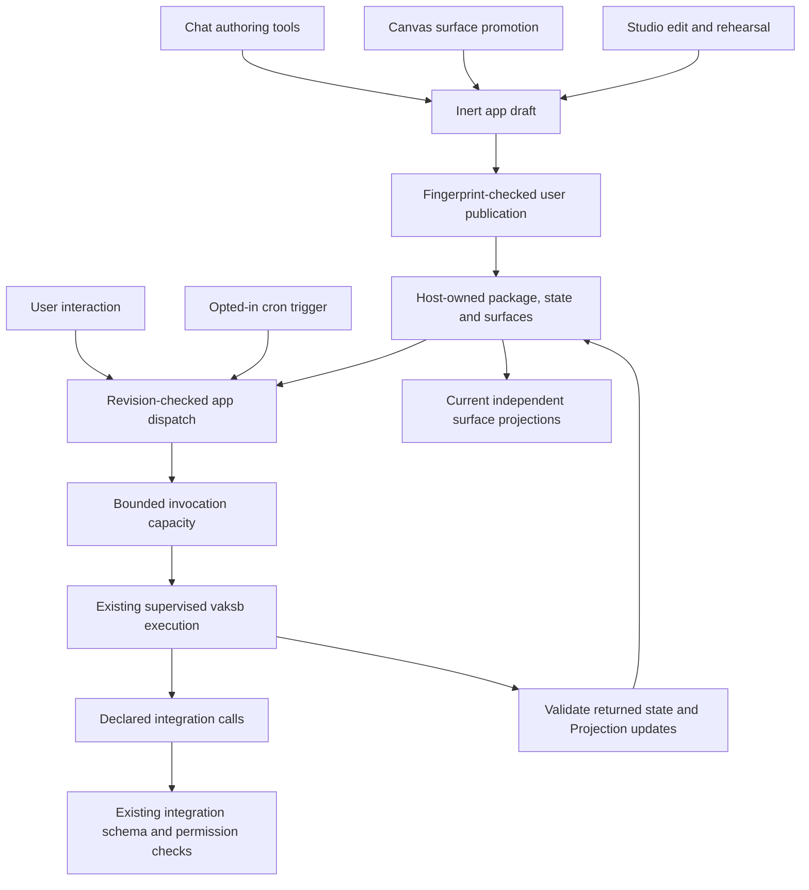

# Executable app architecture

The mini-cloud turns authored behavior into a persistent local application. A saved surface supplies presentation; an executable package also defines computation, actions, data access and refresh handlers. Promoting a surface creates an inert draft so missing behavior can be built and reviewed explicitly.

This describes the current implementation and supersedes the earlier warm-worker architecture proposal. The [runtime contract](RUNTIME-CONTRACT.md) owns exact supported interfaces and bounds.

## Separate lifetimes

| Entity | Owner and lifetime |
| --- | --- |
| Source conversation | Existing chat owner; Canvas records its source session so Build with chat can return there |
| App draft | App registry; inert source, including incomplete text, until reviewed publication or discard |
| Published package | App registry; complete versioned manifest/source checked against review fingerprints |
| Domain state and surfaces | One host-owned app record; survives navigation and process restart |
| Invocation | Existing sandbox helper; fresh disposable copy per action/trigger, removed after verified completion |
| External operation | Existing integration lifecycle, permissions, schema validation and logs |

Closing a view does not delete its app. Saving a draft does not activate executable code. Refreshing data does not update the package's code. Code changes return through publication.

## Execution flow

The model helps author code through `read_app_package` and approval-backed `save_app_draft`. Studio's Build with chat prepares an editable message in the source conversation; it does not send a hidden model request. Published handlers execute directly without inference. Explicit model invocation from app code is not currently provided.

## Runtime placement

Vakyartha owns drafts, publication, run records, scheduling and execution capacity. The separate sandbox project owns OS confinement, supervised process lifetime and completion cleanup. Projection supplies rendering and update validation through public APIs. Integrations retain installation, credentials, tool schemas, policies and call logs. None of these duties moves into generated application code.

The pool limits simultaneous invocations rather than keeping ordinary Node processes warm. Each invocation receives package source, state and current surface snapshots in a disposable workspace and runs the declared Node entrypoint through `vaksb run`. The existing helper deliberately closes target stdin. Bounded file mailboxes carry inputs, results and sequential declared tool requests without adding a native relay or network listener. Target output never supplies host authority.

## Data and projection

`app-drafts/<id>.json` stores inert source. `app-state/<id>.json` holds the published package, JSON domain state, canonical surface snapshots, revision, schedule-minute claims and bounded run history. One serialized host owner commits these records. File sync, rename and directory sync improve crash ordering; physical power-loss durability has not been certified.

Handlers mutate `context.state` and return supported Projection updates. Only successful validated work commits current state and surfaces together. Multiple surfaces remain independently selectable. Open views poll for newer revisions while preserving local edits; reopening loads committed snapshots. Domain correctness, source freshness and calculations remain application responsibilities requiring independent checks.

Publication switches the complete package record, retains domain state, initializes the new package's surfaces and pauses scheduling. Schema/projection migrations therefore require deliberate application handling; package updates are not an automatic domain migration system. Original legacy directories and data remain untouched; compatible source imports once as inert drafts.

## Failure and authority

Network is denied inside app execution; declared real-data calls resolve through existing integration tools. Only enabled tools currently permitting Allow can run unattended. Credentials remain in the host. Ask/off policies cannot be overridden by a package declaration. Studio rehearsal has no external-tool authority.

A missing handler, rejected promise, timeout, invalid result or failed commit is not a successful refresh. Tool-effect uncertainty is retained, pauses schedules and blocks further execution until exact-run acknowledgement after inspection. Restart marks interrupted runs uncertain. Recovery never automatically replays an external operation.

No worker prewarming, LRU process eviction, permanent daemon, persistent filesystem database, watcher, raw network/model broker, hard spend ceiling or strict CPU/RSS/disk quota is claimed. Existing desktop private IPC and development-only loopback HTTP remain the UI transport boundaries.

## Source map

- [App registry](../../sidecar/sandbox-pool/app-registry.ts): lifecycle, records, drafts, publication and scheduling.
- [Pool manager](../../sidecar/sandbox-pool/pool-manager.ts): bounded invocations and helper/tool exchange.
- [Worker](../../sidecar/sandbox-pool/worker.ts): declared async handlers in the contained process.
- [Package boundary](../../sidecar/sandbox-pool/package.ts): identifiers, file confinement, bounds and persistence.
- [Server](../../sidecar/server.ts): authenticated app routes, chat authoring tools and integration adapter.
- [Studio](../../src/skills-studio.ts), [Apps](../../src/apps-page.ts), [Canvas](../../src/canvas.ts): product flows.
- [Acceptance checks](../../scripts/apps-check.ts): real WebKit interaction, refresh, multiple surfaces and reopen.

Current evidence and the failed primary-provider gate remain in [Evaluation](../EVALUATION.md#executable-local-app-runtime--2026-10-28). Mechanism success does not close earlier model/source/value/interpretation/interaction/receipt failures.
