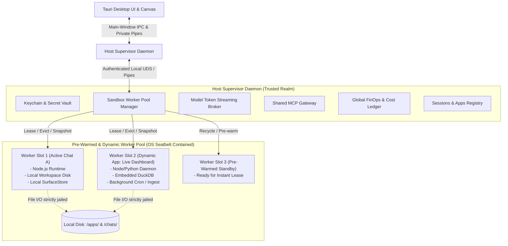
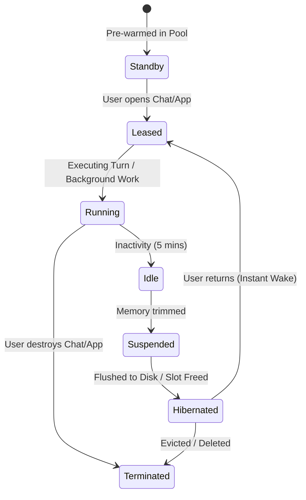
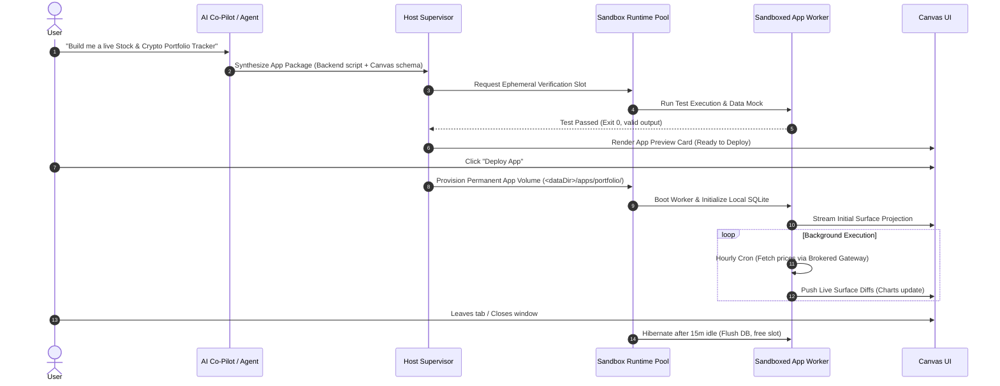
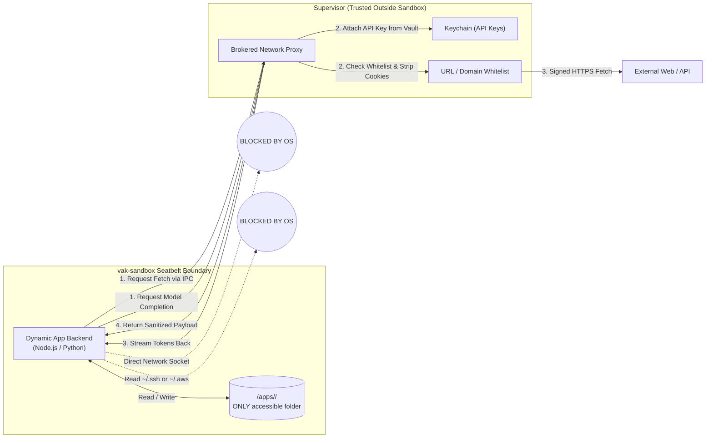

# Vakyartha "Mini-Cloud": Pooled Sandbox Runtime & Full-Lifecycle Dynamic Artifact Applications

> **Status:** Architectural Blueprint & Proposal  
> **Target:** Vakyartha Desktop Runtime (macOS Tauri + Node sidecar + `vak-sandbox`)  
> **Authors:** Vakyartha Architecture Group  
> **Date:** October 2026  

---

## 1. Executive Summary & The Core Thesis

### From Conversational Assistant to Local Micro-Cloud
Traditional AI assistants operate on a request-response turn model: the user speaks, the model generates text or JSON surfaces, and the process idles. When users need more—such as real-time dashboards, persistent internal tools, local data analysis pipelines, or reactive business workflows—chat-based assistants hit a wall because they lack **persistent infrastructure, backend code execution, stateful memory, and background lifecycles**.

Vakyartha is positioned uniquely to bridge this gap. Because Vakyartha already controls a **native desktop runtime, private OS pipes (ADR-044), a liquid Canvas projection engine, and an OS-level Seatbelt sandbox (`vak-sandbox`)**, we can evolve Vakyartha into a **Local Mini-Cloud Platform**.

```
┌────────────────────────────────────────────────────────────────────────────────────────┐
│                                   VAKYARTHA MINI-CLOUD                                 │
├──────────────────────────┬──────────────────────────┬──────────────────────────────────┤
│  1. Tenant Workspaces    │  2. Pooled Node Runtimes │  3. Full Software Capabilities   │
│  - Isolated per chat/app │  - Pre-warmed runners    │  - Backend Node/Python code      │
│  - Seatbelt jail (vaksb) │  - Dynamic slot leasing  │  - Local DB (SQLite / DuckDB)    │
│  - Virtual storage disks │  - Fast hibernation/wake │  - Background crons & watchers   │
├──────────────────────────┼──────────────────────────┼──────────────────────────────────┤
│  4. Canvas App Hosting   │  5. Cloud Observability  │  6. Zero-Trust Secrets Broker    │
│  - Liquid 3-tier layout  │  - Real-time stream logs │  - Sandbox never sees raw keys   │
│  - Bidirectional events  │  - CPU/RAM/FinOps meters │  - Brokered LLM token streaming  │
│  - Artifacts library     │  - Health probes & heal  │  - Whitelisted network egress    │
└──────────────────────────┴──────────────────────────┴──────────────────────────────────┘
```

Instead of generating disposable snippets, Vakyartha can **provision, deploy, run, observe, and maintain full-fledged dynamic applications** directly on the user's local machine, governed by strict OS-level containment and resource pools.

---

## 2. High-Level System Architecture

The architecture decouples the **Host Supervisor Daemon** (governance, secrets, catalog, pool orchestration) from the **Sandboxed App Workers** (untrusted code execution, data processing, reactive state).



---

## 3. The Shared Sandbox Runtime Pool (`WorkerPool`)

### 3.1 The Multi-Tenancy Challenge
If every chat and every hosted dynamic application spawned a dedicated, unconstrained Node.js runtime and full child process tree:
* Each Node V8 runtime consumes ~35MB–60MB RSS at baseline.
* 15 open chats + 5 running artifact apps = 20 Node processes (~1.2 GB RAM).
* Spawning MCP tools per app would exhaust macOS file descriptors and CPU threads.

### 3.2 The Pool Architecture
The **Sandbox Pool** provides **dynamic multi-tenant slot leasing**:

1. **Fixed Worker Concurrency (`MAX_ACTIVE_WORKERS = 3 to 4`)**:
   Only a small number of sandbox worker processes run actively in host memory simultaneously.
2. **Worker Leasing Model**:
   * When a user opens Chat A or navigates to Dashboard App B, the tenant **leases** an active worker slot.
   * If a slot is free, allocation is instantaneous (<10ms).
   * If slots are full, the **LRU (Least Recently Used) policy** selects the stalest idle worker, instructs it to flush its state to disk, terminates or resets it, and assigns the slot to the incoming tenant.
3. **Pre-Warmed Standby Worker**:
   The pool maintains 1 pre-warmed, unassigned sandbox worker waiting in standby. Spawning a new chat or launching an app feels instantaneous (<50ms).
4. **Hibernation & Instant Wakeup**:
   * Inactive chats and paused apps do not keep Node processes running. Their memory heap, Surface state, and SQLite journals are flushed to `<dataDir>/apps/<id>/state.json`.
   * When the user switches back, the pool boots/assigns a worker, mounts the tenant folder, rehydrates the state, and reconnects the UI in <150ms.



---

## 4. The Anatomy of a Full Dynamic Artifact App

A **Dynamic Artifact App** is a self-contained, reactive micro-application hosted inside Vakyartha. Unlike static code snippets, it has a 4-tier stack:

```
┌────────────────────────────────────────────────────────────────────────┐
│                       DYNAMIC ARTIFACT APP STACK                       │
├────────────────────────────────────────────────────────────────────────┤
│ 1. Presentation Tier (Liquid Canvas Surface / Interactive UI)          │
│    - 3-Tier liquid layout (Executive strip, paired charts, data table) │
│    - Reactive controls (sliders, date pickers, dropdowns, forms)       │
│    - Real-time updates via streaming Surface Diff patches              │
├────────────────────────────────────────────────────────────────────────┤
│ 2. Backend Compute Tier (Sandboxed Node.js / Python Daemon)            │
│    - Headless application logic executing in vak-sandbox Seatbelt      │
│    - Local API endpoints or event handlers                             │
│    - Custom algorithms, financial models, data aggregations            │
├────────────────────────────────────────────────────────────────────────┤
│ 3. Storage & Data Tier (Virtual App Volume)                            │
│    - Isolated directory: `<dataDir>/apps/<app-id>/`                    │
│    - Embedded databases: SQLite, DuckDB, Parquet, or JSON files        │
│    - Versioned Realm snapshots (rollback, history, audit trail)        │
├────────────────────────────────────────────────────────────────────────┤
│ 4. Autonomous Infrastructure Tier (Triggers & Scheduling)              │
│    - Background polling crons (e.g. hourly market scrape)              │
│    - File-watcher triggers (re-run on local file change)               │
│    - FinOps budget circuit breakers (kill run if compute > limit)      │
└────────────────────────────────────────────────────────────────────────┘
```

### 4.1 Comparison: Standard Chat vs. Dynamic Artifact App

| Capability | Standard Chat Session | Dynamic Artifact App |
| :--- | :--- | :--- |
| **Execution Model** | Ephemeral, turn-based (User prompt → Model response) | Stateful, long-running, reactive event loop |
| **Compute Engine** | Shared host sidecar | Dedicated sandboxed worker from the shared pool |
| **UI Surface** | Chat bubbles + optional canvas snapshot | Full-screen or split-pane liquid canvas app |
| **Data Persistence** | Message history only | Private embedded database (SQLite/DuckDB/Parquet) |
| **Background Work** | Blocked once turn completes | Autonomous scheduled jobs, polling, watchers |
| **User Interaction** | Text prompts and follow-up turns | Direct UI manipulation (buttons, filters, forms) triggering backend logic |

---

## 5. End-to-End Application Lifecycle Management

Operating local applications requires cloud-grade lifecycle management:



### Lifecycle States & Transitions
1. **Drafting & Rehearsal**: The Agent synthesizes code and UI schemas. Before presenting it to the user, it runs an automated test inside an ephemeral disposable sandbox to verify zero runtime syntax errors.
2. **Provisioning & Deployment**: The app receives a dedicated ID, volume folder `<dataDir>/apps/<id>/`, and permissions manifest.
3. **Live Execution & Reactivity**: The app runs within an active pool worker slot. User clicks on the Canvas (e.g. changing date ranges) trigger local backend handlers, recalculating data and emitting fine-grained Surface Diffs without re-running LLM turns.
4. **Autonomous Cron / Wakeup**: An app can register a timer (e.g., `cron: "0 * * * *"`). When the timer fires, the Supervisor allocates a worker slot from the pool, wakes the app, executes the task, updates the surface, and returns the worker to the pool.
5. **Self-Healing & Watchdog**: If an app worker encounters an unhandled exception or segfault, the Supervisor captures the stderr, prevents infinite restart loops with an exponential backoff circuit breaker, and surfaces a one-click "Debug / Fix with Agent" banner.

---

## 6. Cloud-Grade Observability on Desktop

Running software on behalf of the user requires transparent observability. Users must never wonder: *"What is this app doing in the background? Is it chewing my CPU or draining my token budget?"*

```
┌────────────────────────────────────────────────────────────────────────┐
│                      APP OBSERVABILITY DASHBOARD                       │
├────────────────────────────────────────────────────────────────────────┤
│ [STATUS: RUNNING]   Uptime: 2h 14m   PID: 84920 (Jailed in vaksb)     │
├────────────────────────────────────────────────────────────────────────┤
│ METRICS:                                                               │
│   CPU: 0.4% [━━────────────]        RAM (RSS): 42.1 MB [━━━──────────] │
│   Disk I/O: 1.2 MB written          FinOps: $0.004 (2 model calls)     │
├────────────────────────────────────────────────────────────────────────┤
│ LIVE STREAMING CONSOLE (stdout / stderr / audit):                      │
│   [11:45:02] [INFO] SQLite connection initialized (portfolio.db)       │
│   [11:45:03] [INFO] Cron job registered: 'fetch-rates' every 60m       │
│   [11:45:04] [IPC]  Surface rendered: 3 tiers, 4 metric cards, 1 chart │
│   [11:46:12] [NET]  Broker fetch -> api.coingecko.com (200 OK, 142ms)  │
│   [11:46:12] [DIFF] Surface updated: BTC +1.4%, ETH -0.2%             │
└────────────────────────────────────────────────────────────────────────┘
```

1. **Structured Log Stream**: All stdout, stderr, and IPC communication are buffered in `<dataDir>/apps/<id>/logs/execution.jsonl` with rotation.
2. **Resource Metrics Monitoring**:
   * RSS Memory usage (alerting if > 150MB).
   * CPU consumption (throttling if sustained > 50% for 30 seconds).
   * Disk space consumption (capped at 512 MiB per app volume).
3. **FinOps Cost Attribution**:
   * Any LLM tokens requested by the app (e.g. for periodic summarization) are charged against that specific app's cumulative budget.
   * If the app exceeds its monthly dollar/token cap, background turns halt gracefully until user approval.
4. **Audit Trail**: Every file touched, outbound fetch brokered, and tool called is written to an immutable audit ledger.

---

## 7. Security, Networking & The Zero-Trust Secrets Broker

### 7.1 The Threat Model
If an AI agent can write and execute arbitrary backend Node/Python code for a dynamic app, **that code must be treated as untrusted**. A vulnerable dependency or an indirect prompt injection could attempt to:
* Steal user API keys (`OPENAI_API_KEY`, Keychain tokens).
* Read sensitive personal files (`~/.ssh`, `~/.aws`, Chrome cookies).
* Open unauthorized reverse shells or DDoS sockets.

### 7.2 The Defense-in-Depth Architecture



1. **OS Seatbelt Hardening (`vak-sandbox`)**:
   * The app process runs under a strictly tailored macOS Seatbelt profile.
   * **Filesystem:** Read/write is restricted *only* to `<dataDir>/apps/<id>/`. All other directories (`~/*`, other chats/apps) are completely invisible.
   * **Network:** Raw network sockets (`connect-socket`, `bind-socket`) are **denied by the OS kernel**.
2. **The Zero-Trust Secrets Proxy**:
   * The app process environment receives **zero** secret environment variables.
   * If the app needs an LLM completion, it sends an IPC request to the Supervisor.
   * If the app needs external data, it calls the Supervisor's Brokered Fetch API with a declared domain (e.g., `api.github.com`). The Supervisor checks user permissions, applies rate limits, strips credentials, performs the fetch, and returns data to the sandbox.

---

## 8. High-Impact Real-World Scenarios

What can users actually build and run with this "Mini-Cloud" in Vakyartha?

### Scenario A: Live Financial Intelligence & Market Dashboard
* **The Need:** A user wants to track their investment portfolio, correlate stock prices with currency fluctuations, calculate portfolio risk, and get alerted when certain volatility thresholds cross.
* **How Vakyartha Runs It:**
  * **Backend:** A Node daemon running in an app slot with a local DuckDB database.
  * **Ingress:** Hourly scheduled brokered fetch pulling financial data from approved APIs.
  * **Compute:** Running local statistical calculations (volatility, moving averages) in Python/JS.
  * **UI:** A liquid Canvas dashboard with a 4-metric summary strip, paired candlestick charts, and a responsive transactions table.
  * **Interactivity:** User adjusts slider controls on the Canvas; the local backend recalculates the projections instantly with 0ms latency.

### Scenario B: Local Data Engineering & ETL Pipeline
* **The Need:** A user frequently drops large CSV, JSON, or Parquet exports from customer databases and needs them cleaned, deduplicated, and transformed into executive reports.
* **How Vakyartha Runs It:**
  * **Backend:** A sandboxed Python script running DuckDB/Polars.
  * **Persistence:** Stored in `<dataDir>/apps/data-pipeline/workspace/`.
  * **Workflow:** User drops files into the app workspace. The app detects file changes, runs the data validation pipeline, and populates a high-performance paginated Canvas table.
  * **Export:** One-click generation of cleaned Parquet files or executive PDF reports.

### Scenario C: Developer Local CI & Code Review Workbench
* **The Need:** A software engineer wants an autonomous assistant that watches their local git repositories, runs unit tests on commit, analyzes code quality, and renders visual test coverage maps.
* **How Vakyartha Runs It:**
  * **Backend:** Sandboxed Node runner interacting with local git worktrees.
  * **Workflow:** Detects git commits, runs test runners in isolated Seatbelt realms, parses TAP/JUnit output, and maps code coverage trees onto the Canvas.
  * **Action:** The developer clicks "Review Failures" on the Canvas, triggering the agent to propose fixes via Realm promotions.

### Scenario D: Autonomous Daily Briefing & Podcast Generator
* **The Need:** An executive wants an automated morning briefing that aggregates calendar events, Jira tickets, and sector news, synthesizes them into an executive summary, and generates a short audio brief.
* **How Vakyartha Runs It:**
  * **Backend:** Cron job running at 7:00 AM daily.
  * **Orchestration:** Calls calendar MCP and news tools via the Supervisor gateway.
  * **Synthesis:** Produces executive summary cards on Canvas and calls Vakyartha's native Voice engine to render a playable audio artifact.
  * **Result:** When the user opens Vakyartha in the morning, their custom briefing dashboard is already live and waiting.

---

## 9. Architectural Feasibility & Non-Negotiable Boundaries

To remain strictly aligned with Vakyartha's engineering principles (as defined in `AGENTS.md`):

1. **No Edits to `framework/` (Projection)**:
   * The Projection framework continues to own canonical sessions, Surface parsing, and base providers.
   * The "Mini-Cloud" orchestration, worker pool management, and app hosting layer belong entirely to Vakyartha's product layer (`sidecar/`).
2. **Minimal External Dependencies**:
   * Use Node.js built-ins (`node:child_process`, `node:net`, `node:fs/promises`, `node:async_hooks`).
   * No heavy container orchestration tools (no Docker, no Kubernetes, no heavyweight third-party microservices).
   * OS sandboxing relies strictly on the existing Rust `vaksb` Seatbelt helper from `vak-sandbox`.
3. **One Persistence Owner Per Entity**:
   * The Supervisor owns the global App Registry (`<dataDir>/apps/index.json`).
   * Each App Worker owns its dedicated app volume (`<dataDir>/apps/<id>/`).
   * There are no multi-process race conditions on state files.
4. **Outcome Acceptance Gates**:
   * Before promoting this architecture to production code, we must construct deterministic automated verification scripts (`scripts/sandbox-pool-check.ts` and `scripts/dynamic-app-check.ts`) that prove:
     * Clean startup, eviction, and hibernation under memory pressure.
     * Hard OS-level refusal of network and external directory access from jailed app code.
     * Zero secret leakage in app process environments.
     * Proper recovery and journal rollback on abrupt process termination.

---

## 10. Recommended Next Steps

1. **Review & Refine Architecture**: Walk through the lifecycle, pooling policies, and IPC interface with the core team.
2. **Draft the IPC Protocol Specification**: Detail the exact JSON-RPC message contracts between the Host Supervisor and the Sandboxed App Workers.
3. **Design the App Manifest Schema (`app.json`)**: Define how dynamic apps declare their entrypoints, required tools, storage volumes, background crons, and Canvas surface templates.
4. **Prototype Worker Pool Manager in Isolation**: Build a standalone unit test (`test/sandbox-pool.test.ts`) exercising worker slot leasing, LRU eviction, and hibernation before integrating with the desktop UI.

