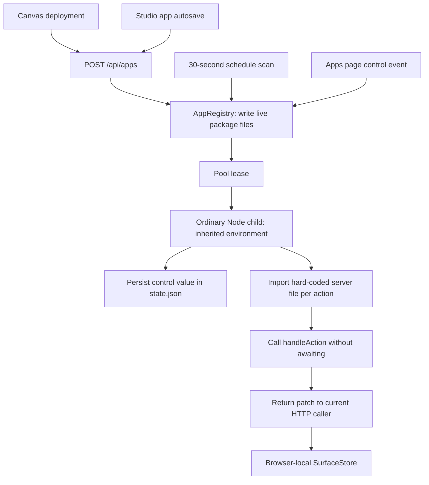

# Sandboxed app review — 2026-10-28

Reviewed source commit: `bdc02ed`. This is a source and targeted execution review, not certification of the installed app. No runtime code was changed. The findings below take precedence over broad completion claims for the reviewed source; they do not change those historical documents.

## Assessment

The product idea is useful: let a user retain an interactive artifact as a local application, with deterministic computation, durable domain data and optional scheduled work. Editing a control should recompute the result without another model request. The model helps author and maintain the package; the installed program performs ordinary computation.

The current implementation is an early app runner, not a safely sandboxed application platform. It has real processes, filesystem persistence, API routes, a registry, UI mounting and a scheduler. However, the app execution path lacks OS isolation, package file confinement, transactional publication, reliable worker ownership, truthful execution receipts and durable reactive state. Those are foundational boundaries, not polish.

The existing command/Realm feature is separate. `sidecar/sandbox-execution.ts` uses the helper, a minimal environment and fail-closed checks. `sidecar/sandbox-pool/pool-manager.ts` launches plain Node directly. Successful command/Realm containment tests cannot establish containment for the app pool.

## Idea and architectural fit

An app needs four distinct things:

1. An immutable, reviewed package: manifest, executable code, surface definitions and content hashes.
2. Mutable app-owned domain data, with one canonical writer and an explicit schema/migration lifecycle.
3. A temporary execution lease, whose process can disappear without deleting the package or durable data.
4. One or more projections of that data, with validated action routing and revision-aware updates.

These lifetimes should remain independent. Closing a view need not uninstall an app; saving a draft must not publish executable code; hibernating a process must not erase state; deleting an app must stop its work before removing its data.

The registry and native resource scheduling belong in Vakyartha. OS containment belongs in the separate sandbox project. Generic projection, interaction validation and rendering remain Projection responsibilities through public APIs. External tools, credentials and permissions should reuse the existing integrations lifecycle. Scheduling needs to reuse or deliberately extend existing task execution authority rather than become an ungoverned second route to effects.

The useful near-term product is a bounded local app runtime. Broad multi-tenant cloud terminology, multiple runtime engines, arbitrary databases and aggressive latency guarantees obscure the smaller contract that first needs proving.

## Implemented flow

Opening an app currently fetches details and mounts `surface.json`; it does not lease/start its backend. The first control event or schedule does. There is no implemented general daemon startup contract.

## Findings

### F1 — P0: App workers have host permissions and inherited environment

[`pool-manager.ts`](../../sidecar/sandbox-pool/pool-manager.ts#L74) spawns the Node executable directly and spreads `process.env`. It neither invokes `vaksb` nor checks the global sandbox switch/helper compatibility. The app module executes inside that ordinary child. Airgap/network/domain/MCP declarations do not enforce anything on this path.

A temporary test installed an airgap app, placed a harmless marker outside its package and set a synthetic environment marker. The app read both. No credential values were inspected or printed. A process boundary alone does not protect host files, other app data or network access.

Required outcome: a fresh tenant-specific OS policy, minimal environment, fail-closed readiness and approved broker access before any package code is loaded. A prewarmed ordinary Node process cannot acquire a trustworthy workspace jail just by receiving a lease message. Pool scarce execution capacity first; retain prewarming only if it preserves the actual isolation boundary.

### F2 — P0: Package writes and deletion escape the app directory

[`installApp` and `updateApp`](../../sidecar/sandbox-pool/app-registry.ts#L220) validate manifest entrypoints but join arbitrary `files` keys to the app directory. `../escaped.txt` wrote outside the package in a temporary probe. Symlink traversal and overwriting reserved runtime files are also unguarded.

[`deleteApp`](../../sidecar/sandbox-pool/app-registry.ts#L275) does not require a registered, valid ID before constructing its fallback path. Calling `deleteApp('../outside-delete')` deleted a sibling directory beneath the temporary test root and returned success. The route decodes its captured ID before forwarding it, so route matching is not a containment check.

Validate every path and identifier at the persistence owner; require registered targets for deletion; reject symlinks and reserved files; stage the complete bounded package before changing live state. HTTP authentication does not make model-authored paths safe.

### F3 — P1: Concurrent leasing violates tenant ownership

[`lease`](../../sidecar/sandbox-pool/pool-manager.ts#L233) has no serialized reservation. A spawning slot is published as standby before initialization completes; competing callers can reuse it. Tenant lookup also treats terminating slots as reusable, and capacity calculations exclude suspended/terminating processes.

In a six-call concurrent probe with capacity one, two leases failed with worker SIGTERM errors and the lease requested for `tenant-5` returned `tenant-2`. This run did not prove a numeric process-cap breach; it directly demonstrated incorrect ownership. The earlier fail-fast version of this probe also failed and was not counted as a pass.

Reserve capacity and tenant identity atomically, await readiness, use lease generations, serialize ownership transitions, and queue or reject contention explicitly. A worker executing a request must not be evicted as ordinary idle capacity.

### F4 — P1: Production startup never starts the pool lifecycle

[`server.ts`](../../sidecar/server.ts#L268) constructs the pool and initializes the registry but never calls `pool.start()`. Lazy leases still launch workers, masking this omission. Startup prewarming, the idle sweep and clock-jump reconciliation therefore do not start through the ordinary server path. Unit pool tests explicitly call `start()` and miss this integration failure.

### F5 — P1: Backend and trigger execution contracts are not implemented faithfully

[`worker.ts`](../../sidecar/sandbox-pool/worker.ts#L170) searches only `server.ts`, `server.mjs`, then `server.js`; it ignores `entrypoints.backend` and the declared runtime engine. It imports on every action with a timestamp query, rerunning top-level initialization and retaining distinct module instances over time. Normal relative filesystem operations also inherit the host working directory; import location does not set the app working directory.

Handlers are called without `await`. A probe using an async handler returned `{}` rather than its completed result. A package declaring `main.ts` received the generic fallback patch without executing that file.

[`runTrigger`](../../sidecar/sandbox-pool/app-registry.ts#L326) sends the declared action name, but the worker only logs that name and calls `handleAction(controlId, value)`. A probe declared `refreshData`; the receipt said `{ok:true, action:'refreshData'}` while its marker proved the function never ran. Missing handlers and caught exceptions also become apparent successes.

Use one documented, versioned app interface; load the approved entrypoint once per package generation, await asynchronous work, route triggers explicitly and return errors when requested computation or persistence fails. Advertise only supported engines.

### F6 — P1: Studio app drafts are immediately live

[`saveDraftAction`](../../src/skills-studio.ts#L504) posts app autosaves to `/api/apps`, directly writing the installed package and its schedule. App publication calls the same function. The skill draft quarantine is not an app draft implementation.

Reopening an app retrieves `AppDetails`, which contains the parsed surface but no backend/package source. The editor reads source from `_supportingFiles`, which is only populated locally for newly authored/edited files. Existing backend files therefore appear empty, and editing them can overwrite existing code without loading it first.

The app rehearsal button is also not connected: `runSandboxTest` exits when there is no `currentSkillPkg`, and the server rehearsal implementation accepts skill scripts under `scripts/`, not app `server.ts` packages.

Require separate app drafts, exact package-source reads, review fingerprints, an explicit publish transition and an actual app rehearsal contract. Autosave must never activate new code or schedules.

### F7 — P1: Durable app state and visible state diverge

The worker saves control inputs before calling application logic. Handler outputs are returned as patches but not persisted into a canonical surface/data revision. [`apps-page.ts`](../../src/apps-page.ts#L319) reloads the original surface and ignores `AppDetails.state`. A reopened view can therefore display the initial values despite previous successful actions.

Scheduled action results are discarded by `runTrigger`. The UI has no app update subscription; `surface_patch` messages with pending request IDs are consumed as responses before the manager's unsolicited event branch. Background work therefore does not update open surfaces through the advertised stream.

Use one app data owner, transactionally acknowledge persisted revisions, derive initial and incremental projections from that state, and preserve supported bindings, multiple surfaces and spoken projection. A map of control IDs and independent UI node patches is insufficient as a general app data contract.

### F8 — P1: Resource and capability limits are declarations only

The parsed memory/CPU/storage limits and trigger deadline are not passed to any enforcement mechanism. `maxWorkerRssBytes` is configured but never enforced. A five-second request timeout only rejects the host promise; it does not stop computation. No implemented network/model broker handles the broker message types. File-watcher triggers are parsed but never scheduled.

Reject unsupported capabilities and expose enforcement limits honestly. Apply bounded execution, process-tree cleanup and storage/output/IPC budgets through their actual runtime owners. Do not represent parsed numbers as enforced quotas.

### F9 — P1: Update, hibernation and deletion do not establish quiescence

[`hibernate`](../../sidecar/sandbox-pool/pool-manager.ts#L279) accepts a response without checking `statePersisted`, records hibernation even after timeout, sends SIGTERM and returns without waiting for process exit. Update/delete can write/remove files while that process is still alive. An immediate lease can select the terminating process again. Updates overwrite live files individually without a rollback journal or package generation switch; POST installation can overwrite an existing running app without even attempting hibernation.

Use an app operation lock: disable new work, drain/cancel in-flight requests, validate checkpoint success, terminate and await the process tree, then switch/delete the package. Failed publication must preserve the previous executable version and data. Rename alone gives an individual file replacement, not a multi-file or power-loss durability guarantee.

### F10 — P1: Runtime output is trusted beyond its authority

[`decodeIpcMessage`](../../shared/sandbox-pool.ts#L99) checks only a few top-level fields. Worker output has no line-size/output cap, payload schema, response-type validation or lease-generation binding. Imported app code shares stdout with protocol frames and can emit purported metrics/logs/responses directly. `console.log` also writes into that protocol stream; ordinary non-JSON logs are discarded.

The manager spreads worker payload after trusted identity fields. The admin terminal inserts some such fields (`level`, slot and tenant identities) into `innerHTML` without escaping. This creates a path from executable app output into trusted console markup. Arbitrary browser script execution was not tested; the trusted-markup violation is visible in source.

Treat worker claims as untrusted data, impose transport bounds and supervisor-owned identity, separate app logs from control framing, and render every field as text. A typed TypeScript union is not runtime message validation.

### F11 — P1: Scheduler execution lacks durable governance

The 30-second scan launches due work without awaiting it, records a minute marker before success and swallows failures. Run markers and last-executed metadata live only in memory. There is no pause/enable state, durable run record, in-flight exclusion, catch-up policy, approval continuity or task-level cancellation. File watchers have no implementation. Failed work may be suppressed for the minute, and restarts can duplicate work in that minute.

Use the existing task/integration authority for effects, retain durable run IDs and uncertain outcomes, and make retries/missed-run policy explicit. Scheduled computation and authorization for network/writes are separate decisions.

### F12 — P1: The console and handover overstate measured protection

[`admin.html`](../../admin.html) statically displays active `vaksb`, zero child keys, kernel-denied sockets, scoped files and enforced network filtering despite F1. Budget figures and security indicators are largely static; `refreshFinops` expects `totalSpend`, while the canonical FinOps view requires its existing summarization logic. `/api/admin/fleet/restart` merely calls `suspendAll()` and the UI announces restart success. Suspension sets a flag and suppresses worker metrics; it does not pause app computation.

The handover claims SQLite checkpointing, full lifecycle verification, bounded concurrency and latency thresholds that the reviewed code/tests do not establish. The architecture document itself still says proposed/review phase. These discrepancies matter because users rely on the console to decide whether running code is contained.

Show unknown/unsupported states until measured from the actual worker boundary. Replace completion claims with scoped evidence; preserve earlier failures. No latency threshold was benchmarked in this review.

## Lifecycle the feature needs

| Transition | Required contract | Reviewed source |
|---|---|---|
| Create/edit → draft | Inert bounded package, source intact | App autosave writes live files |
| Draft → rehearsal | Exact hash, same containment model, no live effects | App rehearsal disconnected |
| Draft → published | Review, permissions, atomic generation switch | Direct file writes |
| Published → runnable | User activation; scheduler explicitly enabled | Installation immediately schedule-eligible |
| Open → active | Validate readiness and lease approved version | Opening only mounts initial surface |
| Action → completed | Validate identity/revision, await work, persist, return receipt | Input saved first; failures can appear successful |
| Active → idle | In-flight-aware accounting | No production idle timer startup |
| Idle → hibernated | Checkpoint confirmed, process exited, durable identity retained | SIGTERM requested; exit not awaited |
| Hibernated → active | Fresh contained process, load canonical current state | Terminating slot can be reused |
| Sleep/wake → reconciled | Real pause semantics, durable missed-run policy | Flag and interval heuristic only |
| Published → updated | Quiesce, stage, migrate, switch, rollback on failure | Live files overwritten |
| Installed → deleted | Stop schedules/work, validate target, await exit, remove exact owned paths | Traversal deletion and process race |
| Crash → recovered | Durable pending/uncertain outcomes; no blind replay | In-memory registry/run markers only |

## Repair order and acceptance

1. **Contain execution and storage first.** Fail closed for app execution until the helper can enforce the required tenant policy. Remove false green security states. Fix all package/delete path ownership. Prove outside read/write/network denial, synthetic environment isolation, switch revocation, missing-helper refusal and process-tree cleanup.
2. **Establish package and tenant ownership.** Separate draft/package/data lifetimes. Serialize lease/update/delete operations. Use immutable package generations and supervised process exits. Stress concurrent requests and assert every reply belongs to the requested tenant and generation.
3. **Prove one app interface.** One declared Node entrypoint; one async action; one named trigger; one supported persistence mechanism. Missing functions, thrown/rejected work, persistence failure and timeouts must produce failed receipts. Reject other advertised engines/capabilities until implemented.
4. **Complete the data-to-projection loop.** Change a value, independently verify the calculation, close/reopen, hibernate/wake and restart the host. The durable value and all supported projections must agree. Background updates need revisioned delivery and conflicting draft preservation. Preserve independent surfaces and existing channel/voice behavior where supported.
5. **Add governed scheduling and operations.** Durable runs, opt-in activation, pause/cancel, missed-run handling, uncertain outcome recovery and accurate metrics precede additional automation features. Verify the actual packaged WebKit app and native shutdown; server-route tests do not cover these outcomes.

No new dependency is necessary to address the identified ownership/validation defects. Any additional runtime capability must first be located in the correct owning project and evaluated against the repository's dependency and runtime-boundary rules.

## Verification performed

- `npm run typecheck`: passed.
- `node --test test/sandbox-pool.test.ts test/app-registry.test.ts test/app-manifest.test.ts test/admin-api.test.ts`: all 10 passed.
- Temporary-directory probes confirmed F1, traversal write/delete in F2, tenant identity/failure behavior in F3, and async/entrypoint/trigger failures in F5. All probe directories were removed and their pools shut down. A process listing afterward showed no remaining source-worker processes.
- No paid/local model run, live provider call, installed-app replacement, native UI smoke or whole-repository test suite was performed. No claim about measured latency, network-denial behavior or stronger resource isolation is inferred from these checks.
- Passing existing tests is compatible with these failures: the API integration fixture has no application handler; registry tests accept a generic fallback patch; trigger tests check the reported name, not the declared function's effect; and pool tests explicitly initialize lifecycle state and mostly lease sequentially.

The feature should remain an experimental local app runner until the containment, ownership and original user-visible outcomes above pass independently.
