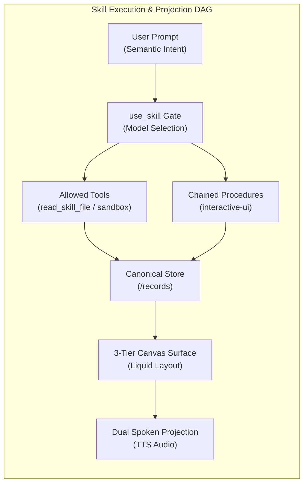
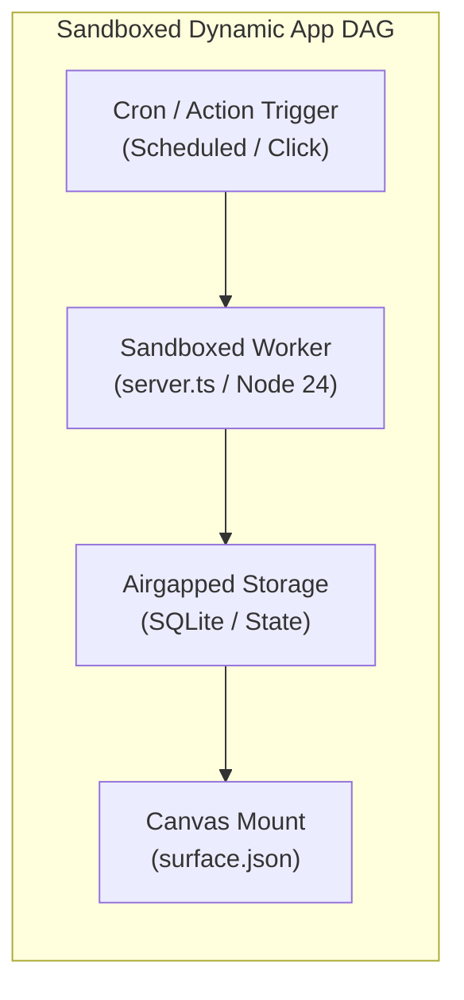

# Vakyartha Creator Studio: Architecture, UX, and Lifecycle Specification

The **Creator Studio** (`src/skills-studio.ts`) is Vakyartha's integrated development environment and visual workbench for authoring, orchestrating, and testing **Agent Skills packages** and **Sandboxed Dynamic Applications** (`app.json`, `server.ts`, `surface.json`).

---

## 1. System Overview & Core Pillars

In Vakyartha, skills and sandboxed apps are self-contained packages of instructions, schemas, daemons, and references that govern how the assistant understands domain procedures, chains capabilities, executes in Seatbelt sandboxes, binds canonical data, and projects reactive visual Canvas interfaces and spoken voice audio.

```
┌────────────────────────────────────────────────────────────────────────────────────────────────────────┐
│                                         VAKYARTHA CREATOR STUDIO                                       │
├───────────────────┬───────────────────┬───────────────────┬───────────────────┬────────────────────────┤
│ 1. Studio Hub &   │ 2. Spec & Code    │ 3. Interactive    │ 4. Responsive     │ 5. Governed            │
│    App Catalog    │    Editor         │    Flow DAG       │    Canvas Stage   │    vak-sandbox         │
└───────────────────┴───────────────────┴───────────────────┴───────────────────┴────────────────────────┘
```

1. **Unified Creator Hub & App Support**: Directly accessible from the sidebar (`✨ Studio`) and Settings. Manages both multi-file Agent Skills packages and Sandboxed Dynamic Applications with filter tabs (`All`, `Skills`, `Sandboxed Apps`, `Drafts`), search, and dedicated creation actions (`+ New Skill`, `+ New Sandboxed App`).
2. **Non-Destructive Multitasking & Continuous Auto-Save**: Seamlessly switch between active package editing and ongoing chat turns or New Chat without losing uncommitted state, open files, active tabs, or cursor position. Edits auto-save continuously to quarantined draft directories (`<dataDir>/skills/.drafts/<name>/`).
3. **Interactive Flow DAG (Directed Acyclic Graph)**: A native SVG-rendered visual dependency and execution graph illustrating the end-to-end pipeline from user intent through selection gates, capability boundaries, canonical stores, canvas surfaces, and voice projections.
4. **Responsive Canvas Staging & Linter**: Fluid container query testing (`320px`, `720px`, `960px`, `100% Fluid`) mounting live `<vak-surface>` Web Components with real package fixtures, layout compliance linting, and Dual Spoken Voice TTS auditioning.
5. **Governed Sandbox (`vak-sandbox`) Rehearsal**: Direct execution rehearsal of scripts and app daemons inside isolated macOS Seatbelt sandboxes with SHA-256 integrity verification, live stdout/stderr console streaming, and prompt selection gate evaluation (`/api/skills/eval`).

---

## 2. Workbench Architecture & Navigation

### 2.1 The Studio Hub (Landing Overview)
Clicking `✨ Studio` in the sidebar lands on the Studio Hub. It displays installed capabilities, working drafts, and metadata:
- **Header**: Title, description, quick creation actions (`+ New Skill`, `+ New Sandboxed App`), and back-to-chat button.
- **Working Drafts Banner**: Automatically detects uncommitted working drafts across all packages with a one-click resumption shortcut.
- **Filter Row**: Quick filters (`All`, `Skills`, `Sandboxed Apps`, `Drafts`) and live search filtering.
- **Card Grid**: Responsive cards showing icons, versions, descriptions, `Built in` / `Yours`, `On` / `Off`, `Draft` / `Published`, and allowed tools.

### 2.2 The 2-Pane Editor Workbench
Opening any skill or application presents a clean, focused workbench:
- **Header Bar**: `← Studio Hub` button, item identifier, type pill (`Skill` / `Sandboxed App`), draft status pill, view switcher segmented control (`Spec & Code`, `Flow DAG`, `Live Preview`, `Sandbox & Tests`), and actions (`Discard Draft`, `Save Draft`, `Publish Skill` / `Save App`).
- **Left Rail (Package Explorer & Capabilities)**:
  - Multi-file package tree (`SKILL.md` or `app.json`, `surface.json`, `server.ts`, schemas, scripts, references).
  - Add File (`+`) and Delete File (`×`) controls with safe relative path enforcement.
  - Active capabilities card: allowed MCP tools for skills, and runtime quotas (engine, memory limit, CPU timeout, airgap mode) for apps.
- **Center Canvas**: Switches dynamically based on the active tab:
  1. **Spec & Code**: Vertical stacked form fields (name, description with live 1024-character counter, allowed tools tokens) and tab-indented monospace code editor.
  2. **Flow DAG**: Interactive visual SVG graph showing the complete pipeline.
  3. **Live Preview**: Responsive container stage with live canvas mount, surface linter, and voice TTS player.
  4. **Sandbox & Tests**: Disposable script rehearsal terminal and prompt selection gate verifier.

---

## 3. The Interactive Flow DAG Engine

Both skills and sandboxed applications are modeled as directed acyclic execution graphs:





### Node Features:
- **Clean SVG Cubic Bezier Connectors**: Smooth vector paths with directional arrowheads connecting nodes.
- **Status Badges & Icons**: Clear capability markers (`Trigger`, `Gate`, `Sandbox`, `Data`, `Visual`, `Spoken`).
- **Interactive Node Inspector**: Clicking any node opens the inspector drawer revealing the exact frontmatter, manifest constraints, or prompt match criteria governing that stage.

---

## 4. Multi-Tab Multitasking & Continuous Auto-Save

Authors frequently switch between authoring capabilities and running live chat turns:
1. **Debounced Background Auto-Save**: Any modification in the form or code editor triggers an 800ms debounced auto-save directly to `<dataDir>/skills/.drafts/<name>/` (`PUT /api/skills/:name/draft`).
2. **Instant Tab Switching**: Switching to **New chat** or an existing conversation hides the Studio view non-destructively. All in-memory state, open files, active tabs, and breakpoints remain preserved.
3. **Seamless Resumption**: Clicking `✨ Studio` restores the active working stage instantly with zero reload latency or cursor reset.
4. **Draft Quarantine Invariant**: Unpublished drafts are strictly ignored by the runtime's local skill discovery during chat turns until explicitly promoted via `Publish Skill`.

---

## 5. Visual Canvas & UI Layout Engine

The app owns where an interface is shown (`src/canvas.ts` and `src/placement.ts`). In Studio, authors can visually assemble, arrange, bind, and stress-test layouts:

### 5.1 The 3-Tier Liquid Layout Architecture
1. **Tier 1 (Executive Summary)**: Headline section & 4-column KPI metric strip (`columns: 4, minItemWidth: "sm"`).
2. **Tier 2 (Analytical Core)**: 2-column grid or proportional split (`split` with `ratio: [2, 1]`) pairing a primary trend chart with distribution.
3. **Tier 3 (Granular Details & Actions)**: Full-width dense detail table (`maxWidth: "full"`) and bounded action forms (`maxWidth: "md"`).

### 5.2 Container Query Viewports
The Studio toolbar features responsive container query toggles:
- **`320px` (Mobile)**: Simulates mobile view, sidebar popover, or Telegram inline widget.
- **`720px` (Form / Tablet)**: Clamped measure for forms and focal charts.
- **`960px` (Desktop)**: Standard analytics grid measure.
- **`100% Fluid`**: Dense tables expand across the entire monitor, while single charts stay cleanly clamped.

### 5.3 Surface Design Linter
Real-time linting catches design violations:
- **Aspect Ratio Distortion**: Flags single charts set to `maxWidth: 'full'` without container bounds.
- **Semantic Tone Compliance**: Flags hardcoded raw hex colors (`#...`) in favor of semantic tones (`positive`, `caution`, `critical`, `neutral`).
- **Standard Chart Verification**: Validates requests against the 8 standard chart kinds (`bar`, `stacked`, `line`, `area`, `pie`, `scatter`, `heatmap`, `radar`).

---

## 6. Governed Sandbox (`vak-sandbox`) Rehearsal

Scripts and app daemons coordinate external tools and isolated execution without ever bypassing security policies:
- **Disposable Runs**: One-off script execution in an ephemeral macOS Seatbelt sandbox with SHA-256 verification.
- **No Direct Authority**: Skills declare tool requirements as hints; the app's native sandbox policy holds ultimate authority.
- **Terminal Console**: Live output streaming displaying exit codes, execution duration in milliseconds, and stdout/stderr channels.

---

## 7. Implementation Architecture & Code Locations

| Capability | App / Sidecar Location | Role in Creator Studio |
| :--- | :--- | :--- |
| **Studio UI Shell** | `src/skills-studio.ts` / `src/app.css` | Studio Hub, 2-pane workbench, Flow DAG, breakpoint stage, terminal |
| **Skill Storage & Manifest** | `sidecar/skills.ts` | Frontmatter parser, package fingerprinting, draft quarantine |
| **Sandboxed Apps Registry** | `sidecar/sandbox-pool/app-registry.ts` | Dynamic app lifecycle, manifest validation, trigger scheduling |
| **Canvas & Surface Staging** | `src/canvas.ts` & `@vak/web` | Container query renderer, canonical data hot-reloading |
| **Dual Spoken Projection** | `@vak/core` (`lowerSurface`, `projectText`) | Spoken gist simulation, TTS playback preview |
| **Sandbox Execution** | `sidecar/skills-sandbox.ts` & `vak-sandbox` | Disposable Seatbelt sandbox rehearsal with SHA-256 verification |
| **Selection Gate Verifier** | `sidecar/skills-eval.ts` | Prompt matching test harness for `use_skill` gate |

---

> [!TIP]
> The Creator Studio unifies Agent Skills and Sandboxed Dynamic Applications under a single, minimalist desktop experience with visual pipeline inspection, live canvas staging, continuous auto-saves, and governed sandbox verification.

---

## 7. Model Evaluation Harness & Regression Runner

- **Local Ollama `qwen3.5:4b-mlx` Execution**:
  - Runs 100% locally and offline (zero cost, zero token leakage).
  - **Selection Gate Test**: Runs positive prompts (expected to load this skill) and distractor prompts (expected to load other skills or none). Asserts that `use_skill` returns `{"names": ["my-skill"]}`.
  - **Instruction Adherence Gate**: Verifies output data structures, canonical path bindings, and absence of hallucinated tool parameters.
  - **Telemetry**: Measures prompt latency, generation speed (tokens/sec), and token consumption.

---

## 8. Implementation Architecture & Code Locations

The Skill Studio leverages Vakyartha's existing, modular architecture without introducing new backend runtimes:

| Capability | App / Sidecar Location | Role in Skill Studio |
| :--- | :--- | :--- |
| **Studio UI Shell** | `src/skills-studio.ts` (new) / `src/skills-page.ts` | 3-pane layout, Monaco editor, breakpoint switcher, test deck |
| **Skill Storage & Manifest** | `sidecar/skills.ts` | Frontmatter parser, package fingerprinting, file storage |
| **Discovery & Catalogs** | `shared/skills.ts` & `sidecar/skills-builtin.ts` | Catalog scrapers, 14-day commit checker, local package indexer |
| **Canvas & Surface Staging** | `src/canvas.ts` & `@vak/web` | Container query renderer, canonical data hot-reloading |
| **Dual Spoken Projection** | `src/voice/speech-text.ts` & `lowerSurface` | Spoken gist simulation, TTS playback preview |
| **MCP Tools & Schema Inspector**| `sidecar/integrations.ts` & `@vak/mcp/client` | Tool schema reader, virtual mock MCP server, approval simulator |
| **Research & Web MCP Grounding**| `sidecar/integrations.ts` (`brave`, `tavily`, `context7`) | Live documentation retrieval, formula verification |
| **Test Evaluation Runner** | `sidecar/skills-eval.ts` (new) | Local Ollama 4B test harness, selection gate runner |
| **Sandbox Execution** | `sidecar/sandbox.ts` & `vak-sandbox` | Disposable realm simulator, command preview |
| **YOLO & Assist Co-Pilot** | `sidecar/skills-copilot.ts` (new) | Full package generator, trigger optimizer, chart recommender |

---

> [!TIP]
> The Skill Studio elevates skills from passive prompt templates into robust, verified software capabilities with full authoring, visual surface staging, dual-projection voice simulation, and deterministic testing.
