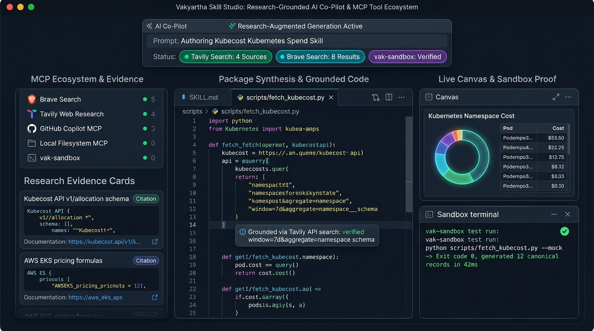
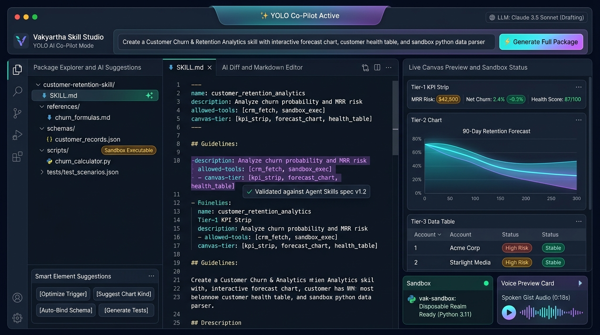
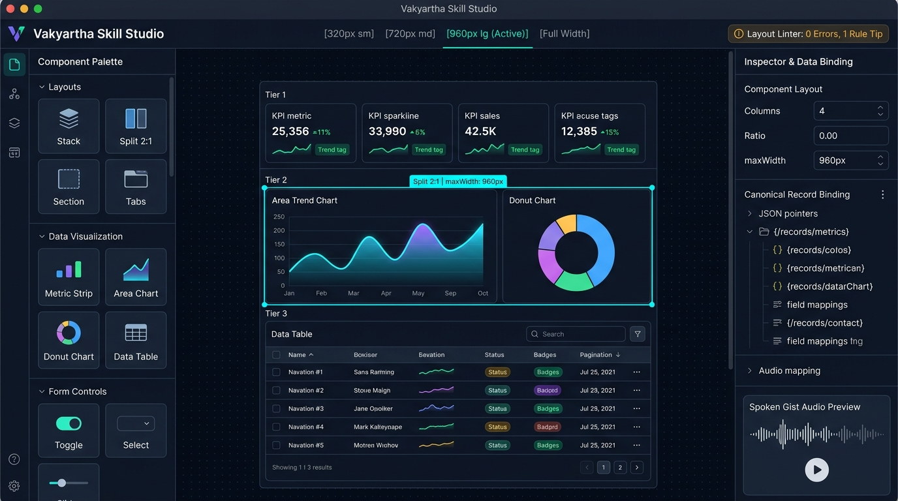
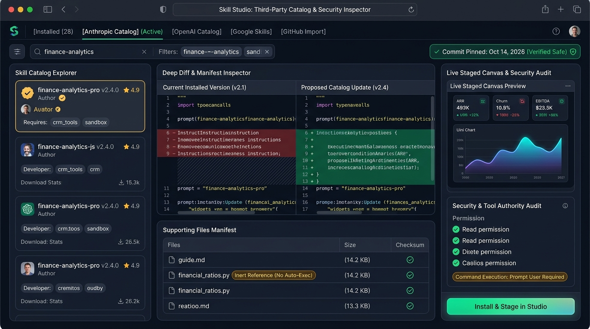
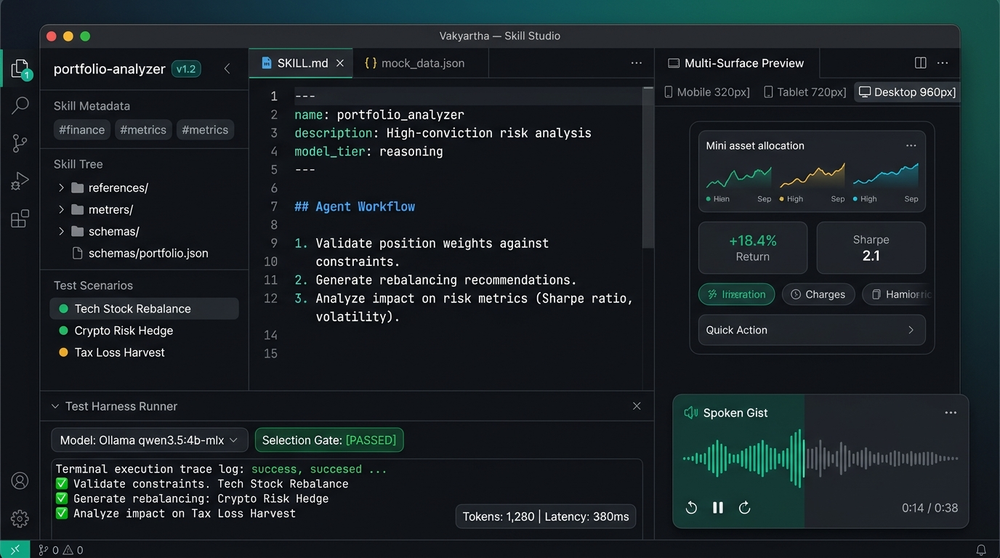
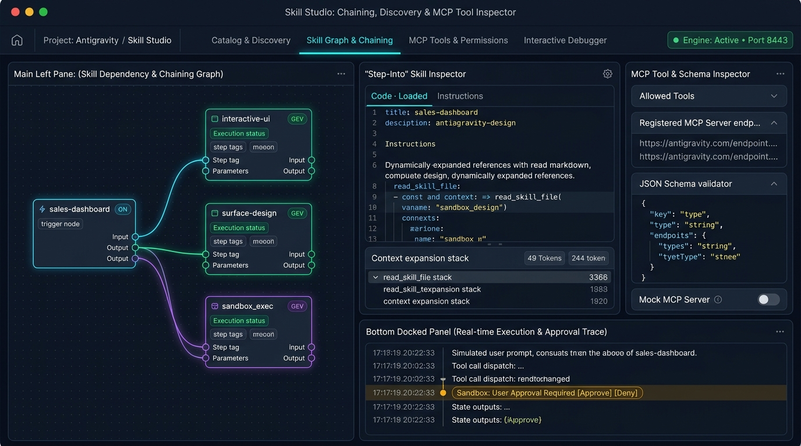
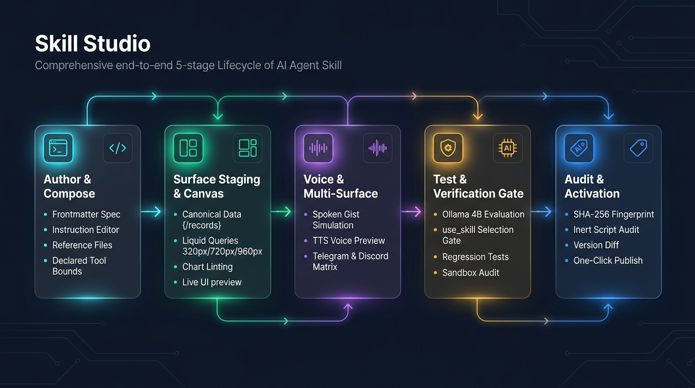
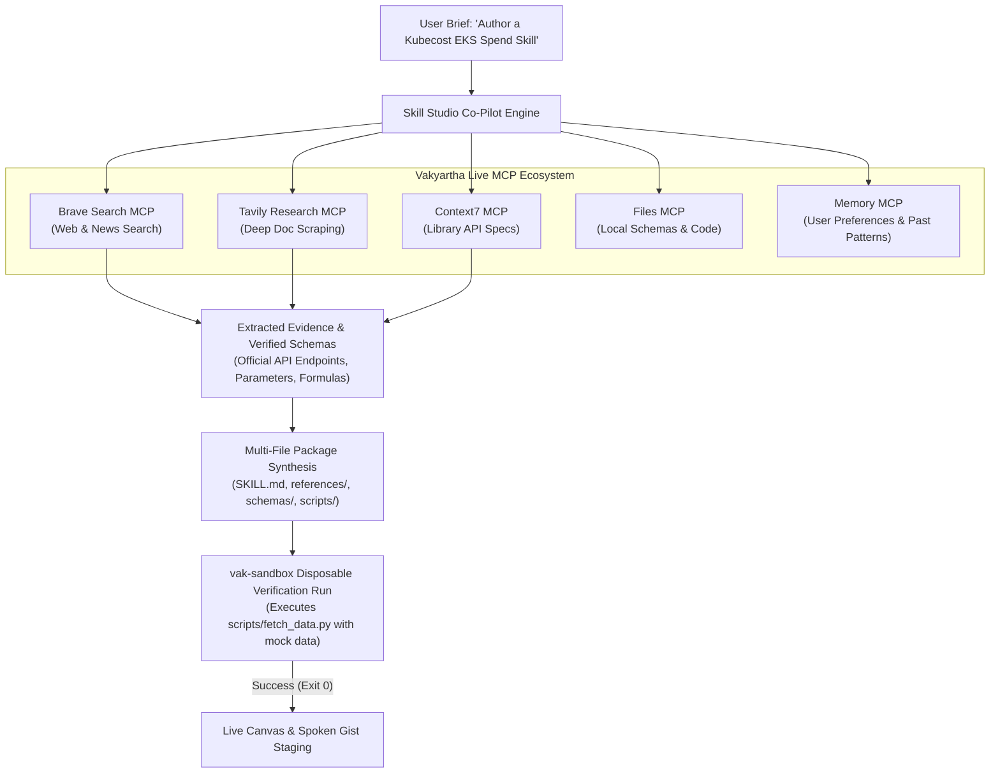
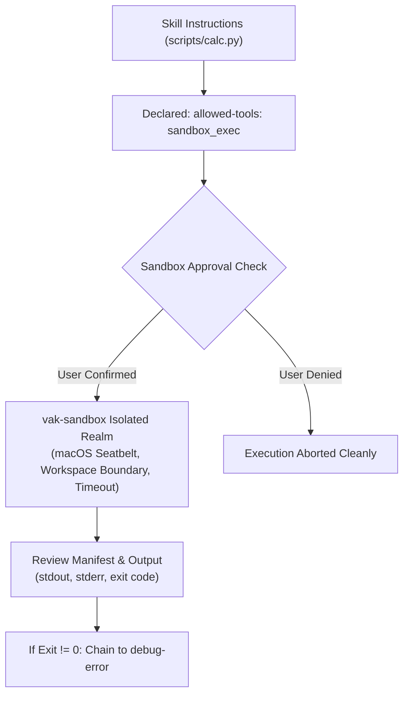

# Vakyartha Skill Studio: Architecture, UX, and Lifecycle Specification

The **Skill Studio** transforms skill development in Vakyartha from editing static markdown files into a first-class Integrated Development Environment (IDE) for agentic capabilities, dynamic canvas surfaces, UI layouts, tool orchestration, and multi-modal projections.

---

## 1. System Overview & The Core Pillars

In Vakyartha, skills are self-contained packages of instructions, schemas, and inert reference material that govern how the assistant understands domain procedures, chains to companion capabilities, uses MCP and sandbox tools, binds canonical data, and projects visual UI onto the Canvas and spoken audio through speech.

```
┌────────────────────────────────────────────────────────────────────────────────────────────────────────┐
│                                         VAKYARTHA SKILL STUDIO                                         │
├───────────────────┬───────────────────┬───────────────────┬───────────────────┬────────────────────────┤
│ 1. Full Package   │ 2. Research &     │ 3. Canvas & UI    │ 4. Chaining &     │ 5. Sandbox &           │
│    Specification  │    YOLO Co-Pilot  │    Layout Engine  │    Step-Into      │    MCP Tools           │
└───────────────────┴───────────────────┴───────────────────┴───────────────────┴────────────────────────┘
```

1. **Full Agent Skills Multi-File Package Specification**: Skills are not isolated markdown files; they are complete directory packages (`SKILL.md`, `references/`, `schemas/`, `scripts/`, `assets/`, `tests/`), with standard frontmatter, literal/folded scalar blocks, and strict safety limits (256 KB/file, 2 MB total, inert scripts).
2. **Research-Grounded AI Co-Pilot & YOLO Mode**: Uses Vakyartha's live MCP ecosystem (Brave Search, Tavily, Context7, GitHub, Filesystem, Memory) to research real APIs, formulas, and schemas, synthesizing hallucination-free skill packages with execution verification in `vak-sandbox`.
3. **Visual Canvas & UI Layout Engine**: A visual design workbench for Vakyartha's 3-Tier liquid layout architecture, responsive container query breakpoints (`sm: 320px`, `md: 720px`, `lg: 960px`, `full`), live `{/records}` canonical data bindings, and real-time layout linting.
4. **Existing & Third-Party Catalog Ecosystem**: Visual inspection, deconstruction, and forking of all 28 built-in skills; safe staging and security auditing of third-party catalog packages (Anthropic, OpenAI, Google, Microsoft, Hugging Face, Vercel, and GitHub repos) with 14-day commit pinning.
5. **Skill Chaining & "Step-Into" Inspection**: Visual dependency graph mapping multi-skill workflows (e.g., `sales-dashboard` → `dashboard` → `interactive-ui` → runtime-injected `surface-design`), with an interactive debugger to step into loaded instructions and trace context.
6. **Governed Sandbox (`vak-sandbox`) & MCP Simulation**: Deep inspection of MCP tool schemas declared under `allowed-tools`, virtual mock MCP server for offline testing, and execution rehearsal in disposable vs durable sandbox realms.

---

## 2. Visual Architecture & Visual Workbenches

### 2.1 Research-Grounded AI Co-Pilot & MCP Tool Ecosystem
*The Studio's AI Co-Pilot actively leveraging live MCP tools (Brave Search, Tavily, GitHub, Filesystem, and Sandbox) to retrieve official documentation and verify generated scripts:*



---

### 2.2 YOLO Mode & AI Co-Pilot Assistant
*One-click full package synthesis from natural language, accompanied by smart element suggestions, AI ghost text completion, live 3-tier canvas preview, and sandbox realm readiness:*



---

### 2.3 Visual Canvas Layout Builder & UI Component Studio
*Visual design and layout workbench for constructing Canvas surfaces, previewing container query reflows, binding canonical data, and checking layout rules:*



---

### 2.4 Third-Party Catalog & Existing Skill Deep Inspector
*Deep inspection and security audit workbench: catalog switcher with 14-day commit safety badge, split-screen instruction diff, inert script manifest, and staged live preview:*



---

### 2.5 The Core Studio Workbench (Authoring, Live Canvas & Model Evaluation)
*The unified 3-pane workbench showing skill navigation, code editor, live canvas, and local Ollama 4B test runner:*



---

### 2.6 Skill Chaining, Step-Into & MCP Tool Inspector View
*Visual node-based dependency graph showing active skill chaining (`sales-dashboard` chaining into `interactive-ui`, `surface-design`, and `sandbox_exec`), an interactive "Step-Into" debugger with prompt injection inspection, and an MCP Tool Schema Inspector:*



---

### 2.7 End-to-End Skill Lifecycle Flow
*The 5-stage pipeline from Authoring $\rightarrow$ Canvas Staging $\rightarrow$ Dual Spoken Projection $\rightarrow$ Verification Gates $\rightarrow$ Cryptographic Audit & Release:*



---

## 3. Research-Grounded Co-Pilot & YOLO Mode

A common failure mode in AI-generated skills is hallucinated APIs, nonexistent CLI arguments, or invalid data schemas. The Skill Studio solves this by connecting the Co-Pilot directly to **Vakyartha's existing MCP tool and research ecosystem**.



### 3.1 Live Grounding via Vakyartha's MCP Servers
When generating or refining a skill, the Co-Pilot can leverage any of Vakyartha’s configured integrations:
1. **Web & Technical Search (`brave-search` & `tavily`)**:
   - Queries real-time documentation for third-party platforms (e.g. Databricks SQL syntax, AWS Boto3 parameters, Stripe Billing Webhooks).
   - Extracts exact request parameters, query filters, and response payloads directly into the skill's `schemas/` and `references/`.
2. **Library Documentation Retrieval (`context7`)**:
   - Fetches verified syntax and method signatures for Python or JavaScript libraries used in inert helper scripts.
3. **Local Workspace & Domain Modeling (`files` MCP)**:
   - Scans the user’s local repository or data models to align the generated skill's canonical data pointers (`{/records}`) with actual project schemas.
4. **Cross-Session Preference Recall (`memory` MCP)**:
   - Remembers preferred charting styles, recurring metric names, and corporate terminology across past authoring sessions.

### 3.2 Full Package Synthesis ("YOLO Mode")
For users who know the goal but not the mechanics, YOLO mode takes a single natural language prompt and synthesizes a production-ready package:

*User Prompt*:
> *"Create a Kubecost Kubernetes Spend skill with namespace breakdown, pod resource table, and an inert Python script to query the allocation API."*

**Synthesized Package Output**:
1. **`SKILL.md`**:
   - `name`: `kubecost-spend-analytics`
   - `description`: Highly discriminating semantic trigger: *"Analyze Kubernetes cluster infrastructure costs by namespace, track CPU/memory idle waste, and query Kubecost allocation endpoints."*
   - `allowed-tools`: `sandbox_exec read_skill_file`
   - Structured instructions chaining to `interactive-ui`, `surface-design`, and `sandbox`.
2. **`references/kubecost_api.md`**:
   - Grounded API documentation retrieved via Tavily, documenting `/model/allocation` parameters (`window`, `aggregate`, `accumulate`).
3. **`schemas/allocation_records.json`**:
   - Canonical record schema with fields `namespace`, `totalCost`, `cpuCost`, `ramCost`, `efficiency`.
4. **`scripts/fetch_kubecost.py`**:
   - Verified Python script with zero hallucinated flags, pre-tested in `vak-sandbox`.
5. **Canvas Layout Blueprint**:
   - Tier 1: 4 KPI metric cards (`Total Spend`, `Monthly Run Rate`, `Idle Waste %`, `Efficiency Score`).
   - Tier 2: 2:1 Split View with Namespace Cost Donut Chart + 7-Day Cost Trend Area Chart.
   - Tier 3: Dense Pod Resource Table with efficiency sorting and namespace filter.
6. **Spoken Gist Template**:
   - Formulated so TTS speaks total cluster spend and top namespace waste in the first sentence.
7. **Test Scenarios (`tests/test_scenarios.json`)**:
   - 3 positive test prompts and 2 distractor test prompts ready for local model evaluation.

### 3.3 Element-by-Element Interactive Co-Pilot ("Smart Suggestions")
When authoring manually, the Co-Pilot acts as an ambient design assistant:
- **Trigger Optimizer**: Analyzes the skill's `description` against the active skill index and rewrites it to maximize semantic retrieval on local Ollama 4B while avoiding collisions.
- **Chart & Layout Recommender**: Given a data schema, suggests the ideal chart kind among the 8 standard types (e.g., *"Use area chart for 90-day retention forecast; avoid unsupported candlestick"*).
- **Canonical Pointer Auto-Complete**: Context-aware auto-completion for `{/records/0/field}` JSON pointers.
- **MCP Tool Discovery**: Scans markdown instructions for external verbs (e.g., "query database", "fetch GitHub issue") and automatically suggests matching installed MCP tools.
- **Sandbox Realm Advisor**: Suggests whether scripts should run in disposable sandboxes or durable Realms with rollback manifests.
- **Spoken Gist Formulator**: Ensures that key caveats and units are in visible prose rather than hidden inside tooltips.

---

## 4. The Complete Multi-File Package Specification

Skills in Vakyartha are not single text files; they are robust directory packages compliant with [Agent Skills](https://agentskills.io/specification) and [ADR-040](file:///Users/nisheethranjan/Projects/vakyartha/docs/ADR.md):

```
kubecost-spend-analytics/
├── SKILL.md                 # Primary instruction file with YAML frontmatter
├── references/              # UTF-8 reference guides, formulas, domain rules
│   └── kubecost_api.md
├── schemas/                 # Canonical data records schemas
│   └── allocation_records.json
├── scripts/                 # Inert reference source code (NEVER auto-executed)
│   └── fetch_kubecost.py
├── assets/                  # Templates, checklists, default data payloads
│   └── report_template.md
└── tests/                   # Verification prompt suites
    └── test_scenarios.json
```

### Safety and Security Invariants
- **Inert Reference Files**: Scripts in `scripts/` are stored as UTF-8 text and paged via `read_skill_file`. They never grant autonomous execution permissions. Command execution is exclusively routed through the governed `vak-sandbox` integration.
- **Strict Size Caps**: Max 256 KiB per file; max 2 MiB package total; max 50 files total.
- **Path Sanitization**: Safe relative paths, max 8 segments, max 200 characters, no `..` traversal, zero NUL bytes.

---

## 5. Visual Canvas & UI Layout Engine

The app owns where an interface is shown (`src/canvas.ts` and `src/placement.ts`). In the Skill Studio, authors can visually assemble, arrange, bind, and stress-test layouts before deploying them.

### 5.1 Component & Layout Palette
- **Structural Layout Containers**:
  - `stack`: Vertical or horizontal layout with alignment and gap controls.
  - `grid`: Multi-column responsive layout with `columns`, `minItemWidth` (e.g. `xs`, `sm`), and item `span`.
  - `split`: Proportional two-pane layout with custom ratios (e.g. `[2, 1]` or `[1, 1]`).
  - `section`: Semantic grouping with title and description (prevents "card soup").
  - `card`: Standalone focal unit with bordered container.
  - `tabs`: Tabbed switching between alternate views.
- **Visual Data Projections**:
  - `metric` Strip: Displays KPIs with delta pills, sparklines, and aggregates (`sum`, `mean`, `min`, `max`, `count`).
  - **8 Standard Chart Kinds**: `bar`, `stacked`, `line`, `area`, `pie` (donut), `scatter`, `heatmap`, `radar`.
  - `table`: Sortable, searchable, paginated data tables mapping canonical rows.
  - Process Displays: `timeline`, `steps`, `gantt`, `calendar`.
- **Interactive Form Controls**:
  - Inputs (`text`, `number`), `select` dropdown, `date` picker, `slider`, `toggle` switch, and `submit` button.

### 5.2 The 3-Tier Liquid Layout Architecture
1. **Tier 1 (Executive Summary)**: Headline section & 4-column KPI metric strip (`columns: 4, minItemWidth: "xs"`).
2. **Tier 2 (Analytical Core)**: 2-column grid (`columns: 2, minItemWidth: "sm"`) or proportional split (`split` with `ratio: [2, 1]`) pairing a primary trend chart with secondary distribution.
3. **Tier 3 (Granular Details & Actions)**: Full-width dense detail table (`maxWidth: "full"`) and bounded action forms (`maxWidth: "md"`).

### 5.3 Container Query Breakpoints
The Studio toolbar features one-click container query toggles:
- **`sm` (320px)**: Simulates mobile view, sidebar popover, or Telegram inline widget. Grids collapse into vertical stacks; charts rescale category axes.
- **`md` (720px)**: Clamped measure for forms and focal charts. Prevents wide-screen distortion.
- **`lg` (960px)**: Standard analytics grid measure.
- **`full` (Fluid 1400px+)**: Dense tables expand across the entire monitor, while single charts stay cleanly clamped.

### 5.4 Canonical Data-to-UI Binding
Surfaces map a single record collection (`{/records}`):
- Table rows: `{"rows": {"records": "{/records}", "fields": ["namespace", "totalCost", "efficiency"]}}`
- Chart series: `{"series": {"records": "{/records}", "label": "namespace", "fields": ["cpuCost", "ramCost"]}}`
- Metric aggregate: `{"value": {"records": "{/records}", "field": "totalCost", "aggregate": "sum"}}`
- **Hot-Reloading**: Editing values in mock JSON or typing into bound forms immediately re-renders every mapped view in real time.

---

## 6. Governed Sandbox (`vak-sandbox`) & MCP Integration

Skills coordinate external tools and isolated script runs without ever bypassing security policies:



### 6.1 Sandbox Execution Rehearsal
- **Disposable Runs**: One-off script execution (e.g. running `fetch_kubecost.py` against mock data) in an ephemeral sandbox.
- **Durable Realms**: Multi-step file changes with full path review, promotion to workspace, and rollback manifests.
- **No Direct Authority**: Skills can only request execution; the app's native sandbox policy holds ultimate authority.

### 6.2 Virtual Mock MCP Server
- Enables full offline authoring without hitting live production APIs or consuming third-party credits.
- Simulate tool returns, rate limits, empty arrays, and error responses to verify robust error-handling.

---

## 7. Model Evaluation Harness & Regression Runner

- **Local Ollama `qwen3.5:4b-mlx` Execution**:
  - Runs 100% locally and offline (zero cost, zero token leakage).
  - **Selection Gate Test**: Runs positive prompts (expected to load this skill) and distractor prompts (expected to load other skills or none). Asserts that `use_skill` returns `{"names": ["my-skill"]}`.
  - **Instruction Adherence Gate**: Verifies output data structures, canonical path bindings, and absence of hallucinated tool parameters.
  - **Telemetry**: Measures prompt latency, generation speed (tokens/sec), and token consumption.

---

## 8. Implementation Architecture & Code Locations

The Skill Studio leverages Vakyartha's existing, modular architecture without introducing new backend runtimes:

| Capability | App / Sidecar Location | Role in Skill Studio |
| :--- | :--- | :--- |
| **Studio UI Shell** | `src/skills-studio.ts` (new) / `src/skills-page.ts` | 3-pane layout, Monaco editor, breakpoint switcher, test deck |
| **Skill Storage & Manifest** | `sidecar/skills.ts` | Frontmatter parser, package fingerprinting, file storage |
| **Discovery & Catalogs** | `shared/skills.ts` & `sidecar/skills-builtin.ts` | Catalog scrapers, 14-day commit checker, local package indexer |
| **Canvas & Surface Staging** | `src/canvas.ts` & `@vak/web` | Container query renderer, canonical data hot-reloading |
| **Dual Spoken Projection** | `src/voice/speech-text.ts` & `lowerSurface` | Spoken gist simulation, TTS playback preview |
| **MCP Tools & Schema Inspector**| `sidecar/integrations.ts` & `@vak/mcp/client` | Tool schema reader, virtual mock MCP server, approval simulator |
| **Research & Web MCP Grounding**| `sidecar/integrations.ts` (`brave`, `tavily`, `context7`) | Live documentation retrieval, formula verification |
| **Test Evaluation Runner** | `sidecar/skills-eval.ts` (new) | Local Ollama 4B test harness, selection gate runner |
| **Sandbox Execution** | `sidecar/sandbox.ts` & `vak-sandbox` | Disposable realm simulator, command preview |
| **YOLO & Assist Co-Pilot** | `sidecar/skills-copilot.ts` (new) | Full package generator, trigger optimizer, chart recommender |

---

> [!TIP]
> The Skill Studio elevates skills from passive prompt templates into robust, verified software capabilities with full authoring, visual surface staging, dual-projection voice simulation, and deterministic testing.
