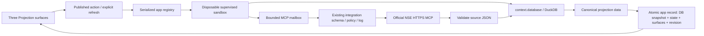

# Architecture and extension map

## File map

- `app.json`: identity, Node entrypoint, three exact read entitlements, DuckDB opt-in and disabled-by-default five-minute market trigger.
- `surface.json`: initial empty Market/Instrument/Analytics snapshots. There are no fixture market values. Each view uses a heading, data status, metric strip, paired analytic sections and precise detail table.
- `source.ts`: untrusted JSON decoding, shape/identity/date/numeric/OHLCV validation, precision interval verification. No side effects.
- `analytics.ts`: canonical SQL table initialization, transactional window replacement and window/aggregate calculations. No external reads or presentation.
- `server.ts`: validated controls, bounded source reads/receipts, ordinary actions and one projection function updating every existing view.

## Runtime interface

`handleAction(controlId, value, context, action)` accepts only `/symbol`, `/months`, `/watchlist`, `refresh_market`, `refresh_instrument`, `focus_instrument` and `recalculate`. Control edits save without fetching. `focus_instrument` returns validated `focusSurface: "instrument"` after committing the selected symbol. The scheduler calls exported `refreshMarket(context)` through the same supervised runtime. `context.surfaces` determines the independent surface identities to update; no app-side renderer patches are used.

`context.database.run(sql, parameters?)` executes statements. `query(sql, parameters?)` returns JSON-compatible row objects, with nulls preserved. The worker alone owns the live DuckDB connection; app code owns the schema and uses value parameters. No host SQL service, extra IPC, global database connection or raw web proxy is added.

The host's original-source capture is request-scoped by a unique internal session. It observes the result from the same authorized integration execution, before the model-facing wrapper truncates it. Failed/missing/oversized receipts fail the read; concurrent app invocations cannot consume each other's receipts. The source is still untrusted data.

## Failure and atomicity

Each invocation rehydrates only its app's committed DuckDB bytes into its disposable workspace. Closing the connection checkpoints the database. Bounded regular-file reads with no symlink following return a base64 snapshot. The registry validates all projection updates before atomically replacing the single app record. Failed computation/invalid projection/oversized response discards the candidate database. An app cannot commit to another app's record through this interface.

DuckDB external access and extension auto-install/load are off, and the helper denies raw network. The package's opt-in is not authorization for MCP calls; enabled integrations with explicit Allow policies are required at dispatch. Runtime bounds and single-writer ownership are defined in `docs/sandboxed-apps/RUNTIME-CONTRACT.md` and ADR-049. The database snapshot is bounded persistence, not a disk quota or an unbounded OLAP service. Existing host crash ordering does not certify physical power-loss behavior.

## Extension decisions

Add a new metric to `analytics.ts`, then expose it with units and interpretation through `project` and a supported mapped view. Add a source only after inspecting its real schema, declaring its exact read tool and extending validation/receipts. Preserve existing policy ownership. Add a view as another ordinary snapshot with the same canonical derived data; verify native WebKit at all supported widths. Any schema change needs a deliberate migration/compatibility plan; any new package needs user approval under repository rules.
