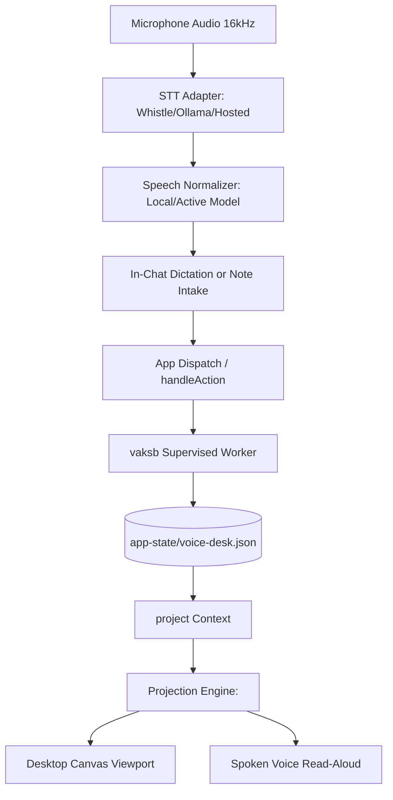

# Voice Desk Architecture

Voice Desk operates within Vakyartha's sandboxed executable app runtime. It bridges local voice transcription, reactive surface projection, and deterministic state persistence.

## Architecture and Data Flow

## Component Boundaries

1. **Presentation (`surface.json`)**:
   - Implements container-query responsive surfaces (`workbench` and `actions`) using Projection's basic catalog.
   - Enforces clamped measures on desktop viewports to prevent distortion of text and action grids.
2. **Execution Worker (`server.ts`)**:
   - Runs in an isolated `vaksb` sandbox process with strict resource limits (256 MB RAM, 30s CPU).
   - Validates incoming form field updates, executes note lifecycle operations, and returns atomic surface snapshots.
3. **Data Persistence**:
   - Atomic serialized JSON storage under `<data>/app-state/voice-desk.json`.
   - Notes, actions, decisions, and raw transcripts survive UI navigation, application restarts, and system power cycles.
4. **Safety & Containment**:
   - Network egress is explicitly denied inside the sandbox worker.
   - File exports are routed strictly through the host's vetted Downloads path.
