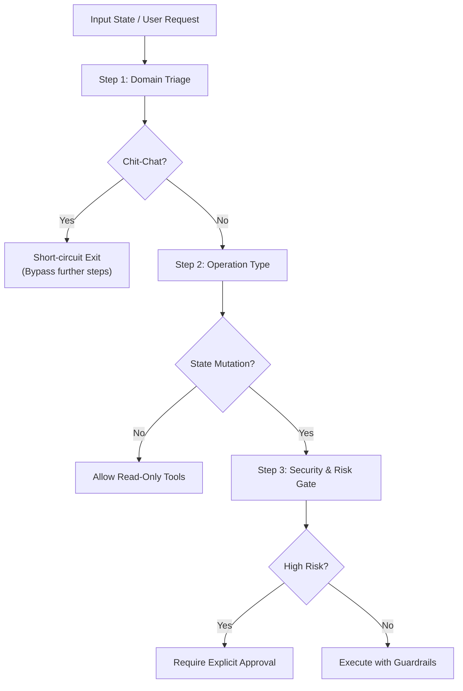

# Multi-Stage Decision Chaining & Branching Pipelines

Provides structured methodology for breaking complex, multi-faceted evaluations into sequential, conditional decision steps using Vakyartha's `DecisionChainRunner`.

## 1. When to Use

Use this skill whenever an evaluation cannot be solved cleanly by a single flat classification:

1. **Hierarchical Task Triage**:
   - Classifying high-level domain first, then operation type, then security risk level.
2. **Conditional Gateways**:
   - Evaluating a security gate *only if* the previous step determined the operation is a mutation.
   - Evaluating visualization layout *only if* data analysis succeeded.
3. **Preventing Agent Reasoning Drift**:
   - Eliminates speculative chain-of-thought hallucination by enforcing deterministic checkpoint verification at each step.

## 2. Pipeline Structure

A decision chain consists of sequential named steps, optional execution conditions, and discrete criteria:



## 3. Authoring Rules for Decision Chains

1. **Step-by-Step Focus**:
   - Each step must answer **one and only one** question.
   - Do not combine classification (e.g. *"What is the domain?"*) with action selection (*"What tool to call?"*) in the same step.
2. **Conditional Execution (`condition`)**:
   - Steps that depend on earlier outcomes must declare an explicit predicate.
   - Example: A risk gate should only execute if `answers.operation?.choice === "mutation"`.
   - Steps whose condition evaluates to false are cleanly skipped without latency or token expenditure.
3. **Composite Confidence Scoring**:
   - The overall pipeline confidence is the product of executed step confidences:
     $$\text{Confidence}_{\text{composite}} = \prod_{i=1}^{K} \text{Confidence}_i$$
   - If any critical gate has $\text{Confidence} < 0.75$, the composite pipeline flags the workflow for user clarification.
4. **Early-Exit Short Circuiting**:
   - Place broad filtering steps first to terminate non-applicable requests early (e.g. casual greetings skip technical triage).

## 4. Standard Chain Definitions

### Pipeline 1: Autonomous Code Edit & File Mutation Gate

```typescript
const codeMutationChain = {
  name: "code_mutation_gate",
  steps: [
    {
      name: "domain",
      instructions: "Classify the technical domain of the task",
      criteria: {
        code_engineering: "Modifying, analyzing, or writing source code and configs",
        data_analysis: "SQL queries, metrics, reports, or charts",
        casual_chat: "Greetings or conversational banter"
      }
    },
    {
      name: "operation",
      instructions: "Determine the operation type",
      condition: (answers) => answers.domain?.choice === "code_engineering",
      criteria: {
        read_only: "Inspecting, reading, or analyzing files without changing state",
        mutation: "Creating, editing, or deleting files on disk"
      }
    },
    {
      name: "risk_gate",
      instructions: "Assess modification risk level",
      condition: (answers) => answers.operation?.choice === "mutation",
      criteria: {
        low_risk: "Minor edits, documentation, comments, or scoped formatting fixes",
        high_risk: "Modifying build scripts, core engines, security policies, or deleting files"
      }
    }
  ]
};
```

### Pipeline 2: Visual Reporting & Chart Kind Selection

```typescript
const visualReportingChain = {
  name: "reporting_projection_gate",
  steps: [
    {
      name: "data_nature",
      instructions: "Classify the shape of the dataset",
      criteria: {
        time_series: "Sequential chronological data points showing trends over time",
        categorical_comparison: "Discrete categories with numeric metrics",
        hierarchical_records: "Nested objects or multi-column records (>5 attributes)",
        single_kpi: "Headline metrics, counts, or singular status figures"
      }
    },
    {
      name: "chart_selection",
      instructions: "Pick the optimal visual representation",
      condition: (answers) => answers.data_nature?.choice !== "hierarchical_records",
      criteria: {
        line_or_area: "Line or area chart suitable for time trends",
        bar_or_donut: "Bar, column, or donut chart suitable for category comparison",
        stat_card: "Single metric stat card with tone badge"
      }
    }
  ]
};
```

### Pipeline 3: Universal Customer Inquiry & Support Escalation Gate

```typescript
const supportTriageChain = {
  name: "support_triage_pipeline",
  steps: [
    {
      name: "intent",
      instructions: "Classify the nature of the customer communication",
      criteria: {
        informational: "Product questions, business hours, documentation, or general FAQ",
        transactional: "Order status, return request, subscription change, or billing inquiry",
        complaint_or_outage: "Service disruption, damaged item, billing error, or severe dissatisfaction"
      }
    },
    {
      name: "financial_impact",
      instructions: "Assess whether a refund or transaction modification is requested",
      condition: (answers) => answers.intent?.choice === "transactional" || answers.intent?.choice === "complaint_or_outage",
      criteria: {
        zero_cost: "Status check, tracking number lookup, or self-service update",
        sub_hundred: "Refund or credit under $100 within automatic policy limits",
        high_value: "Disputed charge or adjustment over $100 requiring supervisory review"
      }
    },
    {
      name: "escalation_gate",
      instructions: "Determine whether human agent takeover is required",
      condition: (answers) => answers.financial_impact?.choice === "high_value" || answers.intent?.choice === "complaint_or_outage",
      criteria: {
        automated_resolution: "Issue matches standard automated policy and customer sentiment is calm",
        human_handoff: "Severe distress, legal mention, or adjustment exceeds autonomous authority"
      }
    }
  ]
};
```

## 5. Skill Chaining

- **`decision-eval`**: The base skill providing single-step criteria formulation rules.
- **`folder-workspace`**: Chain with `decision-chain` before performing directory-wide batch refactorings.
- **`code-review`**: Chain with `decision-chain` to perform multi-stage security audits.
- **`interactive-ui`**: Chain with `decision-chain` to select multi-surface report layouts.
